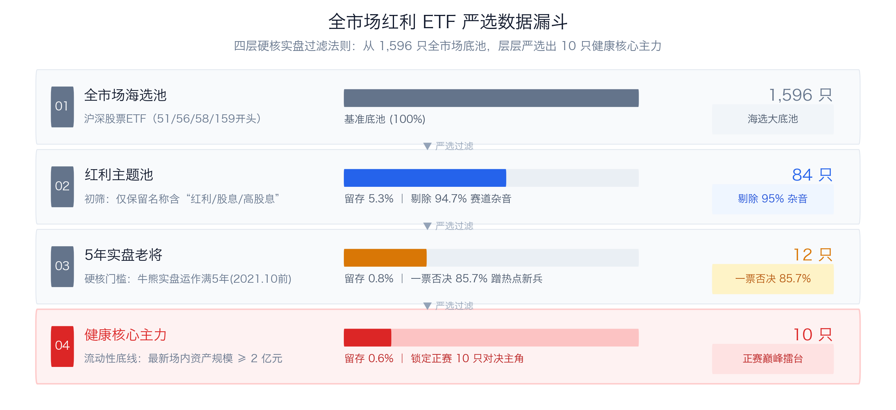
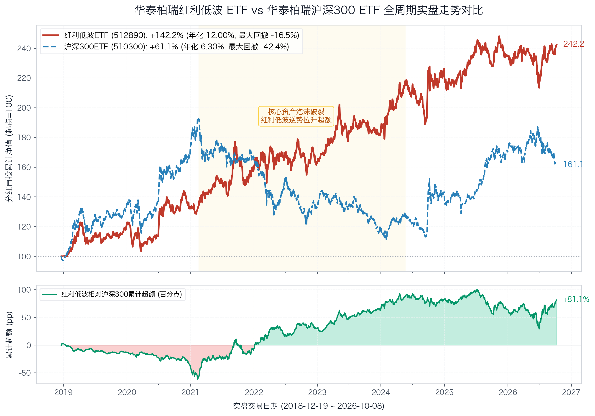
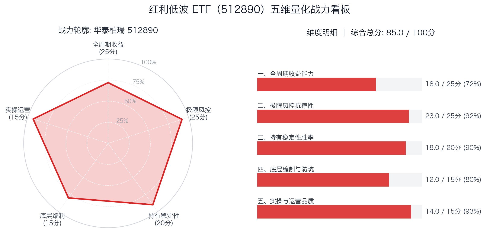

# 【基准篇】华泰柏瑞红利低波 ETF：为什么全市场喜欢拿它当“尺子”？

打开证券交易软件搜索“红利 ETF”，全市场足足有 **84 只**挂着红利、高股息招牌的场内产品在同时交易。

通过上面的四层严选漏斗，全市场的筛选逻辑一目了然：
1. **全市场海选池（1,596 只）**：沪深两市全部存续的股票型 ETF（统计口径为场内代码 **51 / 56 / 58 / 159** 开头的纯场内交易型产品，已严格剔除场外联接、QDII跨境及固收类基金）。
2. **红利主题池（84 只）**：名称命中“红利 / 股息 / 高股息”，直接剔除 94.7% 的赛道杂音。
3. **5 年实盘老将（仅 12 只）**：必须真金白银在真实牛熊中运作满 5 年以上（2021年10月前成立），**一票否决了 85.7% 蹭高股息热点发行的投机新兵！**
4. **健康核心主力（10 只）**：剔除规模低于 2 亿的小微边缘品种，锁定最终入选擂台的正赛主角。

剩下那 70 多只所谓的爆款红利，绝大多数都是 2022 到 2024 年高股息爆火之后，基金公司为了迎合市场热点扎堆追高发行的。它们宣传手册上动辄 15%、20% 的惊人年化回报，超过一半甚至 80% 都是指数公司在电脑里对着历史考题拟合出来的“发布前回测数据”。

到底哪只红利能在真实牛熊中拿得住？我们从这严选出的 12 只老将开始，开展 1 对 1 深度擂台决战。

一切对决的起点，必须先立住全市场最常用的这一把基准尺——**华泰柏瑞中证红利低波动交易型开放式指数证券投资基金（场内挂牌简称：红利低波 ETF，代码：512890，本专栏简称：华泰红利低波 ETF）**。

---

### 🏆 【5年实盘】红利 ETF 争霸天梯榜（基准创榜）

> 本榜单仅收录在大陆上市、实盘满 5 年以上的红利 ETF。
> 以华泰红利低波 ETF 为基准锚（设定基准分 85.0 分），结合五维实盘量化模型，随着后续每一场 1 对 1 对决动态排定座次。

| 排名 | 场内代码 | 参赛 ETF 简称 | 所属门派 / 跟踪指数 | 综合评分 | 相对基准 | 核心战力标签 | 文章状态 |
| :---: | :---: | :---: | :---: | :---: | :---: | :--- | :---: |
| **擂主** | **512890** | **华泰红利低波ETF** | 中证红利低波动 | **85.0** | **基准锚** | 全市场最稳的锚，匀速爬坡之王 | **本篇基准** |
| 待评 | 515100 | **景顺红利低波100ETF** | 红利低波100 | 待评 | -- | 样本扩充中小盘，低波下沉决战 | 第 1 战即将登场 |
| 待评 | 515300 | **嘉实300红利低波ETF** | 300红利低波 | 待评 | -- | 沪深300大蓝筹低波，极致防守 | 第 2 战 |
| 待评 | 515450 | **南方红利低波50ETF** | 标普低波50 | 待评 | -- | 标普外资规则，33%行业硬约束 | 第 3 战 |
| 待评 | 501029 | **华宝标普红利机会LOF** | 标普红利机会 | 待评 | -- | 近9年老牌特邀，不加低波进攻弹性 | 第 4 战 |
| 待评 | 159758 | **华夏红利质量ETF** `[NEW]` | 中证红利质量 | 待评 | -- | Quality vs Low-Vol，高ROE进攻反击 | 第 5 战 |
| 待评 | 510880 | **华泰上证红利ETF** | 上证红利 | 待评 | -- | 18年老牌元老，大盘周期纯高息 | 第 6 战 |
| 待评 | 515180 | **易方达中证红利ETF** *(联合)* | 中证红利 | 待评 | -- | 全市场正统基准，跟踪运营决战 | 第 7 战 |
| 待评 | 159905 | **工银深证红利ETF** | 深证红利 | 待评 | -- | 白酒家电重仓，伪红利真消费反思 | 第 8 战 |
| 待评 | 513690 | **博时港股红利ETF** | 恒生港股通高股息 | 待评 | -- | 离岸高折价，深入剖析20%红利税 (附159726) | 第 9 战 |
| 待评 | 007751 | **景顺长城成长低波A** *(场外特邀)* | 沪港深成长低波 | 待评 | -- | 二期总分第一，场外神基越级踢馆 | 特邀番外篇 |

---

## 一、 编制规则：它凭什么成为“最稳的锚”？

华泰红利低波 ETF 跟踪的是**中证红利低波动指数（代码：H30269）**。

- **选股链条：** 连续 3 年分红 → 剔除支付率异常及股息未增长公司 → 3 年平均股息率前 75 只 → 低波动前 50 只 → 股息率加权（单股上限 15%）。
- **核心取舍：** 分红质量约束清晰，低波动漏斗有效平滑了净值颠簸；但金融板块占比 50%+，对银行等单一行业存在较强的主动暴露与集中度风险。

---

## 二、 近 8 年实盘复算：匀速爬坡的长跑者

不看回测，只看华泰红利低波 ETF 从 2018 年 12 月成立以来到现在的真金白银实盘数据（统计区间：2018-12-19 至 2026-10-08，历时 7.8 年）。

基于我们复算的手工分红再投资净值（剔除交易折溢价与行情软件算法失真），华泰红利低波 ETF 展现出了极强的稳定性：

上图揭示了一个震撼全市场的实盘事实：
- **主图（耐力长跑）**：以 2018 年底为同一起点（基准=100），华泰红利低波 ETF（512890）走出了一条几乎不掉头的稳健对角线，净值爬升至 **242.2**（分红再投累计总回报 **+142.2%**，年化复利 **12.00%**）；而同期华泰柏瑞沪深300 ETF（510300）历经牛熊剧烈洗礼后落点在 **161.1**（分红再投累计总回报 **+61.1%**，年化复利 **6.30%**）。
- **子图（超额剪刀差）**：在 2019~2020 年核心资产抱团牛市中，华泰红利低波紧咬沪深300未被甩开；而从 2021 年春季大盘抱团泡沫破裂起，华泰红利低波一骑绝尘，逆势扩张超额收益，相对沪深300的累计超额迅速拉大到 **+81.1 个百分点**！

| 考核维度 | 核心量化指标 | 512890 实盘数值 | 沪深300 (参考坐标) | 实盘评价与解读 |
| :--- | :--- | :---: | :---: | :--- |
| **长跑收益能力** | **分红再投累计总回报** | **+142.18%** | +61.06% | **大胜 81.1 个百分点**，长跑耐力极为突出 |
| **长跑收益能力** | **年化复合增长率 (CAGR)** | **12.00%** | 6.30% | **年化超额 +5.7 个百分点**，匀速复利长跑不掉队 |
| **极限风控抗摔** | **全周期历史最大回撤** | **-16.52%** | -42.42% | **回撤不足大盘 4 成**，暴跌市提供极坚实安全垫 |
| **极限风控抗摔** | **年化下行标准差** | **11.50%** | 13.14% | 只算挨揍时的颠簸，持仓体感平缓如“空气悬挂” |
| **极限风控抗摔** | **卡玛比率 (收益/回撤)** | **0.73** | 0.15 | 每挨 1% 极端跌幅换 0.73% 年化，性价比断层领先 |
| **运营体量安全** | **最新场内资产规模** | **316.7 亿元** | 1,400+ 亿元 | **全市场红利 ETF 断层第一**，做市流动性极其充沛 |
| **运营体量安全** | **运作时长与牛熊周期** | **7 年+ (2018成立)** | 12 年+ | 完整穿越 4 轮大牛熊，经过长周期真金白银实战检验 |

> 📌 **术语注释**：
> - **下行标准差**：*“只算挨揍时的颠簸，不算数钱时的颠簸。”*（剔除上涨带来的波动，只计算资产下跌跌破基准时的剧烈程度。11.50% 在股票型基金中属于极低水平，说明跌的时候非常抗摔。）
> - **卡玛比率**：*“每挨一顿暴揍，能换来多少年化收益。”*（年化回报 ÷ 最大回撤。华泰红利低波 ETF 达到 0.73，意味着它只要承担 1% 的潜在极端跌幅，就能换回 0.73% 的年化复利，这在权益类基金中是极其罕见的舒适体验。）

### 历年年度战绩拆解：年年正收益

*“它明明是一只 100% 仓位买股票的纯场内 ETF，却在长达近 8 年的时间里，走出了类似高息理财一样平滑向上的复利曲线——在股票资产里堪称一个‘非典型’的异类。”*

华泰红利低波 ETF 最恐怖的不是某一年赚了多少，而是**它在任何一轮熊市里都几乎不亏钱**：

- **2019 年（全面反弹年）**：**+21.55%**（跟上大盘节拍，不掉队）
- **2020 年（核心资产抱团狂欢）**：**+9.46%**（跑输茅指数，但依然正收益）
- **2021 年（赛道股见顶分化）**：**+19.56%**（低波价值开始发威）
- **2022 年（大盘惨烈单边熊市）**：**+2.72%**（沪深300暴跌 -21%，它逆势飘红！）
- **2023 年（弱复苏熊市）**：**+11.91%**（低利率环境确立，红利持续爬坡）
- **2024 年（高股息主升浪）**：**+22.64%**（迎来属于自己的大牛市）
- **2025 年（高位震荡消化期）**：**+4.74%**（依然守住正收益）
- **2026 年（截至 10 月最新）**：**+3.10%**（大盘剧烈震荡下，依然逆势飘红）

近 8 年实盘下来，完整自然年中**正收益年份占比高达 100%（全阶段飘红）**！它把“防守反击”这四个字做到了极致。

---

## 三、 五维量化打分：基准分 85.0 是如何定出来的？

为了给全专栏后续的挑战者设立明确的比拼靶子，我们将华泰红利低波 ETF 的五维模型量化拆解如下：

| 评价维度 | 满分 | 实得分 | 得分进度条 | 核心定分依据（长跑体检报告） |
| :--- | :---: | :---: | :---: | :--- |
| **一、全周期收益能力** | 25分 | **18.0** | `███████░░░` 72% | 近8年年化 12.0% 复利惊人；但爆发力弱，2020牛市滞涨（扣7分） |
| **二、极限风控抗摔性** | 25分 | **23.0** | `█████████░` 92% | 回撤仅 -16.5%，下行波动极低，极难亏大钱（仅扣2分） |
| **三、持有稳定性胜率** | 20分 | **18.0** | `█████████░` 90% | **连续近 8 年全正收益**，正收益年份胜率 100%，任意时点买入体验极佳 |
| **四、底层编制与防坑** | 15分 | **12.0** | `████████░░` 80% | 股息与低波动双重约束机制好；但缺少单行业硬上限（扣3分） |
| **五、实操与运营品质** | 15分 | **14.0** | `█████████░` 93% | 316 亿巨头航母，做市商维护优良，日均成交活跃，分红机制成熟 |
| **🏆 综合总分（基准分）** | **100分** | **85.0** | `████████▌░` **85%** | **【王者段位 · 全篇基准锚】** |

**为什么给它 85 分？**
在这个世界上，没有完美的投资工具。华泰红利低波 ETF 扣掉的 15 分，主要集中在以下两个先天短板（其余在风控、胜率与管理费上留有微扣）：

1. **收益缺乏爆发力（扣 7 分）**：在 2020 年核心资产大牛市中，别人翻倍，它只有 +9.46%。如果你在全面牛市里买它，你会极其难受；
2. **规则缺乏行业硬约束（扣 3 分）**：它的单票权重上限高达 15%（且无单行业上限）。在某些周期里，银行板块权重甚至超过 50%，面临潜在的单一行业共振风险。

---

## 四、它适合谁？

华泰红利低波 ETF 是全市场红利基金里的**“马拉松运动员”**。

- **它最适合谁？**
  适合那些把资金当做“养老底仓”或者“大额理财替代品”的投资者。你不需要去赌明天行情是牛是熊，也不用频繁择时看盘，闭着眼睛买入并拿住 3 年以上，可以睡安稳觉的ETF。
- **它不适合谁？**
  渴望预测趋势做波段，在牛市中抓反弹、赚大钱赚快钱的人不要买它，它慢吞吞的节奏会让你抓狂。

基准已经立下：**85.0 分，最大回撤 -16.52%，年化复利 12.00%。**

全市场的 11 位老牌挑战者，究竟谁能在收益上实现超越？谁又能在风控上比它更抗摔？
下一篇，第一位同门血亲登场——**景顺长城红利低波 100 ETF**。把 50 只样本扩充到 100 只，到底是分散了风险，还是稀释了质量？第 1 战即将开打！
