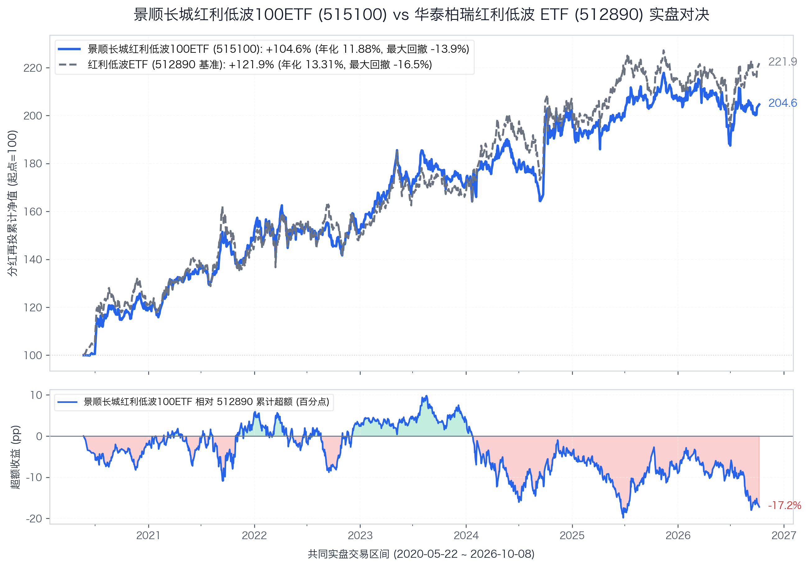
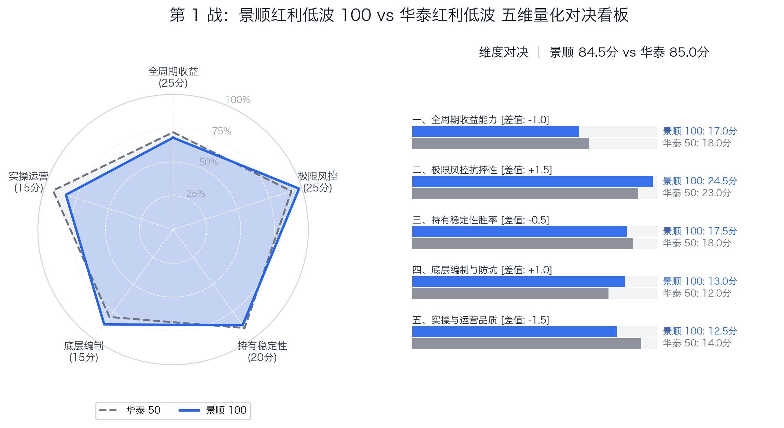

# 【第1战】实盘6年回撤仅13%！全市场最“抗摔”的红利ETF，为什么长跑还是输给了50只老龙头？

> **对决双方**：景顺红利低波 100 ETF（515100）vs 华泰红利低波 ETF（512890）  
> **核心命题**：样本池从 50 只扩充到 100 只，到底是分散了黑天鹅，还是悄悄稀释了复利质量？

2026 年金秋的一个周五收盘后，北京金融街某营业部的大户室里，烟灰缸里落满了烟蒂。

两位重仓红利资产六年多的老股民正盯着屏幕上的两条曲线争得面红耳赤。桌上摆着两张持仓单，代码只差几个数字：一个是全市场规模超 300 亿的巨无霸**华泰红利低波 ETF（512890）**，另一个是主打百只样本分散、体量超 50 亿的挑战者**景顺红利低波 100 ETF（515100）**。

买华泰的老哥吐了一口烟，语气里带着胜券在握的笃定：“你看 2024 年大行和煤炭狂飙时，我这 50 只龙头的净值直往上窜；六年多跑下来累积超额有 17 个点，终点资产高出 8% 以上，抓牢最顶格的龙头才是硬道理！”

坐在对面的景顺持有者慢悠悠抿了口茶，指着 2022 年单边大熊市的深坑反问：“你光看顺风时谁涨得快，忘了当年大盘连续阴跌、甚至 2026 年分化震荡时你的账户颠成什么样了？景顺这只实盘整整六年多，**历史上最大的回撤才仅仅 -13.9%**！你在 A 股见过哪只纯股票基金能稳成这样？我少赚一点，但换来的是天天睡得踏实。”

这一幕，几乎是全市场所有红利投资者内心撕裂的微观缩影。

在上一期《基准篇》中，我们通过四层严格的数据漏斗，从全市场 80 多只红利 ETF 中剔除了 85% 蹭热点发行的新兵，确立了实盘运作满五年的华泰红利低波（512890）作为 85 分的基准锚。

今天第一位登台挑战基准擂主的，正是它最亲近的“同门血亲”——**景顺红利低波 100 ETF（515100）**。

它们同样主打“高股息+低波动”的双因子策略，但景顺把选股数量直接从 50 只翻倍到了 100 只。**把样本池扩充一倍、下沉到更多二线中小盘高息股，到底是分散了风险，还是把核心龙头的复利引擎给稀释了？**

我们拉出两只基金从 2020 年 5 月 22 日同台起跑至今、跨越 **1529 个交易日（历时 6.38 年）**的分红再投资全收益真实净值，用扎扎实实的数据展开这场深度较量。

---

## 一、 编制规则拆解：加权公式里的“暗门”与“紧箍咒”

很多投资者以为，两只基金唯一的区别就是一个买 50 只、一个买 100 只。

把两份厚厚的指数编制方案并排拆开，你会发现它们的底层齿轮完全在不同轨道上啮合：

```text
【华泰红利低波（512890）底层编制路线】
全市场流动性前80% → 连续三年分红且股息正增长（剔除高支付率排雷） → 选三年平均股息前75名 → 选其中波动率最低的50名 → 【纯股息率加权】（单票上限15%，无行业上限，年调1次）

【景顺红利低波100（515100）底层编制路线】
全市场成交额前80% → 连续三年分红 → 选三年平均股息前300名 → 选其中波动率最低的100名 → 【股息率 ÷ 波动率加权】（单二级行业上限20%，季调4次）
```

拆解这两套选股程序，里面藏着决定最终命运的四大关键差异：

### 1. 谁把低波当“门槛”，谁把低波当“权重”？
* **华泰红利低波（512890）**是**“纯股息率加权”**。低波动对它而言只是一道**“准入门禁”**——只要波动率足够低、挤进了全市场前 50 名，进门之后谁的仓位高，全看谁的股息率更突出。
* **景顺红利低波 100（515100）**则是**“股息率 ÷ 波动率加权”**。波动率不仅是门禁，还直接化作了分母写入加权公式。也就是说，**哪怕两家公司股息率完全一样，走势更平稳、颠簸更小的那一家，景顺会自动赋予更高的仓位权重**。“低波动”彻底渗入了组合的权重内核。

### 2. 行业上限：“裸奔”对决“20% 紧箍咒”
* 华泰 50 虽然单票限制在 15%，但它**没有任何行业上限**。这就导致当银行、煤炭整体股息率极高时，指数会顺理成章地重仓集中。近年来华泰 50 持仓里的金融银行占比一度突破 50%，在顺风局里它是一列高动力的重载列车，但在逆风局里也要承担单一板块集中的颠簸。
* 景顺 100 则被套上了一道铁律：**单个中证二级行业严禁超过 20%**。这道紧箍咒逼着基金经理哪怕再看好银行，到了 20% 红线也必须把多出来的资金分流到交通运输、基础化工、建筑装饰、煤炭公用甚至消费板块。它主动放弃了单押单一行业的极端弹性，换来了跨行业的全方位防弹衣。

### 3. 排雷：三年股息正增长的质地考验
华泰 50 设有一道严格的排雷关卡：**“过去三年每股股息必须正增长”，同时强制剔除分红支付率最高的 5% 公司**。这意味着只有那些经营现金流扎实、盈利能够支撑分红台阶式上升的公司才能留下来。

而景顺 100 为了将选股池扩容到 100 只，对分红仅要求“过去三年有分红”，缺乏股息持续增长的约束，选股范围直接放宽到前 300 只。这不可避免地在周期拐点处，将部分处于景气顶点、未来分红可能出现滑坡的中小盘周期标的纳入其中。

### 4. 调仓频率：一年 1 次 vs 一年 4 次
* 华泰 50 每年 12 月调整一次，换手率低，交易摩擦损耗小，更有利于长期持仓滚雪球；
* 景顺 100 每年每季度调整一次（一年 4 次）。需要厘清的是：**在日常交易中，股票因价格上涨导致的行业权重自然漂移，并不会触发被动卖出**；但到了每季度的定期再平衡日，20% 的行业上限会对超标板块实施硬性的“削峰填谷”，平抑了单一行业的过度集中，也在震荡市中带来略高的换手摩擦。

---

## 二、 1529 天实盘硬核 PK：谁更抗摔？谁赚得更多？

两只基金在 2020 年 5 月 22 日拉到同一条起跑线。从那天截至 2026 年 10 月 8 日，历经 **1529 个交易日（跨越 6.38 年）**，复算分红再投资全收益净值走势如下：



| 考核核心维度 | 量化指标标尺 | 华泰 50 (512890) | 景顺 100 (515100) | 胜负归属 | 穿透底层逻辑的白话解读 |
| :--- | :--- | :---: | :---: | :---: | :--- |
| **长跑终点财富** | **分红再投累计总回报** | **+121.86%** | +104.64% | **华泰 50 胜** | 华泰累计多赚 **+17.22 个百分点**，终点总资产多出 8.4% |
| **复利爬坡速度** | **年化复合回报 (CAGR)** | **13.31%** | 11.88% | **华泰 50 胜** | 华泰年化高出 1.43 个百分点，长跑时间越长优势越发明显 |
| **极限抗摔风控** | **全周期历史最大回撤** | -16.52% | **-13.94%** | **景顺 100 胜** | **景顺回撤足足浅了 2.58 个百分点**，全市场权益类回撤天花板 |
| **日常颠簸程度** | **年化波动率** | 16.39% | **14.75%** | **景顺 100 胜** | 景顺波动低 1.64 个百分点，股息/低波双加权平抑震荡 |
| **破位砸盘体感** | **年化下行标准差** | 11.12% | **10.05%** | **景顺 100 胜** | 普跌砸盘行情下，景顺回撤速率更缓，如同自带“空气悬挂” |
| **挨打换收益比** | **卡玛比率 (年化/最大回撤)**| 0.81 | **0.85** | **景顺 100 胜** | 景顺每承受 1% 极限回撤能换来 0.85% 年化，防守性价比胜出 |
| **做市规模安全** | **场内最新资产规模** | **316.7 亿元** | 50.1 亿元 | **华泰 50 胜** | 华泰体量断层领先；但景顺 50 亿也处于极为充裕的梯队 |

把数字放在一起对比，结论非常直白：
1. **年化下行标准差（10.05% vs 11.12%）**：这个指标只统计净值向下破位时的剧烈程度。大白话讲，市场大跌时，华泰 50 像是一台底盘紧绷的轿跑车，路感清晰颠簸强烈；而景顺 100 凭借“股息/低波双重加权 + 20% 行业封顶”，更像一台舒适的SUV，有效吸收了向下冲击，坐感明显更温和。
2. **最大回撤（仅 -13.94%）**：在过去六年多大盘剧烈震荡的完整周期中，许多主打稳健的固收+基金回撤都超过 15%，**景顺 100 作为一只满仓运作的纯股票 ETF，历史最大回撤始终封死在 -13.94%**。这也是为什么它的卡玛比率（0.85）能够反超华泰 50（0.81）——在控制下行风险这件事上，它做到了同类极高水准。

---

### 历年年度胜负对比：周期轮动下的高光时刻

把 6 年切分成完整自然年与 2026 最新阶段，两只基金的年度胜负手完全呼应了它们的编制逻辑：

| 自然年份 | 华泰红利低波 ETF (512890) | 景顺红利低波 100 ETF (515100) | 阶段胜负手核心归因 |
| :---: | :---: | :---: | :--- |
| **2021 年** | +19.56% | **+26.22%** *(显著跑赢 +6.66%)* | **景顺大幅胜出**：春节见顶后“核心资产”抱团崩解，资金全面涌向中小盘与二线周期，景顺 100 只样本充分吃满中小市值弹性。 |
| **2022 年** | **+2.72%** *(微胜 +1.92%)* | +0.80% | **华泰抗跌占优**：单边大熊市中，50 只千亿龙头大蓝筹防守护城河更深。 |
| **2023 年** | +11.91% | **+12.62%** *(微胜 +0.71%)* | **平分秋色**：无风险利率下行，全市场高股息概念迎普涨行情。 |
| **2024 年** | **+22.64%** *(超额胜出 +5.52%)* | +17.12% | **华泰大幅胜出**：煤炭大行巨头主升浪，华泰 50 集中度高进攻犀利；景顺受 20% 行业上限约束无法重仓追击。 |
| **2025 年** | **+4.74%** *(胜 +2.19%)* | +2.55% | **华泰微胜**：高位震荡消化，头部龙头流动性抱团韧性更优。 |
| **2026 年 (截至10月)** | **+3.10%** *(胜 +3.82%)* | -0.72% | **华泰超额明显**：行情巨震分化，超级巨头高息护盘更稳，中小盘低波略有回撤。 |

* **为什么景顺 100 在 2021 年能跑赢 6.6 个百分点？**  
  2021 年春节之后，高估值的“核心资产”抱团瓦解，市场风格急剧下沉。景顺 100 纳入的大量二线高息标的全面活跃，充分吃到了中小市值的估值修复溢价。
* **为什么华泰 50 在 2024 年能打出 5.5 个百分点的超额？**  
  2024 年是属于大型国有行、中国神华等超级巨头的“高息牛市”。华泰红利低波 ETF 顶格押注核心龙头，持仓集中度高；而景顺 100 因为单个二级行业在季度再平衡时必须约束在 20% 以内，且分散至 100 只标的，无法全力吃到单一板块的拉升主浪。

---

## 三、 五维量化：景顺 100 到底能不能掀翻老基准？

综合两只基金 6 年多的全周期实战表现，我们以华泰红利低波 ETF（85.0 分）为基准锚，对景顺红利低波 100 进行逐项打分体检：



| 评价维度 | 满分 | 华泰 50 得分 | 景顺 100 得分 | 景顺战力进度条 | 胜负手原因（量化体检结论） |
| :--- | :---: | :---: | :---: | :---: | :--- |
| **一、全周期收益能力** | 25分 | **18.0** | **17.0** `(-1.0)` | `███████░░░` 68% | 6 年年化少 1.43%，在 2024 巨头牛市与 2026 震荡中爆发力略钝（扣1分） |
| **二、极限风控抗摔性** | 25分 | **23.0** | **24.5** `(+1.5)` | `█████████▌` 98% | **回撤仅 -13.9% 惊艳全场**，下行颠簸控制极优（大幅加分） |
| **三、持有稳定性胜率** | 20分 | **18.0** | **17.5** `(-0.5)` | `████████▌░` 88% | 完整自然年（2021-2025）5 年全正收益，体验极佳（2026 年内微跌 -0.7%） |
| **四、底层编制与防坑** | 15分 | **12.0** | **13.0** `(+1.0)` | `████████▌░` 87% | **20% 行业封顶 + 波动率加权**防范黑天鹅，季度调仓响应迅速（规则加分） |
| **五、实操与运营品质** | 15分 | **14.0** | **12.5** `(-1.5)` | `████████░░` 83% | 规模 50 亿虽健康，但相比华泰 316 亿巨无霸流动性略逊一筹 |
| **🏆 综合总分** | **100分** | **85.0 (胜)** | **84.5** `(-0.5)` | `████████▌░` **84.5%** | **【精锐段位 · 仅差 0.5 分！】** |

算清这笔账后，第一场同门巅峰对决的胜负正式决出。景顺红利低波 100 ETF 最终拿下 **84.5 分**，以极其微弱的 0.5 分差距位列天梯榜第 2 名：

### 🏆 【5年实盘】红利 ETF 争霸天梯榜（当前排位）

| 排名 | 场内代码 | 参赛 ETF 简称 | 所属门派 / 跟踪指数 | 综合评分 | 相对基准 | 核心战力标签 |
| :---: | :---: | :---: | :---: | :---: | :---: | :--- |
| 🥇 **1** | **512890** | **华泰红利低波ETF** | 中证红利低波动 | **85.0** | **基准锚** | 全市场最稳的锚，大盘龙头复利胜出 |
| 🥈 **2** | **515100** | **景顺红利低波100ETF** | 红利低波100 | **84.5** | **-0.5** | 全市场回撤最浅，防守极佳但牛市略钝 |

---

## 四、 持仓集中度：投资中的“分散”真的免费吗？

金融学常讲：“分散投资是市场上唯一的免费午餐。”

但这六年实盘清晰地告诉我们：**在特定的红利策略里，分散并不免费，它明码标价。**

### 1. 扩容样本带来的潜在“降质”成本
从全市场挑选 50 只龙头时，进入视野的往往是**中国神华、交通银行、山东高速、兖矿能源、中国石化、大秦铁路**这类资产壁垒深厚、现金流确定性高的代表性公司。中国神华更是常年稳居华泰 50 前列的核心压舱石。

但当样本数量从 50 只放宽到 100 只时，后 50 只标的大多是百亿市值的周期制造或二线公用事业。由于景顺缺乏“连续三年股息正增长”的硬性排雷，在宏观经济周期回落时，部分二线品种的分红持续性不如顶尖龙头稳健。**长跑六年下来少赚的 17.22 个百分点，实质上就是为了获得极度平稳所支付的“分散成本”。**

### 2. 行业硬封顶的双面性
景顺的 20% 行业上限，在 2024 年大行主升浪中限制了向上的爆发力，但在防范行业黑天鹅时却是一顶扎实的保护伞。

如果未来单一权重行业因利差收窄或周期下行出现较大幅度调整，行业无上限的华泰 50 可能会面临阶段性集中回撤；而景顺 100 凭借在工业、消费、基建与周期板块的均匀分布，大概率会再度发挥其强劲的抗震韧性。

---

## 五、 小结：怕跌还是求收益？两只基金怎么选？

两只基金综合评分仅相差 0.5 分，但在实操配置上有着清晰的受众分野：

1. **如果你属于“本金绝对不能大亏、稍微回撤就焦虑失眠、追求资产平稳复利”的极度厌恶风险型选手**：
   **果断选择景顺红利低波 100 ETF（515100）！**
   不必为长跑少赚那 1.4% 的年化感到可惜。在波诡云谲的市场里，一只纯权益 ETF 能够在整整六年中将最大回撤死死守在 -14% 以内，这种平稳体验所带来的长持信心，远比纸面上的超额收益更有价值。

2. **如果你是“追求长期复利最大化、在红利周期不愿掉队、能够坦然承受 15% 左右正常波动”的理性长跑者**：
   **坚定留守华泰红利低波 ETF（512890）！**
   50 只龙头企业壁垒高、盈利质量更扎实，三年股息增长排雷锁定了分红成色。300 多亿的做市体量让资金进出极其从容，六年多赚出的 17.22 个百分点，是对你坚守大盘龙头最好的回馈。

**回到最初的问题：样本从 50 只扩充到 100 只，到底是分散了风险还是稀释了质量？**

答案早已清晰写在实盘曲线中：
**它真真切切为你熨平了下行时的颠簸阵痛，但也实实在在地减弱了顺风时的冲刺锋芒。**

投资的世界里从来没有既要又要。你为安全感支付的每一分防守成本，早已在市场的周期起伏中被明码标价。

---

*下一篇预告：【第 2 战】嘉实 300 红利低波 ETF 迎战华泰 50。把选股池死死限制在沪深 300 核心大蓝筹里，究竟是加固了钢铁防线，还是作茧自缚？敬请期待！*

---

如果您觉得这篇文章有启发，欢迎点赞、转发、关注！

风险提示： 本文仅供参考，不构成投资建议。市场有风险，入市需谨慎。
