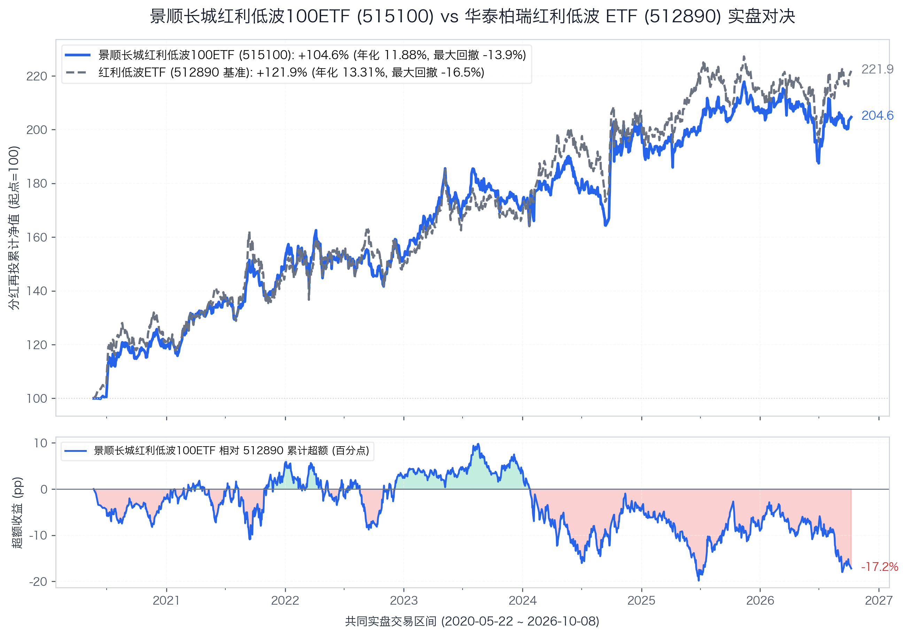
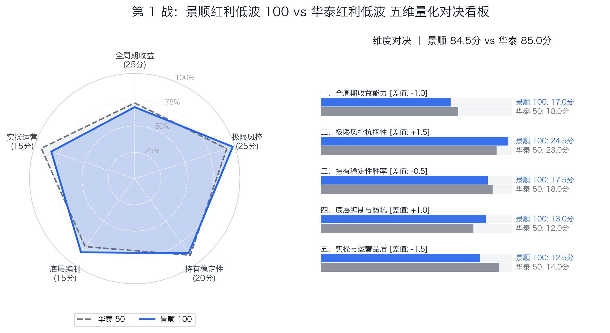

# 【第1战】景顺红利低波 100 ETF vs 华泰红利低波 ETF：样本扩充到 100 只，到底是分散了风险还是稀释了质量？

在全市场 84 只红利 ETF 中（*注：统计口径为沪深两市 51/56/58/159 纯场内 ETF，已剔除场外联接），成立满 5 年的老牌精选池迎来了第一位登台挑战的选手。

它是华泰柏瑞中证红利低波动交易型开放式指数证券投资基金（场内挂牌简称：红利低波 ETF，代码：512890，本专栏简称：华泰红利低波 ETF）最亲近的“同门血亲”，同样主打红利与低波动双因子——**景顺长城中证红利低波动 100 交易型开放式指数证券投资基金（场内挂牌简称：红利低波 100 ETF，代码：515100，本专栏简称：景顺红利低波 100 ETF）**。

很多投资者在挑选红利低波时都会纠结：**华泰柏瑞是 50 只样本，景顺长城是 100 只样本。** 样本数量直接翻倍、下沉到更多二线中小盘高息股，到底是让投资更分散更安全了，还是把龙头的盈利质量给稀释了？

我们用两只基金在过去 6 年多的真实实盘净值，展开第一场硬核复盘。

---

### 🏆 【5年实盘】红利 ETF 争霸天梯榜（第 1 战更新）

> 本榜单仅收录在大陆上市、实盘满 5 年以上的红利 ETF。
> 以华泰红利低波 ETF（512890）为基准锚（85.0 分），结合五维实盘量化模型，动态排定座次。

| 排名 | 场内代码 | 参赛 ETF 简称 | 所属门派 / 跟踪指数 | 综合评分 | 相对基准 | 核心战力标签 | 文章状态 |
| :---: | :---: | :---: | :---: | :---: | :---: | :--- | :---: |
| **1** | **512890** | **华泰红利低波ETF** | 中证红利低波动 | **85.0** | **基准锚** | 全市场最稳的锚，大盘龙头复利胜出 | [基准篇](00_基准篇_华泰柏瑞红利低波ETF.md) |
| **2** | **515100** | **景顺红利低波100ETF** `[NEW]` | 红利低波100 | **84.5** | **-0.5** | **全市场回撤最浅，跌得更轻但牛市略钝** | **本篇挑战者** |
| 待评 | 515300 | **嘉实300红利低波ETF** | 300红利低波 | 待评 | -- | 沪深300大蓝筹低波，极致防守 | 第 2 战 |
| 待评 | 515450 | **南方红利低波50ETF** | 标普低波50 | 待评 | -- | 标普外资规则，33%行业硬约束 | 第 3 战 |
| 待评 | 501029 | **华宝标普红利机会LOF** | 标普红利机会 | 待评 | -- | 近9年老牌特邀，不加低波进攻弹性 | 第 4 战 |
| 待评 | 159758 | **华夏红利质量ETF** `[NEW]` | 中证红利质量 | 待评 | -- | Quality vs Low-Vol，高ROE进攻反击 | 第 5 战 |
| 待评 | 510880 | **华泰上证红利ETF** | 上证红利 | 待评 | -- | 18年老牌元老，大盘周期纯高息 | 第 6 战 |
| 待评 | 515180 | **易方达中证红利ETF** *(联合)* | 中证红利 | 待评 | -- | 全市场正统基准，跟踪运营决战 | 第 7 战 |
| 待评 | 159905 | **工银深证红利ETF** | 深证红利 | 待评 | -- | 白酒家电重仓，伪红利真消费反思 | 第 8 战 |
| 待评 | 513690 | **博时港股红利ETF** | 恒生港股通高股息 | 待评 | -- | 离岸高折价，深入剖析20%红利税 (附159726) | 第 9 战 |
| 待评 | 007751 | **景顺长城成长低波A** *(场外特邀)* | 沪港深成长低波 | 待评 | -- | 二期总分第一，场外神基越级踢馆 | 特邀番外篇 |

---

## 一、 编制规则照妖镜：100 只与 50 只的底层逻辑差异

两只 ETF 虽然名字只差两个字，但底层指数的选样顺序截然不同：

```
【华泰红利低波 ETF（512890）编制路线】
全市场A股（流动性前80%） → 连续三年分红且股息正增长（剔除高支付率排雷） → 选三年平均股息前75名 → 选其中波动率最低的50名 → 纯股息率加权（单票上限15%，无行业上限，年调1次）

【景顺红利低波 100 ETF（515100）编制路线】
全市场A股（成交额前80%） → 连续三年分红 → 选三年平均股息前300名 → 选其中波动率最低的100名 → 股息率/波动率加权（单二级行业上限20%，季调4次）
```

通俗讲，这两套规则藏着四个关键差异：

1. **加权方式截然相反（谁把低波当门槛，谁把低波当权重）**：
   - 华泰红利低波 ETF 是**“纯股息率加权”**，低波动只是筛选样本时的过滤网，进入前 50 之后按股息率排座次；
   - 景顺红利低波 100 ETF 则是**“股息率 ÷ 波动率加权”**，波动率不仅用来选股，还直接做进了加权公式——走势越平稳、波动越低的公司权重越高，低波因子真正渗入权重内核。
2. **行业硬约束 vs 单票上限**：
   - 华泰红利低波 ETF 单票上限是 **15%**，但**没有任何行业上限**，在特定行情下容易出现单一行业极度集中（例如近年金融银行占比突破 50% ）；
   - 景顺红利低波 100 ETF **强制设定单个中证二级行业不超过 20%**，逼着持仓必须均衡分散到消费、基建、制造、周期、医药等多个板块，杜绝单押一个行业。
3. **样本扩充与分红质量排雷**：
   - 华泰红利低波 ETF 设有严苛的“过去三年每股股息正增长”和“剔除支付率过高（前5%）”双重排雷，先从 75 只里挑 50 只，龙头质地纯粹、抗衰退力强；
   - 景顺红利低波 100 ETF 将股息池放宽到 300 只再挑 100 只，下沉到大量 100 亿~300 亿的中小市值标的。但因缺乏股息增长排雷，在周期拐点容易选入处于利润高点、未来分红可能滑坡的标的。
4. **调仓频率差异（一年 1 次 vs 一年 4 次）**：
   - 华泰红利低波 ETF 每年 12 月调整一次，换手率低，更利于长期复利滚存；
   - 景顺红利低波 100 ETF 每季度调整一次（一年 4 次），风险响应更迅速，但在震荡行情中换手摩擦略高。

---

## 二、 6年实盘硬核 PK：谁更抗摔？谁赚得更多？

景顺红利低波 100 ETF 成立于 2020 年 5 月 22 日。我们将两只基金拉到完全一致的共同起跑线（2020-05-22 至 2026-10-08，共 1529 个交易日，历时 6.38 年），复算分红再投资全收益净值：



| 考核维度 | 核心量化指标 | 华泰 50 (512890) | 景顺 100 (515100) | 胜负归属 | 关键差异与白话解读 |
| :--- | :--- | :---: | :---: | :---: | :--- |
| **长跑收益能力** | **分红再投累计总回报** | **+121.86%** | +104.64% | **华泰 50 胜** | 华泰累计多赚 **+17.22 个百分点**，龙头集中进攻更锐利 |
| **长跑收益能力** | **年化复合回报 (CAGR)** | **13.31%** | 11.88% | **华泰 50 胜** | 华泰年化高出 1.43 个百分点，长跑复利优势逐步放大 |
| **极限风控抗摔** | **全周期历史最大回撤** | -16.52% | **-13.94%** | **景顺 100 胜** | **景顺回撤浅 2.58 个百分点**，极端熊市抗摔性惊艳全场 |
| **极限风控抗摔** | **年化波动率** | 16.39% | **14.75%** | **景顺 100 胜** | 景顺波动低 1.64 个百分点，股息/低波双加权+20%行业封顶平滑震荡 |
| **极限风控抗摔** | **年化下行标准差** | 11.12% | **10.05%** | **景顺 100 胜** | 景顺破位下跌剧烈程度更低，坐感如同装了“空气悬挂” |
| **极限风控抗摔** | **卡玛比率 (收益/回撤)** | 0.81 | **0.85** | **景顺 100 胜** | 景顺每挨 1% 跌幅换 0.85% 年化，防守反击性价比更优 |
| **运营体量安全** | **最新场内资产规模** | **316.7 亿元** | 50.1 亿元 | **华泰 50 胜** | 华泰做市体量断层领先；但景顺 50 亿也极为健康 |

> 📌 **指标通俗再注释**：
> - **下行标准差（10.05% vs 11.12%）**：景顺 100 明显更低。大白话讲就是，行情普跌砸盘的时候，景顺 100 的下坠感更像坐在装了空气悬挂的轿车里，颠簸感明显小于华泰红利低波 ETF。
> - **卡玛比率（0.85 vs 0.81）**：景顺 100 的最大回撤足足比华泰红利低波 ETF 浅了 **2.58 个百分点**（仅 -13.94%）。虽然年化少了 1.4%，但回撤大幅缩小，换来了更高的持有舒适度。

### 历年年度胜负切片：各领风骚的周期轮动

把 6 年切分成完整自然年与 2026 最新阶段，两者的胜负逻辑完全映射了各自的编制规则：

| 自然年份 | 华泰红利低波 ETF (512890) | 景顺红利低波 100 ETF (515100) | 阶段胜负手剖析 |
| :---: | :---: | :---: | :--- |
| **2021 年** | +19.56% | **+26.22%** *(大胜 +6.66%)* | **景顺大胜**：中小市值活跃狂欢，100 只样本充分下沉吃满弹性。 |
| **2022 年** | **+2.72%** *(胜 +1.92%)* | +0.80% | **华泰胜出**：单边大熊市中，50 只千亿龙头大蓝筹防守护城河更深。 |
| **2023 年** | +11.91% | **+12.62%** *(微胜 +0.71%)* | **平分秋色**：无风险利率下行，全市场高股息概念迎普涨行情。 |
| **2024 年** | **+22.64%** *(大胜 +5.52%)* | +17.12% | **华泰大胜**：煤炭银行巨头主升浪，50 只集中度高，进攻穿透力更强。 |
| **2025 年** | **+4.74%** *(胜 +2.19%)* | +2.55% | **华泰微胜**：高位震荡消化，头部龙头流动性抱团韧性更好。 |
| **2026 年 (截至10月)** | **+3.10%** *(胜 +3.82%)* | -0.72% | **华泰胜出**：行情巨震分化，超级巨头高息护盘更稳，中小盘低波略有回撤。 |

- **景顺 100 为什么在 2021 年能狂胜 6.6 个百分点？**
  因为 2021 年是典型的中小市值狂欢年，景顺 100 扩充的二线标的弹性彻底爆发。
- **华泰 50 为什么在 2024 年能大胜 5.5 个百分点？**
  因为 2024 年是属于神华、中石化、大型国有行等超级权重股的“巨头红利牛市”，华泰红利低波 ETF 的持仓集中度高（前十大占比超 30% 且金融银行权重集中），直接吃满了龙头主升浪；而景顺 100 因为单个二级行业强制硬顶 20% 且 100 只样本充分分散，无法重仓吃满单一板块行情。

---

## 三、 五维量化打分卡：景顺 100 最终定分 84.5

以华泰红利低波 ETF（85.0 分）为基准，景顺红利低波 100 ETF 逐项打分如下：



| 评价维度 | 满分 | 华泰 50得分 | 景顺 100得分 | 景顺战力进度条 | 胜负手原因（量化体检结论） |
| :--- | :---: | :---: | :---: | :---: | :--- |
| **一、全周期收益能力** | 25分 | **18.0** | **17.0** `(-1.0)` | `███████░░░` 68% | 6年年化输1.43%，在2024巨头牛市与2026震荡中爆发力略钝（扣1分） |
| **二、极限风控抗摔性** | 25分 | **23.0** | **24.5** `(+1.5)` | `█████████▌` 98% | **回撤仅 -13.9% 惊艳全场**，下行颠簸明显更平缓（大幅加分） |
| **三、持有稳定性胜率** | 20分 | **18.0** | **17.5** `(-0.5)` | `████████▌░` 88% | 5年年度战绩2胜3负，但年年均为正收益，体验极佳 |
| **四、底层编制与防坑** | 15分 | **12.0** | **13.0** `(+1.0)` | `████████▌░` 87% | **20%行业封顶+低波加权**更防黑天鹅，季度调仓响应迅速（规则加分） |
| **五、实操与运营品质** | 15分 | **14.0** | **12.5** `(-1.5)` | `████████░░` 83% | 规模 50 亿虽健康，但相比华泰 316 亿巨无霸流动性略逊一筹 |
| **🏆 综合总分** | **100分** | **85.0 (胜)** | **84.5** `(-0.5)` | `████████▌░` **84.5%** | **【精锐段位 · 仅差 0.5 分！】** |

景顺红利低波 100 ETF 最终拿下 **84.5 分**，以极其微弱的 0.5 分差距位列天梯榜第 2 名。

---

## 四、 最终建议

两只基金同属红利低波门派，分值非常接近

1. **如果你属于“极度厌恶亏损、稍微回撤就心慌失眠”的防御型选手**：
   **果断选景顺红利低波 100 ETF！**
   它实盘 6 年的最大回撤只有 -13.94%，在所有权益类基金里堪称奇迹。它的 100 只分散度、低波动深度加权与 20% 行业硬封顶，真真切切为你熨平了下行颠簸。
2. **如果你追求“长期复利最大化、在红利大年不想被抛下、且重视极致流动性”**：
   **坚定选华泰红利低波 ETF（512890）！**
   50 只龙头虽然日常颠簸略大 1 个百分点，但它足足多赚出了 **17.22 个百分点**的累计超额（终点资产相对多出 8.4%），分红增长排雷保住了底层盈利质量，且 300 亿规模在任何极端行情下买卖都毫不费力。

**那景顺红利低波 ETF 扩充到 100 只到底是分散了风险还是稀释了质量？**
答案是**两者兼备**！行业封顶和低波加权真真切切分散了下行风险（回撤仅 -13.9%），但缺少股息增长排雷和扩容中小盘也实实在在稀释了龙头复利质量（长跑少赚 17.2%）。

**一句话**：

更怕跌、想睡觉踏实的买景顺 100；想在红利周期多赚点收益的留守华泰 50。两者没有优劣，只有人性的取舍！

---

*下一篇预告：第 2 战即将迎来嘉实 300 红利低波 ETF。把选股池死死限死在沪深 300 核心大蓝筹里，究竟是加固了防线，还是作茧自缚？敬请期待！*

---

如果您觉得这篇文章有启发，欢迎点赞、转发、关注！

风险提示：本文基于公开客观数据与独立研究，仅供交流参考，不构成任何投资建议。市场有风险，投资需谨慎。
