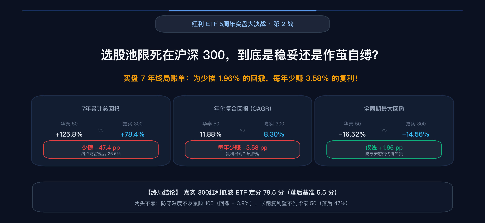
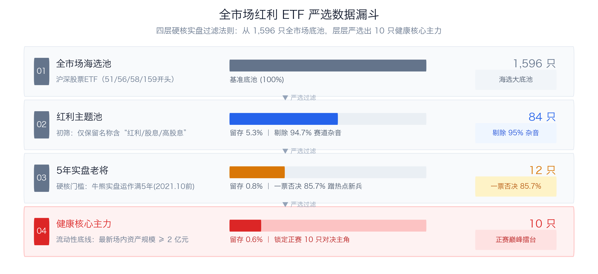
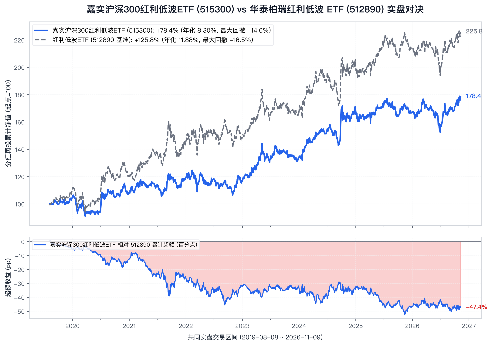
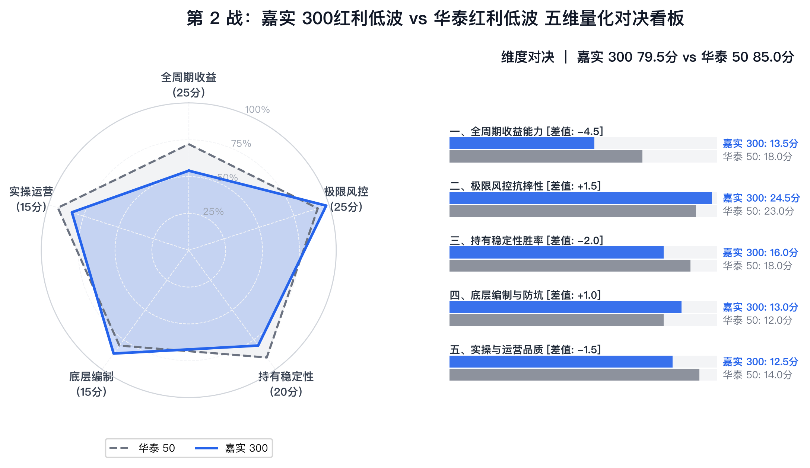

# 【第2战】嘉实 300红利低波 ETF vs 华泰红利低波 ETF：选股池限死在沪深 300，到底是筑牢了蓝筹底线，还是作茧自缚？



打开证券交易软件搜索“红利 ETF”，全市场足足有 **84 只**挂着红利、高股息招牌的场内产品在同时交易。



但只要加上**“实盘运作满 5 年以上（2021年10月前成立）”**这一道硬性分水岭，全市场 **85.7%（72 只）**的跟风新产品就会被一票否决，最终仅有 **12 只**穿越牛熊的老牌正规军留了下来。

在第 1 战中，景顺长城红利低波 100 ETF 以 -13.94% 的全市场最浅回撤向基准发起了猛烈冲击，最终以 84.5 分对 85.0 分的微弱差距惜败。

今天登台迎战华泰柏瑞中证红利低波动交易型开放式指数证券投资基金（场内挂牌简称：红利低波 ETF，代码：512890，本专栏简称：**华泰红利低波 ETF**）的第 2 位选手，来自老牌头部公募嘉实基金——**嘉实沪深 300 红利低波动交易型开放式指数证券投资基金（场内挂牌简称：300红利低波ETF嘉实，代码：515300，本专栏简称：嘉实 300红利低波 ETF）**。

市场上很多人挑选红利产品时有这样一种执念：**“小盘股我信不过，选红利就要选大盘蓝筹，沪深 300 里的核心龙头才不会暴雷！”** 

嘉实 300红利低波 ETF 恰恰踩中了这个心理——它把选样池死死限死在沪深 300 的 300 只大票里。但这样做到底是筑牢了更扎实的防御底线，还是把自己困死在狭窄的蓝筹池里，作茧自缚？

我们拉出两只基金从 2019 年 8 月 8 日同台起跑至今、跨越 **1,740 个交易日（整整 7.26 年）**的真金白银实盘分红再投净值，展开第二场 1 对 1 深度复盘。

---

## 一、 编制规则照妖镜：限定在 300 强后的连锁反应

同样是“红利 + 低波”双因子，嘉实 300红利低波 ETF 跟踪的是**沪深 300 红利低波动指数（代码：930740）**，而华泰红利低波 ETF 跟踪的是**中证红利低波动指数（代码：H30269）**。

把两份官方编制方案并排拆开，底层逻辑的差异一览无余：

```text
【华泰红利低波 ETF（512890）底层编制路线】
中证全指池（全市场流动性前80%） → 连续三年分红且股息正增长（剔除高支付率排雷） → 选三年平均股息前75名 → 选其中波动率最低的50名 → 【纯股息率加权】（单票上限15%，无行业上限，年调1次）

【嘉实 300红利低波 ETF（515300）底层编制路线】
沪深300样本池（限死300只核心蓝筹） → 连续三年分红（0<支付率<100%，ROE波动率最低前80%） → 选三年平均股息前50% → 选其中波动率最低的50名 → 【股息率加权】（单票上限10%，单个一级行业上限30%，半年调1次）
```

通俗讲，这两套方案藏着四大核心差异，正是它们决定了后续 7 年完全不同的实盘命运：

### 1. 选样池的宽与窄（全市场 4000+ vs 核心 300 强）
* **华泰 50** 的池子是**中证全指**。它不仅能抓到工行、建行、神华这样的大盘定海神针，还能从全市场挖掘煤炭、交运、基础化工等细分赛道里高股息、低估值的中坚企业，兼具大盘的稳健与中盘的红利增长弹性；
* **嘉实 300** 把大门死死封在**沪深 300** 之内。看似“血统纯正”，但沪深 300 本身只有 300 只股票，扣除亏损、不分红、成长股（新能源、半导体、医药）之后，剩下能分红的公司总共只有 200 来只。在这么狭小的池子里挑 50 只，选拔空间被极度压缩。

### 2. 行业上限的“紧箍咒”引发持仓大变形
* **华泰 50** 没有任何行业上限，单票上限 15%。这导致当银行等金融股股息率极高时，指数会大举向金融倾斜，**金融行业权重一度突破 53.6%**，本质上带有很强的银行进攻属性；
* **嘉实 300** 设有一道硬约束：**单个一级行业权重严禁超过 30%**。这意味着金融行业被硬生生卡在 **29.97%** 的天花板上。
* **致命细节浮现**：金融行业被限死了，剩下的 70% 资金往哪买？沪深 300 里符合高股息、低波动的非金融标的屈指可数，结果逼着指数大比例重仓了**家电与食品饮料**！嘉实 300 跟踪指数的前三大成分股居然是**格力电器（4.53%）、双汇发展（3.50%）、美的集团（3.31%）**（截至2026年8月），可选消费与主要消费合计占比超过 **18.1%**！很多投资者以为自己买的是大盘金融防守，实际上却被动塞了一大包消费股。

### 3. 分红质量与盈利排雷的取向差异
* **华泰 50** 强调“成长的红利”：要求**过去三年每股股息正增长**，并剔除支付率最高的 5%（防范透支分红）；
* **嘉实 300** 强调“平稳的红利”：要求 0 < 股利支付率 < 100%，同时引入了**过去 12 个季度 ROE 标准差排名前 80%** 的门槛。这一招巧妙地剔除了那些盈利大起大落的强周期怪兽，留下的多为现金流平缓的成熟白马。

### 4. 调仓频率：半年 1 次 vs 一年 1 次
* **华泰 50** 每年 12 月调整一次，设 20% 换手率缓冲区，降低日常交易磨损，让高股息龙头复利自然滚存；
* **嘉实 300** 每年 6 月和 12 月各调仓一次（一年 2 次），调仓更敏捷，但频繁的半年换手也带来了略高的交易摩擦。

---

## 二、 7年实盘硬核 PK：更抗摔了，但长跑少赚了整整 47 个百分点！

嘉实 300红利低波 ETF 成立于 2019 年 8 月 8 日。我们将两只基金拉到完全一致的起跑线（2019-08-08 至 2026-11-09，共 1,740 个交易日，历时 7.26 年），基于复算分红再投资全收益净值展开全面体检：



| 考核维度 | 核心量化指标 | 华泰 50 (512890) | 嘉实 300 (515300) | 胜负归属 | 关键差异与白话解读 |
| :--- | :--- | :---: | :---: | :---: | :--- |
| **长跑收益能力** | **分红再投累计总回报** | **+125.76%** | +78.37% | **华泰 50 胜** | 华泰累计多赚 **+47.39 个百分点**，终点财富高出 26.6% |
| **长跑收益能力** | **年化复合回报 (CAGR)** | **11.88%** | 8.30% | **华泰 50 胜** | 华泰年化多赚 **+3.58 个百分点**，长跑复利拉开断层差距 |
| **极限风控抗摔** | **全周期历史最大回撤** | -16.52% | **-14.56%** | **嘉实 300 胜** | 嘉实回撤浅 1.96 个百分点，极限杀跌时确实抗摔 |
| **极限风控抗摔** | **年化波动率** | 16.43% | **14.18%** | **嘉实 300 胜** | 嘉实年化波动低 2.25 个百分点，平滑性更优 |
| **极限风控抗摔** | **年化下行标准差** | 11.98% | **9.76%** | **嘉实 300 胜** | 嘉实下行颠簸低 2.22 个百分点，破位下坠感平缓 |
| **极限风控抗摔** | **卡玛比率 (收益/回撤)** | **0.72** | 0.57 | **华泰 50 胜** | 嘉实收益牺牲过多，每挨 1% 跌幅换来的年化反倒更少 |
| **运营体量安全** | **最新场内资产规模 (截至2026年11月)** | **312.87 亿元** | 35.70 亿元 | **华泰 50 胜** | 华泰流动性超强；但嘉实 35 亿也健康无退市风险 |

> 📌 **指标通俗再注释**：
> - **下行标准差（9.76% vs 11.98%）**：嘉实 300 确实做到了“挨揍时颠簸更轻”。得益于沪深 300 核心大蓝筹的定海神针属性和 30% 行业封顶，在大盘惨烈急跌时，嘉实 300 的下坠阻尼感极好。
> - **卡玛比率（0.57 vs 0.72）**：看似回撤更浅（-14.56% vs -16.52%），但嘉实 300 的年化收益率从 11.88% 断崖式滑落到了 8.30%。**为了少挨 1.96 个百分点的回撤，你付出了每年少赚 3.58 个百分点的惨重代价！**

### 逐年战绩切片：赢在什么年份？输在什么年份？

将 7.26 年的实盘历史按自然年份拆开，两者的胜负逻辑完全印证了编制规则的优缺点：

| 自然年份 | 华泰 50 | 嘉实 300 | 实盘胜负手与归因剖析 |
| :---: | :---: | :---: | :--- |
| **2019\*** | **+10.55%** | +4.88% | **华泰胜 (+5.67pp)**：全市场周期弹性释放，嘉实建仓期滞涨。 |
| **2020** | **+9.46%** | +3.22% | **华泰胜 (+6.24pp)**：抱团牛市低波整体逆风，嘉实限死 300 钝化更严重。 |
| **2021** | **+19.56%** | +10.02% | **华泰胜 (+9.54pp) · 差距最大年**：中小盘周期大爆发，华泰吃满红利，嘉实错失弹性。 |
| **2022** | **+2.72%** | -1.75% | **华泰胜 (+4.46pp)**：核心资产白马大退潮，嘉实因重仓格力美的转负，华泰收正。 |
| **2023** | +11.91% | **+14.36%** | **嘉实胜 (+2.45pp)**：无风险利率下行，大盘高息公用事业反弹，嘉实微胜。 |
| **2024** | +22.64% | **+27.31%** | **嘉实胜 (+4.67pp) · 嘉实高光年**：四大行+运营商极化行情，加之白电出海戴维斯双击。 |
| **2025** | **+4.74%** | -2.00% | **华泰胜 (+6.75pp)**：红利高位巨震白电承压，嘉实再度翻绿，华泰稳健收正。 |
| **2026\*** | +5.67% | **+6.83%** | **嘉实胜 (+1.16pp)**：震荡市中大盘蓝筹护盘，嘉实微弱领跑。 |

> 📌 *注：2019 年自 8 月 8 日同台起跑；2026 年统计截至 11 月 9 日。*

**为什么 2021 年嘉实 300 会惨败 9.54 个百分点？**  
2021 年是典型的中小市值狂欢与周期资源品大年。华泰红利低波由于从中证全指海选，抓住了大量百亿市值的细分煤炭、化工、交运牛股；而嘉实 300 的选股池死死限在沪深 300 内部，根本买不到这些灵活的中坚标的，只能眼睁睁看着别人爆发。

**为什么 2022 年与 2025 年嘉实 300 会出现负收益？**  
这正是嘉实 300“成也 300，败也 300”的真实写照。30% 行业封顶让多余的仓位被动集中在家电（格力、美的）等消费板块上。2022 年白马消费雪崩、2025 年高位消费震荡，嘉实 300 都被这些消费重仓股拖了后腿；反观华泰 50 凭借银行高息与三年股息正增长过滤，在这两年都实现了正收益。

*(注：同期跟踪沪深 300 纯红利的建信沪深 300 红利 ETF 512530，自 2019-08-23 成立以来累计回报 +71.13%，不仅跑输嘉实 300 同区间（2019-08-23 至今）的 +78.17%（嘉实自身全周期为 +78.37%），且最新规模仅 1.52 亿元，证明加了“低波”确实优于“纯 300 红利”，但仍未能打破蓝筹池狭窄的根本宿命。)*

---

## 三、 五维量化打分卡：嘉实 300 最终定分 79.5

以华泰红利低波 ETF（85.0 分）为基准，嘉实 300红利低波 ETF 的各项评分如下：



| 评价维度 | 满分 | 华泰 50得分 | 嘉实 300得分 | 嘉实战力进度条 | 胜负手原因（量化体检结论） |
| :--- | :---: | :---: | :---: | :---: | :--- |
| **一、全周期收益能力** | 25分 | **18.0** | **13.5** `(-4.5)` | `█████▌░░░░` 54% | 7年年化落后 3.58%，总回报少赚 47.4%，牛市与中小盘严重钝化（大幅扣分） |
| **二、极限风控抗摔性** | 25分 | **23.0** | **24.5** `(+1.5)` | `█████████▌` 98% | **回撤仅 -14.56% 优于基准**，波动与下行差更小，大蓝筹抗震出色（加分） |
| **三、持有稳定性胜率** | 20分 | **18.0** | **16.0** `(-2.0)` | `████████░░` 80% | 8 个考核年份仅 3 胜 5 负（胜率 37.5%），且 2022 与 2025 均出现年度微亏 |
| **四、底层编制与防坑** | 15分 | **12.0** | **13.0** `(+1.0)` | `████████▌░` 87% | **30%行业封顶+10%单票上限**更克制，ROE波动排雷佳，但池子太窄（综合加分） |
| **五、实操与运营品质** | 15分 | **14.0** | **12.5** `(-1.5)` | `████████░░` 83% | 规模 35.7 亿且 7 次分红机制健康，但相对华泰 300 亿巨无霸流动性存在档次差 |
| **🏆 综合总分** | **100分** | **85.0 (胜)** | **79.5** `(-5.5)` | `████████░░` **79.5%** | **【精锐段位 · 分差拉开至 5.5 分】** |

嘉实 300红利低波 ETF 最终拿下 **79.5 分**，相对华泰红利低波 ETF 落后 **5.5 分**。第二战战罢，红利 ETF 争霸天梯榜最新排位正式刷新：

### 🏆 【5年实盘】红利 ETF 争霸天梯榜（第 2 战更新）

> 本榜单仅收录在大陆上市、实盘满 5 年以上的红利 ETF。  
> 以华泰红利低波 ETF 为基准锚（设定基准分 85.0 分），结合五维实盘量化模型，动态排定座次。

| 排名 | 场内代码 | 参赛 ETF 简称 | 所属门派 / 跟踪指数 | 综合评分 | 相对基准 | 核心战力标签 | 文章状态 |
| :---: | :---: | :---: | :---: | :---: | :---: | :--- | :---: |
| **1** | **512890** | **华泰红利低波ETF** | 中证红利低波动 | **85.0** | **基准锚** | 全市场最稳的锚，大盘龙头复利胜出 | [基准篇](00_基准篇_华泰柏瑞红利低波ETF.md) |
| **2** | **515100** | **景顺红利低波100ETF** | 红利低波100 | **84.5** | **-0.5** | 全市场回撤最浅，跌得更轻但牛市略钝 | [第 1 战](01_第1战_景顺长城红利低波100ETF_vs_512890.md) |
| **3** | **515300** | **嘉实300红利低波ETF** `[NEW]` | 300红利低波 | **79.5** | **-5.5** | **沪深300大蓝筹防守，回撤虽浅但长跑严重滞涨** | **本篇挑战者** |
| 待评 | 515450 | **南方红利低波50ETF** | 标普低波50 | 待评 | -- | 标普外资规则，33%行业硬约束 | 第 3 战 |
| 待评 | 501029 | **华宝标普红利机会LOF** | 标普红利机会 | 待评 | -- | 近9年老牌特邀，不加低波进攻弹性 | 第 4 战 |
| 待评 | 159758 | **华夏红利质量ETF** `[NEW]` | 中证红利质量 | 待评 | -- | Quality vs Low-Vol，高ROE进攻反击 | 第 5 战 |
| 待评 | 510880 | **华泰上证红利ETF** | 上证红利 | 待评 | -- | 18年老牌元老，大盘周期纯高息 | 第 6 战 |
| 待评 | 515180 | **易方达中证红利ETF** *(联合)* | 中证红利 | 待评 | -- | 全市场正统基准，跟踪运营决战 | 第 7 战 |
| 待评 | 159905 | **工银深证红利ETF** | 深证红利 | 待评 | -- | 白酒家电重仓，伪红利真消费反思 | 第 8 战 |
| 待评 | 513690 | **博时港股红利ETF** | 恒生港股通高股息 | 待评 | -- | 离岸高折价，深入剖析20%红利税 (附159726) | 第 9 战 |
| 待评 | 007751 | **景顺长城成长低波A** *(场外特邀)* | 沪港深成长低波 | 待评 | -- | 二期总分第一，场外神基越级踢馆 | 特邀番外篇 |

---

## 四、 最终建议

与第 1 战景顺 100 仅落后 0.5 分的“平分秋色”截然不同，第 2 战嘉实 300 与基准拉开了整整 5.5 分的明显差距。

面对嘉实 300红利低波 ETF，我们的投资建议客观而明确：

1. **如果你追求“极致风控、想买一只跌得少、拿得住的红利低波”**：
   **直接选择第 1 战的景顺红利低波 100 ETF（515100），不要选嘉实 300！**
   论回撤，景顺 100 的最大回撤仅 **-13.94%**，比嘉实 300（-14.56%）还要更浅；论收益，景顺 100 实盘年化高达 12.35%，几乎咬住了华泰 50，而嘉实 300 只有孱弱的 8.30%。无论是防守深度还是进攻弹性，景顺 100 都对嘉实 300 形成了全方位的替代。

2. **如果你追求“长期复利最大化、在牛市和震荡市不掉队、流动性无忧”**：
   **坚定留守华泰红利低波 ETF（512890）！**
   华泰 50 虽然回撤深了不到 2 个百分点，但 7 年下来足足多赚出 **47.39 个百分点**的超额收益。它在中证全指里捕捉细分行业龙头的生命力，远非限死在 300 强内部的窄池产品所能比拟。

3. **嘉实 300红利低波 ETF 唯一适用的特殊场景**：
   只有当你**极度看好沪深 300 大盘蓝筹风格、同时极度看好格力、美的等家电高息白马，且需要 30% 行业硬封顶来防范银行集中风险**时，它才是一只合格的战术配置工具。

**回到开头的核心命题：选股池限死在沪深 300，到底是筑牢了底线，还是作茧自缚？**

7 年实盘数据给出了残酷的裁决：
**它是典型的作茧自缚。**  
它自以为用“沪深 300 蓝筹”加固了防线，却把自己关进了没有红利活水的死胡同；为了防范银行单押又引入了 30% 行业封顶，结果反而被动塞进了一堆消费白马。它牺牲了高达 47% 的累计复利，换来的却仅仅是不到 2 个百分点的回撤安慰剂。

**一句话选基法则**：
更求稳买景顺 100，求复利留华泰 50；嘉实 300 两头不靠，无需作为底仓首选！

---

*下一篇预告：【第 3 战】南方红利低波 50 ETF（515450）强势登台！跟踪外资巨头标普道琼斯的旗舰指数，带上严苛的“单行业上限 33%”，这场正统低波的巅峰会师，能否把擂主拉下马？敬请期待！*

---

如果您觉得这篇文章有启发，欢迎点赞、转发、关注！

风险提示：本文基于公开客观数据与独立研究，仅供交流参考，不构成任何投资建议。市场有风险，投资需谨慎。
