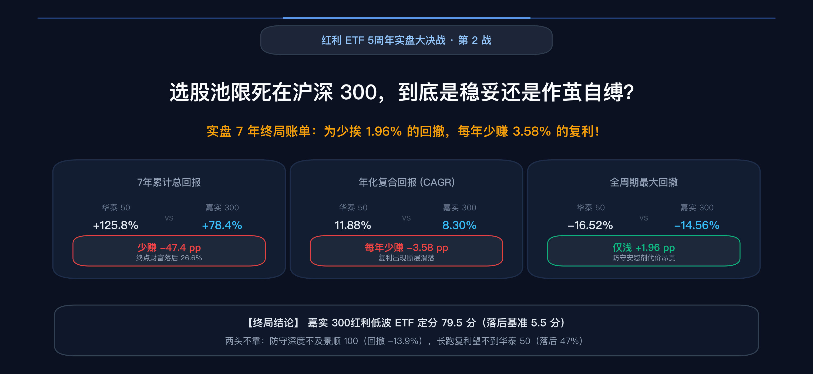
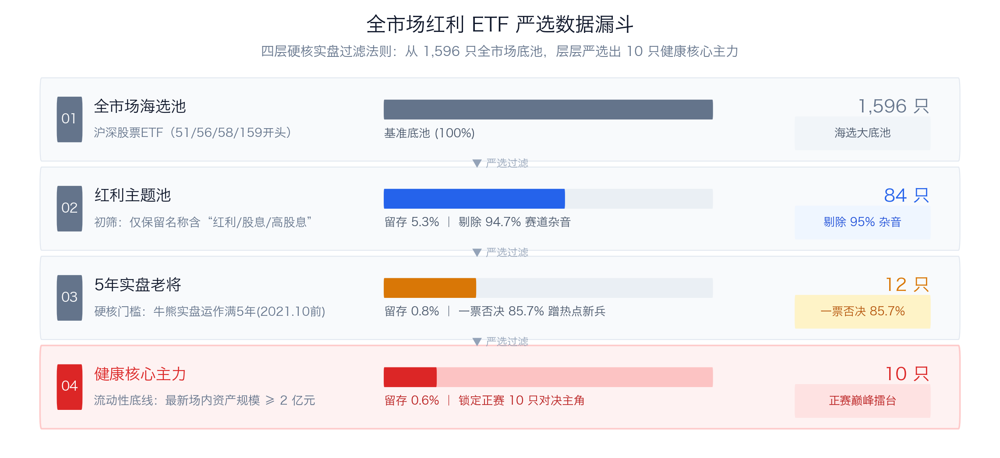
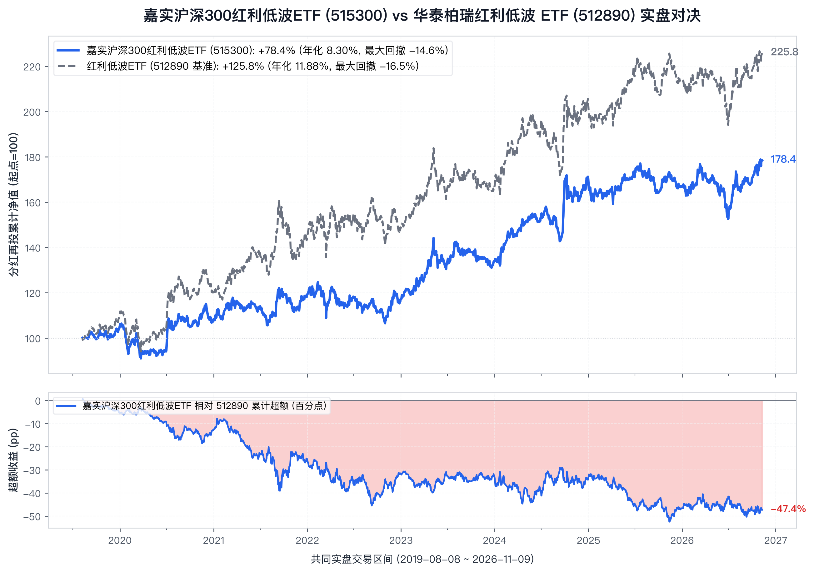
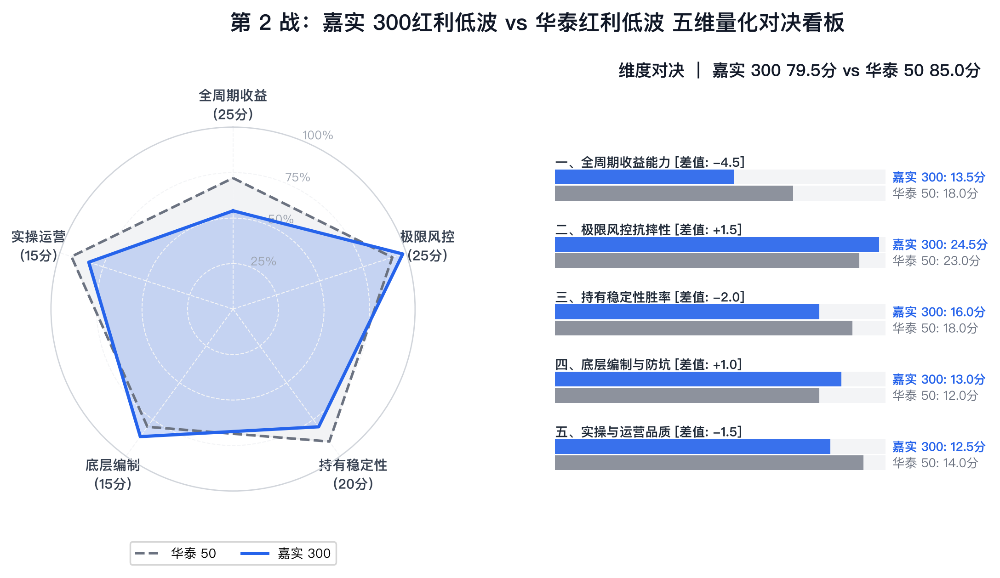

# 标题备选

* **反常识反转型**：《为少跌 2% 每年少赚 3.5%：嘉实 300红利低波的“作茧自缚”》
* **冲突与战略抉择型**：《限死沪深 300 之后：一场为了“安全感”支付的昂贵暗税》
* **持仓变形追因型**：《以为买了金融大蓝筹，前三重仓却是格力美的？拆解 515300 实盘 7 年的持仓变形记》
* **战役大复盘型**：《实盘 7 年少赚 47%：被困在 300 强蓝筹池里的红利低波老将》

---

# 【第2战】限死在沪深 300 大蓝筹，实盘 7 年少赚 47%！嘉实这只红利低波究竟是稳妥，还是作茧自缚？



假设在 2019 年 8 月初，两位投资者各自拿出 100 万元积蓄买入红利基金。

一位看中了全市场规模最大的**华泰柏瑞中证红利低波动 ETF（512890，简称：华泰 50）**；另一位坚信“小盘股靠不住，选高息必须选沪深 300 核心大蓝筹”，全仓买入了新成立的**嘉实沪深 300 红利低波动 ETF（515300，简称：嘉实 300）**。

7 年过去，时间来到 2026 年 11 月 9 日。历经整整 1,740 个交易日的牛熊颠簸后，两张对账单摆在面前：

买华泰 50 的账户，在分红再投复利下滚成了 **225.8 万元**（累计收益 **+125.76%**，年化复合回报 **11.88%**）；  
买嘉实 300 的账户，账面只有 **178.4 万元**（累计收益 **+78.37%**，年化复合回报 **8.30%**）。

同样的本金，同样的“红利 + 低波”双因子招牌，嘉实 300 的持有者整整少拿了 **47.39 万元**。



在全市场 84 只场内红利 ETF 中，成立满 5 年的老牌基金总共只有 12 只。嘉实 300（515300）成立于 2019 年 8 月 8 日，是名副其实的 5 年期实盘老将。很多人买它，图的就是“沪深 300 蓝筹”这块金字招牌。

但 7 年下来少赚近一半的实盘账单，逼着我们必须回答一个残酷的商业问题：**把选股池死死限死在沪深 300 核心大蓝筹里，到底是加固了防御铁壁，还是一场作茧自缚？**

## 一、 池子缩到 300 只后，选拔机制彻底失灵

很多投资者在直觉上容易犯一个错误：认为“沪深 300 红利低波”就是把全市场的红利低波精简出最优质的 50 家龙头。

但指数编制的数学逻辑恰恰相反。

对比华泰 50（中证红利低波，H30269）与嘉实 300（300红利低波，930740）的官方选拔程序，能看出明显的机制反差：

```text
【华泰红利低波（512890）选拔齿轮】
中证全指（4000+家流动性前80%） → 连续三年分红且股息正增长（剔除高支付率排雷） → 选三年平均股息前75名 → 选其中波动率最低的50名 → 股息率加权（单票上限15%，无行业上限）

【嘉实 300红利低波（515300）选拔齿轮】
沪深300（限死300只核心蓝筹） → 连续三年分红（0<支付率<100%，ROE波动率最低前80%） → 选三年平均股息前50% → 选其中波动率最低的50名 → 股息率加权（单票上限10%，单个一级行业上限30%）
```

问题正出在第一道门槛上——**选样底池的大小**。

华泰 50 从全市场 4000 多只股票里挑选。即使扣除了小微市值和垃圾股，候选池依然有 1000 多家公司。它既能将中国神华、工商银行这种大盘巨头收归囊中，又能深入到煤炭、化工、交通运输、港口航运等细分赛道，把那些“市值 200~500 亿、股息率高达 6%~8%、股价常年横盘不折腾”的中坚企业挖出来。

而嘉实 300 把大门限死在沪深 300 之内。

沪深 300 看起来家大业大，但仔细拆开这 300 家公司的结构：新能源（宁德、隆基）、半导体、创新药、科技互联网……这些占了大半个权重的成长赛道根本不分红，或者股息率低得可怜。

把不分红的、近三年亏损的、以及股息率偏低的公司剔除后，**整个沪深 300 内部能参与分红选拔的股票，满打满算只有 200 来只**。

在 200 只股票里挑选 50 只样本，意味着每 4 只股票就要选入 1 只，淘汰率仅有可怜的 75%！

当选样池被强行收窄，所谓“精挑细选”的筛选器就失去了意义。大量在全市场中盘赛道里极具分红爆发力和低估值弹性的优质标的，因为没有挤进沪深 300，直接被拒之门外；而沪深 300 内部一些股息平平、仅仅因为市值大而入榜的股票，却能轻松坐稳席位。

选样池收窄砍掉的不是风险，而是全市场资产配置的广度。

---

## 二、 30% 行业封顶的连锁反应：它被动买成了一只“消费基金”

如果选样池狭窄只是削弱了选拔深度，那么嘉实 300 编制规则里的另一项设计，则引发了资产配置的重大变形——**单个一级行业权重严禁超过 30%**。

行业封顶本身的初衷是为了防黑天鹅。

基准华泰 50 是“纯股息率加权且没有任何行业限制”。过去几年当银行板块整体股息率极高时，华泰 50 顺势大举增配银行，**金融行业权重一度突破 53.6%**。你可以批评它“行业极度集中”，但至少投资逻辑简单透明——顺风时直接吃满大行主升浪。

嘉实 300 被套上了 30% 的紧箍咒。这意味着金融行业就算股息率再高、波动再小，到了 **29.97%** 就必须强行封顶，多出来的 70% 资金必须配到非金融行业。

荒诞的转折在这里发生了：

**在沪深 300 这 200 多只备选票里，除了金融银行，还能去哪里找高股息、低波动的非金融大蓝筹？**

周期股波动太大，科技股没有股息，医药股持续调整，算下来符合条件的非金融品种屈指可数。最终，指数编制公式不得不把大笔仓位硬生生赶到了家电和食品饮料板块。

穿透嘉实 300 跟踪指数的成分股明细（截至2026年8月），前三大重仓股的名单让很多投资者目瞪口呆：

1. 第一大重仓股：**格力电器（权重 4.53%）**
2. 第二大重仓股：**双汇发展（权重 3.50%）**
3. 第三大重仓股：**美的集团（权重 3.31%）**

前三大重仓股不仅没有一家银行，反而全被家电和肉制品包揽。穿透到中证一级行业，嘉实 300 的**可选消费（10.42%）与主要消费（7.68%）合计占比高达 18.10%**！

很多散户买入嘉实 300，以为自己买的是大盘金融防守盾牌；但在真实的持仓齿轮里，它却被动塞进了一大包消费白马。

---

## 三、 实盘 7 年硬核算账：输在哪一年？赢在哪一年？

嘉实 300红利低波 ETF 成立于 2019 年 8 月 8 日。我们将两只基金拉到完全一致的起跑线（2019-08-08 至 2026-11-09，共 1,740 个交易日，历时 7.26 年），基于复算分红再投资全收益净值展开全面体检：



| 考核维度 | 核心量化指标 | 华泰 50 (512890) | 嘉实 300 (515300) | 胜负归属 | 关键差异与白话解读 |
| :--- | :--- | :---: | :---: | :---: | :--- |
| **长跑收益能力** | **分红再投累计总回报** | **+125.76%** | +78.37% | **华泰 50 胜** | 华泰累计多赚 **+47.39 个百分点**，终点财富高出 26.6% |
| **长跑收益能力** | **年化复合回报 (CAGR)** | **11.88%** | 8.30% | **华泰 50 胜** | 华泰年化多赚 **+3.58 个百分点**，长跑复利拉开断层差距 |
| **极限风控抗摔** | **全周期历史最大回撤** | -16.52% | **-14.56%** | **嘉实 300 胜** | 嘉实回撤浅 1.96 个百分点，极端杀跌时确实抗摔 |
| **极限风控抗摔** | **年化波动率** | 16.43% | **14.18%** | **嘉实 300 胜** | 嘉实年化波动低 2.25 个百分点，平滑性更优 |
| **极限风控抗摔** | **年化下行标准差** | 11.98% | **9.76%** | **嘉实 300 胜** | 嘉实下行颠簸低 2.22 个百分点，破位下坠阻尼感好 |
| **极限风控抗摔** | **卡玛比率 (收益/回撤)** | **0.72** | 0.57 | **华泰 50 胜** | 嘉实收益牺牲过多，每挨 1% 跌幅换来的年化反倒更少 |
| **运营体量安全** | **最新场内资产规模 (截至2026年11月)** | **312.87 亿元** | 35.70 亿元 | **华泰 50 胜** | 华泰流动性超强；但嘉实 35 亿也健康无退市风险 |

从走势图和指标表来看，嘉实 300 确实有它的防守长处：
* 全周期历史最大回撤 **-14.56%**，比华泰 50（-16.52%）浅了近 2 个百分点；
* 年化下行标准差 **9.76%**，明显低于华泰 50 的 11.98%。在大盘急跌破位时，大蓝筹的坐垫确实让人少挨了一点颠簸。

但把 7.26 年的实盘历史按自然年份拆开，胜负逻辑清晰显现：

| 自然年份 | 华泰 50 | 嘉实 300 | 实盘胜负手与归因剖析 |
| :---: | :---: | :---: | :--- |
| **2019\*** | **+10.55%** | +4.88% | **华泰胜 (+5.67pp)**：全市场周期弹性释放，嘉实建仓期滞涨。 |
| **2020** | **+9.46%** | +3.22% | **华泰胜 (+6.24pp)**：抱团牛市低波整体逆风，嘉实限死 300 钝化更严重。 |
| **2021** | **+19.56%** | +10.02% | **华泰胜 (+9.54pp) · 差距最大年**：中小盘周期大爆发，华泰吃满红利，嘉实错失弹性。 |
| **2022** | **+2.72%** | -1.75% | **华泰胜 (+4.46pp)**：核心资产白马大退潮，嘉实因重仓格力美的转负，华泰收正。 |
| **2023** | +11.91% | **+14.36%** | **嘉实胜 (+2.45pp)**：无风险利率下行，大盘高息公用事业反弹，嘉实微胜。 |
| **2024** | +22.64% | **+27.31%** | **嘉实胜 (+4.67pp) · 嘉实高光年**：四大行+运营商极化行情，加之白电出海戴维斯双击。 |
| **2025** | **+4.74%** | -2.00% | **华泰胜 (+6.75pp)**：红利高位巨震白电承压，嘉实再度翻绿，华泰稳健收正。 |
| **2026\*** | +5.67% | **+6.83%** | **嘉实胜 (+1.16pp)**：震荡市中大盘蓝筹护盘，嘉实微弱领跑。 |

> 📌 *注：2019 年自 8 月 8 日同台起跑；2026 年统计截至 11 月 9 日。*

这组年度账单揭示了两个致命的战略痛点：

### 痛点一：顺风大年吃不到中小市值的弹性
2021 年是典型的中小市值狂欢年，全市场煤炭、化工、有色等顺周期品种暴赚。华泰 50 从全市场筛选出了平煤、淮北矿业等一批百亿市值的细分高息黑马，当年大赚 **+19.56%**；而嘉实 300 被锁死在沪深 300 内部，眼睁睁看着池子外面的中小盘狂飙，当年仅录得 **+10.02%**，单年落后 **9.54 个百分点**。

### 痛点二：被动重仓的消费股在逆风期成了拖油瓶
2022 年单边大熊市与 2025 年高位震荡期，消费白马整体承压。嘉实 300 重仓的格力、双汇、美的受到波及，导致嘉实 300 在这两年分别录得 **-1.75%** 和 **-2.00%** 的亏损；而基准华泰 50 凭借银行高股息与三年股息正增长过滤，在 2022 年（+2.72%）与 2025 年（+4.74%）均稳稳实现了正收益。

*(注：同期还有一只跟踪沪深 300 纯红利指数的建信沪深 300 红利 ETF 512530。自 2019-08-23 成立以来，建信纯红利累计回报仅 +71.13%，不仅跑输嘉实 300 同区间（2019-08-23 至今）的 +78.17%（嘉实自身全周期为 +78.37%），且最新规模萎缩至 1.52 亿元。这证明加了“低波”确实比“纯 300 红利”强，但依然无法拯救池子狭窄带来的天然局限。)*

---

## 四、 五维量化打分：嘉实 300 最终定分 79.5

以华泰红利低波 ETF（85.0 分）为基准，嘉实 300红利低波 ETF 的各项评分如下：



| 评价维度 | 满分 | 华泰 50得分 | 嘉实 300得分 | 嘉实战力进度条 | 胜负手原因（量化体检结论） |
| :--- | :---: | :---: | :---: | :---: | :--- |
| **一、全周期收益能力** | 25分 | **18.0** | **13.5** `(-4.5)` | `█████▌░░░░` 54% | 7年年化落后 3.58%，总回报少赚 47.4%，牛市与中小盘严重钝化（大幅扣分） |
| **二、极限风控抗摔性** | 25分 | **23.0** | **24.5** `(+1.5)` | `█████████▌` 98% | **回撤仅 -14.56% 优于基准**，波动与下行差更小，大蓝筹抗震出色（加分） |
| **三、持有稳定性胜率** | 20分 | **18.0** | **16.0** `(-2.0)` | `████████░░` 80% | 8 个考核年份仅 3 胜 5 负（胜率 37.5%），且 2022 与 2025 均出现年度微亏 |
| **四、底层编制与防坑** | 15分 | **12.0** | **13.0** `(+1.0)` | `████████▌░` 87% | **30%行业封顶+10%单票上限**更克制，ROE波动排雷佳，但池子太窄（综合加分） |
| **五、实操与运营品质** | 15分 | **14.0** | **12.5** `(-1.5)` | `████████░░` 83% | 规模 35.7 亿且 7 次分红机制健康，但相对华泰 300 亿巨无霸流动性存在档次差 |
| **🏆 综合总分** | **100分** | **85.0 (胜)** | **79.5** `(-5.5)` | `████████░░` **79.5%** | **【精锐段位 · 分差拉开至 5.5 分】** |

嘉实 300红利低波 ETF 最终拿下 **79.5 分**。

与第 1 战景顺 100 仅落后 0.5 分的惜败不同，嘉实 300 落后基准多达 **5.5 分**，直接拉开了档次差距。红利 ETF 争霸天梯榜最新排位正式刷新：

### 🏆 【5年实盘】红利 ETF 争霸天梯榜（第 2 战更新）

| 排名 | 场内代码 | 参赛 ETF 简称 | 所属门派 / 跟踪指数 | 综合评分 | 相对基准 | 核心战力标签 | 文章状态 |
| :---: | :---: | :---: | :---: | :---: | :---: | :--- | :---: |
| **1** | **512890** | **华泰红利低波ETF** | 中证红利低波动 | **85.0** | **基准锚** | 全市场最稳的锚，大盘龙头复利胜出 | [基准篇](00_基准篇_华泰柏瑞红利低波ETF.md) |
| **2** | **515100** | **景顺红利低波100ETF** | 红利低波100 | **84.5** | **-0.5** | 全市场回撤最浅，跌得更轻但牛市略钝 | [第 1 战](01_第1战_景顺长城红利低波100ETF_vs_512890.md) |
| **3** | **515300** | **嘉实300红利低波ETF** `[NEW]` | 300红利低波 | **79.5** | **-5.5** | **沪深300大蓝筹防守，回撤虽浅但长跑严重滞涨** | **本篇挑战者** |

---

## 五、 商业抉择的代价：你为安全感支付了过于昂贵的溢价

商业世界里，任何战略都有代价。

嘉实 300 的产品设计者在 2019 年面临的选择是清晰的：
他们想做一只“最安全、绝不暴雷、机构和散户买了大盘龙头挑不出毛病”的防御型产品。于是他们选择圈死沪深 300，选择 30% 行业封顶，选择按季度排查 ROE 波动。

在风控端，他们确实做到了：实盘 7.26 年最大回撤仅 -14.56%，年化波动率 14.18%，在权益资产里算得上抗震。

但他们付出的隐性代价过于沉重：

1. **收益大幅滑落**：年化复合收益率从华泰 50 的 11.88% 骤降至 8.30%，每年少赚 3.58 个百分点。
2. **卡玛比率恶化**：**华泰 50 的卡玛比率是 0.72，嘉实 300 反而降到了 0.57**。
   大白话讲，虽然嘉实 300 回撤浅了不到 2 个点，但因为收益缩水更快，**你每挨 1% 的回撤所能换回的年化收益反而变少了**。

算一笔直观的“保险账”：
嘉实 300 为投资者挡住了 1.96 个百分点的极端回撤，但为此收取的“防守保费”，是累计 **47.39 个百分点**的超额收益损失。

这份“安全感”，被市场过度定价了。

---

## 六、 最终建议：防守不及景顺，进攻望不到华泰

两只基金的优劣分野在数据面前已无任何模糊空间：

1. **如果你追求“极致抗摔、绝对不愿承受大跌、求晚上睡个安稳觉”**：
   **果断选择第 1 战的景顺红利低波 100 ETF（515100），不要选嘉实 300！**
   比风控，景顺 100 实盘最大回撤仅 **-13.94%**，比嘉实 300（-14.56%）还要稳健；比长跑，景顺 100 实盘年化高达 12.35%，几乎咬住了华泰 50，而嘉实 300 只有疲软的 8.30%。论防守舒适度，景顺 100 在各个维度都更胜一筹。

2. **如果你追求“长期复利最大化、红利大年不掉队、极致流动性”**：
   **坚定留守华泰红利低波 ETF（512890）！**
   华泰 50 回撤只深了不到 2 个百分点，但 7 年下来足足多赚出 **47.39 个百分点**的财富增量。它在中证全指里捕捉细分行业龙头的生命力，远非限死在 300 强内部的产品所能比拟。

3. **嘉实 300 唯一适用的极窄场景**：
   只有当你**极度看好沪深 300 大蓝筹、极度看好格力美的等白电龙头、且必须用 30% 行业封顶防范银行单一风险**时，它才是一只合格的战术工具。

**总结选基法则**：
更求稳选景顺 100，求复利留华泰 50；嘉实 300 两头不靠，无需作为底仓首选！

---

*下一篇预告：【第 3 战】南方红利低波 50 ETF（515450）登台！跟踪外资巨头标普道琼斯的旗舰指数，带上严苛的“单行业上限 33%”，这场正统低波的巅峰对决，能否撼动擂主地位？敬请期待！*

---

如果您觉得这篇文章有启发，欢迎点赞、转发、关注！

风险提示：本文基于公开客观数据与独立研究，仅供交流参考，不构成任何投资建议。市场有风险，投资需谨慎。
