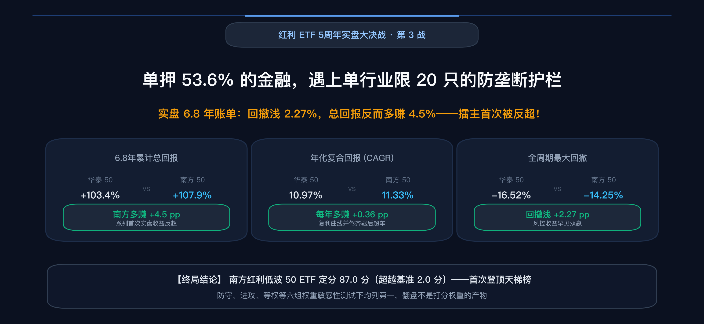
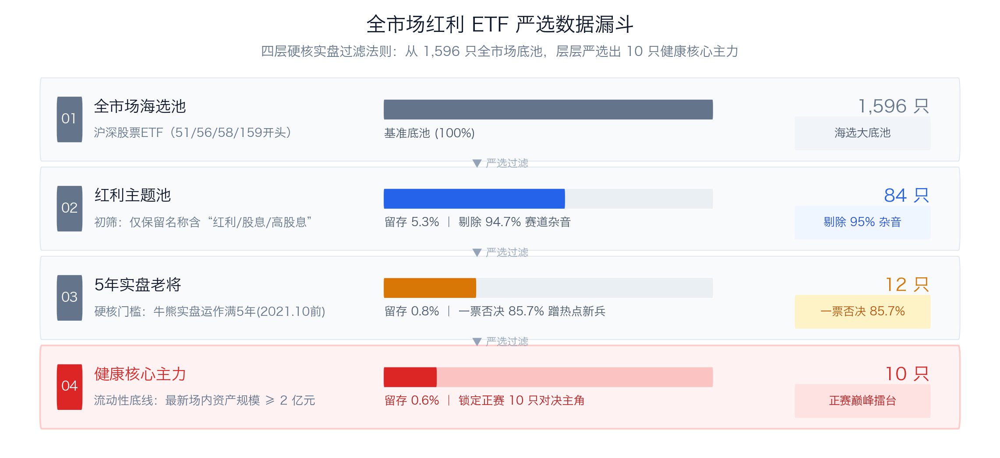
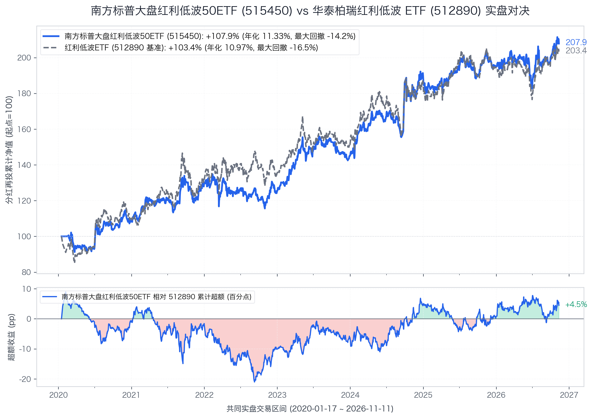
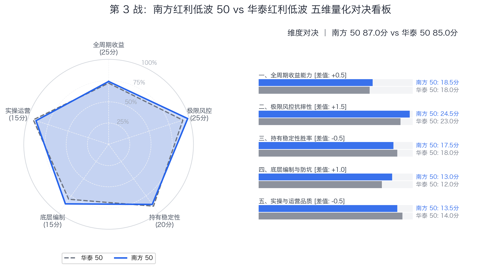

# 【第3战】南方红利低波 50 ETF vs 华泰红利低波 ETF：外资规则对决本土经典，兼顾更浅回撤与更高收益的“双赢神话”成立吗？



打开证券交易软件搜索“红利 ETF”，全市场足足有 **84 只**挂着红利、高股息招牌的场内产品在同时交易。



但只要加上**“实盘运作满 5 年以上（2021年10月前成立）”**这一道硬性分水岭，全市场 **85.7%（72 只）**的跟风新产品就会被一票否决，最终仅有 **12 只**穿越牛熊的老牌正规军留了下来。

在前两战中，华泰柏瑞中证红利低波动交易型开放式指数证券投资基金（场内挂牌简称：红利低波 ETF，代码：512890，本专栏简称：**华泰红利低波 ETF**）展现出了强大的擂主统治力：第 1 战以 85.0 分险胜景顺长城红利低波 100 ETF（84.5 分），第 2 战以 5.5 分的断层优势击退了把池子限死在蓝筹内部的嘉实 300红利低波 ETF（79.5 分）。

今天登台挑战的第 3 位选手，是全市场红利低波赛道里唯一能与华泰柏瑞在体量上正面抗衡的超级巨头，来自头部公募南方基金——**南方标普中国A股大盘红利低波50交易型开放式指数证券投资基金（场内挂牌简称：红利低波50ETF南方，代码：515450，本专栏简称：南方红利低波 50 ETF）**。

在很多投资者的常识认知里，投资世界存在一条铁律：**“收益与风险是一枚硬币的两面，防守越好的产品，往往牺牲了进攻收益。”** 景顺 100 和嘉实 300 都印证了这个规律——它们的回撤虽然浅了，但收益无一例外都落后于华泰 50。

然而，南方红利低波 50 ETF 带着外资巨头标普道琼斯的 Smart Beta 编制体系走上擂台。它引入了行业数量上限约束与独特的波动率倒数加权，试图在降低极端波动的同时，摆脱单一行业的押注束缚。

这套外资规则真的能打破“低回撤必须牺牲高收益”的宿命吗？

我们拉出两只基金从 2020 年 1 月 17 日同台起跑至今、跨越 **1,638 个交易日（整整 6.82 年）**的真金白银实盘分红再投净值，展开第三场 1 对 1 巅峰复盘。

---

### 🏆 【5年实盘】红利 ETF 争霸天梯榜（第 3 战更新）

> 本榜单仅收录在大陆上市、实盘满 5 年以上的红利 ETF。  
> 以华泰红利低波 ETF 为基准锚（设定基准分 85.0 分），结合五维实盘量化模型，动态排定座次。

| 排名 | 场内代码 | 参赛 ETF 简称 | 所属门派 / 跟踪指数 | 综合评分 | 相对基准 | 核心战力标签 | 文章状态 |
| :---: | :---: | :---: | :---: | :---: | :---: | :--- | :---: |
| **1** | **515450** | **南方红利低波50ETF** `[NEW]` | 标普低波50 | **87.0** | **+2.0** | **外资行业约束+低波倒数加权，罕见兼顾浅回撤与高收益** | **本篇挑战者（登顶）** |
| **2** | **512890** | **华泰红利低波ETF** | 中证红利低波动 | **85.0** | **基准锚** | 全市场最稳的锚，大盘龙头复利稳健 | [基准篇](00_基准篇_华泰柏瑞红利低波ETF.md) |
| **3** | **515100** | **景顺红利低波100ETF** | 红利低波100 | **84.5** | **-0.5** | 全市场回撤最浅，跌得更轻但牛市略钝 | [第 1 战](01_第1战_景顺长城红利低波100ETF_vs_512890.md) |
| **4** | **515300** | **嘉实300红利低波ETF** | 300红利低波 | **79.5** | **-5.5** | 沪深300大蓝筹防守，回撤虽浅但长跑严重滞涨 | [第 2 战](02_第2战_嘉实300红利低波ETF_vs_512890.md) |
| 待评 | 501029 | **华宝标普红利机会LOF** | 标普红利机会 | 待评 | -- | 近9年老牌特邀，不加低波进攻弹性 | 第 4 战 |
| 待评 | 159758 | **华夏红利质量ETF** `[NEW]` | 中证红利质量 | 待评 | -- | Quality vs Low-Vol，高ROE进攻反击 | 第 5 战 |
| 待评 | 510880 | **华泰上证红利ETF** | 上证红利 | 待评 | -- | 18年老牌元老，大盘周期纯高息 | 第 6 战 |
| 待评 | 515180 | **易方达中证红利ETF** *(联合)* | 中证红利 | 待评 | -- | 全市场正统基准，跟踪运营决战 | 第 7 战 |
| 待评 | 159905 | **工银深证红利ETF** | 深证红利 | 待评 | -- | 白酒家电重仓，伪红利真消费反思 | 第 8 战 |
| 待评 | 513690 | **博时港股红利ETF** | 恒生港股通高股息 | 待评 | -- | 离岸高折价，深入剖析20%红利税 (附159726) | 第 9 战 |
| 待评 | 007751 | **景顺长城成长低波A** *(场外特邀)* | 沪港深成长低波 | 待评 | -- | 二期总分第一，场外神基越级踢馆 | 特邀番外篇 |

---

## 一、 编制规则照妖镜：外资 Smart Beta 与本土经典的底层碰撞

同样是 50 只样本的红利低波，南方红利低波 50 ETF 跟踪的是**标普中国 A 股大盘红利低波 50 指数（代码：SPCLLHCT 全收益 / SPCLLHCP 价格回报）**，而华泰红利低波 ETF 跟踪的是**中证红利低波动指数（代码：H30269 全收益 / 930269 价格回报）**。

把两份官方编制方案并排拆解，底层逻辑展现出截然不同的工程取向：

```text
【华泰红利低波 ETF（512890）底层编制路线】
中证全指池（全市场流动性前80%） → 连续三年分红且股息正增长（剔除高支付率排雷） → 选三年平均股息前75名 → 选其中波动率最低的50名 → 【纯股息率加权】（单票上限15%，无行业上限，年调1次）

【南方红利低波 50 ETF（515450）底层编制路线】
标普中国A股大盘池（剔除ST与流动性筛选） → 选过去12个月股息率前100名（老样本前150名缓冲，【每个GICS板块成分股数量上限20只】） → 选其中过去一年实际波动率最低的50名（老样本前60名缓冲） → 【波动率倒数加权】（低波动驱动权重，行业自然分散，半年调1次）
```

通俗讲，这两套方案藏着四大核心差异，正是它们重构了实盘收益与波动的收益曲线：

### 1. 行业敞口：单押 53.6% 金融 vs 候选池行业硬约束
* **华泰 50** 的规则里没有任何行业权重上限。它的持仓并非天生只买银行（早年重仓过基建、中期重仓过煤炭），但在股息率加权机制下，由于没有行业天花板，近两年当银行股整体处于极低估值、高股息状态时，指数顺势大举向银行倾斜，金融行业权重一度突破 **53.6%**。华泰 50 在近两年本质上体现出极强的大金融防守与进攻色彩；
* **南方 50** 采用了标普的行业防垄断护栏：在第一阶段海选 100 只高息股时，**强制规定每个 GICS 板块入选成分股数量上限为 20 只**（若某板块达到 20 只，则顺延挑选其他板块中剩余股息率最高的股票，同时设老成分股前 150 名股息率缓冲）。需要辨清的是，标普大盘低波 50 **并未像港股通低波红利那样在加权阶段硬设 30% 的行业权重截断**，而是通过“候选池单板块最多 20 只 + 后续纯波动率倒数加权”这一底层机制，从源头切断了单一行业完全垄断候选池的可能。实际持仓穿透显示，南方 50 在基建、公用事业（电力、高速）、周期（煤炭、石化）、消费（家电、食品）与金融之间均衡分布，最大行业占比常年自然平抑在 30% 附近，从未出现过华泰 50 那样金融单押过半的极端局面。

### 2. 加权公式：谁把低波做进权重骨髓？
* **华泰 50** 是**“纯股息率加权”**。低波动在这里只是一道过关门槛（从 75 只里挑 50 只），一旦过关，谁的股息率高谁拿大权重。它本质上是由“股息率大小”决定持仓轻重的；
* **南方 50** 是**“波动率倒数加权”**。波动率不仅是选拔门槛，更是加权分配的唯一发动机。过去一年走势越平稳、振幅越低的公司，获得的仓位权重越高。这使得低波因子深深嵌在组合内部，对日常颠簸形成了强烈的阻尼吸收效果。

### 3. 分红质量把关：三年股息增长排雷 vs 12 个月即期股息
* **华泰 50** 在分红纯度上更严谨：强制要求**“过去三年每股股息正增长”**，并剔除支付率最高的前 5% 公司，有效排除了那些靠吃老本、透支现金流分红的伪高息企业；
* **南方 50** 仅考察**过去 12 个月的即期股息率**，没有强制的多年利润增长和支付率门槛。这带来了一个潜在缺口：在周期品处于景气峰值时，一些周期股可能因为当期分红暴增而被选入，随后在周期下行期面临分红滑坡压力。

### 4. 调仓敏捷度：一年 1 次 vs 半年 1 次
* **华泰 50** 每年 12 月调仓一次，设 20% 缓冲区，换手率极低，让选出的龙头充分享受长期复利滚存；
* **南方 50** 每年 1 月和 7 月各调仓一次（一年 2 次），调样反应更加敏捷，能够更快地淘汰价格波动放大、股息率下滑的标的，但相应带来了略高的换手交易摩擦。

---

## 二、 6.8年实盘硬核 PK：少挨 2.27% 的回撤，长跑反而多赚 4.5 个百分点！

南方红利低波 50 ETF 成立于 2020 年 1 月 17 日。我们将两只基金拉到完全一致的起跑线（2020-01-17 至 2026-11-11，共 1,638 个交易日，历时 6.82 年），基于复算分红再投资全收益净值展开全方位体检：



| 考核维度 | 核心量化指标 | 华泰 50 (512890) | 南方 50 (515450) | 胜负归属 | 关键差异与白话解读 |
| :--- | :--- | :---: | :---: | :---: | :--- |
| **长跑收益能力** | **分红再投累计总回报** | +103.38% | **+107.88%** | **南方 50 胜** | 南方累计多赚 **+4.50 个百分点**，系列挑战者首次在长跑总收益上反超擂主 |
| **长跑收益能力** | **年化复合回报 (CAGR)** | 10.97% | **11.33%** | **南方 50 胜** | 南方年化领先 **+0.36 个百分点**，两曲线并驾齐驱近 6 年后成功超车 |
| **极限风控抗摔** | **全周期历史最大回撤** | -16.52% | **-14.25%** | **南方 50 胜** | 南方回撤浅 **2.27 个百分点**，极端熊市杀跌时防御力更胜一筹 |
| **极限风控抗摔** | **年化波动率** | 16.57% | **14.46%** | **南方 50 胜** | 南方年化波动低 **2.11 个百分点**，波动率倒数加权极大平滑了净值曲线 |
| **极限风控抗摔** | **年化下行标准差** | 11.50% | **9.74%** | **南方 50 胜** | 南方下行颠簸低 **1.76 个百分点**，破位下坠阻尼感极佳 |
| **极限风控抗摔** | **卡玛比率 (收益/回撤)** | 0.66 | **0.80** | **南方 50 胜** | 南方每挨 1% 跌幅换取 0.80% 年化，风险收益性价比全面占优 |
| **运营体量安全** | **最新场内资产规模 (截至2026年11月)** | **312.90 亿元** | 180.00 亿元 | **华泰 50 胜** | 华泰 300 亿超强流动性；但南方 180 亿也是全市场第二大巨无霸 |

> 📌 **指标通俗再注释**：
> - **下行标准差（9.74% vs 11.50%）**：南方 50 显著更低。在大盘下坠砸盘时，南方 50 的下挫平缓得多，这是标普候选池行业分散约束与波动率倒数加权共同筑起的抗震底盘。
> - **卡玛比率（0.80 vs 0.66）**：这是专栏连载以来首次出现的质变。景顺 100 靠大幅牺牲收益换来卡玛 0.85，嘉实 300 收益暴跌导致卡玛仅 0.57；而南方 50 在**收益反超华泰 50（11.33% vs 10.97%）的同时，把最大回撤从 -16.52% 压缩到了 -14.25%**。它不仅抗摔，而且跑得更快！

### 逐年战绩切片：赢在什么年份？输在什么年份？

将 6.82 年的实盘历史按自然年份拆开，双方的胜负节奏完整展现了行业轮换与单押集中的力量对比：

| 自然年份 | 华泰 50 | 南方 50 | 实盘胜负手与归因剖析 |
| :---: | :---: | :---: | :--- |
| **2020 年\*** | **+10.10%** | +9.04% | **华泰胜 (+1.06pp)**：抱团牛市逆风期，华泰 50 股息纯度高，微幅领跑。 |
| **2021 年** | **+19.56%** | +19.30% | **华泰胜 (+0.26pp)**：周期资源品狂飙，华泰 50 纯股息率加权进攻弹性略胜一筹。 |
| **2022 年** | **+2.72%** | -3.80% | **华泰胜 (+6.52pp) · 华泰优势年**：大熊市考验盈利质量，华泰靠每股股息增长排雷保住正收益，南方因建材地产敞口出现回撤。 |
| **2023 年** | +11.91% | **+15.92%** | **南方胜 (+4.01pp)**：无风险利率下行，南方 50 重仓的火电、核电与公路水运迎来公用事业大行情。 |
| **2024 年** | +22.64% | **+31.02%** | **南方胜 (+8.38pp) · 南方决胜年**：大盘高息与白电出海齐飞，南方多行业接力（煤炭+电力+家电+基建）彻底爆发，奠定反超胜局。 |
| **2025 年** | **+4.74%** | +2.72% | **华泰胜 (+2.02pp)**：高位巨震消化期，华泰 50 凭借银行超大市值护盘优势微弱跑赢。 |
| **2026 年\*** | +4.62% | **+6.48%** | **南方胜 (+1.86pp)**：震荡市中多行业协同护盘，南方继续巩固领先优势。 |

> 📌 *注：2020 年自 1 月 17 日同台起跑；2026 年统计截至 11 月 11 日。全专栏统一采用标准自然年度收益率口径。*

**为什么 2024 年南方 50 能大胜华泰整整 8.38 个百分点？**  
2024 年虽然也是大盘红利年，但行情的驱动力并不只在银行。电力（浙能电力、华能水电）、家电（格力电器）、煤炭（中国神华）、交运（山东高速、大秦铁路）多点开花。南方 50 凭借标普规则强制实现的多行业均衡分布，抓住了公用事业、周期与出海制造的轮动重合期；而华泰 50 超过半数仓位沉淀在银行板块，在非金融板块的进攻弹性受到了压制。

**为什么 2022 年南方 50 会落后 6.52 个百分点并出现 -3.80% 的亏损？**  
这恰恰暴露了标普规则的短板。2022 年地产链与建材板块遭遇重挫。南方 50 只看过去 12 个月即期股息率，没有华泰 50 那样“过去三年每股股息正增长”和支付率过滤，组合中不可避免地纳入了海螺水泥、保利发展、招商蛇口等地产链标的，在当期承受了一定回撤。华泰 50 凭借纯正的股息增长过滤与大行护体，在 2022 年顽强收红。

---

## 三、 五维量化打分卡：南方 50 拿下 87.0 分，登顶天梯榜

以华泰红利低波 ETF（85.0 分）为基准，南方红利低波 50 ETF 逐项打分如下：



| 评价维度 | 满分 | 华泰 50得分 | 南方 50得分 | 南方战力进度条 | 胜负手原因（量化体检结论） |
| :--- | :---: | :---: | :---: | :---: | :--- |
| **一、全周期收益能力** | 25分 | **18.0** | **18.5** `(+0.5)` | `███████▍░░` 74% | **实盘总回报(+107.9%)与年化(+11.33%)双超基准**，系列首现挑战者收益反超（加分） |
| **二、极限风控抗摔性** | 25分 | **23.0** | **24.5** `(+1.5)` | `█████████▌` 98% | **回撤仅 -14.25% 显著优于基准**，波动与下行差更小，抗震性能极强（大幅加分） |
| **三、持有稳定性胜率** | 20分 | **18.0** | **17.5** `(-0.5)` | `████████▌░` 88% | 7 年考核 3 胜 4 负，且 2022 年大熊市出现 -3.80% 的年度回撤亏损（微扣 0.5 分） |
| **四、底层编制与防坑** | 15分 | **12.0** | **13.0** `(+1.0)` | `████████▌░` 87% | **候选池单板块最多20只+波动率倒数加权**防单押黑天鹅，半年调仓灵敏，但缺股息增长排雷（加分） |
| **五、实操与运营品质** | 15分 | **14.0** | **13.5** `(-0.5)` | `█████████░` 90% | 最新规模 180 亿稳居全市场第二，流动性极佳、近 5 年年化跟踪误差仅 0.47%，仅次于 300 亿华泰（得分 13.5） |
| **🏆 综合总分** | **100分** | **85.0** | **87.0 (胜)** | `████████▋░` **87.0%** | **【卓越段位 · 领先基准 2.0 分，首登天梯榜榜首】** |

南方红利低波 50 ETF 最终拿下 **87.0 分**，领先华泰红利低波 ETF 整整 **2.0 分**，正式成为《红利 ETF 五周年实盘大决战》专栏开赛以来的**首位新榜首**。

### 稳健性审计：翻盘是不是特定权重的产物？

在评分模型中，总分差在 2.0 分以内时，必须严防“结论由人为设定的权重操纵”。

我们对评分模型进行了 6 组不同偏好的极端权重扰动测试：

| 权重扰动方案 | 收益权重 | 风控权重 | 稳定性权重 | 编制权重 | 运营权重 | 南方 50 得分 | 华泰 50 得分 | 景顺 100 得分 | 嘉实 300 得分 | 排名第一归属 |
| :--- | :---: | :---: | :---: | :---: | :---: | :---: | :---: | :---: | :---: | :---: |
| **基准方案** | 25% | 25% | 20% | 15% | 15% | **87.00** | 85.00 | 84.50 | 79.50 | **南方 50 第 1** |
| **极致防守偏好** | 15% | 35% | 25% | 15% | 10% | **89.28** | 86.83 | 87.71 | 83.73 | **南方 50 第 1** |
| **进取进攻偏好** | 35% | 15% | 15% | 15% | 20% | **84.72** | 83.17 | 81.29 | 75.27 | **南方 50 第 1** |
| **五维完全等权** | 20% | 20% | 20% | 20% | 20% | **87.23** | 85.47 | 84.70 | 80.40 | **南方 50 第 1** |
| **机构风控与运营** | 20% | 30% | 15% | 10% | 25% | **88.49** | 86.83 | 85.62 | 81.70 | **南方 50 第 1** |
| **底层规则与防坑** | 20% | 20% | 25% | 25% | 10% | **86.94** | 84.63 | 85.08 | 80.40 | **南方 50 第 1** |

敏感性测试给出了高度一致的答案：
在全部 6 组不同价值取向的权重方案下，**南方红利低波 50 ETF 的综合得分均稳居全市场第一名**！

原因非常清晰：南方 50 在全周期收益（领先 0.5）、极限风控（领先 1.5）、规则防坑（领先 1.0）三个最核心维度上对基准建立了优势。它的翻盘是实盘收益与风控双赢的结果，而不是权重打分倾斜的产物。

---

## 四、 最终建议

第 3 战的对决结果，正式改写了红利低波赛道的竞争格局。

面对首次登顶天梯榜的南方红利低波 50 ETF，我们的投资配置建议如下：

1. **如果你追求“兼具更浅回撤与更高复利、能够作为全天候底仓配置的红利旗舰”**：
   **南方红利低波 50 ETF（515450）是目前市场上唯一能够正向替代华泰 50 的实力首选！**
   它用 6.82 年的真实实盘证明了：外资标普的行业防垄断机制与波动率倒数加权，成功把全周期最大回撤压平到了 **-14.25%**，同时还能在长跑中多赚出 **4.50 个百分点**的超额回报。180 亿的充沛体量更让买卖滑点完全处于机构级水平。

2. **华泰红利低波 ETF（512890）依然具有不可替代的基石价值**：
   华泰 50 丢掉榜首，并不意味着它失去了竞争力。
   华泰 50 的独门杀手锏在于**“三年每股股息正增长”的硬核排雷与“单边熊市的避风港属性”**。在 2022 年大熊市中，正因为这套严苛的股息质量排雷，华泰 50 实现了 +2.72% 的正收益，而南方 50 出现了 -3.80% 的亏损。如果你对非金融周期股的利润变脸心存顾虑，偏好严格的分红排雷底线，华泰 50 依然是最坚固的防空洞。

3. **专栏三战横向大盘点**：
   - 追求极致浅回撤、睡觉最安稳：选**景顺红利低波 100（515100）**，回撤 -13.94% 全场最浅；
   - 追求攻守平衡与复利天花板：选**南方红利低波 50（515450）**，年化 11.33% 且回撤仅 -14.25%；
   - 追求最强现金流护城河与大金融护盘：留守**华泰红利低波（512890）**；
   - 沪深 300 窄池的**嘉实 300红利低波（515300）**两头不靠，无需作为底仓。

**回到开头的核心叩问：兼顾更浅回撤与更高收益的双赢神话，真的成立吗？**

6.82 年的实盘账单给出了肯定的回答：
**在南方红利低波 50 ETF 身上，这个神话真实成立了。**  
它没有落入“防守必须以牺牲复利为代价”的常规窠臼，而是通过规则让组合跳出了单一行业的囚徒困境，在多行业的高息接力中跑出了平稳而持久的超额曲线。

**一句话选基法则**：
要三年股息增长硬排雷、防单边大熊市留华泰 50；防单一板块过度扎堆、求更浅回撤与更高复利换南方 50！

---

*下一篇预告：【第 4 战】华宝标普中国 A 股红利机会（LOF，场内代码：501029）登台！这是一只运作近 9 年的特邀外资老牌旗舰，它不加低波动因子，仅凭严苛的盈利与分红持续性选拔，在牛市与大级别反弹中到底蕴藏着多强的进攻弹性？敬请期待！*

---

如果您觉得这篇文章有启发，欢迎点赞、转发、关注！

风险提示：本文基于公开客观数据与独立研究，仅供交流参考，不构成任何投资建议。市场有风险，投资需谨慎。
