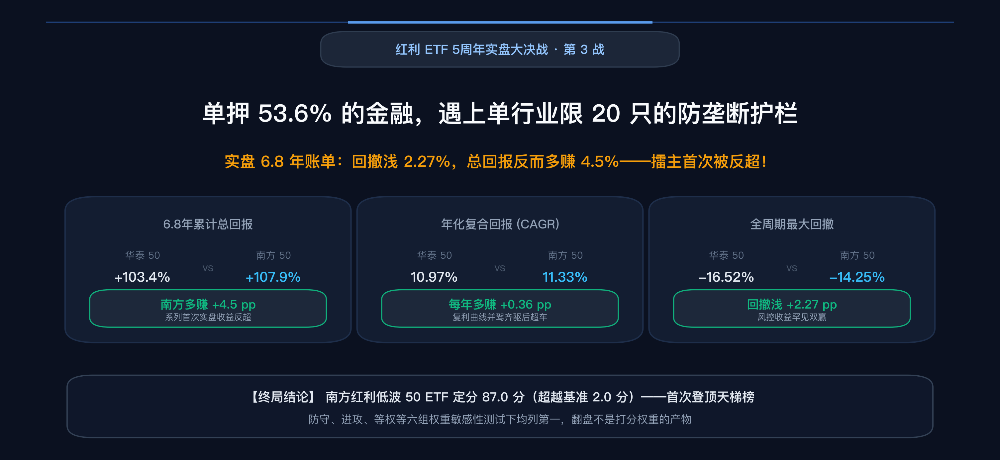
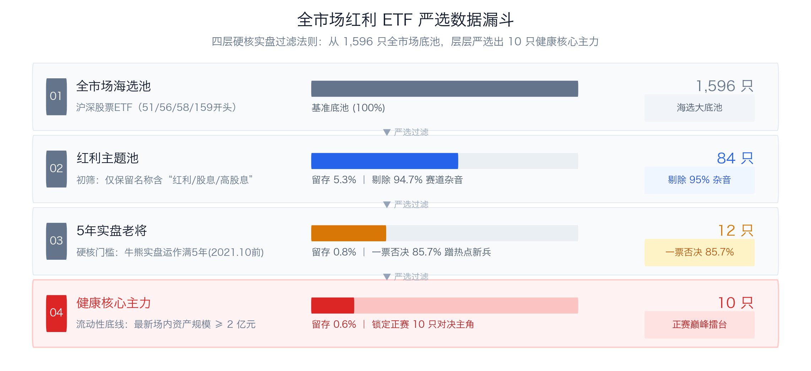
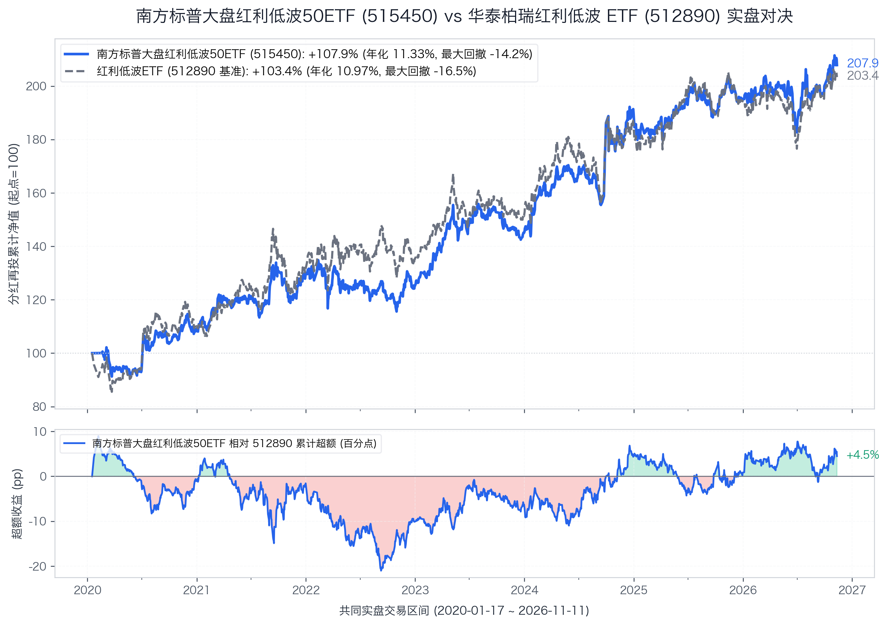
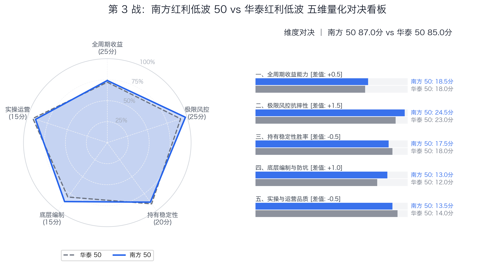

# 标题备选

* **反常识算账型**：《少挨打还能多赚钱？实盘 6.8 年多赚 4.5%：南方红利低波 50 是怎么打破“双赢不可能”的？》
* **机制冲突型**：《单押 53.6% 金融，遇上候选池单行业限 20 只：外资低波规则给 A 股老擂主上了一课》
* **战役复盘型**：《红利擂主 7 年来首次被超车！拆解南方 515450 逆袭华泰背后的真实账单》
* **终局决策型**：《如果手里只有一份红利底仓预算：选大行护体的华泰，还是换多行业接力的南方？》

---

# 【第3战】少挨打还能多赚钱？实盘 6.8 年多赚 4.5%：南方红利低波 50 是怎么打破“双赢不可能”的？



2020 年 1 月 17 日，如果分别拿出 100 万元积蓄买入两只老牌红利 ETF。

一个账户买入全市场体量最大、成立最久的擂主——**华泰柏瑞中证红利低波动 ETF（场内简称：红利低波 ETF，代码：512890，以下简称：华泰 50）**；另一个账户买入当天刚成立的外资规则挑战者——**南方标普中国A股大盘红利低波50 ETF（场内简称：红利低波50ETF南方，代码：515450，以下简称：南方 50）**。

近 7 年过去，跨越 1,638 个交易日的牛熊起伏，截至 2026 年 11 月 11 日，两张分红再投资对账单摆在面前：

买华泰 50 的账户，本金滚成了 **203.4 万元**（累计回报 **+103.38%**，年化复合回报 **10.97%**，全周期最大回撤 **-16.52%**）；  
买南方 50 的账户，账面结余 **207.9 万元**（累计回报 **+107.88%**，年化复合回报 **11.33%**，全周期最大回撤 **-14.25%**）。

同样的本金，同样的“红利 + 低波”双因子策略，买南方的账户不仅累计多拿了 **4.50 万元（+4.50 个百分点）**，而且在最惨烈的杀跌阶段，最大回撤还少挨了 **2.27 个百分点**。



打开交易软件，全市场挂着高股息标签的股票 ETF 足足有 84 只。但加上“实盘满 5 年（2021年10月前成立）”这道硬门槛后，85.7% 的跟风产品被一票否决，真正穿越过完整牛熊周期的老牌正规军只剩 12 只。南方 50 是全市场极少数在资产规模上能突破 180 亿元、正面叫板华泰 300 亿帝国的巨无霸。

很多人在选基金时都有一个根深蒂固的常识：**“防守越稳的产品，收益往往牺牲得越多。”** 前两战的景顺 100（515100）和嘉实 300（515300）都印证了这一点——回撤虽然更浅，但长跑收益都被华泰甩在身后。

偏偏南方 50 打破了这个定势。它凭什么做到“跌得更少，跑得反而更快”？

---

## 一、 编制规则照妖镜：外资 Smart Beta 与本土经典的齿轮碰撞

两只基金的样本数都是 50 只，但底层跟踪的指数血统完全不同：华泰 50 跟踪的是本土老牌**中证红利低波动指数（代码：H30269 全收益 / 930269 价格回报）**，南方 50 跟踪的是标普道琼斯编制的**标普中国 A 股大盘红利低波 50 指数（代码：SPCLLHCT 全收益 / SPCLLHCP 价格回报）**。

把官方编制方案里的齿轮拆开，两者的工业设计截然相反：

```text
【华泰红利低波 ETF（512890）选拔齿轮】
中证全指池（全市场流动性前80%） → 连续三年分红且每股股息正增长（剔除高支付率） → 选三年平均股息前75名 → 选其中波动率最低的50名 → 【纯股息率加权】（单票上限15%，无行业上限，年调1次）

【南方红利低波 50 ETF（515450）选拔齿轮】
标普中国A股大盘池（剔除ST与微流动性） → 选过去12个月股息率前100名（老样本前150名缓冲，【每个GICS板块成分股数量上限20只】） → 选其中过去一年实际波动率最低的50名（老样本前60名缓冲） → 【波动率倒数加权】（单票由低波动驱动，半年调1次）
```

这两套齿轮藏着四个决定性的设计分歧：

### 1. 行业敞口：单押 53.6% 金融 vs 候选池单板块限 20 只
* **华泰 50 的规则里没有设置任何行业上限**。它并不是天生就只买银行（早年重仓过基建、中期重仓过煤炭采掘），但在股息率加权机制下，近两年当银行股整体处于低估值、高股息状态时，资金顺势大举流入银行，金融行业权重一度冲破 **53.6%**。华泰 50 在这轮周期里带上了极强的大金融防守与进攻色彩；
* **南方 50 引入了标普的前置防垄断约束**。在海选 100 只高息股时，规则定死：**每个 GICS 板块入选的股票数量最多不超过 20 只**（哪怕银行全行业股息再诱人，选样池里最多也只能占 20 个席位，其余名额必须顺延让给公用事业、工业、周期和消费）。需要辨清的是，标普大盘低波 50 并未在后期加权阶段生硬设置 30% 的权重上限，而是依靠“前端行业数量配额 + 后端纯波动率倒数分配”，让持仓自然平抑。穿透后，南方 50 的基建、电力、煤炭、家电与金融分布均匀，最大板块常年稳定在 30% 上下，从未出现过华泰 50 那样金融单一行业过半的极端局面。

### 2. 加权发动机：谁把低波做进了骨髓？
* **华泰 50 是“纯股息率加权”**。低波动只是一道过关及格线（75 进 50），一旦过关，谁的股息率高谁拿大仓位。持仓轻重本质上由股息率大小决定；
* **南方 50 是“波动率倒数加权”**。低波动不仅是门槛，更是分蛋糕的唯一尺度。过去一年振幅越小、走势越稳的公司，分到的仓位权重越高。低波因子深度嵌在组合中，对日常颠簸形成了强烈的阻尼吸收效果。

### 3. 分红质量把关：三年股息增长排雷 vs 12 个月即期股息
* **华泰 50 对分红质量更严苛**：强制要求“过去三年每股股息正增长”，并剔除支付率最高的前 5% 公司，直接排除了靠透支账面现金分红的伪高息企业；
* **南方 50 只考察过去 12 个月的即期股息率**，没有多年利润增长和支付率的过滤。在周期品处于景气顶峰时，部分周期股容易因为当期分红暴增而被选入，随后在行业退潮期暴露分红滑坡风险。

### 4. 调样节奏：一年 1 次 vs 半年 1 次
* **华泰 50 每年 12 月调仓一次**，设 20% 缓冲区，换手率极低，让选出的龙头充分享受长期复利滚存；
* **南方 50 每年 1 月和 7 月各调仓一次**，调样反应敏捷，能更快踢掉价格波动放大、股息率缩水的标的，但也付出了稍高的换手交易摩擦。

---

## 二、 实盘 6.8 年硬核算账：少挨打的为什么反而多赚了？

将两只基金拉到同一条起跑线上（2020-01-17 至 2026-11-11，共 1,638 个交易日），基于复权分红再投资净值展开全方位体检：



| 考核维度 | 核心量化指标 | 华泰 50 (512890) | 南方 50 (515450) | 胜负归属 | 关键差异与白话解读 |
| :--- | :--- | :---: | :---: | :---: | :--- |
| **长跑收益能力** | **分红再投累计总回报** | +103.38% | **+107.88%** | **南方 50 胜** | 南方累计多赚 **+4.50 个百分点**，系列挑战者首次在长跑总收益上反超擂主 |
| **长跑收益能力** | **年化复合回报 (CAGR)** | 10.97% | **11.33%** | **南方 50 胜** | 南方年化领先 **+0.36 个百分点**，两曲线并驾齐驱近 6 年后成功超车 |
| **极限风控抗摔** | **全周期历史最大回撤** | -16.52% | **-14.25%** | **南方 50 胜** | 南方回撤浅 **2.27 个百分点**，极端熊市杀跌时防御底盘更扎实 |
| **极限风控抗摔** | **年化波动率** | 16.57% | **14.46%** | **南方 50 胜** | 南方年化波动低 **2.11 个百分点**，波动率倒数加权极大平滑了净值颠簸 |
| **极限风控抗摔** | **年化下行标准差** | 11.50% | **9.74%** | **南方 50 胜** | 南方下行颠簸低 **1.76 个百分点**，大盘下坠砸盘时阻尼感极佳 |
| **极限风控抗摔** | **卡玛比率 (收益/回撤)** | 0.66 | **0.80** | **南方 50 胜** | 南方每挨 1% 跌幅换取 0.80% 年化，风险收益性价比全面占优 |
| **运营体量安全** | **最新场内资产规模 (截至2026年11月)** | **312.90 亿元** | 180.00 亿元 | **华泰 50 胜** | 华泰 300 亿超强流动性；但南方 180 亿也是全市场第二大巨无霸 |

这组数据亮出了一个质变：在卡玛比率（每挨 1% 跌幅能换来多少年化收益）上，景顺 100 靠大幅牺牲收益换来卡玛 0.85，嘉实 300 收益缩水导致卡玛跌到 0.57；而南方 50 在**收益反超华泰 50（11.33% vs 10.97%）的同时，把最大回撤从 -16.52% 压平到了 -14.25%**。

### 逐年战绩切片：赢在什么年份？输在什么年份？

将 6.82 年的历史按自然年份切开，两只基金的胜负节奏完整呈现了行业轮动与单押集中的力量对比：

| 自然年份 | 华泰 50 | 南方 50 | 实盘胜负手与归因剖析 |
| :---: | :---: | :---: | :--- |
| **2020 年\*** | **+10.10%** | +9.04% | **华泰胜 (+1.06pp)**：核心资产抱团逆风期，华泰 50 股息纯度高，微幅领跑。 |
| **2021 年** | **+19.56%** | +19.30% | **华泰胜 (+0.26pp)**：周期资源品爆发，华泰 50 纯股息率加权弹性略胜一筹。 |
| **2022 年** | **+2.72%** | -3.80% | **华泰胜 (+6.52pp) · 华泰优势年**：大熊市考验盈利质量，华泰靠股息增长排雷守住正收益，南方因地产建材链出现回撤。 |
| **2023 年** | +11.91% | **+15.92%** | **南方胜 (+4.01pp)**：利率下行周期确立，南方 50 重仓的火电、核电与公路水运迎来公用事业大行情。 |
| **2024 年** | +22.64% | **+31.02%** | **南方胜 (+8.38pp) · 南方决胜年**：大盘高息与白电出海齐飞，南方多行业接力（煤炭+电力+家电+基建）彻底爆发，奠定反超胜局。 |
| **2025 年** | **+4.74%** | +2.72% | **华泰胜 (+2.02pp)**：高位巨震消化期，华泰 50 凭借银行超大市值护盘优势微弱跑赢。 |
| **2026 年\*** | +4.62% | **+6.48%** | **南方胜 (+1.86pp)**：震荡市中多行业协同护盘，南方继续巩固领先优势。 |

> 📌 *注：2020 年自 1 月 17 日同台起跑；2026 年统计截至 11 月 11 日。全专栏统一采用标准自然年度收益率口径。*

#### 为什么 2024 年南方 50 能大胜华泰 8.38 个百分点？
2024 年是红利大年，但行情的发动机并不只有银行。电力（浙能电力、华能水电）、家电（格力电器）、煤炭（中国神华）、交运（山东高速、大秦铁路）多点开花。南方 50 凭借候选池每个板块限 20 只的刚性约束，抓住了公用事业、周期与出海制造的重合爆发期；而华泰 50 超过半数仓位沉淀在银行板块，在非金融板块的进攻弹性受到了明显压制。

#### 为什么 2022 年南方 50 会落后 6.52 个百分点，出现 -3.80% 的亏损？
这恰恰暴露出标普规则的短板。2022 年地产链遭遇重创。南方 50 只看过去 12 个月即期股息率，缺少“过去三年每股股息正增长”和支付率的严格过滤。海螺水泥、保利发展、招商蛇口等地产链标的因为前一年的丰厚分红被选入组合，在下行期被动承受了回撤；华泰 50 凭借纯正的股息增长排雷和大行护航，在全市场惨跌的大熊市中顽强收红。

---

## 三、 五维量化打分卡：南方 50 拿下 87.0 分，首登天梯榜榜首

以华泰红利低波 ETF（基准分 85.0 分）为基准标尺，南方红利低波 50 ETF 逐项打分如下：



| 评价维度 | 满分 | 华泰 50得分 | 南方 50得分 | 南方战力进度条 | 胜负手原因（量化体检结论） |
| :--- | :---: | :---: | :---: | :---: | :--- |
| **一、全周期收益能力** | 25分 | **18.0** | **18.5** `(+0.5)` | `███████▍░░` 74% | **实盘总回报(+107.9%)与年化(+11.33%)双超基准**，系列首现挑战者收益反超（加分） |
| **二、极限风控抗摔性** | 25分 | **23.0** | **24.5** `(+1.5)` | `█████████▌` 98% | **回撤仅 -14.25% 显著优于基准**，波动与下行差更小，抗震性能极强（大幅加分） |
| **三、持有稳定性胜率** | 20分 | **18.0** | **17.5** `(-0.5)` | `████████▌░` 88% | 7 年考核 3 胜 4 负，且 2022 年大熊市出现 -3.80% 的年度回撤亏损（微扣 0.5 分） |
| **四、底层编制与防坑** | 15分 | **12.0** | **13.0** `(+1.0)` | `████████▌░` 87% | **候选池单板块最多20只+波动率倒数加权**防单押黑天鹅，半年调仓灵敏，但缺股息增长排雷（加分） |
| **五、实操与运营品质** | 15分 | **14.0** | **13.5** `(-0.5)` | `█████████░` 90% | 最新规模 180 亿稳居全市场第二，流动性极佳、近 5 年年化跟踪误差仅 0.47%，仅次于 300 亿华泰（得分 13.5） |
| **🏆 综合总分** | **100分** | **85.0** | **87.0 (胜)** | `████████▋░` **87.0%** | **【卓越段位 · 领先基准 2.0 分，首登天梯榜榜首】** |

南方红利低波 50 ETF 最终拿下 **87.0 分**，领先华泰红利低波 ETF 整整 **2.0 分**，成为开赛以来的**首位新榜首**。

### 🏆 【5年实盘】红利 ETF 争霸天梯榜（第 3 战更新）

| 排名 | 场内代码 | 参赛 ETF 简称 | 所属门派 / 跟踪指数 | 综合评分 | 相对基准 | 核心战力标签 | 文章状态 |
| :---: | :---: | :---: | :---: | :---: | :---: | :--- | :---: |
| **1** | **515450** | **南方红利低波50ETF** `[NEW]` | 标普低波50 | **87.0** | **+2.0** | **候选池行业配额+波动率倒数加权，罕见兼顾浅回撤与高收益** | **本篇挑战者（登顶）** |
| **2** | **512890** | **华泰红利低波ETF** | 中证红利低波动 | **85.0** | **基准锚** | 全市场最稳的锚，大盘龙头复利稳健 | [基准篇](00_基准篇_华泰柏瑞红利低波ETF.md) |
| **3** | **515100** | **景顺红利低波100ETF** | 红利低波100 | **84.5** | **-0.5** | 全市场回撤最浅，跌得更轻但牛市略钝 | [第 1 战](01_第1战_景顺长城红利低波100ETF_vs_512890.md) |
| **4** | **515300** | **嘉实300红利低波ETF** | 300红利低波 | **79.5** | **-5.5** | 沪深300大蓝筹防守，回撤虽浅但长跑严重滞涨 | [第 2 战](02_第2战_嘉实300红利低波ETF_vs_512890.md) |
| 待评 | 501029 | **华宝标普红利机会LOF** | 标普红利机会 | 待评 | -- | 近9年老牌特邀，不加低波进攻弹性 | 第 4 战 |
| 待评 | 159758 | **华夏红利质量ETF** `[NEW]` | 中证红利质量 | 待评 | -- | Quality vs Low-Vol，高ROE进攻反击 | 第 5 战 |
| 待评 | 510880 | **华泰上证红利ETF** | 上证红利 | 待评 | -- | 18年老牌元老，大盘周期纯高息 | 第 6 战 |
| 待评 | 515180 | **易方达中证红利ETF** *(联合)* | 中证红利 | 待评 | -- | 全市场正统基准，跟踪运营决战 | 第 7 战 |
| 待评 | 159905 | **工银深证红利ETF** | 深证红利 | 待评 | -- | 白酒家电重仓，伪红利真消费反思 | 第 8 战 |
| 待评 | 513690 | **博时港股红利ETF** | 恒生港股通高股息 | 待评 | -- | 离岸高折价，深入剖析20%红利税 (附159726) | 第 9 战 |
| 待评 | 007751 | **景顺长城成长低波A** *(场外特邀)* | 沪港深成长低波 | 待评 | -- | 二期总分第一，场外神基越级踢馆 | 特邀番外篇 |

---

## 四、 最终建议：你的真金白银该给谁管？

第 3 战的对决结果，正式改写了红利低波赛道的格局。

面对首次登顶天梯榜的南方红利低波 50 ETF，资金配置建议如下：

1. **追求“更浅回撤与更高复利兼顾、作为全天候底仓”**：
   **南方红利低波 50 ETF（515450）是目前市场上能够正向替代华泰 50 的实力首选。**  
   它用 6.82 年的真实实盘证明了：候选池行业防垄断与波动率倒数加权，成功把全周期最大回撤压平到了 **-14.25%**，长跑中还多赚了 **4.50 个百分点**。180 亿的充沛体量更让买卖滑点完全处于机构级水平。

2. **华泰红利低波 ETF（512890）依然具有不可替代的基石价值**：
   华泰 50 丢掉榜首，并不代表它失去了竞争力。它的杀手锏在于**“三年每股股息正增长”的硬核排雷与“极端单边熊市的避风港属性”**。在 2022 年大熊市中，正因为这套严苛的股息质量排雷，华泰 50 实现了 +2.72% 的正收益，而南方 50 出现了 -3.80% 的亏损。如果对非金融周期股的利润变脸心存顾虑，更看重分红质量的硬核底线，华泰 50 依然是最坚固的防空洞。

3. **专栏三战横向大盘点**：
   * 追求极致浅回撤、睡觉最安稳：选**景顺红利低波 100（515100）**，回撤 -13.94% 全场最浅；
   * 追求攻守平衡与复利天花板：选**南方红利低波 50（515450）**，年化 11.33% 且回撤仅 -14.25%；
   * 追求最硬现金流护城河与大金融护盘：留守**华泰红利低波（512890）**；
   * 沪深 300 窄池的**嘉实 300红利低波（515300）**两头不靠，无需作为底仓。

回到开头的核心叩问：兼顾更浅回撤与更高收益的双赢神话，真的成立吗？

6.82 年的实盘账单给出了肯定的回答：**在这个产品身上，双赢真实成立了。**  
它没有落入“防守必须以牺牲复利为代价”的常规窠臼，而是通过底层规则跳出了单一行业的押注困境，在多行业的高息轮动中跑出了一条平稳而持久的超额曲线。

**一句话选基法则**：
要三年股息增长硬排雷、防单边大熊市留华泰 50；防单一板块过度扎堆、求更浅回撤与更高复利换南方 50！

---

*下一篇预告：【第 4 战】华宝标普中国 A 股红利机会（LOF，场内代码：501029）登台！这是一只运作近 9 年的特邀外资老牌旗舰，它不加低波动因子，仅凭严苛的盈利与分红持续性选拔，在牛市与大级别反弹中到底蕴藏着多强的进攻弹性？敬请期待！*

---

如果您觉得这篇文章有启发，欢迎点赞、转发、关注！

风险提示：本文基于公开客观数据与独立研究，仅供交流参考，不构成任何投资建议。市场有风险，投资需谨慎。
