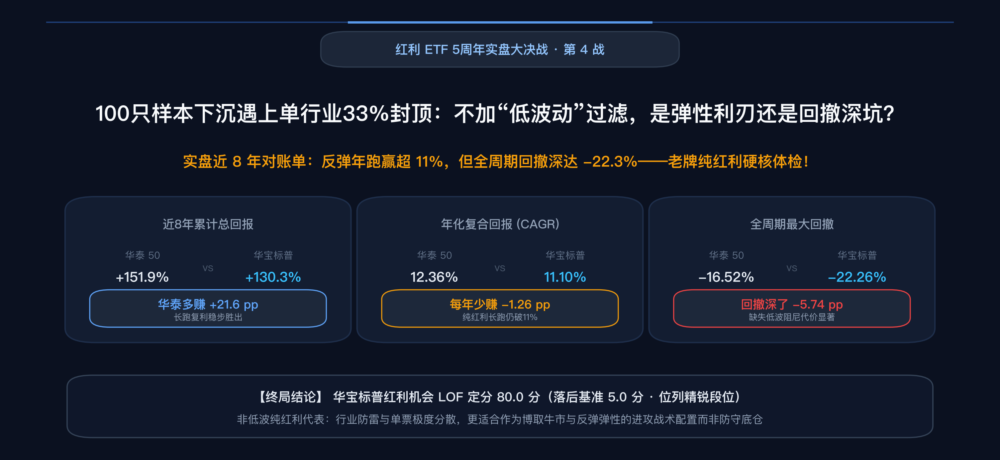
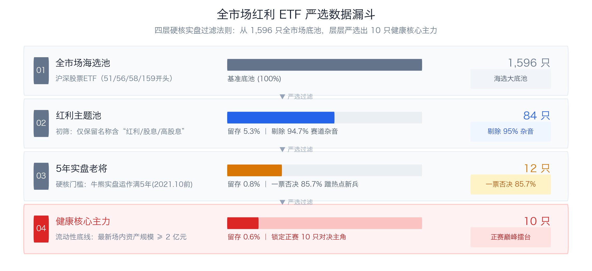
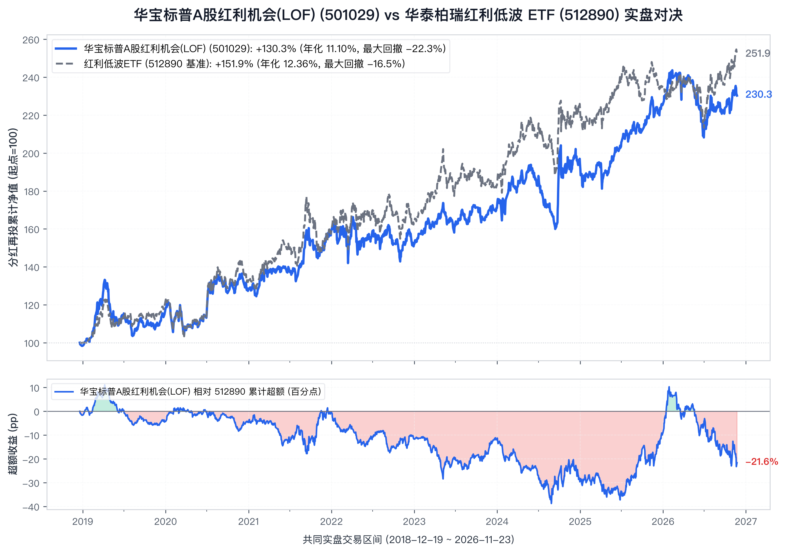
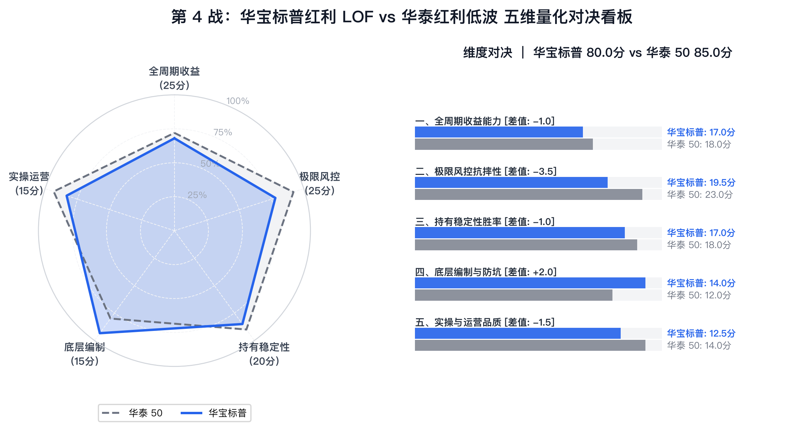

# 【第4战】华宝标普红利机会 LOF vs 华泰红利低波 ETF：不加“低波动”过滤的老牌外资旗舰，牛市弹性与熊市抗摔如何抉择？



打开证券交易软件搜索“红利 ETF”，全市场足足有 **84 只**挂着红利、高股息招牌的场内产品在同时交易。



但只要加上**“实盘运作满 5 年以上（2021年10月前成立）”**这一道硬性分水岭，全市场 **85.7%（72 只）**的跟风新产品就会被一票否决，最终仅有 **12 只**穿越牛熊的老牌正规军留了下来。

在前三场决战中，红利低波家族各显神通：
- 第 1 战：华泰柏瑞红利低波 ETF（512890，定分 85.0 分）险胜样本扩充至 100 只中小盘、全市场回撤最浅的景顺长城红利低波 100 ETF（84.5 分）；
- 第 2 战：华泰红利低波 ETF 以 5.5 分优势击退了把选股池限死在沪深 300 蓝筹、长跑严重滞涨的嘉实 300红利低波 ETF（79.5 分）；
- 第 3 战：南方红利低波 50 ETF（515450）凭借外资行业约束与波动率倒数加权，以 87.0 分力压华泰 50，专栏开赛以来首次登顶天梯榜。

细心的投资者会发现，前三战登台的标的全都带着“低波动（Low-Vol）”因子。低波动就像一层缓冲垫，帮助平抑了市场的大幅颠簸。

今天登台挑战的第 4 位选手，是国内红利投资界资历最老、名气最大的外资旗舰策略之一——**华宝标普中国A股红利机会指数证券投资基金（LOF）（场内挂牌简称：标普红利LOF，代码：501029，本专栏简称：华宝标普红利 LOF）**。

> 📌 **为什么特邀这只 LOF 登台？**  
> 标普中国 A 股红利机会指数（CSPSADRP / CSPSADCP）是国内跟踪规模最大、知名度最高的经典红利策略之一。虽然其纯 ETF 产品（华宝标普红利 ETF，代码：562060）成立仅约 3 年，但同门运作的标普红利 LOF（501029）早在 **2017 年 1 月 18 日**便已成立，实盘运作时间接近 **10 年（实盘 9.85 年）**，场内最新规模超 14 亿元（加上同策略 ETF 联接合计超 40 亿元）。为了检验这套外资经典策略在真金白银实盘中的真实表现，专栏特辟特邀席位，让这位老将登台踢馆。

更关键的是：**它是专栏开赛以来第一只“完全不加低波动因子”的纯红利老牌基金！**

在很多投资者的潜意识里：**“红利策略自带防御属性，不加低波动的纯红利，在行情转暖时弹性更大，长跑收益一定能跑赢那些缩手缩脚的低波品种。”**

当红利策略不加这层低波动滤网，换上外资标普经典的“33% 单行业封顶 + 3% 单票上限 + 3年盈利增长排雷”，在真实的牛熊震荡中，到底是带来更足的反弹弹性，还是更深的回撤代价？

我们拉出两只基金从 2018 年 12 月 19 日同台起跑至今、跨越 **1,913 个交易日（近 8 年，历时 7.93 年）**的真金白银实盘分红再投净值，展开第四场 1 对 1 硬核复盘。

---

### 🏆 【5年实盘】红利 ETF 争霸天梯榜（第 4 战更新）

> 本榜单仅收录在大陆上市、实盘满 5 年以上的红利 ETF（及特邀老牌场内 LOF）。  
> 以华泰红利低波 ETF 为基准锚（设定基准分 85.0 分），结合五维实盘量化模型，动态排定座次。

| 排名 | 场内代码 | 参赛标的简称 | 所属门派 / 跟踪指数 | 综合评分 | 相对基准 | 核心战力标签 | 文章状态 |
| :---: | :---: | :---: | :---: | :---: | :---: | :--- | :---: |
| **1** | **515450** | **南方红利低波50ETF** | 标普低波50 | **87.0** | **+2.0** | 外资行业约束+低波倒数加权，罕见兼顾浅回撤与高收益 | [第 3 战](03_第3战_南方红利低波50ETF_vs_512890.md) |
| **2** | **512890** | **华泰红利低波ETF** | 中证红利低波动 | **85.0** | **基准锚** | 全市场最稳的锚，大盘龙头复利稳健 | [基准篇](00_基准篇_华泰柏瑞红利低波ETF.md) |
| **3** | **515100** | **景顺红利低波100ETF** | 红利低波100 | **84.5** | **-0.5** | 全市场回撤最浅，跌得更轻但牛市略钝 | [第 1 战](01_第1战_景顺长城红利低波100ETF_vs_512890.md) |
| **4** | **501029** | **华宝标普红利机会LOF** `[NEW]` | 标普红利机会 | **80.0** | **-5.0** | **外资盈利排雷+单行业33%封顶，无低波约束进攻弹性强但回撤偏深** | **本篇挑战者** |
| **5** | **515300** | **嘉实300红利低波ETF** | 300红利低波 | **79.5** | **-5.5** | 沪深300大蓝筹防守，回撤虽浅但长跑严重滞涨 | [第 2 战](02_第2战_嘉实300红利低波ETF_vs_512890.md) |
| 待评 | 159758 | **华夏红利质量ETF** | 中证红利质量 | 待评 | -- | Quality vs Low-Vol，高ROE进攻反击 | 第 5 战 |
| 待评 | 510880 | **华泰上证红利ETF** | 上证红利 | 待评 | -- | 18年老牌元老，大盘周期纯高息 | 第 6 战 |
| 待评 | 515180 | **易方达中证红利ETF** *(联合)* | 中证红利 | 待评 | -- | 全市场正统基准，跟踪运营决战 | 第 7 战 |
| 待评 | 159905 | **工银深证红利ETF** | 深证红利 | 待评 | -- | 白酒家电重仓，伪红利真消费反思 | 第 8 战 |
| 待评 | 513690 | **博时港股红利ETF** | 恒生港股通高股息 | 待评 | -- | 离岸高折价，深入剖析20%红利税 (附159726) | 第 9 战 |
| 待评 | 007751 | **景顺长城成长低波A** *(场外特邀)* | 沪港深成长低波 | 待评 | -- | 二期总分第一，场外神基越级踢馆 | 特邀番外篇 |

---

## 一、 编制规则对比：纯红利与红利低波的底层选股逻辑

同样是外资巨头标普道琼斯指数公司的手笔，华宝标普红利 LOF 跟踪的是**标普中国 A 股红利机会指数（代码：CSPSADRP 全收益 / CSPSADCP 价格回报）**，而华泰红利低波 ETF 跟踪的是**中证红利低波动指数（代码：H30269 全收益 / 930269 价格回报）**。

需要明确的是：**本文复盘的近 8 年（2018-2026）真金白银实盘数据，均是在各指数原有编制规则下运行出来的。**  
因此在拆解选股逻辑时，我们主要以华泰 50 运行近 8 年的原规则为主；中证官方于 2026 年 11 月发布的最新修订方案，我们在括号与注脚中单列说明，确保历史数据与规则严谨对应。

将两份官方编制方案并排拆解，底层逻辑展现出截然不同的工程诉求：

```text
【华泰红利低波 ETF（512890）底层编制路线（以实盘历史规则为主*）】
中证全指池（全市场流动性前80%） → 连续三年分红且每股股息正增长（剔除高支付率排雷） → 选三年平均股息前75名 → 选其中过去一年波动率最低的50名 → 【三年平均股息率加权】（单票上限15%*，无行业上限，年调1次）
*注：历史实盘运作期单票上限为15%（公募基金实盘受双十原则限制持仓不超10%）。中证指数公司于2026年11月对H30269进行升级（2026年12月实施），将单票上限下调至10%并增设成交额流动性上限，同时取消了过去三年每股股息正增长门槛，调整为0<过去三年平均支付率<100%。

【华宝标普红利机会 LOF（501029）底层编制路线】
标普中国A股池（流通市值≥10亿，日均成交≥2000万，剔ST/*ST） → 【四重基本面排雷：过去12个月EPS>0 + 过去三年EPS持续增长 + 过去12个月股息支付率<100% + 过去两年连续分红】 → 选股息率最高的100只股票（老样本前150名缓冲） → 【股息率加权】（单票权重上限3%，单个GICS行业权重上限33%，半年调仓1次）
```

通俗讲，这两套方案藏着四大核心差异，正是它们决定了两只产品截然相反的收益与波动性格：

### 1. 低波动过滤：加不加波动平抑网？
* **华泰 50** 把“低波动”作为第二道核心筛选漏斗：先在全市场挑出股息率最高的 75 只，再砍掉波动率偏高的 25 只，只留波动最平稳的 50 只。低波因子在这套组合里发挥着强烈的降噪与平抑波动作用；
* **华宝标普** **完全没有低波动筛选环节**。它选样只认基本面盈利与股息率高低，只要盈利过关、分红高就直接纳入。这意味着组合在市场单边杀跌或剧烈震荡时，无法依靠低波动阻尼平抑跌幅，必须硬扛市场波动的全额冲击。

### 2. 行业天花板：单押 53.6% 金融 vs 单行业 33% 铁律封顶
* **华泰 50** 的规则中没有任何行业权重上限。当银行等高息板块深度折价时，指数会顺势大幅向该行业倾斜，金融行业权重一度突破 **53.6%**，呈现出极强的大金融抱团色彩；
* **华宝标普** 设定了标普标志性的行业防垄断硬约束：**单个 GICS 行业权重绝对上限不得超过 33%**。无论银行、煤炭当期的股息率有多高，入选权重被卡死在三分之一以内。持仓穿透显示，其持仓广泛散布在轻工、纺织服装、汽车零部件、机械设备、建筑装饰、公用事业与传媒板块中，彻底杜绝了单一行业一荣俱荣、一损俱损的系统性风险。

### 3. 单票防雷护栏：10%~15% 顶格集中 vs 3% 极限分散
* **华泰 50** 样本仅 50 只，在近 8 年历史实盘运行中单票权重上限为 15%（基金实盘受法规“双十原则”约束单票不超 10%，中证官方于 2026 年底最新规则中亦正式收紧为 10% 并叠加成交流动性约束），前十大重仓股合计权重常年占到 30%~40%，单家核心大行的异动对组合净值有显著影响；
* **华宝标普** 样本扩充至 **100 只**，并且强制执行**“单票权重上限 3%”**的顶格约束。即便是组合中持仓权重居前的二线细分标的（如朗姿股份、钱江摩托），单票占比也仅在 1%~2% 左右，最大权重股不到 1.7%。持仓极其平铺，有效抹平了单家上市公司的暴雷风险。

### 4. 盈利排雷口径：分红持续性 vs 过去三年底层利润 (EPS) 复合增长
* **华泰 50** 考核侧重“分红本身”：在近 8 年历史实盘中要求**过去三年每股现金分红必须实现正增长**；而在 2026 年 11 月最新修订方案中，中证官方将其优化为“过去三年平均股利支付率大于 0 且小于 1”，删除了股息必须年年增长的硬杠杠，在支付率防雷口径上向标普看齐；
* **华宝标普** 则更早且更彻底地穿透至“企业底层利润”：不仅要求**过去 12 个月 EPS 必须为正，且最新报告期 EPS 必须大于三年前的 EPS（三年盈利复合正增长）**。同时设定了**“股息支付率必须 < 100%”**的硬指标，直接将那些主营亏损、靠变卖资产或掏空老本勉强分红的“伪高息垃圾股”一票否决。

---

## 二、 近 8 年实盘硬核 PK：反弹年跑赢超 11%，但全周期回撤深了 5.74 个百分点！

华泰红利低波 ETF 成立于 2018 年 12 月 19 日，而华宝标普红利 LOF 成立于 2017 年 1 月 18 日。我们将两只基金拉到完全一致的起跑线（2018-12-19 至 2026-11-23，共 1,913 个交易日，历时 7.93 年），基于复算分红再投资全收益净值展开全面体检：



| 考核维度 | 核心量化指标 | 华泰 50 (512890) | 华宝标普 (501029) | 胜负归属 | 关键差异与白话解读 |
| :--- | :--- | :---: | :---: | :---: | :--- |
| **长跑收益能力** | **分红再投累计总回报** | **+151.92%** | +130.31% | **华泰 50 胜** | 华泰长跑累计多赚 **+21.61 个百分点**，复利滚存优势随着时间逐步拉大 |
| **长跑收益能力** | **年化复合回报 (CAGR)** | **12.36%** | 11.10% | **华泰 50 胜** | 华泰年化领先 **+1.26 个百分点**；但华宝作为纯红利长跑仍保持 11% 以上年化 |
| **极限风控抗摔** | **全周期历史最大回撤** | **-16.52%** | -22.26% | **华泰 50 胜** | 华宝回撤深 **5.74 个百分点**（若从2017年成立算达-29.37%），缺失低波阻尼代价明显 |
| **极限风控抗摔** | **年化波动率** | 16.47% | **16.37%** | **华宝标普 胜** | 双方全周期综合年化波动基本打平（仅差 0.10pp） |
| **极限风控抗摔** | **年化下行标准差** | **11.27%** | 11.52% | **华泰 50 胜** | 华宝下行颠簸高 **0.25 个百分点**，市场砸盘时下坠速度明显更快 |
| **极限风控抗摔** | **卡玛比率 (收益/回撤)** | **0.75** | 0.50 | **华泰 50 胜** | 华泰每挨 1% 跌幅换得 0.75% 年化，华宝仅 0.50，风控性价比明显逊色 |
| **运营体量安全** | **最新场内资产规模 (截至2026年9月)** | **312.87 亿元** | 14.36 亿元 | **华泰 50 胜** | 华泰 300 亿巨无霸流动性充沛；华宝 LOF 14 亿+同门 ETF 26 亿合计超 40 亿 |

> 📌 **指标通俗再注释**：
> - **全周期最大回撤（-22.26% vs -16.52%）**：华宝标普在 2019 年 4 月至 8 月期间出现了 -22.26% 的深跌（同期华泰 50 仅回撤 -11.77%）。若拉长到 2017 年成立以来的完整近 10 年历史，华宝标普在 2018 年去杠杆大熊市中的最大回撤高达 **-29.37%**。没有低波动因子的防护，纯红利在遭遇系统性流动性挤压时跌幅明显加深。
> - **卡玛比率（0.50 vs 0.75）**：华宝标普的卡玛比率不仅远低于基准华泰 50（0.75）和南方 50（0.80），也低于景顺 100（0.85）。这意味着投资者为了获得这 11.10% 的年化复利，中间需要忍受更大幅度的浮亏颠簸。

### 逐年战绩切片：赢在什么年份？输在什么年份？

将近 8 年的实盘历史按自然年份拆开，两只标的的胜负节奏淋漓尽致地展现了“大盘银行防守”与“中小盘均衡纯红利”的轮动规律：

| 自然年份 | 华泰 50 | 华宝标普 | 实盘胜负手与归因剖析 |
| :---: | :---: | :---: | :--- |
| **2019 年** | **+21.57%** | +19.21% | **华泰胜 (+2.36pp)**：春季躁动后二季度中小盘剧烈回调，华泰靠低波防守守住优势。 |
| **2020 年** | +9.46% | **+9.48%** | **华宝胜 (+0.02pp)**：核心资产抱团牛市逆风期，双方几乎打平。 |
| **2021 年** | +19.56% | **+23.73%** | **华宝胜 (+4.16pp) · 华宝弹性年**：周期与资源品大爆发，华宝 100 只样本下沉进攻弹性全面释放。 |
| **2022 年** | **+2.72%** | -4.42% | **华泰胜 (+7.14pp) · 华泰防守年**：单边大熊市泥沙俱下，华泰凭借低波与大金融护盘收红，华宝出现回撤。 |
| **2023 年** | +11.91% | **+12.69%** | **华宝胜 (+0.79pp)**：红利主升浪开启，华宝多行业均衡分布微幅胜出。 |
| **2024 年** | **+22.64%** | +13.78% | **华泰胜 (+8.86pp) · 华泰决胜年**：特大盘银行股狂飙，华泰金融仓位突破 50% 爆发，华宝受 33% 行业限制落后。 |
| **2025 年** | +4.74% | **+15.95%** | **华宝胜 (+11.21pp) · 华宝反弹年**：震荡分化期市场风格转向中小盘弹性，华宝轻工制造与汽车链全面爆发。 |
| **2026 年\*** | **+7.25%** | +2.06% | **华泰胜 (+5.18pp)**：高股息大蓝筹重拾避险属性，华泰大盘优势再显。 |

> 📌 *注：2018 年 12 月 19 日至年底区间双方微跌（501029 为 -1.66%，512890 为 -0.02%）；2026 年统计截至 11 月 23 日。全专栏统一采用标准自然年度分红再投净值收益率口径。*

在 7 个完整年度考核中，双方的交锋胜负战成了 **4 胜 3 负（华宝胜 4 年：2020、2021、2023、2025；华泰胜 3 年：2019、2022、2024）**。

**为什么 2025 年华宝标普能大胜华泰整整 11.21 个百分点？**  
2025 年是风格剧烈切换的一年。在经历了 2024 年大行波澜壮阔的拔估值行情后，大盘银行进入高位休整。市场增量资金开始在中小市值优质制造、轻工家电、汽车零部件中寻找兼具高股息与成长弹性的品种。华宝标普不设低波门槛、样本深潜至 100 只中小盘的优势彻底释放，抓住了以朗姿、钱江摩托、建霖家居为代表的二线细分龙头的重估行情，打出了专栏开赛以来的最大单年领先胜局。

**为什么 2024 年华泰 50 能甩开华宝标普 8.86 个百分点？**  
这恰恰是“行业天花板”的一体两面。2024 年是极端的大盘银行高息行情，国有大行与股份行估值全线修复。华泰 50 没有任何行业上限，金融板块仓位最高膨胀至 53.6%，吃满了大金融主升浪的全部红利；而华宝标普受制于“单 GICS 行业 33%”的硬上限，金融板块顶格只能拿到三分之一，在单边行业牛市中不可避免地跑输给单押赛道的选手。

---

## 三、 五维量化打分卡：华宝标普拿下 80.0 分，位居精锐段位

以华泰红利低波 ETF（85.0 分）为基准，华宝标普红利机会 LOF 逐项打分如下：



| 评价维度 | 满分 | 华泰 50得分 | 华宝标普得分 | 华宝战力进度条 | 胜负手原因（量化体检结论） |
| :--- | :---: | :---: | :---: | :---: | :--- |
| **一、全周期收益能力** | 25分 | **18.0** | **17.0** `(-1.0)` | `███████░░░` 68% | 实盘近 8 年年化 11.10%（落后基准 1.26pp），反弹年进攻性强但长跑总回报稍逊（扣 1.0 分） |
| **二、极限风控抗摔性** | 25分 | **23.0** | **19.5** `(-3.5)` | `███████▊░░` 78% | **全周期回撤达 -22.26%（成立来 -29.37%）**，缺失低波动缓冲，下行差更高（大幅扣 3.5 分） |
| **三、持有稳定性胜率** | 20分 | **18.0** | **17.0** `(-1.0)` | `████████▌░` 85% | 7 年考核 4 胜 3 负，但 2022 熊市亏损 -4.42%，整体持有颠簸度偏大（扣 1.0 分） |
| **四、底层编制与防坑** | 15分 | **12.0** | **14.0** `(+2.0)` | `█████████▎` 93% | **单行业33%封顶+单票3%分散+过去三年EPS增长排雷+支付率<100%**，规则设计极严密（大幅加分） |
| **五、实操与运营品质** | 15分 | **14.0** | **12.5** `(-1.5)` | `████████▎░` 83% | 场内 LOF 规模 14.36 亿（同门 ETF 26 亿），场内买卖流动性不及 300 亿华泰，偶有微幅折溢价（扣 1.5 分） |
| **🏆 综合总分** | **100分** | **85.0** | **80.0 (负)** | `████████░░` **80.0%** | **【精锐段位 · 落后基准 5.0 分，暂列天梯榜第 4 名】** |

华宝标普红利机会 LOF 最终拿下 **80.0 分**，落后基准华泰 50 整整 **5.0 分**，微弱领先嘉实 300红利低波 ETF（79.5 分），位列天梯榜第 4 位。

### 稳健性审计：华宝标普与嘉实 300 的 0.5 分差是谁的偏好？

华宝标普（80.0 分）与嘉实 300（79.5 分）的总分差仅有 **0.5 分**。按照专栏红线，我们对模型执行了 6 组不同偏好的极端权重扰动测试，彻底检验排名的稳健性：

| 权重扰动方案 | 收益权重 | 风控权重 | 稳定性权重 | 编制权重 | 运营权重 | 南方 50 得分 | 华泰 50 得分 | 景顺 100 得分 | 华宝标普 得分 | 嘉实 300 得分 | 第 4 名归属 |
| :--- | :---: | :---: | :---: | :---: | :---: | :---: | :---: | :---: | :---: | :---: | :---: |
| **基准方案** | 25% | 25% | 20% | 15% | 15% | **87.00** | 85.00 | 84.50 | **80.00** | 79.50 | **华宝标普 胜 (+0.50)** |
| **极致防守偏好** | 15% | 35% | 25% | 15% | 10% | **89.28** | 86.83 | 87.71 | 81.08 | **83.73** | **嘉实 300 翻盘 (+2.65)** |
| **进取进攻偏好** | 35% | 15% | 15% | 15% | 20% | **84.72** | 83.17 | 81.29 | **78.92** | 75.27 | **华宝标普 大胜 (+3.65)** |
| **五维完全等权** | 20% | 20% | 20% | 20% | 20% | **87.23** | 85.47 | 84.70 | **81.53** | 80.40 | **华宝标普 胜 (+1.13)** |
| **机构风控运营** | 20% | 30% | 15% | 10% | 25% | **88.49** | 86.83 | 85.62 | 79.92 | **81.70** | **嘉实 300 翻盘 (+1.78)** |
| **底层规则防坑** | 20% | 20% | 25% | 25% | 10% | **86.94** | 84.63 | 85.08 | **82.12** | 80.40 | **华宝标普 胜 (+1.72)** |

审计结果揭示了一个非常有价值的投资真相：
**华宝标普与嘉实 300 的座次，完全取决于投资者的“风险偏好属性”：**
- **在“极致防守”与“机构风控”方案下，嘉实 300 能够成功翻盘（领先 1.78 ~ 2.65 分）**。因为嘉实 300 回撤仅 -14.56%，在大盘单边阴跌时保本能力极强；
- **在“进取进攻”、“规则防坑”与“五维等权”方案下，华宝标普则展现出压倒性优势（领先 1.13 ~ 3.65 分）**。因为华宝标普年化高达 11.10%（嘉实 300 仅 8.30%），且外资盈利排雷与单行业 33% 封顶的规则含金量远高于嘉实。

因此，结论必须实事求是：华宝标普的 80.0 分带有鲜明的**“进攻与反弹偏好属性”**。

---

## 四、 最终建议

第 4 战的对决，首次将“纯红利”与“红利低波”放在了同一架天平上。

面对综合得分 80.0 分、位列精锐段位的华宝标普红利机会 LOF（501029 / 标普红利 ETF 562060），我们的投资配置建议如下：

1. **如果你追求“牛市与反弹时的进攻弹性，反感特大盘银行过度抱团”**：
   **华宝标普红利机会（501029 / 562060）是全市场少有的高弹性进攻型纯红利品种。**  
   它用近 10 年的实盘历史证明：只要行情转入反弹与中小盘风格（如 2021 年与 2025 年），它就能打出单年跑赢华泰 50 超过 **11 个百分点**的超强爆发力。33% 行业天花板与 3% 单票上限更提供了近乎完美的单票防雷护栏。场内交易者可直接关注其 ETF 版本标普红利 ETF（562060），场外投资者可配置 501029。

2. **华泰红利低波 ETF（512890）依然是作为全天候“底仓压舱石”的更优解**：
   对于普通投资者而言，买红利的核心诉求是“睡觉踏实”。  
   华泰 50 全周期最大回撤仅 **-16.52%**，年化复利高达 **12.36%**，卡玛比率达到 0.75。而华宝标普全周期最大回撤深达 **-22.26%（历史最大 -29.37%）**，卡玛比率仅 0.50。为了博取部分年份的超额弹性，需要多承受近 6 个百分点的回撤代价，作为日常长期不动的底仓，华泰 50 依然更加稳健可信。

3. **专栏四战横向大盘点**：
   - 追求极致浅回撤、跌得最轻最安心：选**景顺红利低波 100（515100）**（回撤 -13.94% 全场最低）；
   - 追求攻守兼备天花板、兼顾更浅回撤与更高复利：选**南方红利低波 50（515450）**（天梯榜榜首，年化 11.33% 且回撤仅 -14.25%）；
   - 追求大市值大金融护盘、穿越单边大熊市：留守**华泰红利低波（512890）**（基准锚，年化 12.36%）；
   - 追求牛市进攻弹性、防单一板块过度扎堆：战术配置**华宝标普红利机会（501029 / 562060）**；
   - 沪深 300 窄池的**嘉实 300红利低波（515300）**两头不靠，无需作为底仓。

**一句话选基法则**：
求睡觉安稳、全天候防守底仓坚定选低波族（南方 50 / 华泰 50 / 景顺 100）；嫌弃蓝筹滞涨、求反弹爆发与多行业扩散配华宝标普！

---

*下一篇预告：【第 5 战】华夏中证红利质量 ETF（场内代码：159758）登台！这是一场“Quality vs Low-Vol”的终极哲学碰撞。高 ROE 质量因子与低波动因子到底谁才是红利策略的终极伴侣？敬请期待！*

---

如果您觉得这篇文章有启发，欢迎点赞、转发、关注！

风险提示：本文基于公开客观数据与独立研究，仅供交流参考，不构成任何投资建议。市场有风险，投资需谨慎。
