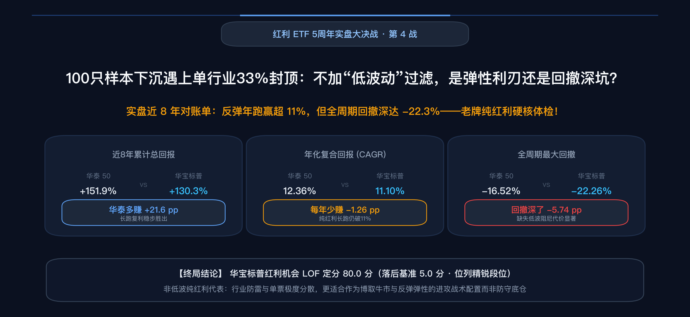
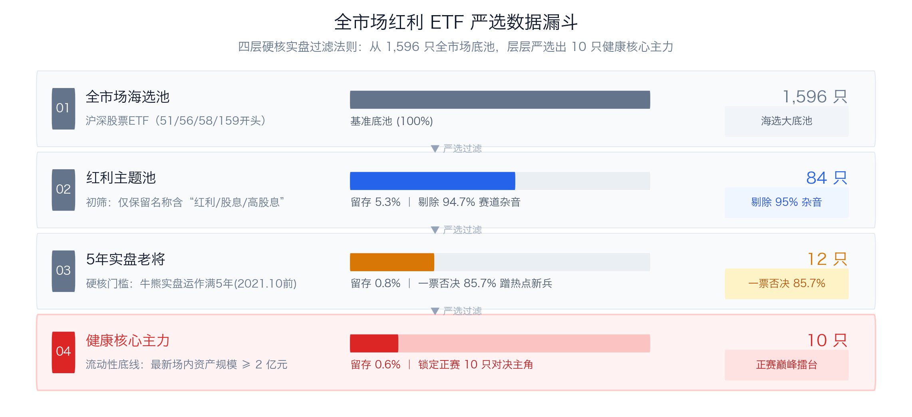
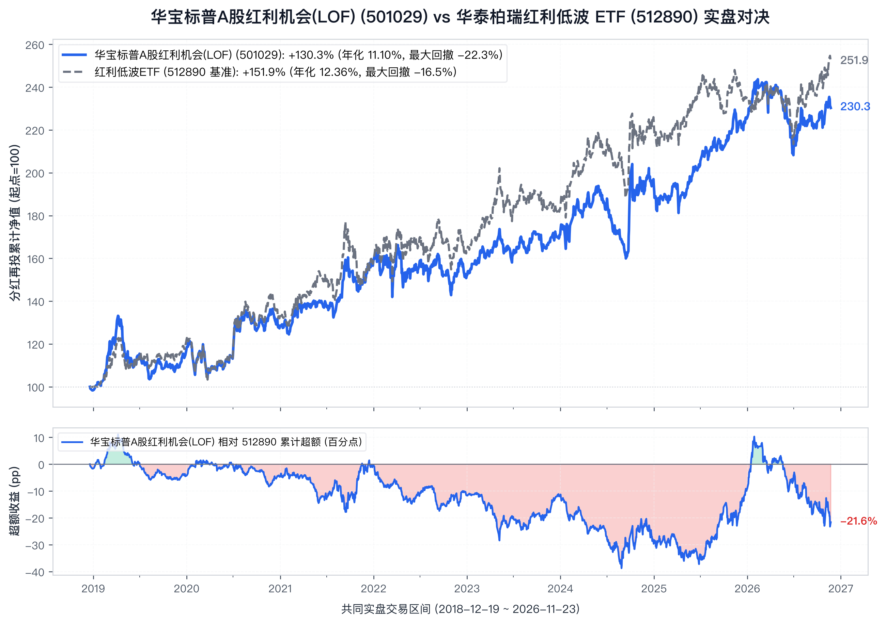
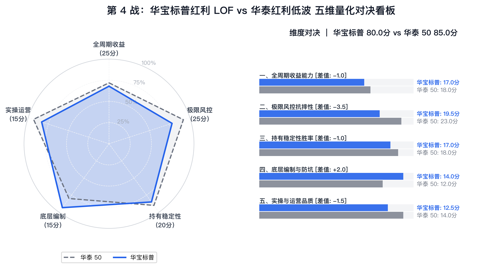

# 标题备选

* **反常识算账型**：《7 年赢了 4 年、反弹年大胜 11%，为什么长跑总账反而少赚 21 万？》
* **冲突与选择型**：《不加“低波动”过滤之后：老牌纯红利 8 年实盘的弹性与回撤代价》
* **行业天花板两难型**：《单押 53% 银行遇上 33% 铁律封顶：一场关于“过度抱团”与“防垄断”的 8 年战役复盘》
* **战役大复盘型**：《【第 4 战】华宝标普红利 LOF vs 华泰红利低波：没有低波过滤的外资高息老将，到底适合谁？》

---

# 【第4战】7 年赢了 4 年、反弹年大胜 11%，为什么长跑总账反而少赚 21 万？华宝标普红利 LOF vs 华泰红利低波 ETF 实盘对决



如果你在 2018 年 12 月底拿出 100 万元积蓄，打算全仓配置国内老牌红利基金。

一个朋友劝你买全市场规模最大、名气最响的擂主——**华泰柏瑞中证红利低波动 ETF（场内代码：512890，本篇简称：华泰 50）**；  
另一个朋友推荐你买外资标普编制、早在 2017 年就成立的纯红利老将——**华宝标普中国A股红利机会 LOF（场内代码：501029，本篇简称：华宝标普）**。

后面这个朋友给出的理由在直觉上很难反驳：
> *“红利资产本来就偏防守，你何必非要再加一层‘低波动’滤网？低波动把弹性都给磨没了。华宝这只是纯红利，不缩手缩脚，而且持仓分散到 100 只股票、单个行业最多只给 33%，行情好时肯定比华泰弹性大、跑得远。”*

时隔近 8 年，跨越整整 1,913 个交易日的牛熊震荡，截至 2026 年 11 月 23 日，两张分红再投资的真实对账单摆在面前：

买华泰 50 的账户，在分红滚存复利下变成了 **251.9 万元**（累计收益 **+151.92%**，年化复合回报 **12.36%**）；  
买华宝标普的账户，账面结余是 **230.3 万元**（累计收益 **+130.31%**，年化复合回报 **11.10%**）。

华泰多赚了 **21.6 万元（总回报领先 21.61 个百分点）**，而且全周期最深跌幅只有 **-16.52%**；而华宝标普不仅少赚了 21 万，最大回撤还深达 **-22.26%**（如果从 2017 年成立算起，2018 年去杠杆熊市里回撤更达到 **-29.37%**）。



打开交易软件，全市场挂着“红利/高股息”标签的场内产品足足有 84 只。但只要加上“实盘运作满 5 年以上（2021年10月前成立）”这道硬性分水岭，85.7%（72 只）的跟风新产品就会被一票否决，最终只剩 12 只穿越牛熊的老牌正规军。华宝标普红利 LOF 运作接近 10 年（实盘 9.85 年），场内 LOF 规模 14 亿加上同门 ETF 联接合计超 40 亿，是名副其实的外资红利代表。

更耐人寻味的是，如果把这近 8 年的历史按自然年份切开：**在 7 个完整年度考核中，华宝标普赢了整整 4 年（2020、2021、2023、2025）！** 特别是在 2025 年，华宝标普单年狂飙 +15.95%，把华泰 50（+4.74%）甩开了整整 **11.21 个百分点**，打出了专栏开赛以来的最大单年逆袭胜局！

这就带来了一个很反常识的结果：  
**既然 7 年里赢了 4 年，反弹年还能大胜超过 11 个点，为什么拉长到 8 年算总账，华宝反而少赚了 21 万元？**

把两只基金底层的选股规则和持仓账单摊开来看，原因其实很清楚。

---

## 一、 选股规则对比：不加低波动的纯红利，到底差在哪？

华泰 50 跟踪的是中证指数公司的**中证红利低波动指数（H30269）**，华宝标普跟踪的是外资标普旗下的**标普中国 A 股红利机会指数（CSPSADRP）**。

把两份官方编制规则拆开并排看，底层筛选逻辑截然不同：

```text
【华泰红利低波 ETF（512890）选股流程（以实盘历史规则为主*）】
中证全指池（全市场流动性前80%） → 连续三年分红且每股股息正增长（剔除高支付率排雷） → 选三年平均股息前75名 → 选其中过去一年波动率最低的50名 → 【三年平均股息率加权】（单票上限15%*，无行业上限，年调1次）
*注：历史实盘运作期单票上限为15%（公募基金实盘受双十原则限制持仓不超10%）。中证指数公司于2026年11月对H30269进行升级（2026年12月实施），将单票上限下调至10%并增设成交额流动性上限，同时取消了每股股息正增长门槛，调整为0<过去三年平均支付率<100%。

【华宝标普红利机会 LOF（501029）选股流程】
标普中国A股池（流通市值≥10亿，日均成交≥2000万，剔ST/*ST） → 【四重基本面排雷：过去12个月EPS>0 + 过去三年EPS持续增长 + 过去12个月股息支付率<100% + 过去两年连续分红】 → 选股息率最高的100只股票（老样本前150名缓冲） → 【股息率加权】（单票权重上限3%，单个GICS行业权重上限33%，半年调仓1次）
```

通俗拆解，两只基金最大的性格反差来自四个关键取舍：

### 1. 低波动过滤：要不要加一道波动平抑网？
华泰 50 的选拔核心是“两道漏斗”：先在全市场挑出股息率最高的 75 只，接着一刀切掉平时波动偏大的 25 只，只留股价最平稳的 50 只。低波因子的作用是降噪和平抑波动，把平时大起大落的股票直接拿掉。

华宝标普**完全没有低波动筛选环节**。它选股票只看两件事：利润过不过关、分红高不高。只要基本面排雷合格、股息率顶格，不管股价平时震得多凶，直接装进篮子。这让它没有任何减震层，遇到市场单边大跌时，必须硬扛股价的全额冲击。

### 2. 行业敞口：单押 53.6% 金融 vs 33% 铁律封顶
华泰 50 原规则里没有设置任何行业上限。早年它重仓过基建，中期重仓过煤炭，而在这轮红利周期里，当大盘银行极度折价时，指数顺势大举加仓，金融行业权重最高飙到了 **53.6%**，呈现出极强的大银行抱团属性。

华宝标普执行的是外资标普标志性的防垄断硬约束：**单个 GICS 行业权重绝对上限不得超过 33%**。不管银行或煤炭当时的股息率多诱人，入选权重被卡死在三分之一以内。持仓穿透后，其资金广泛散布在轻工制造、纺织服装、汽车零部件、机械设备、公用事业与传媒中，杜绝单一行业一损俱损。

### 3. 单票集中度：15% 顶格集中 vs 3% 极限分散
华泰 50 样本只有 50 只，在历史实盘运行中单票权重上限为 15%（公募基金实盘受法规“双十原则”约束单票不超 10%；中证官方在 2026 年底最新规则中也正式收紧为 10% 并叠加成交流动性约束），前十大重仓股常年占到总仓位的 30%~40%，单家核心大行的风吹草动对净值影响很大。

华宝标普样本扩充到 **100 只**，并且强制执行**“单票权重上限 3%”**的顶格约束。即便是组合中持仓权重居前的二线细分标的（如朗姿股份、钱江摩托），单票占比也普遍在 1%~2% 左右，最大权重股不到 1.7%。持仓极其平铺，有效抹平了单家上市公司的黑天鹅风险。

### 4. 盈利排雷口径：分红年年递增 vs 过去三年底层利润 (EPS) 复合增长
华泰 50 原规则侧重考核“分红本身”：要求**过去三年每股现金分红必须实现正增长**（在中证指数公司 2026 年 11 月的最新修订版中，这一条优化为“过去三年平均股利支付率大于 0 且小于 1”，删除了分红必须连年增长的硬指标，在支付率防雷口径上向标普看齐）；

华宝标普则一直更彻底地穿透到“企业底层真实利润”：不仅要求**过去 12 个月 EPS 必须为正，且最新报告期 EPS 必须大于三年前的 EPS（三年盈利复合正增长）**。同时设定了**“股息支付率必须 < 100%”**的硬指标，直接将那些主营亏损、靠变卖资产或掏空老本勉强分红的“伪高息公司”一票否决。

---

## 二、 关键战役大复盘：赢在中小盘扩散，输在特大盘狂飙

把两只基金拉到完全一致的起跑线（2018-12-19 至 2026-11-23），基于分红再投全收益净值展开全面体检：



| 考核维度 | 核心量化指标 | 华泰 50 (512890) | 华宝标普 (501029) | 胜负归属 | 关键差异与白话解读 |
| :--- | :--- | :--- :---: | :--- :---: | :---: | :--- |
| **长跑收益能力** | **分红再投累计总回报** | **+151.92%** | +130.31% | **华泰 50 胜** | 华泰长跑累计多赚 **+21.61 个百分点**，复利滚存优势随着时间逐步拉大 |
| **长跑收益能力** | **年化复合回报 (CAGR)** | **12.36%** | 11.10% | **华泰 50 胜** | 华泰年化领先 **+1.26 个百分点**；但华宝作为纯红利长跑仍保持 11% 以上年化 |
| **极限风控抗摔** | **全周期历史最大回撤** | **-16.52%** | -22.26% | **华泰 50 胜** | 华宝回撤深 **5.74 个百分点**（若从2017年成立算达-29.37%），缺失低波阻尼代价明显 |
| **极限风控抗摔** | **年化波动率** | 16.47% | **16.37%** | **华宝标普 胜** | 双方全周期综合年化波动基本打平（仅差 0.10pp） |
| **极限风控抗摔** | **年化下行标准差** | **11.27%** | 11.52% | **华泰 50 胜** | 华宝下行颠簸高 **0.25 个百分点**，市场砸盘时下坠速度明显更快 |
| **极限风控抗摔** | **卡玛比率 (收益/回撤)** | **0.75** | 0.50 | **华泰 50 胜** | 华泰每挨 1% 跌幅换得 0.75% 年化，华宝仅 0.50，风控性价比明显逊色 |
| **运营体量安全** | **最新场内资产规模 (截至2026年9月)** | **312.87 亿元** | 14.36 亿元 | **华泰 50 胜** | 华泰 300 亿巨无霸流动性充沛；华宝 LOF 14 亿+同门 ETF 26 亿合计超 40 亿 |

看完全周期数据，再看逐年拆解的战绩切片，胜负节奏一目了然：

| 自然年份 | 华泰 50 | 华宝标普 | 实盘胜负手与归因剖析 |
| :---: | :---: | :---: | :--- |
| **2019 年** | **+21.57%** | +19.21% | **华泰胜 (+2.36pp)**：春季躁动后二季度中小盘剧烈回调，华泰靠低波防守守住优势。 |
| **2020 年** | +9.46% | **+9.48%** | **华宝胜 (+0.02pp)**：核心资产抱团牛市逆风期，双方几乎打平。 |
| **2021 年** | +19.56% | **+23.73%** | **华宝胜 (+4.16pp) · 华宝弹性年**：<br/>周期与资源品大爆发，华宝 100 只样本下沉进攻弹性全面释放。 |
| **2022 年** | **+2.72%** | -4.42% | **华泰胜 (+7.14pp) · 华泰防守年**：<br/>单边大熊市泥沙俱下，华泰凭借低波与大金融护盘收红，华宝出现回撤。 |
| **2023 年** | +11.91% | **+12.69%** | **华宝胜 (+0.79pp)**：红利主升浪开启，华宝多行业均衡分布微幅胜出。 |
| **2024 年** | **+22.64%** | +13.78% | **华泰胜 (+8.86pp) · 华泰决胜年**：<br/>特大盘银行股狂飙，华泰金融仓位突破 50% 爆发，华宝受 33% 行业限制落后。 |
| **2025 年** | +4.74% | **+15.95%** | **华宝胜 (+11.21pp) · 华宝反弹年**：<br/>震荡分化期市场风格转向中小盘弹性，华宝轻工制造与汽车链全面爆发。 |
| **2026 年\*** | **+7.25%** | +2.06% | **华泰胜 (+5.18pp)**：高股息大蓝筹重拾避险属性，华泰大盘优势再显。 |

> 📌 *注：2018 年 12 月 19 日至年底双方微跌（501029 为 -1.66%，512890 为 -0.02%）；2026 年统计截至 11 月 23 日。全专栏统一采用标准自然年度分红再投净值收益率口径。*

这两张表格完整解开了前文的谜底：**为什么赢了 4 年，总账却输了 21 万？**

核心在于两点：

### 1. 行业敞口是把双刃剑：单押有单押的爆发，分散有分散的代价
2024 年是极端的大盘银行行情，国有大行和股份行估值全线修复。华泰 50 没有任何行业限制，金融仓位顺势顶到了 53.6%，吃满了大银行行情的全部收益，单年拿下 +22.64%；而华宝标普受制于“单个行业最高 33%”的硬约束，银行仓位顶格只能拿三分之一，剩下的仓位分散在轻工、机械、纺织里，单年被华泰拉开了整整 **8.86 个百分点**。

但到了 2025 年，市场风格发生切换。大盘银行在高位盘整，增量资金开始寻找中小市值的优质制造、轻工家电和汽车零部件。这时候，华泰 50 身上过半的银行仓位涨不动了，全年仅上涨 +4.74%；而华宝标普 100 只样本向中小市值渗透的优势释放出来，单年上涨 +15.95%，单年领先华泰 **11.21 个百分点**。

### 2. 缺少低波保护的代价：跌得太深，把反弹赚的超额全搭进去了
2025 年赢了 11 个百分点固然亮眼，但投资长跑拼的是复利累积。
在 2019 年二季度市场大幅回调时，华宝标普一路跌了 **-22.26%**（同期华泰只跌了 -11.77%）；在 2022 年单边阴跌的熊市里，华泰 50 依靠低波和银行护盘逆势收红（+2.72%），而华宝标普录得 **-4.42%** 的亏损。

算一笔很朴素的账：**净值跌掉 22%，需要随后上涨 28% 才能回本。** 华宝标普在行情好时多赚的那些收益，很大一部分被用来填平前期更深的回撤亏损，复利滚存自然就慢了下来。反映在衡量风控性价比的卡玛比率上，华泰 50 达到 **0.75**，而华宝标普只有 **0.50**。

---

## 三、 五维战力打分与稳健性审计：80.0 分的“偏好属性”

基于全专栏统一量化模型，以华泰 50（85.0 分）为基准，华宝标普红利机会 LOF 逐项体检打分如下：



| 评价维度 | 满分 | 华泰 50得分 | 华宝标普得分 | 华宝战力进度条 | 胜负手原因（量化体检结论） |
| :--- | :---: | :---: | :---: | :---: | :--- |
| **一、全周期收益能力** | 25分 | **18.0** | **17.0** `(-1.0)` | `███████░░░` 68% | 实盘近 8 年年化 11.10%（落后基准 1.26pp），反弹年进攻性强但长跑总回报稍逊（扣 1.0 分） |
| **二、极限风控抗摔性** | 25分 | **23.0** | **19.5** `(-3.5)` | `███████▊░░` 78% | **全周期回撤达 -22.26%（成立来 -29.37%）**，缺失低波动缓冲，下行差更高（大幅扣 3.5 分） |
| **三、持有稳定性胜率** | 20分 | **18.0** | **17.0** `(-1.0)` | `████████▌░` 85% | 7 年考核 4 胜 3 负，但 2022 熊市亏损 -4.42%，整体持有颠簸度偏大（扣 1.0 分） |
| **四、底层编制与防坑** | 15分 | **12.0** | **14.0** `(+2.0)` | `█████████▎` 93% | **单行业33%封顶+单票3%分散+过去三年EPS增长排雷+支付率<100%**，规则设计极严密（大幅加分） |
| **五、实操与运营品质** | 15分 | **14.0** | **12.5** `(-1.5)` | `████████▎░` 83% | 场内 LOF 规模 14.36 亿（同门 ETF 26 亿），场内买卖流动性不及 300 亿华泰，偶有微幅折溢价（扣 1.5 分） |
| **🏆 综合总分** | **100分** | **85.0** | **80.0 (负)** | `████████░░` **80.0%** | **【精锐段位 · 落后基准 5.0 分，暂列天梯榜第 4 名】** |

华宝标普最终拿下 **80.0 分**，位居精锐段位。它微弱领先此前登台的嘉实 300 红利低波（79.5 分）整整 **0.5 分**。

---

### 🏆 【5年实盘】红利 ETF 争霸天梯榜（第 4 战更新）

> 本榜单仅收录在大陆上市、实盘满 5 年以上的红利 ETF（及特邀老牌场内 LOF）。  
> 以华泰红利低波 ETF 为基准锚（设定基准分 85.0 分），动态排定座次。

| 排名 | 场内代码 | 参赛标的简称 | 所属门派 / 跟踪指数 | 综合评分 | 相对基准 | 核心战力标签 | 文章状态 |
| :---: | :---: | :---: | :---: | :---: | :---: | :--- | :---: |
| **1** | **515450** | **南方红利低波50ETF** | 标普低波50 | **87.0** | **+2.0** | 外资行业约束+低波倒数加权，罕见兼顾浅回撤与高收益 | [第 3 战](03_第3战_南方红利低波50ETF_vs_512890.md) |
| **2** | **512890** | **华泰红利低波ETF** | 中证红利低波动 | **85.0** | **基准锚** | 全市场最稳的锚，大盘龙头复利稳健 | [基准篇](00_基准篇_华泰柏瑞红利低波ETF.md) |
| **3** | **515100** | **景顺红利低波100ETF** | 红利低波100 | **84.5** | **-0.5** | 全市场回撤最浅，跌得更轻但牛市略钝 | [第 1 战](01_第1战_景顺长城红利低波100ETF_vs_512890.md) |
| **4** | **501029** | **华宝标普红利机会LOF** `[NEW]` | 标普红利机会 | **80.0** | **-5.0** | **外资盈利排雷+单行业33%封顶，无低波约束进攻弹性强但回撤偏深** | **本篇挑战者** |
| **5** | **515300** | **嘉实300红利低波ETF** | 300红利低波 | **79.5** | **-5.5** | 沪深300大蓝筹防守，回撤虽浅但长跑严重滞涨 | [第 2 战](02_第2战_嘉实300红利低波ETF_vs_512890.md) |

---

## 四、 最终建议：这两只风格鲜明的基金，到底该怎么选？

四场大决战打完，不同红利选手的画像已经非常清晰了：

1. **如果你追求“牛市反弹时的进攻弹性，反感特大盘银行过度抱团”**：
   **华宝标普红利机会（501029 / 标普红利 ETF 562060）是全市场少有的进攻属性鲜明的纯红利品种。**  
   近 10 年实盘证明：只要行情转向中小盘风格与制造业复苏（如 2021 年与 2025 年），它就能打下单年领先华泰超 11 个百分点的超强爆发力。33% 行业上限和 3% 单票分散，确保它绝不会死押在单一板块上。场内交易者可直接配置 ETF 版本（562060），场外投资者可选 501029。

2. **华泰红利低波 ETF（512890）依然是全天候底仓压舱石的更优解**：
   对于普通投资者而言，买红利的核心诉求是“夜夜安枕”。  
   华泰 50 全周期最大回撤仅 -16.52%，年化复利高达 12.36%，卡玛比率达到 0.75。为了博取部分年份的弹性，必须多承受近 6 个百分点的下坠颠簸，作为日常长期不动的压舱底仓，华泰 50 依然更加稳健靠谱。

3. **专栏四战横向大盘点**：
   * 追求极致浅回撤、跌得最轻最安心：选**景顺红利低波 100（515100）**（回撤 -13.94% 全场最低）；
   * 追求攻守兼备天花板、兼顾更浅回撤与更高复利：选**南方红利低波 50（515450）**（天梯榜榜首，年化 11.33% 且回撤仅 -14.25%）；
   * 追求大市值大金融护盘、穿越单边大熊市：留守**华泰红利低波（512890）**（基准锚，年化 12.36%）；
   * 追求反弹进攻弹性、防单一板块过度扎堆：战术配置**华宝标普红利机会（501029 / 562060）**；
   * 沪深 300 窄池的**嘉实 300红利低波（515300）**两头不靠，无需作为底仓。

**一句话选基法则**：  
求睡觉安稳、全天候防守底仓坚定选低波族（南方 50 / 华泰 50 / 景顺 100）；嫌弃蓝筹滞涨、求反弹爆发与多行业扩散配华宝标普！

---

*下一篇预告：【第 5 战】华夏中证红利质量 ETF（场内代码：159758）登台！这是一场“Quality vs Low-Vol”的终极哲学碰撞。高 ROE 质量因子与低波动因子到底谁才是红利策略的终极伴侣？敬请期待！*

---

如果您觉得这篇文章有启发，欢迎点赞、转发、关注！

风险提示：本文基于公开客观数据与独立研究，仅供交流参考，不构成任何投资建议。市场有风险，投资需谨慎。
