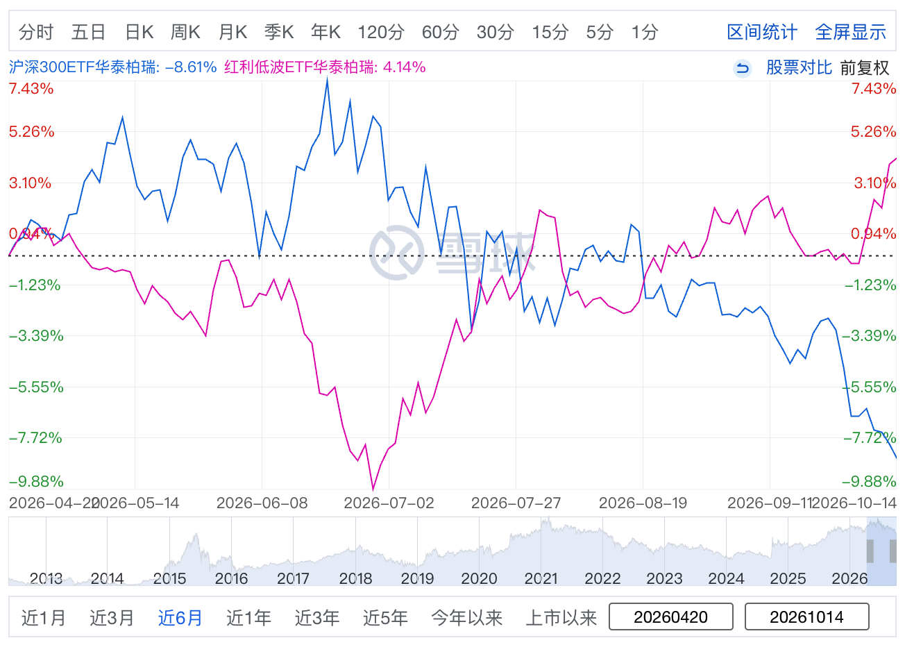

# 大盘持续阴跌，红利低波却创了新高：到底是谁在买？

在大盘持续阴跌的背景下，华泰柏瑞红利低波ETF（512890）却走出了一条完全独立的单边上升通道：单日成交额连续冲上 **10 亿元** 天量，最新资产净值直接突破了 **322.7 亿元**（最新基金总份额超 **261.78 亿份**），价格稳步攀升至 1.23 元上方创出新高。



上面这张走势对比图非常直观：在同一阶段里，代表大盘风向标的**华泰柏瑞沪深300ETF（510300）下跌 -8.61%**，而**华泰柏瑞红利低波ETF（512890）却逆势大涨 +4.14%**，两者近半年呈现极强的负相关走势，拉出近 **13 个百分点** 的剧烈“剪刀差”。

很多投资者的第一反应：**“是不是国家队（中央汇金）在暗中护盘买红利低波？”**

**其实中央汇金一股都没买红利低波。**

国家队那几千亿救市资金，清一色去买了沪深300和上证50等核心宽基。**真正把红利低波从2023年初的2.58亿元一路买到322亿、把PE推到近十年80%高分位的**，是另外一股庞大力量——**保险公司的“保单浮存金”、银行理财子，以及通过场外联接基金密集涌进来的散户。**

这背后到底是怎样的资金博弈？为什么险资要疯狂买入？他们算不算国家队？眼下这个位置还能不能碰？我们把账本彻底翻开来看。

---

## 一、国家队资金：钱去了哪？买了红利低波吗？

很多人琢磨国家队的动向喜欢盯盘口分时图猜谜，其实完全不用猜。公募基金每年8月底的中报和次年3月底的年报，早把大机构的底牌掀得一清二楚。

重点看两处：一是看“前十名持有人”，二是看第12章《单一投资者持有基金份额比例达到或超过20%的情况》。后者的表格里，期初多少、买了多少、期末多少，全是白纸黑字的法定数据。

把这几张底牌翻开，大家最关心的核心问题答案其实一目了然：

**第一，国家队的真金白银到底砸向了哪？**  
2024年以来，中央汇金（包括母公司“汇金投资”和全资子公司“汇金资管”）稳市场的思路极度纯粹，只打“托底”一张牌，钱清一色去了**全市场的大盘核心宽基**：

* 绝对的主战场是四大沪深300ETF，占了汇金ETF总持仓的六到七成。仅华泰柏瑞300（510300）这一只，汇金上半年母公司买、下半年资管子公司接力买，合计买到了超 **622 亿份**，单只持仓市值一度冲破 **2450 亿元**；再加上易方达、华夏、嘉实另外三只300，以及持仓超405亿份的上证50ETF，光这些超大盘蓝筹就沉淀了数千亿资金。
* 年初微盘股流动性告急时，汇金又公告扩围入场，大举建仓中证500、中证1000和创业板ETF，扑灭中小盘的流动性踩踏。
* 从体量上看，仅2024年上半年，汇金净增持这些核心宽基就花了超 **4200 亿元**；到了年末，汇金持有的宽基ETF总市值直接飙过了 **8300 亿元**。

**第二，这几千亿里面，到底有没有买红利低波？**  
查遍华泰柏瑞红利低波ETF（512890）从2023年到2024年的历期前十大持有人名册：**中央汇金投资、汇金资管、证金公司，一个影子都没有。**  
这个逻辑其实很朴素：国家队的钱是救火资金，救火必须用高压水枪全盘喷洒大盘（全市场宽基Beta），不可能拿着有限的救命钱，跑到红利低波这种策略基金的细分赛道（Smart Beta）里去搞局部进攻。

---

## 二、幕后真买家：资本接力的三大阶段

既然不是国家队买的，到底是谁把华泰柏瑞红利低波ETF（512890）从几亿元一路买成了如今的 322 亿元？

翻开该基金近几年的历期中报与年报，我们可以清晰地看到一场长达三年的**“资本接力大戏”**——从险资在熊市底部低调点火，到机构集中度冲上顶峰，再到散户百亿大接棒：

### 阶段一（2023～2024年中）：险资低位点火，熊市扫货造势
* **规模跃升**：基金份额从 27.65 亿份（约 25.3 亿元）一路狂飙至 **87.72 亿份（净资产 92.6 亿元）**，短短半年暴增为原来的 3 倍。
* **持仓演变**：
  * 2023年末，平安人寿自有资金以 3.07 亿份（占比 11.09%）低调建仓，外资与信托若隐若现；
  * 到了 2024 年中报，全市场阴跌不止，险资开启了大规模建仓模式：大家人寿（万能+传统+分红产品）合计买入近 9.8 亿份，平安人寿增持至 6.75 亿份，泰康、太平紧随其后。**前十大持有人中险资独占 7 席，合计占前十大份额的 87.09%**。
* **资金结构**：此时中证红利低波的市盈率仅 5~6 倍（处于历史 20%~30% 底部），股息率高达 6.0% 左右。这些险资背后 85%~90% 全是老百姓交的**“保单浮存金”**。在全市场悲观时，险资在地点为扫货，砸出了弱市里最亮眼的单边上涨通道。

### 阶段二（2024年末）：机构狂欢顶峰，单户突击 20 亿
* **规模跃升**：基金份额进一步膨胀至 **122.62 亿份（净资产达 137.5 亿元）**。
* **持仓演变**：
  * 这一时期出现了该基金历史上最激进的单一持有人——**中国平安财产保险－传统普通保险产品**在年底单月突击扫货，期末单户持仓高达 **20.93 亿份（单户占比高达 17.07%）**，成为历史上最大的单一机构股东；
  * 加上大家人寿、泰康、交银康联等老面孔，**前十大持有人中险资占了整整 8 席，在场内前十大份额中的占比达到惊人的 95.07%**。
* **阶段特征**：机构控盘集中度在此时达到了历史最高峰。在年底利差考核与新会计准则切换的双重刺激下，商业机构的抢筹冲刺将红利低波推向了第一波高潮。

### 阶段三（2025至今）：筹码质变，散户百亿接棒与险资高位离场
* **规模跃升**：在 2025 年报披露中，基金总份额翻倍跨过 **227.80 亿份**，并在随后的行情中一路冲上最新实盘的 **261.78 亿份（资产净值突破 322.7 亿元）**，单日成交突破 10 亿元天量。
* **筹码大逆转**：
  1. **超级第一大买家登场**：据 2025 年报披露，**华泰柏瑞红利低波联接基金（007466）**单独持有 **100.62 亿份，独占全基金总份额的 44.17%**！穿透到底层，其实都是在支付宝、天天基金、招行等渠道看着连涨榜单涌进来的场外个人基民；
  2. **敏锐险资高位兑现**：此前在 2024 年末单月突击买入 20.9 亿份的平安产险，在 2025 年年报中已然大举赎回离场、退出前十大，完成了漂亮的波段止盈；
* **阶段特征**：若以 2025 年报口径计算，加上场内个人散户持有的 24.29%，**零售散户属性的资金实际已经控制了该基金近 68.5% 的总盘子**。昔日由险资等机构主导的低位避险品种，如今逐步演变成为场内外散户广泛持有的“类固收”资产。

---

## 三、保险公司算是“国家队”吗？

很多读者会问：既然很多大险企都是国资背景，那险资进场算不算国家队出手？

**严格来说，不算。把险资当成国家队是一个常见的投资认知误区。**

险资与国家队有三大本质差异：

1. **资金所有权不同**：重仓 512890 的平安产险、泰康人寿等，属于混合所有制或民营上市公司，根本不属于国家资本；
2. **受托责任与风险底线不同**：国家队用的是战略维稳资金，可以不计短期盈亏、彻底锁仓；但险资背负着刚性的保单兑付责任（存量负债成本在2.5%~3.5%）。险企受到《保险法》和“偿二代”极其严苛的偿付能力监管，**如果盲目护盘导致亏损，保险公司要自己掏净资产填坑，甚至面临被接管风险**；
3. **动机是“商业自保”，而非“救市”**：险资买红利低波，是出于纯粹的商业利差考量，核心由两大现实困境倒逼：**利差损倒挂**。国内10年期国债收益率跌破2.0%，而存量保单成本高达3.0%~3.5%，买债券面临买得越多亏越多的“利差损”。红利低波提供4.5%~5.5%的股息，刚好能覆盖保单成本，是市场上少有的“类永续浮息年金”；

因此，官方更准确地将险资定义为**“长期机构投资者”**或**“耐心资本”**，它并不是听从行政指令兜底的平准基金。

---

## 四、编制规则：中证红利低波如何契合险资？

险资为什么偏偏选中了中证红利低波动（H30269）？这得归功于它极为苛刻的选样机制。

中证红利低波并不是简单按股息率从高到低买，它有一套严格的**两道财务排雷 + 两段式筛选 + 股息率加权**漏斗：

```text
[中证红利低波 H30269 编制漏斗]
1. 样本空间：中证全指，过去3年连续分红，日均市值与成交额排名前80%
   ↓
2. 财务排雷：剔除过去1年红利支付率前5%或为负的公司；剔除过去3年每股分红非正增长的公司
   ↓
3. 股息初选：按过去3年平均税后股息率排名，挑选前 75 只作为备选池
   ↓
4. 低波过滤：在75只备选池中，按过去1年波动率由低到高排列，挑出最低的 50 只作为最终成分股
   ↓
5. 权重配置：采用【股息率加权】（单股上限15%，每年12月调整，设置20%换手缓冲区）
```

这套规则在熊市里展现出了极强的生命力：
* **“剔除支付率前5%与负增长”**，直接扫除了借债分红、周期顶点一次性暴利分红的“伪高息陷阱”；
* **“低波过滤”**在75只里砍掉25只振幅剧烈的高Beta周期股，留下了特许经营的公用事业与银行大蓝筹；
* **“股息率加权”**让股息率最高的股票拥有更大权重，直接放大了组合整体的现金流产出。

高分红、低回撤、分红直通投资收益，加上ETF持续净申购逼迫基金经理被动按权重扫货成分股，这才造就了逆势上涨的“抱团正反馈”。

---

## 五、思考：现在还能无脑上车红利低波吗？

理解了以上逻辑，对普通投资者最大的启示是什么？

**必须警惕这只“避险神器”背后的拥挤度与高估值风险。**

打开最新的指数估值监控数据，中证红利低波的指标已经亮起黄灯：
* **PE（TTM）已升至 8.59**，处于近十年 **79.84%** 的历史高位；
* **PB 处于 64.44%** 分位；
* 原本超过 5.5%~6.0% 的股息率，**已经被各路买盘买薄压缩至 4.37%**。

这意味着，红利低波已经从过去的“低估值修复”，变成了“避险溢价抱团”。

更关键的是资金属性的区别：
* **国家队买沪深300，能做到锁仓几年不卖，有刚性托底的政策预期**；
* **险资买红利低波，是商业机构在资产荒下的妥协选择，它们没有无限托底的义务。**

一旦未来宏观预期发生转变、市场企稳反弹、成长与科技板块重新展现赚钱效应，或者红利低波的股息率被进一步买薄到失去利差吸引力时，追求绝对收益的险资和理财资金是会为了锁定利润而减仓换仓的。

---

### 小启示：买在险资布局时，慎在散户狂热处

穿透了三年来的筹码迁徙历程：**最好的买入时机，永远是跟着险资等敏锐机构逆向布局，而不是在散户狂潮中跟风接盘。**

1. **为什么说“跟着险资买”是高胜率的买点？**  
   2023年末到2024年上半年，全市场一片恐慌，红利策略被大多数成长风格投资者视作缺乏弹性的“防御型冷板凳”。险资在此刻大举建仓，依据的是极其精密的利差精算模型：**市盈率仅 5~6 倍（处于历史底部），股息率高达 6.0% 远超国债**。  
   此时进场，投资者拿到了极其深厚的“双重安全垫”：既有 6% 的确定性现金流打底，又有极大的估值修复空间，稳稳享受到后来的“戴维斯双击”。

2. **为什么说“跟着散户买”是危险的接棒？**  
   到了 2025 年末乃至当下，红利低波连续创历史新高，各大理财 APP 首页全在推“月月分红、稳健避险”，场外联接基金一家就暴增上百亿。  
   散户买的不是底层资产的性价比，而是**“过去走势曲线带来的安全感”**。此时市盈率已被推高至近十年 80% 的高分位，股息率被摊薄至 4.37%。在这个位置跟风进场，向上估值弹性极小，向下却要承担极大的杀估值风险——**极容易陷入“拿着 4% 出头的股息，去硬抗 10%~15% 本金回撤”的尴尬境地**。

3. **警惕财报时滞，切忌“刻舟求剑”**  
   公募基金中报和年报有 2~3 个月的法定披露滞后。如果投资者在年报里看到“某某大险资买了20亿”，不看估值就盲目冲进去，极可能会正好撞上机构获利兑现、散户人传人接棒的尴尬时点。  
   **别呆板的“抄作业”，而是抄险资在低估值、高股息时的逆向决断思维，不是在估值透支时盲从跟进。**

**红利低波是震荡市里优秀的防守底仓、肯定是中国的优质资产，但好资产、好公司，也要有好价格。在近十年80%的估值分位上，它绝不是不会回撤的“永动机”。看清谁在买、因何而买、何时买，才不会在风格切换到来时成为抱团瓦解的买单者。**

---

如果您觉得这篇文章有启发，欢迎点赞、转发、关注！

风险提示： 本文仅供参考，不构成投资建议。市场有风险，入市需谨慎。
