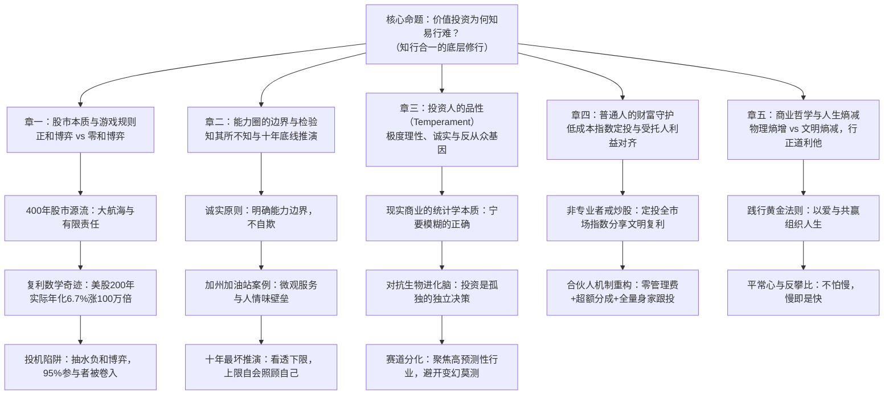

# 李录：价值投资的知行合一与实践（北大光华2019演讲深度研报）

> **视频来源**：YouTube - SHADOW RADIO（时长 142 分钟 / 8537 秒，视频链接：[UOvjzQBGt4s](https://www.youtube.com/watch?v=UOvjzQBGt4s)）  
> **演讲主题**：价值投资的知行合一与实践（北京大学光华管理学院《价值投资》课程专场讲座）  
> **主讲嘉宾**：李录（喜马拉雅资本创始人、查理·芒格家族资产掌门人）  
> **现场主持与嘉宾**：姜国华教授、常劲老师、现场北大师生及投资界校友  
> **演讲实录备查**：[李录_2019_北大光华_价值投资的知行合一与实践_演讲实录.md](./李录_2019_北大光华_价值投资的知行合一与实践_演讲实录.md)（前87分钟完整主旨演讲全量逐字实录稿）  
> **问答实录备查**：[李录_2019_北大光华_价值投资的知行合一与实践_对话实录.md](./李录_2019_北大光华_价值投资的知行合一与实践_对话实录.md)（后55分钟现场8大核心互动问答与交锋实录）  
> **母体清单导航**：[知名投资人核心音视频与文字研读清单.md](../知名投资人核心音视频与文字研读清单.md)

---

## 核心商业认知导图与全景框架

---

## 一、破除零和博弈迷思：400年股市本质与正和复利铁律

### 1. 价值投资的四大基石与“知易行难”之谜
李录在开场回顾了本杰明·格雷厄姆确立的价值投资四大基石概念：
1. **股票是对企业实质所有权的一部分**（买股票就是买公司一部分所有权）；
2. **市场先生（Mr. Market）**：市场的存在是为你服务、提供买卖报价的，而不是来指导你的决策；
3. **安全边际（Margin of Safety）**：未来本质上是不可预测的，投资是概率与赔率的艺术，必须以远低于内在价值的价格买入以吸收意外风险；
4. **能力圈（Circle of Competence）**：通过长期专注学习建立属于自己的认知边界，严守在边界之内做决策。

这四条原理逻辑清晰、通俗易懂，甚至妇孺皆知（尤其是巴菲特近60年的长青纪录已成为全球现象）。然而在现实资本市场中，**真正的价值投资者占比不足全市场参与者的 5%**。绝大多数人在学校或书本上看似“听懂了”，一旦进入市场实战，就会被各种喧嚣、短期波动和同侪压力吸引到投机的歧途上去。

### 2. 400年现代股市源流与“复利”这个可怕的数学概念
人类现代股票市场诞生于约400年前（以荷兰东印度公司成立为标志）。在此之前数千年农业文明中，由于缺乏持续累进的商业增量，不存在资本市场持续繁荣的基础。
* **现代化的本质**：自由市场机制与现代科学技术的结合，开启了人类历史上前所未有的、可持续累进的经济内生复利增长。
* **200年资产类别复利实证（西格尔教授数据）**：
  * 在扣除通货膨胀后，过去200年美国股票的**实际年化复合收益率约为 6.7%**；
  * 如果以 6.7% 的速度复利增长 200 年，最终资产将**膨胀 100 万倍**！
  * 同期黄金、国债、现金扣除通胀后的实际回报微乎其微甚至缩水。
* **中国改革开放的 40 年实证**：中国改革开放以平均每年约 9% 的实际增速增长，短短 40 年间财富创造与社会面貌翻天覆地。

### 3. 正和博弈（投资）vs 负和博弈（投机）
* **价值投资是“正和博弈”**：股票的长期价值锚定于企业创造的自由现金流与经济蛋糕的做大。投资人作为企业成长的合伙人，收益来源于企业实际创造的财富增量。
* **投机是“负和博弈”**：在不创造企业实质财富的前提下，仅凭对价格短期波动的预测进行筹码博弈，本质如同打麻将、进赌场。由于交易中存在券商佣金、印花税、融资利息等持续“抽水机制”，投机群体从整体数学期望上看必然走向亏损。
* **为什么绝大多数人陷入投机？**
  * 人性天然渴望即时反馈（投机每天甚至每小时都有输赢反馈）；
  * 市场先生的情绪波动极具传染性；进入职场后，周围的交易对手看似资历深厚、资金庞大，让人误以为跟随市场短期共识才是理性的。

---

## 二、能力圈的边界与检验：从加州加油站递水到十年最坏底线推演

### 1. 能力圈的核心在于“边界的诚实”
能力圈最关键的不是圆圈的大小，而是**你是否真正清楚圆圈的边界在哪里**。
* **不骗自己最难**：知识上的诚实（Intellectual Honesty）是极其稀缺的品质。大部分人很容易陷入“懂了一点就以为全懂”的虚妄之中。
* **查理·芒格的反驳测试**：“如果我想要拥有一种观点，我必须能够比全世界最聪明的反对者更好地反驳自己的观点；只有达到这个标准，我才有资格拥有这个观点。”

### 2. 商业微观洞察：加州加油站的“递水护城河”
为了说明如何从底层微观视角看懂商业，李录分享了一个经典的加州加油站实战案例：
* **表象矛盾**：在加州同一条商业街上，分布着几家品牌、地段高度相似的加油站。但其中一家生意冷清、濒临亏损，而另一家却车水马龙、利润极其丰厚。
* **深入微观调研真相**：李录实地走访发现，生意火爆的加油站由一个印度移民家庭全家扎根经营：
  * 只要有顾客车辆开进站，全家人无论在做什么，必定立刻有人热情迎上前去；
  * **主动双手递上一瓶冰水或热茶**，无论顾客最终买不买额外商品，都先送上水并真诚寒暄；
  * 加油站便利店井井有条，家庭经营省去了雇员懈怠与高昂管理成本，形成了无可替代的熟客黏性与口碑壁垒。
* **商业启示**：商业竞争的优势往往藏在看似不起眼的微观运营细节中。没有实地穿透到企业毛细血管的研究，只能停留在财务数字的空中楼阁。

### 3. 喜马拉雅资本的硬核能力圈检验标准：“十年最坏底线”
* **能否看清公司未来十年最坏是什么样？**
  * 对于真正优秀的公司，最好的情况通常会“自行照顾好自己（Take care of itself）”；
  * 但投资人必须在极高确定性下看透：**十年之后这家企业遭遇极端逆境时，最差、最惨会演变成什么样？**
  * 如果连十年后的最坏下限都推导不出来，就不能声称自己懂这家公司。

---

## 三、投资人的性情修养（Temperament）：极度理性、诚实与反从众基因

### 1. 为什么智力超群的人反而做不好投资？
投资是一门反人性的学问。巴菲特和芒格反复强调，投资中最重要的不是智商（IQ），而是**性情与品性（Temperament）**。
* 许多学术背景极其亮眼、数学与分析能力极强的人在投资中惨败，原因在于**缺乏抵御情绪波动的性情**；
* 投资人面对的是生物进化遗留给人类的天然心理倾向（芒格《人类误判心理学》中系统归纳的25种心理倾向，如过度自信、确认偏误、社会认同从众、剥夺超级反应等）。

### 2. 现实商业是“统计学概率”，而非“牛顿力学公式”
* **微积分不重要，统计学至关重要**：物理学追求精确的公式推导，但商业社会本质是人与人互动的复杂自适应系统，服从统计学概率分布。
* **“宁要模糊的正确，不要精确的错误”**：投资决策永远面对不确定性，追求的是大概率正确与非对称风险收益比。必须用严密的科学态度做调研，但心态上要坦然接受模糊与概率。

### 3. 投资是孤独的个人决策：警惕群体动力学（Group Dynamics）
* **拒绝投资委员会决策**：真正的深度投资判断必须由个人独立完成。一旦引入委员会多人讨论，就会不可避免地滋生政治妥协、相互兜售、群体极化与面子心理，客观理性将荡然无存。
* **远离赛道炒作，专注高可预测性（Predictability）赛道**：
  * 例如餐馆行业：每隔几年北京最火的餐馆就换一茬，极难预测哪家能在十年后依然领先，在其中耗费精力得不偿失；
  * 必须将认知资源集中在**具备天然长期稳定性、高进入壁垒、资本回报率（ROIC/ROE）远超同行**的优秀企业上。

---

## 四、普通人的财富守护与机构激励机制的重构

### 1. 给普通非专业投资者的财富建议
* **远离个股炒作与高频交易**：普通人没有时间、资源与心理训练去建立商业能力圈，盲目进入二级市场炒个股几乎注定沦为被抽水的负和博弈牺牲品。
* **定投低费率全市场指数基金**：通过被动投资长期持有代表整个经济体系的指数基金，普通人就能以近乎为零的管理成本，完整捕捉人类文明 6%~7% 的长期内生复合增长。

### 2. 资产管理行业的委托代理冲突与喜马拉雅合伙人机制
如果资金量大需要委托外部专业投资人，普通人应如何甄别？
* **警惕传统对冲基金“2/20 法则”的道德风险**：无论业绩好坏旱涝保收收取 2% 固定管理费，激励基金经理不断扩大资产规模而非追求超额回报。
* **喜马拉雅资本传承的“巴菲特合伙人结构”**：
  1. **零固定管理费**：不向出资人收取任何固定管理费；
  2. **门槛收益机制（Hurdle Rate）**：年化复合收益率前 6% 全部归投资人所有，基金分文不取；
  3. **超额收益提成**：仅对年化超过 6% 以上的净利润部分计提 25% 业绩报酬；
  4. **全量身家跟投**：基金管理人自身及其家族的绝大部分财富全额投入同一基金中。
* **效果**：唯有在机制上使管理人与投资人的经济利益完全锁死，才能杜绝委托代理摩擦，形成心安理得、不急躁的长期复利飞轮。

---

## 五、终极商业哲学：人生的“熵减”旅程与黄金法则

### 1. 物理世界的熵增 vs 文明精神的熵减
* **物理世界的大势是“熵增”**：能量从高向低耗散，宇宙不可逆地走向无序与死寂。
* **人类文明的奇迹是“熵减”**：人类通过理性思维、知识积累、道德修炼和制度创新，将无序的混乱自组织为高度有序的现代文明。
* **做价值投资是一场正道上的熵减修炼**：
  * 通过深度的学习与实践，投资人自身在认知和德行上实现熵减；
  * 通过将宝贵的社会资本配置给最具生产力、最创造社会价值的伟大企业，推动整个经济要素的高效循环。

### 2. 践行黄金法则：以爱与双赢组织人生
* **巴菲特对人生的终极定义**：“什么是成功？成功就是那些你希望爱深你的人，真的爱你。”
* **黄金法则（Golden Rule）**：以你希望别人对待你的方式对待别人。在商业与投资中坚持多赢与互利，不做任何损人利己的短视博弈。
* **慢即是快，平常心面对复利**：
  * 芒格名言：“想得到优秀的伴侣，第一步是让自己配得上优秀的伴侣；因为优秀的伴侣绝不是傻子。”投资人与资本的关系亦复如是。
  * 绝不盲目与同龄人、老同学攀比。人生极其短暂，唯有活在自己的节奏（Pace）中，坚守知行合一，才能在平静与幸福中见证复利的伟大奇迹。

---

## 选配积木：核心数据看板与攻防对照表

### 🧩 积木 1：【核心硬核数据看板】

| 维度 / 类别 | 历史实证指标 | 背后运行逻辑与启示 |
| :--- | :--- | :--- |
| **美股200年实际年化收益率** | **~6.7%**（扣除通胀） | 200年累积增值 **100 万倍**；股票是抗通胀、分享文明财富的最强资产。 |
| **中国改革开放40年年化增速** | **~9.0%**（GDP实际年化） | 短短40年天翻地覆，现代科技与市场经济结合释放惊人财富复利。 |
| **价值投资真实实践者比例** | **< 5%** | 理念极其简单，但受制于生物进化心理缺陷，绝大多数人滑向投机。 |
| **巴菲特/芒格薪酬机制** | **50年维持年薪10万美元** | 彻底杜绝委托代理利益冲突，内心坦然，跳着踢踏舞上班。 |
| **喜马拉雅资本合伙人机制** | **0管理费 / 6%门槛 / 25%超额分成** | 不赚出资人本金，唯有创造真实超额财富时才获得报酬，实现深度双赢。 |

---

### 🧩 积木 2：【投资 vs 投机 底层机制攻防对照表】

| 对比维度 | 价值投资（正道 / 熵减） | 市场投机（赌博 / 负和） |
| :--- | :--- | :--- |
| **游戏性质** | **正和博弈**（分享经济蛋糕与企业成长） | **零和 / 负和博弈**（零和对赌 + 交易抽水） |
| **收益来源** | 企业创造的持续自由现金流折现与分红 | 交易对手的错误与短期筹码接盘 |
| **交易对手** | 将市场视为提供买卖报价的“服务仆人” | 试图在零和博弈中战胜高频对手与算法 |
| **面对暴跌心态** | **欣喜若狂**（能以更低折扣买入优质资产） | **恐慌割肉**（担心本金被价格波动吞噬） |
| **时间维度的朋友** | **时间是最好的朋友**（复利滚雪球） | **时间是最大的敌人**（高频摩擦成本吞噬本金） |
| **最终数学期望** | 伴随文明演进而获得确定性财富增值 | 绝大多数散户因手续费与人性弱点归零 |

---

### 🧩 积木 3：【李录反常识商业金句集锦】

> 1. “价值投资的道理简单到几乎人人都能理解，但真正能做到知行合一的人，全市场不超过 5%。”
> 2. “股票最本质的属性是企业的所有权。如果你真信这一条，买完股票后你的心态会发生根本性转变，你会真真切切觉得这家公司是你的。”
> 3. “能力圈最核心的不是圆圈有多大，而是你知道不知道那个圈的边界在哪里。”
> 4. “对于优秀企业，最好的情况往往会自行照顾好自己；投资人真正需要拼死搞清楚的，是这家公司十年之后最坏会到什么地步。”
> 5. “宁要模糊的正确，不要精确的错误。现实商业世界不是微积分，几乎所有现实问题本质上都是统计学与概率分布问题。”
> 6. “投资是孤独的个人决策，切忌搞投资委员会。讨论的人越多，群体的社会认同偏差就会越严重，客观理性荡然无存。”
> 7. “想找到优秀的投资人，就像想找到好太太一样——第一步是让自己配得上对方，因为好太太绝不是傻子。”
> 8. “不怕慢，慢即是快。只要有平常心，按照自己的节奏生活，复利的力量会在时间深处奖赏坚守正道的人。”
