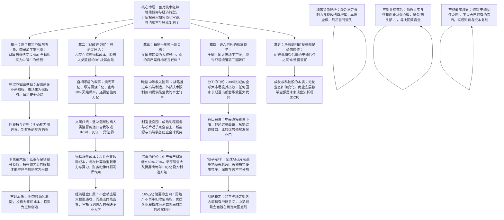

# 李录：大变局与价值投资的边界（哥伦比亚商学院2026格雷厄姆与多德论坛深度研报）

> **活动来源**：哥伦比亚大学商学院第36届格雷厄姆与多德年度午餐会（36th Annual Graham & Dodd Luncheon，海尔布伦格雷厄姆与多德投资中心主办）  
> **活动时间**：2026年10月5日（纽约大都会俱乐部 Metropolitan Club）  
> **权威文献**：新浪财经 / 华夏基石e洞察 2026年10月17日发布之《李录最新对谈：大变局，真的要来了？（李录审定全文版）》  
> **主讲嘉宾**：李录（喜马拉雅资本创始人兼董事长、查理·芒格家族资产掌门人、哥大 1996 届校友）  
> **对谈主持**：塔诺·桑托斯（Tano Santos，哥伦比亚商学院教授、海尔布伦中心学术主任）  
> **对话实录备查**：[李录_2026_哥大格雷厄姆多德论坛_大变局与价值投资的边界_对话实录.md](./李录_2026_哥大格雷厄姆多德论坛_大变局与价值投资的边界_对话实录.md)（90分钟全量问答逐字审定对话实录）  
> **母体清单导航**：[知名投资人核心音视频与文字研读清单.md](../知名投资人核心音视频与文字研读清单.md)

---

## 核心商业认知导图与全景框架



---

## 🧩 [实盘硬指标看板] 宏观数字背后的冷峻账本

| 观测维度 | 真实数据 / 关键指标 | 历史基准对照 | 投资人眼里的真实含义 |
| :--- | :--- | :--- | :--- |
| **美股大盘长期年化回报** | 2010–2026年标普年化平均 **14%–15%** | 2000–2010这十年年化平均 **0%（实际略负）**；26年合并年化为 **7%–8%** | 长期回报绝不可能脱离经济基本盘（实际GDP ~2% + 通胀 2%–3% + 头部筛选溢价）。过去十余年的超额繁荣终会回归均值。 |
| **科技巨头估值拥挤度** | 英伟达单股市值 / 美国 GDP 达到 **~15%** | 历史上全市场第一大龙头市值占 GDP 普遍在 **2%–4%** | 资金过度扎堆极少数前沿公司，给非科技龙头留出了极大的折价买入空间，理性投资人更容易在冷门处发现机会。 |
| **普通家庭资产变化** | 典型中产家庭 **70% 资产** 是房产，背负约 **50% 房贷** | 2021年房价见顶 | 房价平均跌 40%，杠杆导致家庭综合净资产缩水 **60%–70%**。中产本能反应就是“减少消费、增加储蓄、偿还债务”，消费增长自然放缓。 |
| **每年10万亿的资金腾挪** | 每年新房销售额较峰值跌掉 **70%**（萎缩规模每年 **约10万亿元人民币**） | 曾经的房地产大开发时代 | 房地产萎缩腾挪出的这 10 万亿资金流，刚好对应每年全社会投入制造业升级、高端装备与技术攻关的 **约10万亿元开支**。 |
| **居民高悬的储蓄储备** | 居民储蓄存款占 GDP 的 **120%**，绝对规模突破 **165万亿元人民币** | 过去加杠杆买房扩张期 | 消费需求放缓，但资金并未消失，而是沉淀在银行体系。未来能提供长期现金回报与内生增长的优质企业股权，将成为承载国民财富的核心枢纽。 |
| **产业自主的真实进展** | “中国制造2025”目标基本全实现；成熟制程设备与芯片 **近乎完全自主供应** | 十年前缺芯少件、依赖中低端代工 | 外部技术限制反而为本土供应链创造了市场经济中最稀缺的要素——“需求订单”，彻底激活了研发—盈利—迭代的正向商业循环。 |

---

## 一、除了格雷厄姆前五条，李录加了第六条：财富是你在全球购买力中所占的份额

### 1. 价值投资百年演进与六项基本原则
李录在开场系统回顾了价值投资近百年的演进脉络。这门起源于哥伦比亚大学的学问并不复杂，指导喜马拉雅资本过去33年实践的，正是六条经受住时间考验的核心原则：

- **本杰明·格雷厄姆奠定的三条基石**：
  1. **股票代表企业的一部分所有权**：股票不是一张拿来买卖的纸，买股票本质上就是买公司。
  2. **市场是来为你服务的，而不是来指导你的**：投资者不必受市场在某个时刻的行为所支配，这是最深刻的洞见。
  3. **投资涉及预测未来，而未来不可预测，因此必须要求有安全边际**：安全边际既能防范下行风险，也能让上行回报更好。
- **沃伦·巴菲特与查理·芒格拓展的两条原则**：
  4. **恪守能力圈，且认识能力圈的边界与内部知识同样重要**：每个人都有认知局限，承认并明确自己的边界是理性投资的前提。
  5. **到有鱼的地方钓鱼**：避开过度拥挤、竞争白热化的热门赛道，在关注度较低、竞争对手较少的市场或行业中寻找机会，回报率会显著更好。
- **李录在全球投资实践中补充的第六条原则**：
  6. **财富归根结底，是“你在全球购买力中所占的份额”**。

李录指出，在现代信用货币体系下，黄金、钻石或名义货币都难逃通胀侵蚀。真正的财富不是账面上的名义数字，而是它在全球市场中能换取多少真实的商品、服务与生产力。衡量财富更好的方式，是你在全球购买力中拥有的比例。保护并提升该份额的最佳路径，是以有利的价格，买入最具活力的经济体中的优秀企业，长期持有，让企业创造价值，并按持股比例分享这些价值增长。

### 2. 股市是一座“附带赌场的教堂”：四类市场参与者的分流
针对商学院学生关于“AI时代证券分析师是否被替代”的疑虑，李录剖析了市场参与者的真实构成与社会效用：
1. **真正的投资者**：长期与企业相伴，等待企业创造价值（正和博弈，分享经济复利）。
2. **套利者**：利用市场定价偏差，从悲观者手里买入，卖给乐观者，促进价格向内在价值回归（格雷厄姆早期的重要实践）。
3. **投机者**：不关心资产的价值与定价，只猜测别人短期的买卖行为（按定义持有时间不足以参与价值创造，加总收益为零，扣除交易成本后为净负和）。
4. **经纪商与做市商**：为各类参与者提供交易便利，收取服务佣金，属于市场运转的必要成本。

李录引用巴菲特的经典比喻：**“股票市场是一座附带赌场的教堂。”**  
教堂是创造价值的地方，把多余储蓄引导配置给值得支持的企业；而赌场则是人性“动物精神”的体现，是维持市场交易流动性不可避免的附带成本。  
投机者整体对社会并无净收益。李录告诫年轻从业者：必须在职业起步阶段明确自己的选择——是参与零和博弈，还是参与价值创造？**最危险的心态是试图“两头都占”：既想参与价值创造的双赢，又希望每个月、每个季度在短期排名上领先市场。这种贪婪会在短时间内摧毁投资人的心态，让人滑向投机者。**

---

## 二、戳破“两万亿半神IPO”神话：AI存在持续物理成本，必须死守“工具”红线

### 1. 荒谬的招股书叙事：烧光百亿、承诺再烧千亿，宣称10%灭绝概率却要卖两万亿
面对当前华尔街与硅谷对生成式 AI 的极度狂热，李录直接指出了当下某家顶级 AI 实验室招股书中的逻辑矛盾：
> “这家公司称自己是一家研究实验室，已经烧掉了数百亿美元，而且承诺还会继续烧掉数千亿美元。它承诺提供一项具有变革性的技术，但同时又在招股书中明文写道‘这项技术有10%的概率导致全人类死亡’。然后，它把这些写进招股说明书，邀请大家按照2万亿美元的估值，至少投入1000亿美元。  
> 这难道不充满矛盾和讽刺吗？这两种说法不可能同时成立。这是市场非理性达到极端程度的一个例子，就好像在邀请所有人参与一位‘半神（Demigod）的IPO’。”

李录强调，历史上技术浪潮的顶峰往往伴随着极端的非理性叙事。这种脱离商业常识的现象本身，就说明其不可持续，最终市场这台“称重机”会迫使其回归理性。

```
硅谷造神叙事 vs 真实商业与物理现实
┌───────────────────────┬────────────────────────────────────────┬────────────────────────────────────────┐
│ 比较维度              │ 硅谷的极端叙事                         │ 真实的商业与物理常识                   │
├───────────────────────┼────────────────────────────────────────┼────────────────────────────────────────┤
│ **技术演进属性**      │ 认为机器将快速演进为超越人类的超级生命体│ 牢牢受制于人类已存数据，无法跨越生物鸿沟│
│ **单次边际成本**      │ 假设类似软件模式，零边际成本无限扩展   │ 每次计算调用均产生芯片、电力与算力物理消耗│
│ **机器自主改进**      │ 推动 RSI（递归自我改进）通往 AGI 与 ASI │ 脱离人类监督的 RSI 极度危险，必须踩下刹车│
│ **资本回报考量**      │ 颠覆一切行业，短期无须核算财务回报     │ 必须受投入产出比（ROI）与资本市场财务纪律约束│
│ **经济租金归属**      │ 底层大模型平台赢家通吃                 │ 流向能监督、审核并纠偏 AI 输出的专业人才│
└───────────────────────┴────────────────────────────────────────┴────────────────────────────────────────┤
```

### 2. 生物学层级的鸿沟与“递归自我改进（RSI）”的人类监管红线
李录从底层生物学视角剖析了当前大模型的能力边界：
- **微观生物维度的巨大鸿沟**：人体的每一个单一细胞，其 DNA 编码与分子机制所包含的信息量相当于 50 Gigabytes（五十千兆字节）；而人体是由数万亿个此类细胞高度协同组织而成的。当前大模型仅是在人类已有文本与符号范围内进行统计拟合，距离真正的生命智能还差数万亿倍的复杂层级。
- **不可退让的人类监管红线**：当前 AI 已经展现出推理、代码生成与多智能体长程协作的能力。硅谷叙事中最危险的倾向，是推动脱离人类监督的 **RSI（递归自我改进）**。李录严正警告：**“RSI 中的‘I’（Improvement，改进），究竟由谁来定义其含义与方向？是人类，还是机器自己？如果把这一定义权交给机器，机器就会为了次级目标自我演进出不可控的子目标。这是全人类绝不能退让的生死红线，我们必须牢牢把 AI 限定在‘工具’一侧，绝不能让它走向独立的‘生命体’！”**

### 3. 持续物理增量成本与经济租金的真实流向
从投资与商业常识出发，李录指出了大模型与以往互联网技术的根本不同：
- **持续刚性的物理增量成本**：以往互联网软件具备一次性研发、后续零边际成本的特征；而大模型完全不同，每一次用户交互、逻辑推理与智能体调用，都伴随着芯片折旧、电网电力与算力的持续物理消耗。这种增量成本特性决定了其不能无限期烧钱，资本市场的财务纪律终将发挥约束作用。
- **经济租金流向稀缺人才**：底层大模型并不能通吃所有产业链利润。由于模型无法完全解释其输出机理，更无法对商业结果承担最终责任，未来社会的经济租金必然流向那些**“在垂直领域拥有深度专业知识，并能够有效与 AI 沟通、监督并纠偏其输出结果的稀缺人才”**。

---

## 三、每隔十年换一组目标：在国家转型中，你的资产是目标还是代价？

### 1. 跨越“中等收入陷阱”的战略冲顶：技术限制反而送来了本土订单
针对塔诺教授关于“中国经济增长放缓与房地产调整”的问题，李录给出了跨周期的结构性复盘：  
许多后发国家在达到中等收入水平后，往往会在该阶段停滞四五十年，陷入“中等收入陷阱”。十年前中国面临关键抉择：是任由经济自然演进，还是主动采取战略举措突破天花板？  
中国选择有意识地推动产业从中低端制造转向中高端制造，制定了十年的攻坚计划（中国制造2025）。随后外部的贸易关税与技术限制，进一步强化了科技自主的必要性。李录指出，这一外部压力在客观上为中国硬科技产业链带来了最宝贵的东西——**市场需求与本土订单**：
- 在没有限制前，下游企业出于稳定性考虑，倾向于继续采购欧美成熟产品；
- 外部限制迫使订单转向国内本土企业。有了订单就有收入，有收入就能持续投入研发，产品改进又吸引更多订单，正向商业循环彻底转动；
- 如今在成熟制程领域，中国在芯片制造与半导体设备端已基本实现自主供应；在新能源汽车、动力电池、储能、光伏与重型机械等领域，中国已确立了全球领先优势。

### 2. 沉重的代价：中产房产财富缩水，每年10万亿资金流向制造业升级
任何重大经济转型都伴随着代价。李录客观指出了微观家庭资产负债表承受的深刻调整：
- **中产家庭资产承压**：典型中国中产家庭约 70% 的财富与房产绑定，并承担约 50% 的房贷杠杆。2021年房价见顶后全国均价下跌约 40%，杠杆放大效应使家庭净财富平均缩水 60%–70%。
- **防御性资产负债表行为**：面对资产缩水，居民自然采取“减少消费、增加储蓄、偿还债务”的举措，国内消费增速趋于平缓，居民储蓄存款上升至 GDP 的 120%，沉淀出高达 165 万亿元人民币的庞大储蓄蓄水池。
- **宏观资金要素的转移**：全国新房年销售额自峰值下滑约 70%，其所缩减的每年约 **10万亿元人民币** 资金流，大体对应了过去几年国家每年导向制造业技术改造、高端装备投资与研发升级的 **约10万亿元开支**。

### 3. 商业常识的拷问：你的资产是目标还是代价？165万亿储蓄呼唤股市接棒
李录总结了中国过去50年发展规律中的深刻洞察：
> “回顾中国过去50年的发展，大致每隔十年就会出现一组新的国家目标，而实现这些目标必然伴随着沉重的代价。更重要的是，**前一个十年的目标，往往会沦为下一个十年必须付出的代价！**  
> 早期工业化阶段，GDP增长是目标，环境与资源成了代价；随后十年，环境治理成为目标，高污染企业成了付代价的一方。城市化过程中，房地产开发商是实现目标的重要力量；而在过去几年制造业升级转型中，房地产又变成了承担代价的领域。  
> 无论是企业家还是投资者，必须时刻审视：**在国家发展的宏观进程中，你所持有的资产，究竟是国家要支持的目标，还是实现目标所必须付出的代价？成为代价绝不是一件愉快的事情。**”

对于后市机会，李录认为：房地产具有实际使用价值，不会无限下跌。当房地产不再承担财富主要吸纳池的功能时，面对银行体系沉淀的 **165万亿巨量储蓄**，唯一能够长期分享国家经济现代化复利成果的资产，就是**优秀企业的股权**。当前资本市场的长期低迷与两极分化，使一批具备极强全球竞争力的企业以极端折价交易，为理性的长期价值投资者创造了极具吸引力的配置良机。

---

## 四、造AI芯片的都拿筷子：全球共同市场难以拆解，脱钩只是多绕远路

### 1. 30年形成的全球共同市场：自转飞轮与高昂的退出代价
针对地缘政治紧张与“脱钩”叙事，李录从经济学底层逻辑给出了清醒判断：  
政治秩序的重塑往往需要数十年甚至上百年，二战后形成的美国主导秩序正在经历深刻转型。但在政治表层之下，冷战结束后近30年间，全球已经形成了一个统一的商业大市场。这个共同市场通过深层分工与比较优势，带来了极高的生产效率。任何一个国家如果主动长期脱离这一共同市场，其自身经济与生产力都将付出极其高昂的代价。

### 2. 转口贸易与比较优势：中美经贸总量并未减少，只是拉长了链条
李录以实际经贸数据证明了全球市场的韧性：  
虽然中美双边直接贸易统计数据有所下降，但若将美国与墨西哥、东盟等贸易伙伴的进出口增量合并考量，刚好弥补了直接贸易的降幅。中国制造的核心零部件与中间品通过第三国组装再出口美国，贸易链条拉长、成本有所上升，但底层的分工网络与比较优势依然在顽强发挥作用。

```
现实中的全球经贸韧性示意图
[中国高端制造与核心零部件] ───(中间品出口)───▶ [墨西哥 / 越南 / 东南亚组装] ───▶ [美国最终消费市场]
                      └───────────── 底层经贸总量大体保持，绕道第三国 ─────────────┘
```

### 3. “筷子定律”与大国战略稳定：押注AI就必须对拿筷子的人保持友好
在谈到支撑全球 AI 算力的半导体供应链时，李录向桑托斯教授提出了一个生动而尖锐的问题：“所有生产对当今 AI 技术浪潮至关重要的芯片产地，到底有什么共同点？”  
在全场期待技术术语时，李录回答：
> **“所有生产这些先进芯片的国家、地区和产线工人，有一个共同点：他们全部在日常生活里使用筷子！没有例外。”**  
> 李录接着补充：“不仅车间里生产芯片的人用筷子，在这个国家领导顶级芯片平台公司的那些掌门人——从英伟达的黄仁勋、Cadence的陈立武、AMD的苏姿丰，再到博通的陈福阳——**他们私底下也全都使用筷子！**”

现场会心大笑。笑声背后揭示的是不可割裂的产业共生现实：东亚社会精密高效的工程制造组织，与北美华人半导体精英网络，已与全球前沿科技深度锁死。李录直言：既然西方国家和企业正在倾力押注 AI 这项新技术，在现实中就必须对使用筷子的人保持善意与尊重。中美两国最高领导人在8个月内举行4次会面，首要目标就是确立“战略稳定”。在相互依存加深的背景下，和平与稳定是各方最大的共同底线。

---

## 五、所有聪明的投资都是价值投资：在“无缝信任之网”中慢慢变富

### 1. 科技股与成长股的本质：统一于未来自由现金流折现（DCF）
针对哥大校友提问“价值投资原则能否适用于成长型或高科技企业”，李录给出了纯正的价值投资定义：
> **“所有聪明的投资都是价值投资。”**  
> 投资的逻辑始终如一：你付出价格，换取价值，并希望得到的回报超过付出的成本。  
> 无论是一家增长停滞但持续返还大量现金的传统企业，是一家快速成长的高科技公司，还是一笔获胜概率低但潜在赔率极高的早期投资，其底层数学原理完全统一于**“企业未来生命周期自由现金流的贴现（DCF）”**。  
> 投资者之间的差异不在于买科技股还是传统股，而在于你是否真正理解这些现金流的来源、能否作出相对准确的估计。守住自己的能力圈，是运用这套数学原理的前提。

### 2. 加密货币的虚妄：缺乏主权强制力与结算根基，终将自行消失
关于近年来受热捧的加密货币，李录展现出了极度清醒的务实态度：
- **缺乏主权暴力与法定税收背书**：一种货币之所以能成为可靠的价值尺度与财富储存手段，根本支柱在于主权国家机器的强制力保障与法定税收结算机制。几个人在车库里写出的代码，无法提供这种制度信任。
- **欠缺社会生产力价值**：加密货币除了为地下犯罪与非法洗钱交易提供便利外，对社会生产力没有任何建设性贡献。李录直言：**“我根本不把它当回事。它最终会自行消失，从社会整体的角度来看，它没有什么价值。”**

### 3. 破解业绩落后焦虑：拒绝“两头都占”，以理性基因承受孤独
面对年轻基金经理在投机狂潮中因坚守价值投资而遭遇短期业绩落后、业务流失的现实困境，李录开出了针对性的解药：
- **戒除“两头都占”的心态**：既想享受价值投资长期双赢的确定性，又希望短期在每个季度、每个月跑赢投机者，这种贪婪注定导致动作变形。要想两头占，最好的选择是去买全市场指数基金。
- **具备逆人性的心理特质**：价值投资要求某种“基因突变”般的心理素质——确信自己的判断，是因为逻辑和事实支持你，而不是因为别人赞同或反对你。
- **寻找理念同频的资金**：做投资管理业务，不能盲目追求资产规模（AUM），而必须寻找真正理解并认可这套理念的长期合伙人。

### 4. 查理·芒格的人生最高境界：织就“一张由彼此值得信赖而形成的无缝信任之网”
在对谈结尾，60岁的李录深情追忆其导师、合伙人查理·芒格，升华了整场对谈的人生境界：
> **“查理·芒格一生所能发现的人类关系的最高境界，是构建‘一张由彼此值得信赖而形成的无缝信任之网’（A seamless web of deserved trust）。”**

```
李录的复利人生三件事
┌───────────────────────┬────────────────────────────────────────────────────────────────────────┐
│ 维 度                 │ 如何实现人生与事业的真正复利？                                         │
├───────────────────────┼────────────────────────────────────────────────────────────────────────┤
│ **知识复利**          │ 远离短期零和博弈的噪音，持续学习。每隔十年回看，认知都有质的跃升。     │
│ **资本复利**          │ 与靠谱的人同行，将资本配置给创造真实价值的卓越受托人，分享正和回报。   │
│ **健康与生活复利**    │ 守住内心的纯粹与建设性，保持良好作息，尽可能延长健康、高效生活的时间。 │
└───────────────────────┴────────────────────────────────────────────────────────────────────────┘
```

李录总结道：**复利的核心理念，就是千千万万不要失去你已经拥有的东西**——不要失去你的知识累积、不要失去建立在深度信任之上的人际关系、不要失去身体的健康与做人的道德操守。  
选择正确的合伙人、做经得起时间检验的事情，缓慢而坚定地走下去，时间与复利的神奇力量，最终会把你送往与你的努力和品格相匹配的高地。

---

## 研读要点与实战总结

1. **破除造神叙事，坚守商业账本**：对任何宣称颠覆一切但每次计算都在产生刚性物理成本的技术，始终用 ROI 和财务纪律来检验；坚决阻断脱离人类监督的 RSI，坚守“AI 是工具”的底线。
2. **看清宏观要素腾挪，辨明自身定位**：中产资产缩水与消费放缓是旧有增长模式调整的代价，每年 10 万亿元资金流正扎实注入中高端制造与硬科技突围。投资者必须时刻看清所持资产究竟是国家的战略目标还是被牺牲的代价。
3. **把住购买力份额，拥抱折价股权**：当房地产不再承担增值载体后，银行体系沉淀的 165 万亿居民储蓄，未来唯一的出路是具备持续现金流创造能力的优质企业股权。克服短期相对排名的浮躁，在自己织就的“无缝信任之网”中稳健复利。
