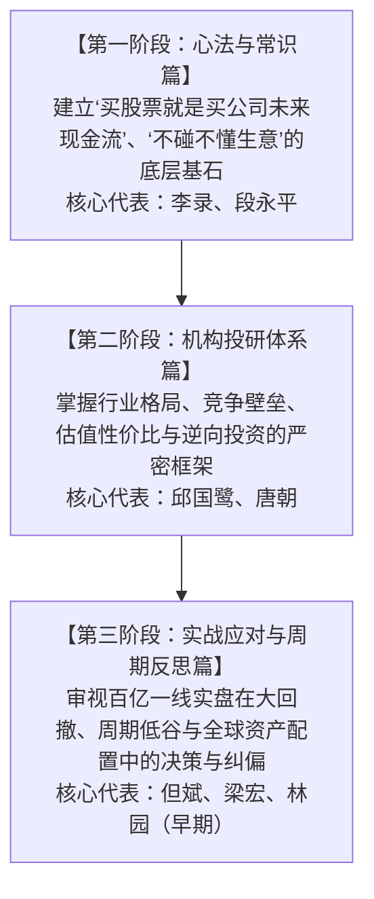

# 知名投资人核心音视频与文字研读清单（Todo List）

> **说明**：本清单针对具有深远行业影响力、思想体系自洽的顶尖投资人与实盘大家（李录、段永平、邱国鹭、但斌、林园、梁宏、唐朝），甄选出含金量最高、逻辑最完整的高清音视频与权威文本归档。  
> **本地专区架构**：各投资人专区已建立独立目录（[李录](./李录/)、[段永平](./段永平/)、[高毅资产](./高毅资产/)、[唐朝](./唐朝/)、[泡泡玛特王宁](./泡泡玛特王宁/)），一体化收拢各期音视频研报实录、离线问答录及官方文献。  
> **使用原则**：按“心法筑基 → 机构框架 → 实战应对”三阶梯逐步研读；只看 60 分钟以上完整讲座/策略会与深度文集，坚决避开算法推荐的碎片化短视频切片。

---

## 阶段导读与进阶路线

---

## 一、第一阶段：心法与常识筑基（必修心法）

### 1. 李录（喜马拉雅资本创始人、查理·芒格家族资产掌门人）

* **核心价值**：格雷厄姆-巴菲特-芒格正统价值投资理论在华人圈的最高水平阐释，系统讲透“真假价值投资、能力圈、现代化与中国经济长期增长逻辑”。
* **学习建议**：必须完整看完北大两次讲座视频，信息密度极高，属于投资生涯必看的基石内容。

#### 研读任务清单（Todo List）
- [ ] **【必看视频】北大光华 2015 演讲《价值投资在中国的展望》（理论基石版）**
  * **时长/形式**：约 120 分钟 / 高清演讲
  * **核心看点**：价值投资的四个基本概念、为什么价值投资在中国行得通、投机与投资的本质差异。
  * **在线链接**：
    * Bilibili（完整字幕版）：[BV1vz9DBTERq](https://www.bilibili.com/video/BV1vz9DBTERq)
    * YouTube（高清版）：[李录2015北大演讲《价值投资在中国的展望》](https://www.youtube.com/watch?v=sosRhVJtTlo)
- [x] **【本地已整理】北大光华 2019 演讲《价值投资的知行合一与实践》（实战答疑版）**
  * **时长/形式**：约 142 分钟（2小时22分） / 完整演讲与全量互动实录
  * **核心看点**：知行合一为什么知易行难、加州加油站案例与微观护城河、能力圈十年最坏底线推演、投资人的性情（Temperament）、普通人定投全市场指数、喜马拉雅合伙人机制、人生熵减与慢即是快、现场8大深度问答。
  * **本地深度研报**：[李录_2019_北大光华_价值投资的知行合一与实践.md](./李录/李录_2019_北大光华_价值投资的知行合一与实践.md)
  * **主旨演讲实录**：[李录_2019_北大光华_价值投资的知行合一与实践_演讲实录.md](./李录/李录_2019_北大光华_价值投资的知行合一与实践_演讲实录.md)
  * **对话实录文档**：[李录_2019_北大光华_价值投资的知行合一与实践_对话实录.md](./李录/李录_2019_北大光华_价值投资的知行合一与实践_对话实录.md)
  * **在线链接**：
    * YouTube（完整版）：[李录 北大演讲：做好投资 必须知行合一](https://www.youtube.com/watch?v=UOvjzQBGt4s)
- [x] **【本地已整理】哥伦比亚商学院 2026 格雷厄姆与多德论坛《大变局与价值投资的边界》（李录审定全本）**
  * **时长/形式**：约 90 分钟 / 现场深度对谈与9大互动问答（华夏基石e洞察 2026-10-17 权威发布李录审定全文版）
  * **核心看点**：价值投资六大原则与“全球购买力份额”、市场的四类参与者与“附带赌场的教堂”、撕开“两万亿半神IPO”假面与RSI人类监管红线、物理增量成本与AI稀缺技能、中国经济中等收入陷阱跨越与10万亿地产向制造大腾挪、165万亿存款与股市承载财富、中美地缘深层互嵌与“筷子定律”、成长股DCF本质、加密货币的消亡归宿、克服业绩落后焦虑与查理·芒格“无缝信任之网”。
  * **本地深度研报**：[李录_2026_哥大格雷厄姆多德论坛_大变局与价值投资的边界.md](./李录/李录_2026_哥大格雷厄姆多德论坛_大变局与价值投资的边界.md)
  * **对话实录文档**：[李录_2026_哥大格雷厄姆多德论坛_大变局与价值投资的边界_对话实录.md](./李录/李录_2026_哥大格雷厄姆多德论坛_大变局与价值投资的边界_对话实录.md)
  * **在线链接**：
    * 新浪财经（李录审定全文）：[李录最新对谈：大变局，真的要来了？](https://cj.sina.com.cn/articles/view/5953740931/162dee08306704270c)
- [ ] **【必看视频】北大光华 2024 讲座《全球价值投资与时代》（十周年纪念版）**
  * **时长/形式**：约 167 分钟 / 芒格书院官方收录
  * **核心看点**：全球大变局下的价值投资、中国经济“2.5阶段”与中等收入陷阱跨越、AI技术浪潮审视、现代化的复利本质。
  * **本地文字稿库**：[李录-北大演讲-20241207.md](./李录/李录-北大演讲-20241207.md)
  * **在线链接**：
    * Bilibili（完整版）：[BV1MCQFByEfk](https://www.bilibili.com/video/BV1MCQFByEfk)
- [ ] **【经典案例视频】哥伦比亚大学 2006 价值投资课实录（Timberland 案例）**
  * **在线链接**：Bilibili [BV1fXJczeE4g](https://www.bilibili.com/video/BV1fXJczeE4g) ｜ YouTube [-jF5au0-JiY](https://www.youtube.com/watch?v=-jF5au0-JiY)
- [ ] **【必读书籍与文献】**
  * 本地专区全集：[李录专区离线文献总览](./李录/)（收纳2015/2024北大演讲官方PDF、2026哥大格雷厄姆多德论坛对谈、持仓与美光投资复盘等 16 篇文献）
  * 专著全书：微信读书 [《文明、现代化、价值投资与中国》](https://weread.qq.com/web/bookDetail/eeb32a5072049d5feeb81b5)
  * 经典期刊专访：哥伦比亚商学院 [Graham & Doddsville Issue 23 李录专访 (PDF)](https://www.gsb.columbia.edu/sites/default/files/pub-files/G%26D_Issue_23_Winter_2015.pdf)
  * 官方机构网站：[喜马拉雅资本官网 (Himalaya Capital)](https://himalayacapital.com/)

---

### 2. 段永平（网名：大道无形我有形，步步高创始人、独立价值投资家）

* **核心价值**：极简常识主义、商业模式至上、不为清单（Stop Doing List）。把复杂的投资决策回归到最质朴的商业逻辑（“敢为天下后，后发制人”、“本分与平常心”）。
* **学习建议**：**95% 的精华在文字**。精读网友整理的二十年问答录（商业逻辑篇、投资逻辑篇），其视频极少但部部皆为经典。

#### 研读任务清单（Todo List）
- [ ] **【本地备查精选】段永平30年投资与商业认知精华（本地已整理）**
  * **本地总结文档**：[段永平_2025_30年投资与商业认知精华_视频总结.md](./段永平/段永平_2025_30年投资与商业认知精华_视频总结.md)
  * **对话实录文档**：[段永平_2025_30年投资与商业认知精华_视频总结_对话实录.md](./段永平/段永平_2025_30年投资与商业认知精华_视频总结_对话实录.md)
  * **对应来源视频**：YouTube [foJnLqbHJLw (66分钟全汇编)](https://www.youtube.com/watch?v=foJnLqbHJLw)
- [ ] **【必看专访视频】雪球《方略》专访：方三文对话段永平（2小时官方完整版）**
  * **时长/形式**：约 120 分钟 / 官方高清深度访谈
  * **核心看点**：投资苹果、茅台、腾讯与拼多多的底层决策、商业模式与企业文化的权重、人生哲学。
  * **在线链接**：
    * Bilibili（官方版）：[BV1X5krBGEsa](https://www.bilibili.com/video/BV1X5krBGEsa)
    * YouTube（官方版）：[方略第13期｜方三文对话段永平](https://www.youtube.com/watch?v=1ikLMn2naSA)
- [ ] **【必读文字全集】二十年雪球问答录开源归档**
  * 本地专区全集：[段永平专区离线文献总览](./段永平/)（收录《商业逻辑篇》/《投资逻辑篇》PDF、雪球近万条发言全文、2018斯坦福对话等 11 篇资料）
  * 官方雪球主页：[雪球@大道无形我有形](https://xueqiu.com/u/1247347556)（个性化链接：[slowisquick](https://xueqiu.com/u/slowisquick)）
  * 经典开源 PDF 仓库：GitHub [iqiancheng/fastisslow (含商业逻辑篇、投资逻辑篇 PDF)](https://github.com/iqiancheng/fastisslow)
  * 在线静态网页版：GitHub [iherwo/duanyongping (网页版文集分类检索)](https://github.com/iherwo/duanyongping)

---

## 二、第二阶段：机构投研与选股框架（招式进阶）

### 3. 邱国鹭（高毅资产董事长、原南方基金投资总监）

* **核心价值**：中国本土机构化价值投资集大成者。提出了“数月亮不数星星”、“行业格局优于行业空间”、“便宜才是硬道理”等一套完整的选股与估值方法论。
* **学习建议**：看其系统性公开课视频，再研读高毅合伙人同台的闭门座谈实录，体会多风格顶尖投资人的碰撞。

#### 研读任务清单（Todo List）
- [ ] **【必看公开课视频】《投资中最简单的事》（66分钟完整版）**
  * **时长/形式**：约 66 分钟 / 专题高清讲座
  * **核心看点**：波特五力分析在 A 股的应用、如何辨别真假壁垒、安全边际的三种维度。
  * **在线链接**：
    * Bilibili（系统完整版）：[BV12X4y1V7QU](https://www.bilibili.com/video/BV12X4y1V7QU)
    * Bilibili（2014经典原版）：[BV1kppt66EVW](https://www.bilibili.com/video/BV1kppt66EVW)
    * Bilibili（高毅投资实战合集全8集）：[BV1qk4y1i7j5](https://www.bilibili.com/video/BV1qk4y1i7j5)
- [ ] **【必看高毅圆桌与精读】高毅资产合伙人深度对谈精读视频**
  * 邓晓峰对话邱国鹭（十年投资经精读）：Bilibili [BV14USMBxEJf](https://www.bilibili.com/video/BV14USMBxEJf)
  * 冯柳投资框架精读（弱者体系）：Bilibili [BV1CXYvzzECt](https://www.bilibili.com/video/BV1CXYvzzECt)
- [ ] **【必读文字实录与专著】**
  * 本地闭门座谈：[高毅资产2021围炉座谈《用更好的研究应对更快的变化》](./高毅资产/高毅资产_2021_围炉座谈_用更好的研究应对更快的变化.md) ｜ [高毅资产2018围炉座谈《变化的环境，不变的价值》](./高毅资产/高毅资产_2018_围炉座谈_变化的环境_不变的价值.md)
  * 微信读书专著：[《投资中最简单的事》](https://weread.qq.com/web/bookDetail/05c325805e324005cfbd362)
  * 高毅2021围炉座谈全文：[雪球长文实录《用更好的研究应对更快的变化》](https://xueqiu.com/9442520620/177338858)
  * 高毅2018围炉座谈全文：[雪球长文实录《变化的环境, 不变的价值》](https://xueqiu.com/9442520620/103382071)
  * 机构官网：[高毅资产官方网站](https://www.gyasset.com/)

---

### 4. 唐朝（网名：唐书房，个人投资者、财报常识普及代表）

* **核心价值**：把巴菲特、段永平的折现思维与中国上市公司财报（年报、资产负债表、现金流量表）无缝结合，创立可严格操作的“老唐估值法”。
* **学习建议**：不看盘、只看财报。直接精读其微信公众号历史全集与财报实战三部曲。

#### 研读任务清单（Todo List）
- [ ] **【必读书籍】手把手读财报与估值实战三部曲**
  * 财报通识经典：微信读书 [《手把手教你读财报》](https://weread.qq.com/web/bookDetail/9e132d50811e544f0g0184af)
  * 估值体系核心：微信读书 [《价值投资实战手册》](https://weread.qq.com/web/bookDetail/df632be0726bdf9bdf68a2e)
  * 银行与金融专著：微信读书 [《手把手教你读财报2：18节课看透银行业》](https://weread.qq.com/web/bookDetail/68732b60811e544f8g014823)
- [ ] **【必读长文归档】唐书房 1756 篇公众号原创长文全备份**
  * 本地离线文库：[唐朝专区离线检索看板（可浏览器直接检索阅读）](./唐朝/index.html) ｜ [唐书房全集阅读说明](./唐朝/唐书房全集阅读说明.md) ｜ [核心精选文章目录](./唐朝/核心精选文章/)
  * GitHub 完整文章开源仓库：[lonelydancer88/tangshufang-archive](https://github.com/lonelydancer88/tangshufang-archive)
  * 雪球主页：[雪球@daniel](https://xueqiu.com/u/daniel)
  * 微信公众号：关注 **“唐书房”**（历史文章合集）与新号 **“唐书院”**

---

## 三、第三阶段：实战应对与周期反思（一线实操）

### 5. 但斌（东方港湾董事长、百亿私募掌舵人）

* **核心价值**：从国内“时间的玫瑰”（消费、茅台）转型重仓全球顶级 AI 算力与科技巨头（英伟达、特斯拉）的百亿私募样本。
* **学习建议**：看其 2024~2025 年近期的策略演讲与长视频专访，观察其宏观资产配置的切换逻辑；微博仅作为市场情绪温度计参考，切忌跟单。

#### 研读任务清单（Todo List）
- [ ] **【必看长视频】格隆汇中期策略会主题演讲（官方高清完整版）**
  * **时长/形式**：约 90 分钟 / 策略会主题演讲
  * **核心看点**：扎根中国走向世界、东方港湾的全球化配置、AI时代的产业投资逻辑。
  * **在线链接**：YouTube [msJK9Wka97w](https://www.youtube.com/watch?v=msJK9Wka97w)
- [ ] **【必看专访视频】东方港湾但斌独家专访（35分钟深度版）**
  * **在线链接**：Bilibili [BV1tAPFe1EX9](https://www.bilibili.com/video/BV1tAPFe1EX9)
  * **补充演讲**：Bilibili [BV1pT7F6JEt2（投资最核心3个秘诀与AI机遇）](https://www.bilibili.com/video/BV1pT7F6JEt2)
- [ ] **【动态追踪主页】**
  * 新浪微博官方认证：[新浪微博@但斌](https://weibo.com/danbin)（亦可访问 [weibo.com/u/1249424622](https://weibo.com/u/1249424622)）

---

### 6. 梁宏（海南希瓦、上海希瓦资产创始人）

* **核心价值**：从雪球草根民间大V一路逆袭至百亿私募的标杆案例。精通多空对冲、高股息红利与港股互联网，交流风格极其坦诚尖锐、不打官腔。
* **学习建议**：看其 120 分钟的投资者策略交流会，能切身体会百亿基金经理在真实市场中的心理压力、选股胜率推演与应对策略。

#### 研读任务清单（Todo List）
- [ ] **【必看长视频】希瓦资产 2024 年中策略交流会（120分钟完整版）**
  * **时长/形式**：约 120 分钟 / 官方投资者沟通视频
  * **核心看点**：宏观周期判断、高股息资产与物业股配置逻辑、组合回撤控制机制。
  * **在线链接**：Bilibili [BV1gE4m1d7Ko](https://www.bilibili.com/video/BV1gE4m1d7Ko)
- [ ] **【专访视频】雪球官方专访：高股息资产与确定性投资**
  * **在线链接**：Bilibili [BV1ozCWY1ECQ](https://www.bilibili.com/video/BV1ozCWY1ECQ)
  * **补充交流会**：Bilibili [BV1QPMq6CEsx（投资者半年交流会）](https://www.bilibili.com/video/BV1QPMq6CEsx)
- [ ] **【个人主页与动态】**
  * 雪球认证个人主页：[雪球@梁宏](https://xueqiu.com/u/9887656769)

---

### 7. 林园（林园投资董事长）

* **核心价值**：极致的朴素商业直觉。死磕“成瘾性、垄断性、嘴巴里的生意”（医药、白酒）。
* **学习建议**：**只看 2007 年前后的早期电视专访**（当时未成百亿规模，讲的是发家时最纯粹的商业判断）；近年的短视频切片与直播完全不要看。

#### 研读任务清单（Todo List）
- [ ] **【必看早期专访】CCTV《证券时间》2007 专访完整版**
  * **核心看点**：早年如何下注深发展、贵州茅台与老字号中药，体验其最原始的选股直觉。
  * **在线链接**：Bilibili [BV191zDBwEhW](https://www.bilibili.com/video/BV191zDBwEhW)
- [ ] **【必看早期辩论】2007《财富非常道》专访完整版（44分钟）**
  * **核心看点**：李南主持，林园与水皮现场辩论，展示牛市顶峰时的心理素质与“长期股东”思维。
  * **在线链接**：
    * Bilibili（完整版）：[BV1pKzQBmEng](https://www.bilibili.com/video/BV1pKzQBmEng)
    * Bilibili（高清修复版）：[BV189F5zkEse](https://www.bilibili.com/video/BV189F5zkEse)
- [ ] **【补充早期档案】**
  * 2007 网易专访《寻找中国巴菲特》：Bilibili [BV1X2zDBhEge](https://www.bilibili.com/video/BV1X2zDBhEge)
  * 2007 电视专题《走进资本市场》：Bilibili [BV1Stz4BxEY2](https://www.bilibili.com/video/BV1Stz4BxEY2)

---

## 四、执行排期建议表（建议学习节奏）

| 周期 | 核心研读任务 | 达成目标 |
| :--- | :--- | :--- |
| **第 1~2 周** | 李录北大 2 场完整视频 + 粗读《段永平投资问答录》 | 建立清晰的商业常识，分清投资与投机的界限 |
| **第 3~4 周** | 邱国鹭公开课（66分钟）+ 微信读书《投资中最简单的事》 | 掌握行业格局剖析法（波特五力在A股的应用） |
| **第 5~6 周** | 唐朝《手把手教你读财报》+ 精读唐书房经典文章 | 消除对上市公司财务报表的恐惧，学会独立测算合理估值 |
| **第 7~8 周** | 但斌 2024 策略会 + 梁宏 120 分钟交流会 + 林园 2007 专访 | 观察真实实战中的仓位博弈、回撤控制与逆向坚持 |
