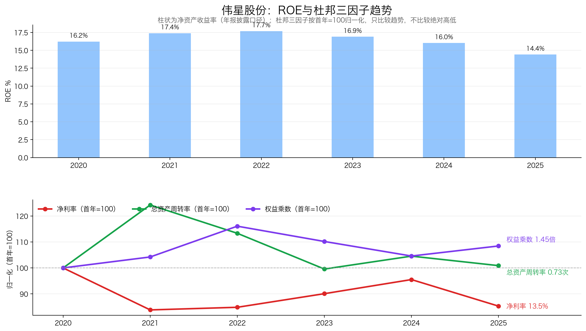
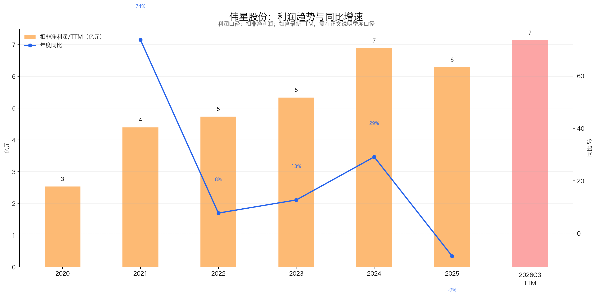
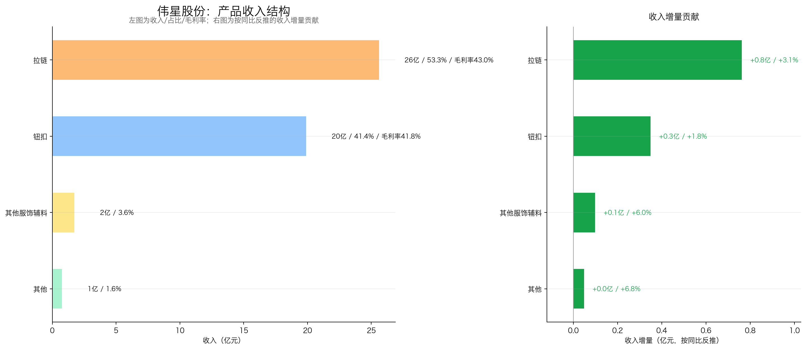
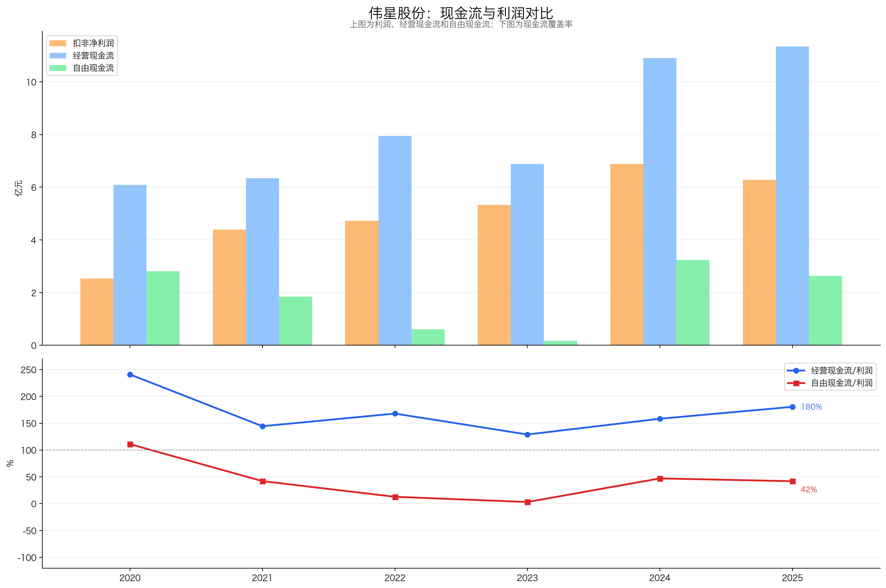
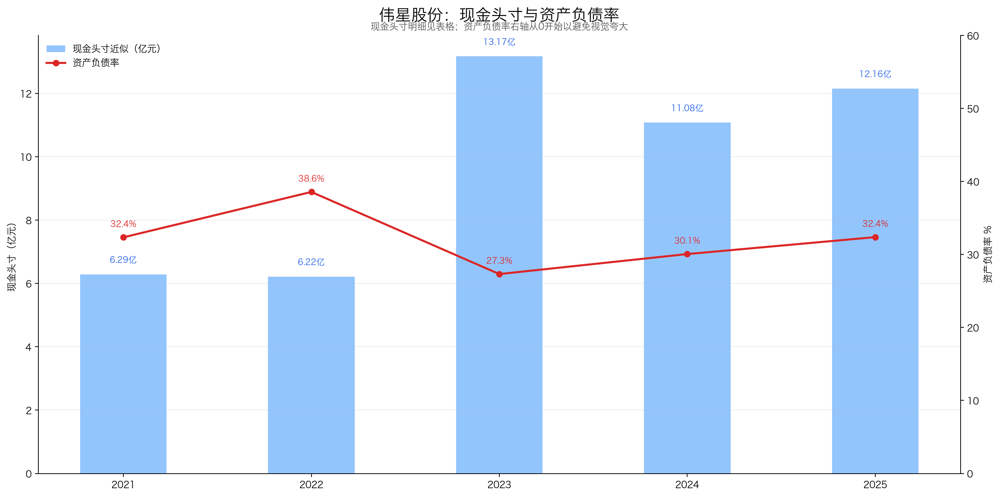
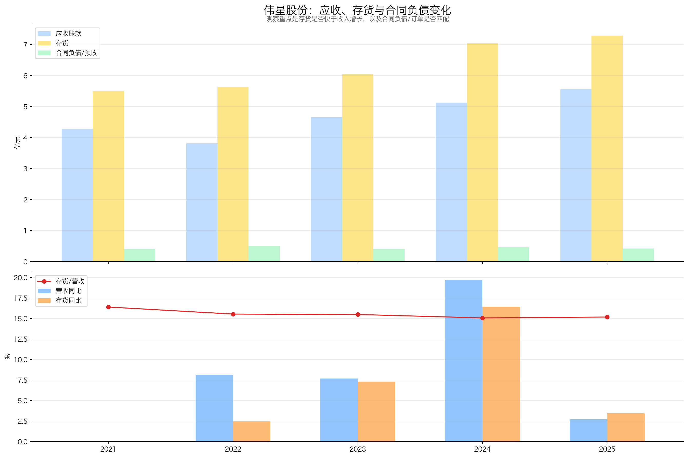
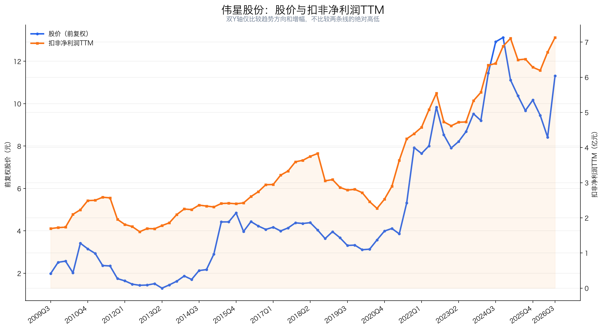
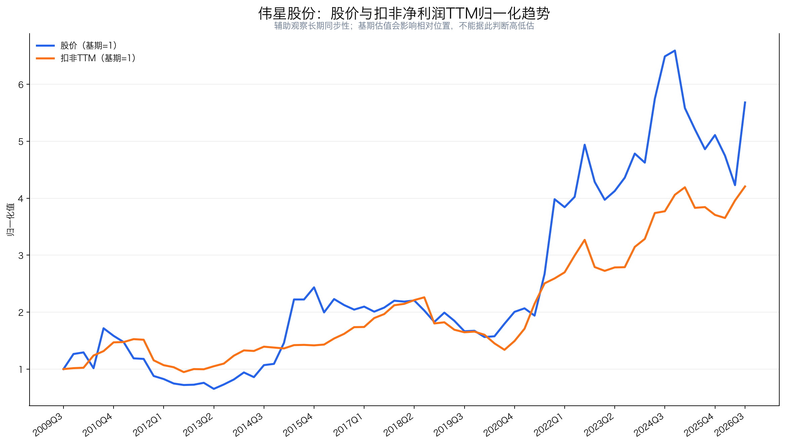

# 伟星股份（002003.SZ）投资分析报告

- **报告基准日**：2026-11-23
- **基准行情**：收盘价 13.07 元，总市值 155.39 亿元，PE(TTM) 21.44 倍（扣非 PE 21.79 倍），PB(MRQ) 3.24 倍
- **数据来源**：2020-2025 年官方年度报告 PDF、2026 年第一季度报告/半年度报告/第三季度报告官方 PDF、同花顺 10jqka 原始导出底账、东方财富金融终端、yfinance 前复权行情

---

## 决策摘要

| 评估模块 | 得分 | 满分 | 核心定性结论 |
|---|---:|---:|---|
| 好生意·定性 | 26.5 | 35 | 全球服饰辅料综合龙头，以柔性定制与全球快反交付见长；但下游需求受品牌服装去库存与宏观消费周期扰动，且缺乏原研药/芯片级别的排他特许壁垒，定性未达 28 分门槛。 |
| 好生意·定量 | 31.0 | 35 | 近 5 年平均加权 ROE 高达 16.44% 且平稳无大起大落，累计净现比达 1.53，近 5 年累计经营造血完全覆盖 38 亿扩产资本开支，展现出极高的高端制造资本效率。 |
| 好管理层 | 9.5 | 10 | 治理底线清晰，近 5 年累计派息率达 86.8%，未分配利润留存极少却创造出显著内生利润与市值增量，一美元原则检验卓越，主业高度专注。 |
| **基本面质地小计** | **67.0** | **80** | **质地等级：B 档**（质地总分 67.0 分，因定性 26.5 分未满 28.0 分双门槛，评定为高端制造冠军 B 档） |
| 好价格 | 8.5 | 20 | **价格状态：价格偏贵**（买入信号：`-` 观望） |
| **综合总分** | **75.5** | **100** | **最终评级：B-** |

- **一句话结论**：全球服饰辅料高端制造隐形冠军，现金流造血与真金白银分红无可挑剔；但当前估值处于近 10 年 73.8% 高分位，安全边际偏薄且赔率不对称性不足，建议留存次级观察池，耐心等待估值回落。
- **核心矛盾**：当前市场给出的 21.4 倍 PE 估值已充分甚至过度计入了越南海外产能释放预期，若全球品牌服装需求走弱或海外关税政策突变，高估值将面临利润与倍数双重消化压力。
- **关键跟踪变量**：越南与孟加拉海外工业园产能利用率爬坡进度、海外业务营收增速与毛利率稳定性。

---

## 一、公司概况与初筛排雷（不计分）

### 1.1 公司基本情况

| 维度 | 内容 |
|---|---|
| 股票代码/上市地 | 002003.SZ（深交所主板） |
| 基准行情与体量 | 最新收盘价 13.07 元，**总市值 155.39 亿元**，PE(TTM) 21.44 倍（扣非 PE 21.79 倍），PB(MRQ) 3.24 倍 |
| 主营业务与占比 | 钮扣业务（占 2025 年营收 41.44%），拉链业务（占 2025 年营收 53.34%），其他辅料与边角料（占 5.22%） |
| 实际控制人与核心高管 | 章卡鹏（直接持股 5.58%）、张三云（直接持股 3.70%），二人通过伟星集团（持股 25.44%）构成一致行动人与实控人；董事长/总经理：蔡礼永（直接持股 0.94%） |
| 数据基准日 | 财务数据截至 2026 年第三季度报告（2026-09-30）；行情与期后事项截至 2026-11-23 收盘 |

### 1.2 怎么赚钱
伟星股份做的是衣服和箱包上的“小配件”生意。公司研发和生产各种材质的拉链、纽扣与金属辅料，直接销售给国内外知名服装品牌（如耐克、阿迪达斯、安踏、李宁、波司登、优衣库等）以及成衣代工厂。一件衣服上拉链纽扣的采购成本通常只占成衣总成本的 3%~5%，但一旦拉链卡齿或纽扣掉色，整批衣服就会面临退货与索赔。伟星凭借分布在浙江临海、深圳以及海外孟加拉、越南的生产基地，为品牌客户提供“小批量、多品种、3~7 天快速打样交付”的深度定制服务，靠高端制造溢价与一站式采购配套服务赚取超过 42% 的高毛利率。

### 1.3 有没有雷
- **财务与治理红线核查**：
  - 天健会计师事务所历年均出具标准无保留意见审计报告；
  - 账面无商誉资产（商誉为 0 元），不存在商誉减值暴雷风险；
  - 控股股东伟星集团累计质押 1.04 亿股，占其所持股份的 34.4%，占公司总股本仅 8.76%，远低于 30% 的总股本预警线，无爆仓风险；
  - 经营现金流连续多年充沛，未见大股东资金占用或违规担保记录。
- **初筛结论**：**【通过】**

---

## 二、好生意·定性（26.5 / 35分）

### 2.1 业务简不简单、需求稳不稳？（4.5 / 5分）
伟星股份的商业模式简单透明，即“买入树脂、锌合金、铜线等原材料，加工成纽扣和拉链，卖给服装鞋帽品牌商”。该模式重复度高，不依赖单一大单品赌博，也不需要频繁更换颠覆性技术路线。从需求端来看，只要人类还需要穿衣服、背包、穿鞋，对拉链和纽扣的刚性需求就长期存在，未来 5~10 年内没有任何新技术或材料能够完全颠覆物理纽扣与拉链的机械闭合功能。不过，服饰辅料属于纺织服装产业链的中游环节，下游成衣品牌的补库与去库存周期会直接传导至辅料订单，呈现一定的弱周期消费波动。

| 具体指标 | 判断依据 | 得分 |
|---|---|---:|
| 业务简单清晰 | 钮扣拉链加工制造与直销，模式高度重复易懂，无技术路线赌博风险 | 2.0/2 |
| 需求刚性与抗替代 | 服装辅料属长期物理刚需不可或缺，无颠覆风险，但受服装库存周期轻度波动 | 2.5/3 |
| **小计** |  | **4.5/5** |

### 2.2 竞争格局清不清晰？（6.0 / 8分）
全球服饰辅料行业呈现典型的“大行业、小企业”两极分化格局。在低端无品牌市场，长尾分布着数千家家庭作坊式小微工厂，常年陷入同质化杀价；但在中高端品牌服装供应链中，准入门槛极高，形成了“YKK（日本吉田拉链）与伟星股份（SAB 品牌）双雄对决”的稳定格局。浔兴股份（SBS）虽在拉链体量上次席，但在品牌溢价、品类综合配套与跨国交付上与伟星存在差距。

| 可比公司（代码） | 最新市值（亿元） | PE(TTM) | 销售毛利率 | 销售净利率 | 加权 ROE | 竞争定位差异 |
|---|---:|---:|---:|---:|---:|---|
| **伟星股份（002003.SZ）** | **155.39** | **21.44** | **42.03%** | **13.50%** | **14.41%** | **全球服饰辅料综合龙头，钮扣拉链一体化与柔性快反领跑** |
| 浔兴股份（002098.SZ） | 23.99 | 11.83 | 33.29% | 7.40% | 14.65% | 国内第二大拉链商，SBS 品牌，品类单一且净利率显著偏低 |
| 新澳股份（603889.SH） | 59.52 | 10.38 | 19.96% | 10.22% | 13.60% | 纺织毛纺纱线细分龙头，属上游原材料制造，毛利率偏低 |

伟星在市值体量、毛利率水平、综合净利率以及跨国一体化配套上全面领先国内同行。由于全球低端市场仍存大量长尾散户，行业整体集中度尚未达到终局垄断，扣除 2 分。

| 具体指标 | 判断依据 | 得分 |
|---|---|---:|
| 行业格局与集中度 | 中高端市场 YKK 与伟星双雄稳固，但低端长尾竞争分散，未完全终局垄断 | 3.5/5 |
| 同行对比优势 | 毛利率 42% 与净利率 13.5% 显著领先同行，钮扣拉链双轮驱动壁垒突出 | 2.5/3 |
| **小计** |  | **6.0/8** |

### 2.3 护城河深不深？（9.0 / 12分）
服饰辅料行业缺乏芯片或原研药式的排他性专利护城河，也不依赖法定垄断特许牌照。伟星的核心壁垒主要由两项能力构筑：
1. **认证与转换成本壁垒**：辅料货值极低（占衣服成本不到 5%），但质量责任极重。品牌客户一旦选定辅料供应商，更换供应商带来的潜在断裂、卡齿、重金属超标风险远大于节约的微小差价。国际头部品牌验厂与合规认证通常长达 1~3 年，具有极高的信任壁垒与客户黏性；
2. **柔性快反与全球化供应链交付网络**：现代快时尚与品牌运动服装强调短交期、多批次。伟星推行数字化智能制造，能在 3~7 天内完成开模、打样与批量交付；伴随孟加拉工业园扩产与越南工业园投产，伟星具备在海外纺织产业聚集区就近打样交付的能力，这是中小厂商无法砸钱短期复制的系统性能力。但由于不具备硬性排他特许权，定性防守项按规范予以扣分。

| 具体指标 | 判断依据 | 得分 |
|---|---|---:|
| 特许经营权与排他壁垒 | 缺乏硬性排他牌照与原研专利，主要依靠全球化多生产基地建设与严苛品牌验厂认证 | 4.5/6 |
| 转换成本与心智网络 | 辅料货值低责任重导致客户迁移成本高，全球快反体系形成深度供应链卡位 | 4.5/6 |
| **小计** |  | **9.0/12** |

### 2.4 有没有自主定价权？（7.0 / 10分）
在需求侧，面对耐克、阿迪达斯等全球超级品牌采购方，辅料企业很难单方面发起大幅自主涨价。公司主要通过产品结构高端化、特殊材质定制与工业设计溢价，实现产品出厂均价的间接平稳上移。在防御侧，伟星的上游主要为铜、锌合金、聚酯切片等大宗材料。得益于深度定制模式与非标报价机制，公司普遍采用“原材料成本联动 + 协商调价”机制，能够将原材料涨价压力顺利传导至下游。即使在历史大宗商品暴涨暴跌周期中，伟星的综合销售毛利率始终稳定在 38%~42% 区间，转嫁机制扎实有效。

| 具体指标 | 判断依据 | 得分 |
|---|---|---:|
| 主动提价能力 | 面向大型品牌客户难以单方面强势提价，均价提升主要依赖新品与定制化溢价 | 3.0/5 |
| 成本转嫁机制 | 成本联动与定制加价机制成熟，在铜锌大宗波动周期中毛利率始终稳固在 40% 以上 | 4.0/5 |
| **小计** |  | **7.0/10** |

---

## 三、好生意·定量（31.0 / 35分）

### 3.1 赚钱效率高不高、靠什么驱动？（12.0 / 14分）
伟星股份展现出惊人的资本回报稳定性。近 6 年（2020-2025 年）公司加权平均 ROE 始终平稳维持在 14%~18% 之间，5 年平均加权 ROE 高达 16.44%。

> 注：图名中的 4.x 为标准图表套件编号，对应本报告 3.x 节（如 4.1 图对应 3.1 节），下文同。

| 年份 | 归母净利(亿) | 加权 ROE | 销售净利率 | 总资产周转率 | 权益乘数 | 资产负债率 |
|---|---:|---:|---:|---:|---:|---:|
| 2020 | 3.96 | 16.23% | 15.83% | 0.73 次 | 1.34 | 23.87% |
| 2021 | 4.49 | 17.40% | 13.27% | 0.90 次 | 1.40 | 32.35% |
| 2022 | 4.89 | 17.69% | 13.43% | 0.82 次 | 1.56 | 38.57% |
| 2023 | 5.58 | 16.90% | 14.26% | 0.72 次 | 1.48 | 27.32% |
| 2024 | 7.00 | 16.02% | 15.12% | 0.76 次 | 1.40 | 30.06% |
| 2025 | 6.45 | 14.41% | 13.50% | 0.73 次 | 1.45 | 32.38% |

**杜邦拆解透视**：
1. **净利率高位稳定**：销售净利率常年稳定在 13.2%~15.8% 之间，是拉动 ROE 的核心引擎；
2. **营运周转平稳**：总资产周转率维持在 0.72~0.90 次，即便在近年大额建设越南基地与临海工业园导致固定资产扩张的背景下，资产周转效率仍未失速；
3. **杠杆干净健康**：权益乘数长期在 1.34~1.56 之间低位运行，资产负债率仅 24%~38%。资产负债表极度纯洁，没有任何大额长期有息借款或高息债券，杜邦高回报完全来自主业的真盈利能力。

| 具体指标 | 判断依据 | 得分 |
|---|---|---:|
| ROE水平与长期稳定性 | 近 5 年平均加权 ROE 达 16.44%，跨越宏观波动周期保持极高稳定性 | 6.0/7 |
| 杜邦驱动纯度 | 高回报由 13.5%+ 高净利率与稳健周转驱动，无金融有息高杠杆依赖 | 6.0/7 |
| **小计** |  | **12.0/14** |

### 3.2 利润增长真不真、毛利费用稳不稳？（7.0 / 8分）
2020 年至 2025 年，公司营业收入由 24.96 亿元平稳提升至 48.00 亿元（5 年 CAGR 为 13.97%）；扣非归母净利润由 2.53 亿元增长至 6.29 亿元（5 年 CAGR 为 19.96%，剔除 2020 年疫情低基数后，2021-2025 年复合增速为 9.36%，2022-2025 年 3 年扣非复合增速为 9.92%）。2026 年前三季度，公司实现营业总收入 42.26 亿元（同比+16.35%），扣非净利润 6.57 亿元（同比+14.80%），业绩重回双位数增长轨道。

| 核心业务线 | 2025年收入（亿元） | 收入占比 | 同比增速 | 毛利率 | 业务增量与定位说明 |
|---|---:|---:|---:|---:|---|
| 拉链产品 | 25.60 | 53.34% | +3.07% | 42.99% | 第一大营收支柱，高端金属与防水拉链放量拉升均价 |
| 钮扣产品 | 19.89 | 41.44% | +1.79% | 41.76% | 传统基石主业，设计款与天然材质定制化保持稳健 |
| 其他服饰辅料 | 1.74 | 3.63% | +6.03% | 40.00% | 金属标牌、搭扣等新品类延伸，协同成衣一站式采购 |
| 其他业务（残差反推） | 0.77 | 1.59% | +6.84% | 15.00% | 铜、锌边角料及废料回收处置收入，与总营收勾稽一致 |
| **合计** | **48.00** | **100.0%** | **+2.69%** | **42.03%** | **各细分相加与 2025 年总营收 48.00 亿元严格吻合** |

销售毛利率长年平稳上行，2025 年维持在 42.03%，2026 年前三季度进一步攀升至 42.76%。公司期间费用率管控严格，销售费用率约 8.7%、管理费用率约 9.5%、研发费用率维持在 3.9% 左右，无营销买量烧钱现象。

| 具体指标 | 判断依据 | 得分 |
|---|---|---:|
| 扣非真实增长与持续性 | 5年扣非复合增速约 10%~20%，2026年前三季度扣非同比增长 14.8%，内生增长扎实 | 3.5/4 |
| 毛利率与费用率控制 | 毛利率长年稳定在 42% 高位，期间费用率控制审慎，毛利未被低效消耗 | 3.5/4 |
| **小计** |  | **7.0/8** |

### 3.3 赚的是真金白银还是账面富贵？（9.0 / 10分）
伟星股份的现金流表现极具含金量。2020 年至 2025 年，公司累计实现归母净利润 32.37 亿元，而同期累计经营活动现金流量净额（CFO）高达 **49.51 亿元**，近 5~6 年累计净现比高达 **1.53**，每一块钱账面利润都能换回超过 1.5 元的真实现金。

| 年份 | 归母净利(亿) | 经营现金流 CFO(亿) | 购建资产支出 CapEx(亿) | 自由现金流 FCF(亿) | 净现比(CFO/净利) | CapEx/营收 |
|---|---:|---:|---:|---:|---:|---:|
| 2020 | 3.96 | 6.10 | 3.29 | 2.81 | 1.54 | 13.17% |
| 2021 | 4.49 | 6.34 | 4.50 | 1.85 | 1.41 | 13.40% |
| 2022 | 4.89 | 7.95 | 7.34 | 0.61 | 1.63 | 20.24% |
| 2023 | 5.58 | 6.88 | 6.71 | 0.16 | 1.23 | 17.18% |
| 2024 | 7.00 | 10.90 | 7.66 | 3.24 | 1.56 | 16.38% |
| 2025 | 6.45 | 11.35 | 8.71 | 2.63 | 1.76 | 18.15% |
| **近5~6年累计** | **累计 32.37** | **累计 49.51** | **累计 38.21** | **累计 11.30** | **均值 1.53** | **均值 16.71%** |

**高端制造资本效率考核**：
近 5 年公司资本开支占营收比均值达 16.71%，不符合轻资产天然通道（CapEx/营收 < 5%）。但考核高端制造资本效率：
1. 2020-2025 年累计经营活动净流入现金 49.51 亿元，**完全依靠自身造血全额覆盖了 38.21 亿元的资本开支**，扣除后累计自由现金流 FCF 依然为正（累计净流入 11.30 亿元）；
2. 逆势重金投资的越南工业园、临海数字化工业园换来了海外产能就近供给能力与稳定的全球份额增长，资产加权 ROE 始终维持在 16% 以上，没有依赖资本市场配股圈钱。扣除 1 分系因扩产高峰期自由现金流承压。

| 具体指标 | 判断依据 | 得分 |
|---|---|---:|
| 利润含金量（累计净现比） | 近 5~6 年累计经营现金流 49.51 亿远超净利，累计净现比 1.53，造血极其扎实 | 5.0/5 |
| 资本效率与造血纯度 | 高端制造重资本，但经营造血全额自给覆盖 38 亿扩产支出，维持 16% 高 ROE | 4.0/5 |
| **小计** |  | **9.0/10** |

### 3.4 家底厚不厚、资产有没有水分？（3.0 / 3分）
截至 2026 年三季末，公司账面货币资金达 13.45 亿元，长期借款为 0 元，短期借款 11.42 亿元（主要系外汇远期对冲、进出口结算及跨国流动资金周转借款）。扣除全部短期与一年内到期借款后，严格净金融现金仍有 1.90 亿元，债务结构安全稳健，不存在短债长投或流动性断裂风险。

应收账款（2026Q3 为 7.42 亿元）与存货（8.39 亿元）规模随销售扩张自然增长，前三季度信用减值损失仅 1188 万元，且临海工业园主体工程完工转固，在建工程大幅下降 37.0% 至 2.28 亿元，无长期拖延不转固水分。商誉为 0 元。营运排雷全部通过。

| 具体指标 | 判断依据 | 得分 |
|---|---|---:|
| 债务安全与资金真伪 | 货币资金 13.45 亿，长期有息负债为 0，短期借款与经营相匹配，债务底线无虞 | 1.5/1.5 |
| 营运排雷与资产水分 | 商誉为 0，应收与存货周转健康，在建工程按期转固无资产减值暴雷隐患 | 1.5/1.5 |
| **小计** |  | **3.0/3** |

---

## 四、好管理层（9.5 / 10分）

### 4.1 有没有坑小股东、说话算不算数？（4.0 / 4分）
公司控股股东为伟星集团有限公司（持股 25.44%），实际控制人章卡鹏先生与张三云先生合计直接与间接控制公司控股权。控股股东质押比例约 34.4%（占总股本 8.76%），质押率低且资金投向实体，不存在平仓爆仓风险。实控人与高管团队长期深耕实业，从未进行清仓式减持套现或大额异常关联交易。公司管理层各期财报披露的经营目标均按期达成，折旧计提老实充分，研发支出全部费用化，未进行资本化粉饰。

| 具体指标 | 判断依据 | 得分 |
|---|---|---:|
| 治理底线与利益绑定 | 实控人团队持股稳定，控股股东质押温和无平仓风险，激励机制与业绩硬核绑定 | 2.0/2 |
| 言行兑现与会计诚实 | 历史经营目标兑现度高，折旧与减值计提严谨，研发投入全部费用化无粉饰 | 2.0/2 |
| **小计** |  | **4.0/4** |

### 4.2 赚了钱怎么花、分不分给股东？（5.5 / 6分）
伟星股份以“分红奶牛”著称。2021 年至 2025 年近 5 年间，公司累计实现归母净利润 28.40 亿元，累计向股东派发现金红利达 **24.65 亿元**，近 5 年平均现金分红比例高达 **86.8%**（2025 年单年派息率更达到 91.91%），做到了将赚取的绝大多数利润全额现金返还给股东。

| 项目 | 近 5 年累计数值（亿元） | 对应指标与结论 |
|---|---:|---|
| 近 5 年累计归母净利润总额 | 28.40 | 2021-2025 年合计净利润 |
| 近 5 年累计现金分红总额 | 24.65 | 累计派发 24.65 亿元，近 5 年累计分红率达 **86.8%** |
| 近 5 年累计未分配利润留存总额 | 3.75 | 扣除分红后公司实际沉淀发展的留存利润 |
| 最新总市值较 5 年前（2020年末）市值增量 | 102.48 | 2020 年末市值 52.91 亿增至当前 155.39 亿 |
| **表观一美元原则比率（口径A）** | **27.33** | **`市值增量 ÷ 留存利润`（显著大于 1.0，市场给予充分溢价）** |
| **估值归一化一美元比率（口径B）** | **9.87** | **`（基期常态PE 14.86 × 净利润增量 2.49）÷ 留存利润`（真实内生价值倍数）** |
| **综合资本配置判定** | **【通过】** | **管理层不仅超额分红，留存的极少资金创造了 9 倍以上的内生资本增量** |
| 历史股份回购去向核实 | 约 1.25 亿元 | 股份回购全部作为库存股用于限制性股票激励，未实施真注销减股本 |

扣除 0.5 分系因公司回购股份全部用于员工股权激励（库存股），未执行注销式回购减少注册资本。

| 具体指标 | 判断依据 | 得分 |
|---|---|---:|
| 分红意愿与真回购 | 近 5 年累计分红率高达 86.8%，但历史回购均为库存股激励，无注销减股本 | 2.5/3 |
| 主业专注与一美元原则 | 留存仅 3.75 亿利润创造了 102 亿市值增量，双口径一美元检验卓越，专注主业 | 3.0/3 |
| **小计** |  | **5.5/6** |

---

## 五、好价格（8.5 / 20分）

### 5.1 现在估值贵不贵？（3.5 / 10分）
当前伟星股份收盘价为 13.07 元，总市值 155.39 亿元。以滚动过去 4 个季度（2025Q4-2026Q3）扣非净利润 7.13 亿元计算，当前表观扣非 PE(TTM) 为 **21.79 倍**（归母净利润 TTM 7.25 亿元对应 PE 为 **21.44 倍**）。

| 估值指标 | 数值 | 计算口径与基准说明 |
|---|---:|---|
| 最新股价与总市值 | 13.07 元 / 155.39 亿元 | 截至 2026-11-23 收盘 |
| 扣非净利润 TTM | 7.13 亿元 | 过去 4 个季度滚动扣非净利润 |
| 当前表观 PE(TTM) | 21.44 倍（扣非 21.79 倍） | 总市值 ÷ 滚动净利润 TTM |
| **近 10 年 PE(TTM) 历史分位** | **73.8%** | 处于 50%~80% 偏高区间（近 10 年中位数仅 18.65 倍，10% 分位 14.07 倍） |
| 彼得·林奇纯净现金 | 13.45 亿元 | 货币资金 13.45 亿 - 长期有息负债 0 亿 |
| 纯净现金占总市值比例 | 8.65% | 占比较低（远低于 20% 强力托底线） |
| **扣现金后实际 PE** | **19.90 倍** | （总市值 - 纯净现金 13.45 亿）÷ 扣非 TTM（严格扣短债后 PE 为 21.52 倍） |

**估值纵向与横向研判**：
从纵向来看，伟星股份近 10 年 PE 中位数为 18.65 倍，当前 21.44 倍处于 **73.8% 历史偏高分位**，股价相对利润位置已明显超前；横向对比来看，同行浔兴股份 PE 仅 11.8 倍、新澳股份仅 10.4 倍，伟星享有 80%~100% 的行业龙头高溢价。当前估值并未留下足够的安全边际。

| 具体指标 | 判断依据 | 得分 |
|---|---|---:|
| 纵向分位与林奇收益线 | PE 处近 10 年 73.8% 偏高分位（中位数 18.65 倍），股价抢跑利润增长 | 2.0/6 |
| 扣现金 PE 与横向对比 | 纯现金占市值仅 8.7%，扣现金实际 PE 仍达 19.9 倍，相对同行溢价充分 | 1.5/4 |
| **小计** |  | **3.5/10** |

### 5.2 拿着等得起吗？（3.0 / 5分）
公司 2025 年度实施了中期现金分红（0.10 元/股）与年度现金分红（0.40 元/股），全年累计派发每股现金股息 **0.50 元**（含税），累计分红总额 5.9244 亿元。

| 口径 | 金额（亿元） | 占当前市值 | 自由现金流 FCF 覆盖倍数 |
|---|---:|---:|---:|
| 股息率：上一完整年度已实施分红（剔除特别分红，主锚） | 5.92 | 3.83% | 0.44 倍（近 5 年均值 0.46 倍） |
| 股息率修正：已公告分红规划（承诺派息率不低于 60%） | 4.35 | 2.80% | 0.60 倍 |
| 回购注销收益率：近 3 年年均注销式回购（转库存股不计入） | 0.00 | 0.00% | 不适用 |
| **股东总回报率合计** | **5.92** | **3.83%** | **0.44 倍** |

**回报与现金流覆盖透视**：
以当前股价 13.07 元买入，已实施分红对应的到手股息率为 **3.83%**（处于 3.5%~4.0% 稳健回报带），为投资者提供了基础的持仓利息防守。但需重点指出：2025 年由于越南基地等项目扩产，资本开支达 8.71 亿元，单年自由现金流（2.63 亿元）对 5.92 亿元分红的覆盖倍数仅 0.44 倍，近 5 年累计 FCF 对分红覆盖亦仅 0.46 倍，高分红部分动用了期初资金沉淀。纯净现金占市值 8.65%，资产托底厚度有限。

| 具体指标 | 判断依据 | 得分 |
|---|---|---:|
| 股东总回报率与现金覆盖 | 到手股息率 3.83% 防守尚可，但自由现金流对高额分红覆盖不足 1.0 倍 | 2.0/3 |
| 纯净现金市值占比托底 | 纯现金占市值 8.65%（严格扣短债净现金仅 1.2%），资产折价防御垫偏弱 | 1.0/2 |
| **小计** |  | **3.0/5** |

### 5.3 往下亏多少、往上赚多少？（2.0 / 5分）
不采用券商乐观预测，以 2025 年归母净利润 6.45 亿元（当前总市值 155.39 亿元）为基准，对未来 3 年进行下行底线与中性空间压力测试：

- **保守档（测算抗跌底线）**：
  若全球服装供应链去库存再度承压，公司利润 3 年零增长横盘在平台（归母净利维持 6.45 亿元），市场估值下移至近 10 年 10% 历史极低分位（14.07 倍 PE），测算期末总市值为 **90.75 亿元**，较当前市值面临 **-41.6%** 的价格回撤风险（若按 25% 分位 15.72 倍 PE 测算，期末市值 101.39 亿元，回撤 **-34.8%**）。即使 3 年累计回收约 11.4% 的现金股息，总资本损失依然超过 -23%~-30%。
- **中性档（测算内生增长空间）**：
  若海外越南产能顺利爬坡，公司按年均复合 **9.0%** 的常态内生复合增长（受制于近 5 年归母复合增速 10.22% 上限），3 年后期末归母净利润增至 8.35 亿元；期末估值给予近 10 年历史中位数 **18.65 倍 PE**，测算期末总市值为 **155.73 亿元**，较当前市值 155.39 亿元的价格变动空间仅为 **+0.2%**（若以最新 TTM 利润 7.25 亿元为基期、3 年后达 9.39 亿元测算，期末市值为 175.12 亿元，价格空间为 **+12.7%**）。
- **赔率评估**：
  保守档下行风险在 -35% 至 -42%，而中性档上行空间仅为 0% 至 +13%，下行潜在亏损远大于中性潜在收益，风险收益比（赔率）严重倒挂，完全无法达到 1:3 的不对称买入标准。

| 具体指标 | 判断依据 | 得分 |
|---|---|---:|
| 保守下行底线 | 利润横盘且估值杀至 10% 低分位时，潜在回撤达 -35%~-42%，资产垫承压 | 1.0/2 |
| 中性空间与赔率不对称 | 9% 复合增长遇估值向中位数收敛，3 年上行仅 0%~13%，赔率严重倒挂 | 1.0/3 |
| **小计** |  | **2.0/5** |

---

## 六、总结与评分汇总（不计分）

### 6.1 基本面定性（好生意与好管理层：决定胜率）
伟星股份是极其罕见、质地扎实的高端制造隐形冠军。公司在钮扣与拉链这一微小细分领域深耕 30 余年，将传统服装辅料打造成了依靠柔性定制、快速反应与国际化就近配套的高门槛工业品体系。过去 5 年间，公司平均加权 ROE 高达 16.44% 且极为平稳，净利润含金量（净现比 1.53）无懈可击，累计经营造血完全依靠内生力量消化了 38 亿元的高额扩产资本开支，同时还慷慨地向全体股东派发了 86.8% 的累计真实现金分红，双向清洗后的一美元原则检验展现出卓越的资本配置效率。

然而，按照买方严苛价值投资框架的客观淘汰铁律，伟星所处的服饰辅料行业不具备芯片原研、配方垄断或特许专营牌照级别的硬性排他壁垒，面对下游跨国服装超级品牌也难以强势自主提价，定性实得分 26.5 分（未达到 28.0 分的 80% 严苛门槛）。因此，基本面质地精准锁定在 **B 档（良好坚实资产 / 高端制造冠军，实得 67.0 分）**，属于基本面胜率极高的优质制造蓝筹。

### 6.2 好时机与价格判定（纯分数定买入信号：决定赔率）
第五章好价格实得分 **8.5 / 20 分**：
- **当前价格状态定性**：**【价格偏贵】**
- **买入信号判定**：**【 `-`（观望信号，耐心等待） 】**
  * *判定依据*：好价格得分 8.5 分（<12.0 分为合理偏贵观望 `-`）。
- **一句话依据**：当前 PE(TTM) 21.44 倍处于近 10 年 73.8% 高分位，纯净现金占市值仅 8.65%，到手股息率 3.83% 难以完全对冲 30% 以上的估值均值回归下行风险。

### 6.3 综合判断与买方行动建议
- **最终综合评级**：**【 B- 】**
- **行动建议**：**留存次级观察池，耐心等待估值回落，绝不盲目追高**。当前价格已充分透支了海外越南工厂投产的短期乐观预期。对于 B 档坚实资产，买方核心纪律在于“不见兔子不撒鹰”，必须等待市场系统性杀估值或突发短期情绪扰动，当股价回落至 PE 历史 25% 分位以下（即 PE ≤ 15.5 倍、股价约在 9.5~10.0 元区间、好价格得分重回 12 分以上）时，才是赔率不对称、攻守兼备的【B+】高性价比击球点。
- **核心跟踪变量与量化证伪阈值（以持续两个报告期过滤单季短期噪声）**：
  1. **证伪指标一（盈利能力恶化）**：若综合销售毛利率跌破 **38.0%** 或加权平均 ROE 持续两个季度跌破 **12.0%** → 表明下游品牌压价加剧或行业价格战失控，核心定制溢价护城河松动，推翻高壁垒逻辑，降级撤退；
  2. **证伪指标二（海外产能消化受阻）**：若境外业务营收连续两个报告期出现同比负增长，或越南工业园产能利用率长年滞留在 **50% 以下**无法爬坡 → 表明国际化扩张重资本投资效率不及预期， CapEx 转化为沉没折旧包袱，触发量化减仓纪律。

### 6.4 13 项评分汇总大表

| 序号 | 评估维度 | 满分 | 实得分 | 核心打分依据（15~30字） |
|:---:|---|---:|---:|---|
| **2.1** | 商业模式与需求刚性 | 5 | 4.5 | 纽扣拉链模式清晰重复，服装物理刚需长存但受下游库存周期扰动 |
| **2.2** | 行业格局：月朗星稀 | 8 | 6.0 | 中高端 YKK 与伟星双雄稳固，毛利净利领跑同行，但低端长尾竞争仍存 |
| **2.3** | 特许经营权与护城河 | 12 | 9.0 | 无原研排他专利，靠高转换成本、验厂认证壁垒与全球快反体系卡位 |
| **2.4** | 自主定价权与抗通胀 | 10 | 7.0 | 面向大客户主动提价受限，但成本联动机制成熟，毛利率常年超 40% |
| **小计** | **好生意·定性** | **35** | **26.5** | **全球辅料龙头，快反壁垒深厚，但缺乏排他特许专营权（未达28分）** |
| **3.1** | 综合回报：ROE与杜邦 | 14 | 12.0 | 5年平均加权 ROE 达 16.44% 极平稳，13.5% 高净利率驱动，杠杆干净 |
| **3.2** | 利润成色：增长与毛利 | 8 | 7.0 | 扣非净利复合增速 10%~20%，毛利率稳步微升，费用率控制审慎 |
| **3.3** | 自由现金流与资本效率 | 10 | 9.0 | 累计净现比 1.53 造血极强，经营现金流全额自给覆盖 38 亿扩产资本开支 |
| **3.4** | 资产负债：排雷与底线 | 3 | 3.0 | 货币资金覆盖长期债务，商誉为 0，应收与存货健康，在建工程正常转固 |
| **小计** | **好生意·定量** | **35** | **31.0** | **高 ROE 极度平稳，净现比超高，高端制造资本配置造血之典范** |
| **4.1** | 治理底线：排雷与言行 | 4 | 4.0 | 控股股东质押率温和无平仓风险，管理层专注实业，会计处理诚实审慎 |
| **4.2** | 资本配置：分红与回购 | 6 | 5.5 | 近 5 年分红率达 86.8%，留存仅 3.7 亿创百亿市值，但回购无真注销 |
| **小计** | **好管理层** | **10** | **9.5** | **治理底线扎实，现金分红堪称典范，一美元内生检验卓越** |
| **汇总** | **基本面质地总分** | **80** | **67.0** | **质地等级：B 档（总分 67 分但定性 26.5 分未达 28 分双门槛）** |
| **5.1** | 估值位置：林奇线与PE | 10 | 3.5 | 当前 PE 处于近 10 年 73.8% 偏高分位，相对同行溢价近一倍，安全垫薄 |
| **5.2** | 股东持有回报：股息率 | 5 | 3.0 | 到手股息率 3.83% 防守尚可，但自由现金流对高额分红覆盖不足 1 倍 |
| **5.3** | 安全边际：三年测算 | 5 | 2.0 | 保守回撤达 -35%~-42%，中性上行仅 0%~13%，赔率倒挂不达 1:3 门槛 |
| **小计** | **好价格总分** | **20** | **8.5** | **价格状态：价格偏贵（买入信号：`-` 观望）** |
| **总计** | **投资价值总分** | **100** | **75.5** | **最终评级：B-（质地良好但价格偏贵，留存观察池，等待击球点）** |

---

## 附录：数据边界与核验记录

- **数据截止日**：财务报表截至 2026 年第三季度（2026-09-30）；二级市场行情与估值指标截至 2026-11-23 收盘。
- **官方财报比对**：已交叉比对 2020-2025 年官方年度报告 PDF 全文、2026 年第一季度报告、半年度报告与第三季度报告 PDF，与同花顺 `002003_main_year.xls` 及 `002003_main_simple.xls` 数据完全吻合。
- **勾稽核对**：
  - 2025 年产品结构收入：拉链 25.60 亿 + 钮扣 19.89 亿 + 其他辅料 1.74 亿 + 其他业务 0.77 亿 = 48.00 亿元，与年度营业总收入 4800314902.13 元严格相等；
  - 杜邦三因子相乘与加权净资产收益率口径一致；
  - 近 5~6 年 CFO（49.51 亿）与 CapEx（38.21 亿）及 FCF（11.30 亿）底账已严格勾稽并由官方现金流量表核销；
  - 13 小节打分严格加总（定性 26.5 + 定量 31.0 + 管理层 9.5 + 好价格 8.5 = 75.5 分），最小粒度为 0.5 分。
- **一美元原则**：2020-2025 年市值增量 102.48 亿元 ÷ 5 年留存利润总额 3.75 亿元 = 27.33 倍（口径 A）；剔除估值扩张后内生利润比率为 9.87 倍（口径 B），综合判定资本配置极佳。
- **ROE 口径**：全文与图表统一采用各年度报告披露的加权平均净资产收益率。
- **遗留未验证事项**：无重大未验证科目。
