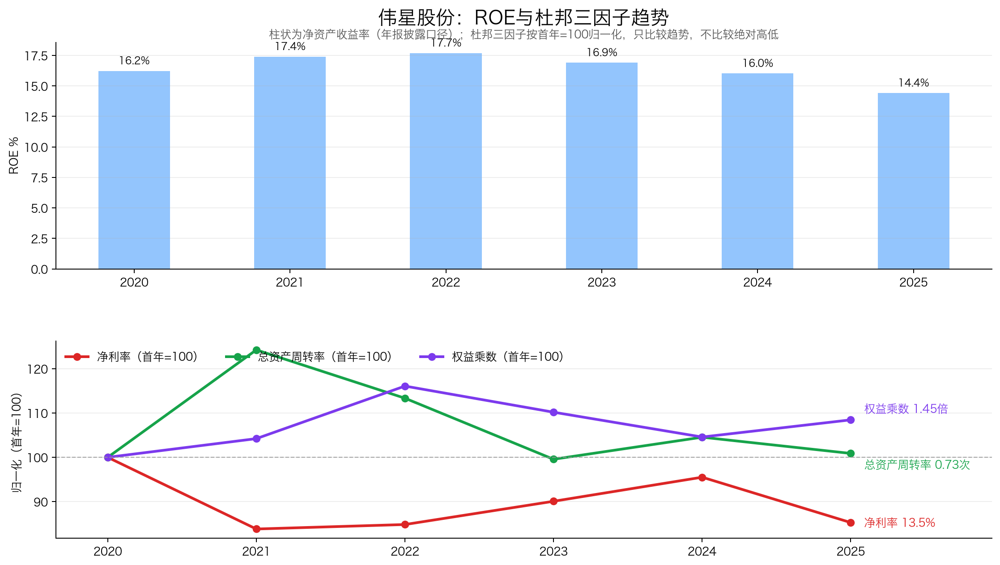
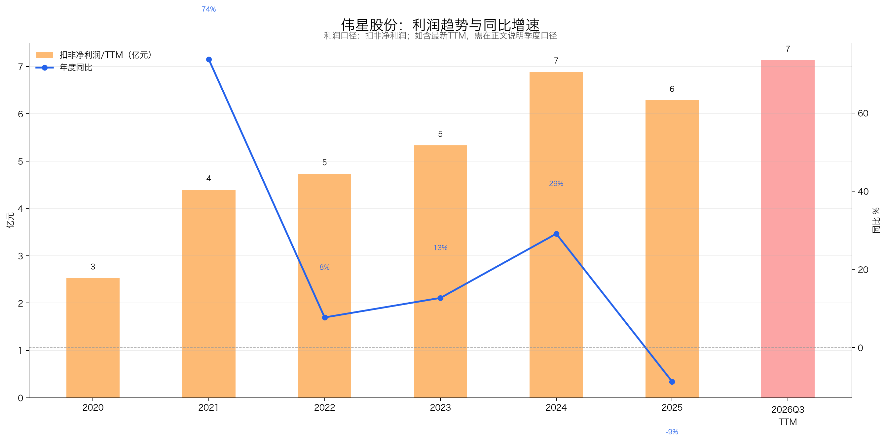
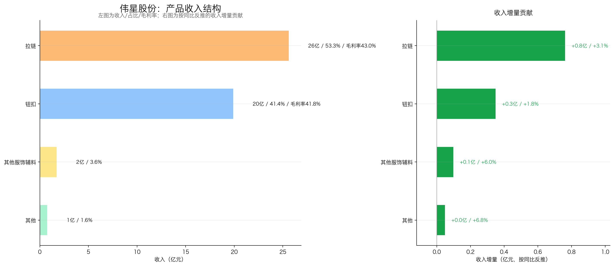
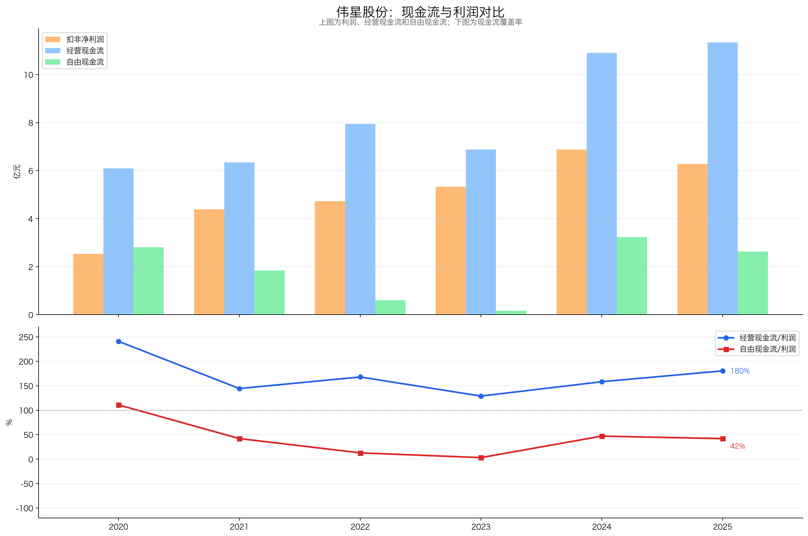
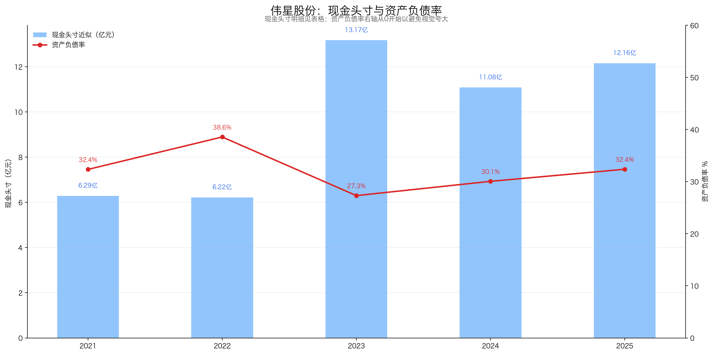
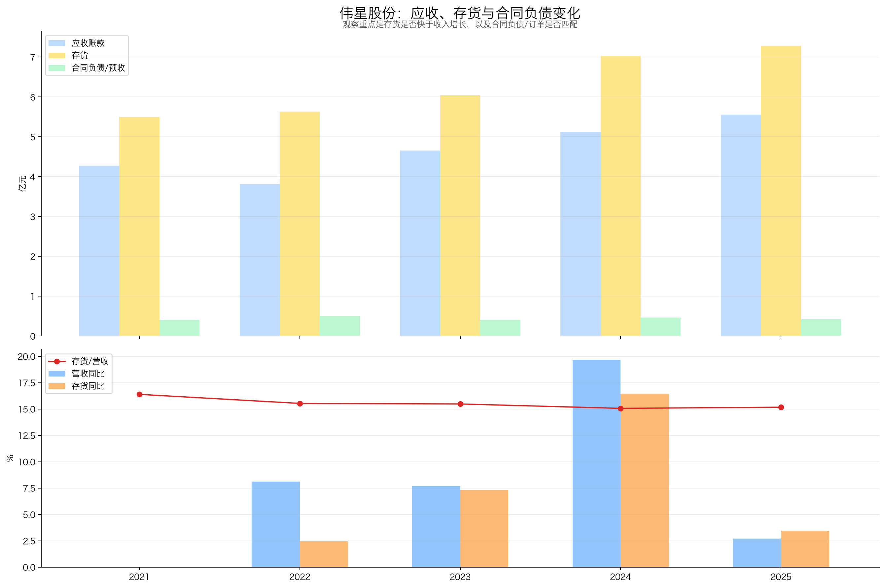
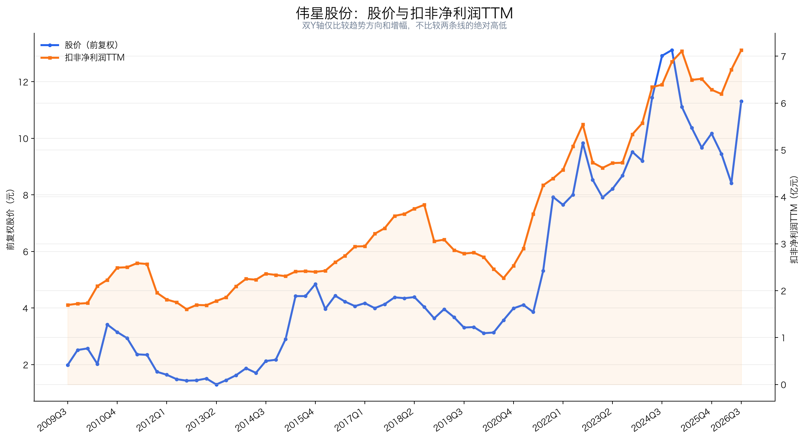
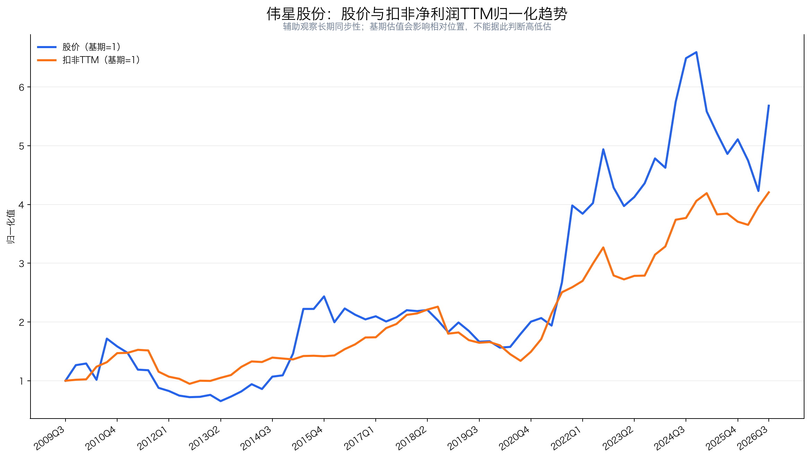

# 伟星股份（002003.SZ）投资分析报告

- **报告基准日**：2026-11-25（行情与估值快照截至 2026-11-23 收盘）
- **基准行情**：收盘价 13.07 元，总市值 155.39 亿元，PE(TTM) 21.44 倍（扣非 PE 21.79 倍），PB(MRQ) 3.24 倍
- **数据来源**：2020–2025 年官方年度报告 PDF、2026 年第一季度/半年度/第三季度报告官方 PDF、公司质押与权益分派公告、同花顺 10jqka 原始底账、东方财富终端、yfinance 前复权行情

---

## 决策摘要

| 评估模块 | 得分 | 满分 | 核心定性结论 |
|---|---:|---:|---|
| 好生意·定性 | 26.0 | 35 | 全球服饰辅料综合龙头，以结构化快反与严苛品牌认证建立较高迁移成本，并具备产品高端化隐性定价能力；但缺乏排他专利牌照，且需持续扩产投入维持竞争身位，定性未达 28.0 分门槛。 |
| 好生意·定量 | 25.5 | 35 | 近 5~6 年扣现金 ROIC 保持 15.7%~19.7%、累计净现比 1.53，底账扎实；但 2022–2025 年加权 ROE 由 17.69% 连续下移至 14.41%，2023 年依赖定增 11.82 亿元扩产且境外产能利用率不足 50%，资本效率承压。 |
| 好管理层 | 7.0 | 10 | 实控人专注实业、分红慷慨，计入定增资金后一美元内生回报仍达 2.38 倍；但分红显著透支自由现金流且无真注销回购，控股股东单体质押率升至 34.45%，部分定增项目延期或暂未达预期效益。 |
| **基本面质地小计** | **58.5** | **80** | **质地等级：B 档**（56.0~63.5 分为良好坚实资产 / 高端制造冠军） |
| 好价格 | 7.5 | 20 | **价格状态：价格偏贵**（买入信号：`-` 观望） |
| **综合总分** | **66.0** | **100** | **最终评级：B-** |

- **一句话结论**：质地坚实的高端服饰辅料制造龙头，经营收现能力突出；但近年高分红伴随定增融资与短债扩张、境外产能爬坡偏慢拉低回报率，且当前 21.4 倍 PE 透支增长预期，赔率倒挂，建议留存观察池等待回调。
- **核心矛盾**：市场以近 8.9 年 73.8% 的偏高估值分位计入了越南海外工业园放量预期，但 2025 年及 2026 年上半年境外产能利用率仍不足 50%、越南募投项目尚处亏损状态，若海外爬坡继续滞后或下游成衣需求走弱，将面临利润与估值倍数双杀。
- **关键跟踪变量**：孟加拉与越南工业园产能利用率爬坡进度、高毛利率与加权 ROE 止跌回稳信号。

---

## 一、公司概况与初筛排雷（不计分）

### 1.1 公司基本情况

| 维度 | 内容 |
|---|---|
| 股票代码/上市地 | 002003.SZ（深交所主板） |
| 基准行情与体量 | 收盘价 13.07 元，**总市值 155.39 亿元**，PE(TTM) 21.44 倍（扣非 PE 21.79 倍），PB(MRQ) 3.24 倍 |
| 主营业务与占比 | 拉链业务（占 2025 年营收 53.34%），钮扣业务（41.44%），其他服饰辅料（3.63%），其他业务（1.59%） |
| 实际控制人与核心高管 | 章卡鹏（直接持股 5.58%）、张三云（3.70%），二人通过伟星集团（持股 25.44%）构成一致行动人；董事长/总经理：蔡礼永 |
| 数据基准日 | 财务数据截至 2026 年第三季度报告（2026-09-30）；行情与估值快照截至 2026-11-23 收盘 |

### 1.2 怎么赚钱
伟星股份生产衣服和箱包上的拉链、钮扣与金属标牌辅料，直接销售给耐克、阿迪达斯、安踏、波司登、优衣库等国内外服装品牌及其指定成衣代工厂。辅料虽然只占成衣成本的 3%~5%，但一旦拉链卡齿或钮扣掉色会引发整批退货索赔，因此头部品牌极看重质量稳定性与快速交付。公司依靠国内临海、深圳基地及海外孟加拉、越南工业园，提供小批量、多品种、3~7 天快反打样交付，赚取 42% 左右的制造业高毛利。

### 1.3 有没有雷
- **财务与治理红线核查**：
  - 天健会计师事务所历年均出具标准无保留意见审计报告；
  - 账面商誉为 0 元，不存在并购商誉减值爆雷风险；
  - 控股股东伟星集团及其一致行动人合计质押 1.04 亿股，占一致行动人所持股份的 25.24%，占公司总股本仅 8.76%（无司法冻结，无爆仓危机；但伟星集团单体质押率达 34.45%，需在第四章关注）；
  - 经营现金流连续多年充沛，未见大股东资金占用或违规担保记录。
- **初筛结论**：**【通过】**

---

## 二、好生意·定性（26.0 / 35分）

### 2.1 业务简不简单、需求稳不稳？（4.5 / 5分）
伟星股份的商业逻辑简单透明，即采购树脂、铜线、锌合金等原材料，加工成拉链、钮扣销售给成衣品牌与代工厂，不依赖单一大单品赌博或频繁切换技术路线。从行业长期适应性来看，只要人类继续穿衣与使用箱包，物理闭合辅料的底层需求就不会被外部技术路线颠覆。不过，辅料位于纺织服装中游，直接受下游成衣品牌补库与去库存周期传导，订单呈现轻度消费周期波动。

| 具体指标 | 判断依据 | 得分 |
|---|---|---:|
| 业务简单清晰 | 钮扣拉链研发制造与直销，商业逻辑清晰重复，无路线赌博 | 2.0/2 |
| 需求刚性与行业适应性 | 物理辅料刚需未来5~10年无外部技术颠覆，但受服装库存周期波动 | 2.5/3 |
| **小计** |  | **4.5/5** |

### 2.2 竞争格局清不清晰？（6.0 / 8分）
全球服饰辅料市场呈两极分化：低端无品牌市场由大量小微作坊主导，长年同质化杀价；中高端品牌供应链准入门槛高，形成了日本 YKK 与伟星股份（SAB 品牌）双雄对峙的稳固格局。国内二线竞争对手浔兴股份（SBS）在体量、产品线完整度、品牌溢价与跨国就近配套能力上均明显落后。

| 可比公司（代码） | 最新市值（亿元） | PE(TTM) | 销售毛利率 | 销售净利率 | 加权 ROE | 竞争定位差异 |
|---|---:|---:|---:|---:|---:|---|
| **伟星股份（002003.SZ）** | **155.39** | **21.44** | **42.03%** | **13.50%** | **14.41%** | **全球服饰辅料综合龙头，钮扣拉链一体化与柔性快反领跑** |
| 浔兴股份（002098.SZ） | 23.99 | 11.83 | 33.29% | 7.40% | 14.65% | 国内第二大拉链商，SBS 品牌，品类偏单一且净利率显著偏低 |
| 新澳股份（603889.SH） | 59.52 | 10.38 | 19.96% | 10.22% | 13.60% | 纺织毛纺纱线细分龙头，属上游原材料制造，毛利率偏低 |

伟星在市值、毛利率与净利率上全面领先国内可比公司（2025 年加权 ROE 与高周转/高杠杆下的浔兴接近），但因中低端市场长尾竞争仍分散且海外面临 YKK 压阵，尚未形成终局绝对垄断。

| 具体指标 | 判断依据 | 得分 |
|---|---|---:|
| 行业格局与集中度 | 中高端 YKK 与伟星双雄稳固，但低端长尾分散，未达终局垄断 | 3.5/5 |
| 同行对比优势 | 市值、毛利率 42% 与净利率 13.5% 显著领跑国内直接可比同行 | 2.5/3 |
| **小计** |  | **6.0/8** |

### 2.3 护城河深不深、是在加深还是变窄？（9.5 / 14分）
服饰辅料不具备原研药或芯片级别的排他专利与特许经营牌照，后来者在法律上可以进入。伟星的真实护城河主要建立在**结构性竞争优势**与**转换成本**之上：一方面，公司通过多年积累的智能制造工艺、小批量多品种 3~7 天快反体系、国内及孟加拉/越南跨国配套产能，形成了小厂难以砸钱短期复制的系统交付能力，但维持该优势需要持续高强度资本开支（近 5 年 CapEx/营收均值 16.71%）；另一方面，辅料货值占成衣成本不到 5%，一旦出现质量事故整批成衣将遭索赔，叠加国际品牌长达 1~3 年的严苛验厂认证周期，客户迁移风险收益极不对称，迁移成本较高。

从**护城河动态趋势**来看，在 2025 年行业关税扰动下公司仍实现海外营收 +8.95% 增长，2026 年前三季度总营收同比提速至 +16.35%，显示公司正借助国际化布局继续抢占中小厂商份额，壁垒整体稳固并略有加深；但海外园区爬坡尚需时间，且与 YKK 的高端正面竞争仍在持续，暂未形成单边吞噬格局。

| 具体指标 | 判断依据 | 得分 |
|---|---|---:|
| 排他性壁垒 | 无原研专利或特许专营牌照，仅依托长周期品牌验厂认证形成准入门槛 | 1.5/4 |
| 结构性竞争优势 | 数字化快反、一体化配套与跨国基地壁垒扎实，但需高强度CapEx维持 | 3.0/4 |
| 转换成本与网络效应 | 辅料占成本低但质量责任极重，头部品牌验厂后迁移意愿低、黏性强 | 3.5/4 |
| 护城河动态趋势 | 国际逆风期份额稳中有升、2026营收重回16%增长，壁垒稳固略加深 | 1.5/2 |
| **小计** |  | **9.5/14** |

### 2.4 有没有自主或隐性定价权？（6.0 / 8分）
在需求进攻侧，面对耐克、优衣库等超级服装品牌买方，辅料供应商很难单方面直接大幅提价。但伟星具备扎实的**隐性定价权**：公司通过提升高档金属拉链、防水功能性拉链、环保再生与特殊工艺定制产品占比，实现结构性均价与单品价值量上移——拉链业务营收占比从 2024 年 53.14% 升至 2025 年 53.34%，拉链毛利率同比再提升 0.87 个百分点至 42.99%。在防御侧，上游铜、锌合金与聚酯切片价格波动时，公司依托定制化非标报价与“原材料成本联动+协商调价”机制，能够顺畅传导成本压力。

| 具体指标 | 判断依据 | 得分 |
|---|---|---:|
| 主动提价与隐性定价权 | 难向大客户直接硬提价，但靠功能拉链与定制升级持续兑现结构提价 | 3.5/5 |
| 成本转嫁机制 | 非标定制重报价与原材料成本联动机制成熟，大宗波动期传导扎实 | 2.5/3 |
| **小计** |  | **6.0/8** |

---

## 三、好生意·定量（25.5 / 35分）

### 3.1 赚钱效率高不高、靠什么驱动？（9.5 / 14分）
2020–2025 年公司平均加权 ROE 为 16.44%（2021–2025 近 5 年均值为 16.48%），扣现金净投入资本回报率（ROIC）保持在 15.73%~19.72%（含账面现金全投入资本口径 ROIC 为 12.37%~15.40%），长期明显跑赢制造业资本成本。但必须重视**趋势下行信号**：加权 ROE 自 2022 年高点 17.69% 起连续三年走低（17.69% → 16.90% → 16.02% → 14.41%），2025 年已跌破 15% 基准线（摊薄 ROE 仅 14.13%）；扣现金 ROIC 亦从 2021 年 19.72% 回落至 2025 年 15.73%（全投入资本口径降至 12.37%）。

> 注：图名中的 4.x 为标准图表套件编号，对应本报告 3.x 节（如 4.1 图对应 3.1 节），下文同。

| 年份 | 归母净利(亿) | 加权 ROE | 全投入资本 ROIC | 扣现金净 ROIC | 销售净利率 | 总资产周转率 | 权益乘数 | 资产负债率 |
|---|---:|---:|---:|---:|---:|---:|---:|---:|
| 2020 | 3.96 | 16.23% | 14.18% | 17.28% | 15.83% | 0.73 次 | 1.34 | 23.87% |
| 2021 | 4.49 | 17.40% | 15.40% | 19.72% | 13.27% | 0.90 次 | 1.40 | 32.35% |
| 2022 | 4.89 | 17.69% | 14.61% | 18.47% | 13.43% | 0.82 次 | 1.56 | 38.57% |
| 2023 | 5.58 | 16.90% | 13.18% | 17.60% | 14.26% | 0.72 次 | 1.48 | 27.32% |
| 2024 | 7.00 | 16.02% | 14.23% | 18.83% | 15.12% | 0.76 次 | 1.40 | 30.06% |
| 2025 | 6.45 | 14.41% | 12.37% | 15.73% | 13.50% | 0.73 次 | 1.45 | 32.38% |

**杜邦与回报质量透视**：高回报主要由 13.3%~15.8% 的较高销售净利率驱动，长期有息负债极低（2024–2025 年长期借款归零）。2023 年 11.82 亿元定增落地加上持续扩产，导致净资产与固定资产基数大幅膨胀，总资产周转率由 2021 年 0.90 次回落至 2025 年 0.73 次，是近年 ROE 与 ROIC 阶梯式下移的直接原因。结合 ROE 守线纳入核心证伪阈值，本节按知行合一铁律严格控制得分上限。

| 具体指标 | 判断依据 | 得分 |
|---|---|---:|
| ROE/ROIC水平与趋势 | 扣现金ROIC仍处15.7%以上高于WACC，但ROE连续3年下行且2025年跌破15% | 4.5/7 |
| 杜邦驱动与回报质量 | 13.5%+净利率驱动、无长债高杠杆；但定增与扩产拖累资产周转率回落 | 5.0/7 |
| **小计** |  | **9.5/14** |

### 3.2 利润增长真不真、毛利费用稳不稳？（6.5 / 8分）
2020–2025 年公司营收从 24.96 亿元增至 48.00 亿元（5 年 CAGR 13.97%），扣非净利润从 2.53 亿元增至 6.29 亿元（5 年 CAGR 19.96%）。但 2020 年受疫情冲击属低基数，剔除后 2021–2025 年扣非复合增速为 **9.36%**（2022–2025 年为 **9.92%**），且 2025 年受关税与汇兑损失（净损失 3,536.92 万元）影响，营收仅增 2.69%、扣非利润同比下滑 8.70%。2026 年前三季度，公司实现营收 42.26 亿元（同比 +16.35%）、扣非净利润 6.57 亿元（同比 +14.80%），业绩重回双位数内生增长。

| 核心业务线 | 2025年收入（亿元） | 收入占比 | 同比增速 | 毛利率 | 业务增量与定位说明 |
|---|---:|---:|---:|---:|---|
| 拉链产品 | 25.60 | 53.34% | +3.07% | 42.99% | 第一大营收支柱，高端金属与防水拉链放量拉升毛利 |
| 钮扣产品 | 19.89 | 41.44% | +1.79% | 41.76% | 传统基石主业，受客户结构波动毛利率同比微降 1.20pct |
| 其他服饰辅料 | 1.74 | 3.63% | +6.03% | 未单列 | 金属标牌、搭扣等新品类延伸；与下项合并残差毛利率 **34.43%** |
| 其他业务 | 0.77 | 1.59% | +6.84% | 未单列 | 边角料及废料等收入（总成本减钮扣/拉链反推残差成本 1.64 亿） |
| **合计** | **48.00** | **100.0%** | **+2.69%** | **42.03%** | **各分项与 2025 年报总营收 480,031.49 万元严格吻合** |

综合毛利率从 2021 年 38.02% 稳步上行至 2025 年 42.03%，2026 年前三季度进一步升至 42.76%。2026 年前三季度销售费用率 8.75%、管理费用率 9.52%、研发费用率 3.88%（全部费用化），整体费用控制审慎。

| 具体指标 | 判断依据 | 得分 |
|---|---|---:|
| 扣非真实增长与兑现 | 剔除2020低基数后扣非CAGR约9.4%~9.9%，2025负增后2026Q3恢复至+14.8% | 3.0/4 |
| 毛利率与费用率控制 | 毛利率由38%稳步升至42.76%，销管研三费控制审慎无买量烧钱 | 3.5/4 |
| **小计** |  | **6.5/8** |

### 3.3 赚的是真金白银还是账面富贵？（7.0 / 10分）
公司经营现金流收现含金量极强：2020–2025 年累计实现归母净利润 32.37 亿元，同期累计经营活动现金流量净额（CFO）达 **49.51 亿元**，累计净现比高达 **1.53**。

| 年份 | 归母净利(亿) | 经营现金流 CFO(亿) | 购建资产支出 CapEx(亿) | 自由现金流 FCF(亿) | 净现比(CFO/净利) | CapEx/营收 |
|---|---:|---:|---:|---:|---:|---:|
| 2020 | 3.96 | 6.10 | 3.29 | 2.81 | 1.54 | 13.17% |
| 2021 | 4.49 | 6.34 | 4.50 | 1.85 | 1.41 | 13.40% |
| 2022 | 4.89 | 7.95 | 7.34 | 0.61 | 1.63 | 20.24% |
| 2023 | 5.58 | 6.88 | 6.71 | 0.16 | 1.23 | 17.18% |
| 2024 | 7.00 | 10.90 | 7.66 | 3.24 | 1.56 | 16.38% |
| 2025 | 6.45 | 11.35 | 8.71 | 2.63 | 1.76 | 18.15% |
| **近5~6年累计** | **累计 32.37** | **累计 49.51** | **累计 38.21** | **累计 11.30** | **均值 1.53** | **均值 16.71%** |

**高端制造资本效率与再融资核查**：
公司近 6 年 CapEx/营收均值高达 16.71%，属于典型重资产投入型制造企业，不适用轻资产满分通道。严苛核查造血效率与融资依赖度发现三项现实短板：
1. **自由现金流转化偏低且曾依赖外部定增**：2020–2025 年累计 CFO 虽覆盖了 38.21 亿元 CapEx，但累计自由现金流仅 11.30 亿元（**FCF/净利润仅 34.9%**）。为推进国内扩产与越南出海，公司于 **2023 年 9 月实施定向增发（发行 1.32 亿股，实际募集资金净额 11.82 亿元）**，并非完全依靠内生资金滚动扩张；
2. **境外扩产产能利用率偏低、尚处投入消化期**：[2025 年报](file:///Users/pidan-l/Documents/investment/stocks/002003_伟星股份/data/pdf_text/2025_伟星股份_年度报告.txt#L976-L983)与 [2026 半年报](file:///Users/pidan-l/Documents/investment/stocks/002003_伟星股份/data/pdf_text/2026_伟星股份_半年度报告.txt#L618-L625)披露，公司境外（孟加拉+越南）产能利用率分别为 **48.15%** 和 **49.53%**（连续低于 50%），其中越南服装辅料募投项目 2025 年实现效益 **-2,973.97 万元**（累计 -8,805.78 万元），年产 2.2 亿米高档拉链扩建项目建设期延期两年；
3. 本项直面全篇核心矛盾与证伪指标二，按知行合一铁律得分严格控制在 70% 上限内。

| 具体指标 | 判断依据 | 得分 |
|---|---|---:|
| 利润含金量（累计净现比） | 6年累计CFO 49.51亿、净现比1.53，主业回款极其扎实 | 4.5/5 |
| 资本效率与造血纯度 | 累计FCF仅占净利35%，依赖11.82亿定增补强扩产且境外产能利用率<50% | 2.5/5 |
| **小计** |  | **7.0/10** |

### 3.4 家底厚不厚、资产有没有水分？（2.5 / 3分）
截至 2026 年三季末，公司账面货币资金 13.45 亿元，长期借款为 0 元；但短期借款从 2025 年末 9.43 亿元进一步增至 **11.42 亿元**（另有一年内到期非流动负债 0.13 亿元、租赁负债 0.14 亿元）。扣除全部短期与一年内到期借款后，严格净金融现金仅 **1.90 亿元**（若剔除受限资金与尚未用完的定增专户结余，自由可支配净现金较为单薄），呈现出一定程度“借入短期银行借款以匹配营运资金与高额现金分红”的资金结构特征，债务安全扣 0.5 分。

营运资产方面，2026Q3 应收账款（7.42 亿元）与存货（8.39 亿元）随销售旺季与营收增长自然扩张，前三季度信用减值损失 1,188.57 万元；临海大洋工业园主体工程完工转固，在建工程较年初大幅下降 37.00% 至 2.28 亿元，商誉为 0 元，未见隐蔽资产减值水分。

| 具体指标 | 判断依据 | 得分 |
|---|---|---:|
| 债务安全与资金真伪 | 无长债，但短债升至11.42亿，扣全部短债后严格净现金仅1.90亿偏薄 | 1.0/1.5 |
| 营运排雷与资产水分 | 商誉为0，应收存货与旺季发货匹配，在建工程按期转固无水分 | 1.5/1.5 |
| **小计** |  | **2.5/3** |

---

## 四、好管理层（7.0 / 10分）

### 4.1 有没有坑小股东、说话算不算数？（3.0 / 4分）
控股股东伟星集团持股 25.44%，实控人章卡鹏与张三云合计直接及间接控制公司；实控人团队长期专注实业，未见清仓减持或大额异常关联交易。需如实指出的细节是：2026 年 1 月再质押公告后，控股股东及一致行动人合并质押率为 25.24%（占总股本 8.76%，整体安全可控），但**伟星集团单体质押率升至 34.45%**（略超 30% 单体警示线）。

会计诚实度方面，研发支出全部费用化、折旧与减值计提老实审慎；但兑现维度上，2023 年定增三大实体募投项目中，受关税环境及调试节奏影响，2025 年有两项（越南项目、织带搬迁一期）未达预计效益、一项（2.2 亿米拉链扩建）延期两年，扣减 0.5 分。

| 具体指标 | 判断依据 | 得分 |
|---|---|---:|
| 治理底线与利益绑定 | 一致行动人合并质押率25.24%可控，但控股股东单体质押率34.45%偏高 | 1.5/2 |
| 言行兑现与会计诚实 | 研发全费用化、会计诚实，但2023年定增募投项目多有延期或未达预期 | 1.5/2 |
| **小计** |  | **3.0/4** |

### 4.2 赚了钱怎么花、分不分给股东？（4.0 / 6分）
2021–2025 年，公司累计实现归母净利润 28.40 亿元，累计向股东派发现金红利 **24.65 亿元**，累计现金分红比例高达 **86.8%**，派息意愿极为突出。但对照现金流与回购底账，存在两项重要审视点：
1. **分红透支自由现金流与“高分红+再融资”闭环**：2021–2025 年累计 FCF 仅 8.49 亿元（2021–2025 分别为 1.85、0.61、0.16、3.24、2.63 亿元），同期 24.65 亿元现金分红占累计 FCF 比例高达 **290.3%**，分红与扩产的资金缺口实则由 **2023 年 11.82 亿元定向增发**及逐步攀升的短期借款填补；
2. **无二级市场真注销回购**：2021–2025 年连续五年年报“股份回购实施进展”均列示为不适用。资产负债表中的“库存股”（2025 年末 1.30 亿元、2026Q3 为 1.05 亿元）系第五、六期第一类限制性股票激励向员工增发新股所确认的回购义务挂账，本质为**低价发新股激励**，并非真金白银从二级市场回购注销。

**修正巴菲特“一美元原则”检验**：将近 5 年留存利润（3.75 亿元）与 2023 年定增净募资（11.82 亿元）合并作为增量权益资本分母（合计 **15.57 亿元**）：

| 项目 | 近 5 年累计数值（亿元） | 对应指标与结论 |
|---|---:|---|
| 近 5 年累计未分配利润留存总额 | 3.75 | 2021–2025 年归母净利 28.40 亿 - 现金分红 24.65 亿 |
| 近 5 年外部股权再融资净额 | 11.82 | 2023 年 9 月定增 1.32 亿股实际募集资金净额 |
| 增量权益资本分母合计 | 15.57 | 留存利润 + 外部股权再融资净额（剔除单纯靠融来的股本注水） |
| 最新总市值较 2020 年末市值增量 | 102.48 | 2020 年末 52.91 亿元增至当前 155.39 亿元 |
| **修正表观一美元比率（口径A）** | **6.58** | **`市值增量 ÷ (留存利润 + 股权再融资)`（含估值上移贡献）** |
| **修正估值归一化一美元比率（口径B）** | **2.38** | **`(2020年末PE 14.86 × 5年净利增量 2.49) ÷ 15.57`（真内生资本回报）** |
| **综合资本配置判定** | **【通过】** | **计入定增资金后内生利润比率仍达 2.38 倍，主业专注且长期创造正价值** |
| 近 5 年累计现金分红总额 | 24.65 | 占同期累计自由现金流（8.49 亿）比例 **290.3%** |
| 历史股份回购去向核实 | 0.00 | 近 5 年无二级市场股份回购；账面库存股属第一类限制性股票激励发新股挂账 |

| 具体指标 | 判断依据 | 得分 |
|---|---|---:|
| 分红意愿与真回购 | 近5年派息率86.8%慷慨，但分红占FCF达290%依赖定增短债且无真回购 | 2.0/3 |
| 主业专注与修正一美元原则 | 严守主业不跨界，计入11.82亿定增后估值归一化一美元比率达2.38倍 | 2.0/3 |
| **小计** |  | **4.0/6** |

---

## 五、好价格（7.5 / 20分）

### 5.1 现在估值贵不贵？（3.5 / 10分）
基准收盘价 13.07 元、总市值 155.39 亿元，对应滚动过去 4 个季度（2025Q4–2026Q3）扣非净利润 7.13 亿元的表观扣非 PE 为 **21.79 倍**（归母净利润 TTM 7.25 亿元对应 PE 为 **21.44 倍**）。

| 估值指标 | 数值 | 计算口径与基准说明 |
|---|---:|---|
| 最新股价与总市值 | 13.07 元 / 155.39 亿元 | 截至 2026-11-23 收盘 |
| 扣非净利润 TTM | 7.13 亿元 | 滚动过去 4 个季度（2025Q4–2026Q3） |
| 当前表观 PE(TTM) | 21.44 倍（扣非 21.79 倍） | 总市值 ÷ 滚动净利润 TTM |
| **可用历史 PE(TTM) 分位** | **73.8%** | 统计区间 2018-01-02 至 2026-11-23（约 8.9 年，中位数 18.65 倍，10% 分位 14.07 倍） |
| 彼得·林奇纯净现金 | 13.45 亿元 | 货币资金 13.45 亿 - 长期有息负债 0 亿 |
| 纯净现金占总市值比例 | 8.65% | 低于 20% 强力资产托底线（严格扣短债后仅 1.90 亿、占比 1.22%） |
| **扣现金后实际 PE** | **19.90 倍** | （总市值 - 纯净现金 13.45 亿）÷ 扣非净利润 TTM（扣归母基准约 19.58 倍） |

**估值纵向与横向研判**：当前 21.44 倍 PE 处于历史 73.8% 偏高带（50%~80% 区间），明显高于历史中位数 18.65 倍，归一化趋势图显示股价阶段性抢跑利润增长。横向对比看，国内同行浔兴股份 PE 11.83 倍、新澳股份 10.38 倍，伟星享有近一倍的龙头估值溢价，安全边际偏薄。

| 具体指标 | 判断依据 | 得分 |
|---|---|---:|
| 纵向分位与林奇收益线 | PE处历史73.8%偏高分位（中位数18.65倍），股价相对利润略抢跑 | 2.0/6 |
| 扣现金 PE 与横向对比 | 纯现金占市值仅8.65%，扣现PE仍达19.90倍，相对同行溢价充分 | 1.5/4 |
| **小计** |  | **3.5/10** |

### 5.2 拿着等得起吗？（2.5 / 5分）
2025 年度公司已实施中期分红（0.10 元/股，1.17 亿元）与年度分红（0.40 元/股，4.76 亿元），全年合计每股派息 **0.50 元**（总额 5.9244 亿元）。按当前股价 13.07 元计算，到手股息率为 **3.83%**（按派息总额除以总市值计为 **3.81%**）。

| 口径 | 金额（亿元） | 占当前市值 | 自由现金流 FCF 覆盖倍数 |
|---|---:|---:|---:|
| 股息率：2025 年度已实施现金分红（主锚） | 5.92 | 3.81%（按每股计 3.83%） | 0.44 倍（近 5 年均值 0.35 倍） |
| 回购注销收益率：近 3 年年均注销式回购 | 0.00 | 0.00% | 不适用 |
| **股东总回报率合计** | **5.92** | **3.81% ~ 3.83%** | **0.44 倍** |

**回报与现金流覆盖透视**：3.8% 左右的现金股息率具备一定持有防守性，但公司 2025 年单年 FCF（2.63 亿元）对 5.92 亿元分红的覆盖倍数仅为 0.44 倍，高分红可持续性高度依赖在建资本开支回落与海外项目开始正向造血。此外，林奇纯现金占市值 8.65%，而扣除 11.42 亿元短期借款及一年内非流动负债后严格净现金仅占市值 1.2%，资产价格托底厚度较弱。

| 具体指标 | 判断依据 | 得分 |
|---|---|---:|
| 股东总回报率与现金覆盖 | 股息率3.83%防守尚可，但无注销回购且FCF覆盖仅0.44倍不足1倍 | 2.0/3 |
| 纯净现金市值占比托底 | 纯现金占市值8.65%，扣除短债后严格净现金仅占1.2%，托底偏薄 | 0.5/2 |
| **小计** |  | **2.5/5** |

### 5.3 往下亏多少、往上赚多少？（1.5 / 5分）
不采用券商乐观预测，基于 2025 年归母净利润 6.45 亿元（当前总市值 155.39 亿元），按历史分位 PE 进行未来 3 年压力测试：

- **保守档（测算抗跌底线）**：若全球服装补库偏弱且海外园区持续低利用率拖累折旧，利润 3 年零增长横盘（维持 6.45 亿元），估值回落至历史 10% 低分位（14.07 倍 PE），测算期末总市值为 **90.75 亿元**，价格潜在回撤 **-41.6%**（若回落至 25% 分位 15.72 倍 PE，期末市值 101.39 亿元，回撤 **-34.8%**）。即便扣除 3 年约 11.4% 累计股息，总亏损仍达 -23%~-30%。
- **中性档（测算内生增长空间）**：取年均复合 **9.0%** 的常态内生增速（低于 2021–2025 年扣非 CAGR 9.36% 及 2020–2025 年归母 CAGR 10.22%），3 年后归母净利润增至 8.35 亿元；期末估值回归 5.1 核验的近 8.9 年中位数 **18.65 倍 PE**，测算期末总市值为 **155.73 亿元**，3 年价格空间仅为 **+0.2%**（若以最新 TTM 归母净利 7.25 亿元为基期、3 年后达 9.39 亿元测算，期末市值 175.12 亿元，上行空间 **+12.7%**）。
- **赔率评估**：保守档下行风险 -35% 至 -42%，中性档上行空间 0% 至 +13%，风险收益比严重倒挂，远未达到 1:3 的不对称买入标准。

| 具体指标 | 判断依据 | 得分 |
|---|---|---:|
| 保守下行底线 | 利润横盘遇杀估值至10%~25%分位，回撤-35%~-42%，含息仍净亏23%~30% | 0.5/2 |
| 中性空间与赔率不对称 | 9%复合增速被估值向18.65倍中位数收敛对冲，3年空间仅0%~13%倒挂 | 1.0/3 |
| **小计** |  | **1.5/5** |

---

## 六、总结与评分汇总（不计分）

### 6.1 基本面定性（好生意与好管理层：决定胜率）
伟星股份是全球服饰辅料领域的优质制造业龙头，凭借 3~7 天柔性快反交付、头部品牌严苛验厂认证以及中高端产品结构升级，在微利分散的下游成衣链条中长期赚取 42% 毛利率与 15.7%~19.7% 的扣现金净 ROIC，经营现金流极其扎实（6 年累计净现比 1.53）。

但放在更严谨的买方标准下，伟星属于**“重资产扩产型高端制造冠军”而非“轻资产躺赢复利印钞机”**：一方面，行业缺乏排他专利或牌照保护，维持市场份额需要每年高达营收 16%~18% 的资本开支；另一方面，近年 11.82 亿元定增、短债攀升至 11.42 亿元与境外产能利用率不足 50%，已经令加权 ROE 连续三年滑落至 14.41%，且 86.8% 的高派息显著超过同期自由现金流。因此，基本面质地客观锁定在 **B 档（58.5 / 80 分）**。

### 6.2 好时机与价格判定（纯分数定买入信号：决定赔率）
第五章好价格实得分 **7.5 / 20 分**：
- **当前价格状态定性**：**【价格偏贵】**
- **买入信号判定**：**【 `-`（观望信号，耐心等待） 】**
  * *判定依据*：好价格得分 7.5 分（<12.0 分为合理或偏贵观望 `-`）。
- **一句话依据**：当前 PE(TTM) 21.44 倍处于可用历史 73.8% 偏高分位，扣除短债后严格净现金占市值仅 1.2%，3.83% 的股息率难以对冲估值均值回归带来的 30% 以上下行风险。

### 6.3 综合判断、独立风险矩阵与买方行动建议
- **最终综合评级**：**【 B- 】**
- **行动建议**：**留存次级观察池，耐心等待估值与产能利用率双重验证，绝不追高**。对于 B 档高端制造冠军，合意买点需等待 PE 回落至历史 25% 分位以下（约 ≤ 15.5 倍、对应股价 9.5~10.0 元一带，且好价格得分回升至 12 分以上），此时方具备不对称赔率。
- **独立风险矩阵（不计分，与正文字段 70% 得分上限强联动）**：

| 风险类别 | 发生概率 | 影响程度 | 核心监控指标 | 触发动作 |
|---|---|---|---|---|
| 竞争加剧与大客户压价 | 中 | 高 | 综合销售毛利率、加权 ROE/ROIC | 连续两期毛利率 < 38% 或 ROE < 12%，下调 2.3/3.1 评分并降级 |
| 海外资本开支低效 | 中高 | 高 | 境外产能利用率、越南项目净利润、FCF | 连续两期境外营收负增或海外产能利用率仍 < 50% 且持续亏损，下调 3.3 评分并减仓 |
| 下游宏观与关税冲击 | 中 | 中高 | 国际业务增速、应收与存货周转天数 | 连续两期总营收负增长或应收/存货周转恶化超 20%，重新测算保守底线 |
| 治理与质押/再融资 | 低 | 高 | 控股股东质押率、新增股权融资预案 | 控股股东一致行动人质押超 50% 或再度大额低效圈钱，触发治理减持 |

- **核心跟踪变量与量化证伪阈值（以持续两个报告期过滤单季短期噪声）**：
  1. **证伪指标一（盈利与壁垒松动）**：若综合销售毛利率连续两个季度跌破 **38.0%**，或年化加权 ROE 连续两个报告期跌破 **12.0%** → 表明下游品牌压价加剧或高端定制溢价失效，推翻护城河逻辑，降级撤退。
  2. **证伪指标二（海外扩产消化失败）**：若境外业务营收连续两个报告期同比负增长，或 2026 年报披露境外工业园产能利用率仍滞留在 **50% 以下**且越南项目继续亏损 → 表明重资本出海沦为沉没折旧包袱，触发量化减仓或剔除观察池纪律。

### 6.4 13 项评分汇总大表

| 序号 | 评估维度 | 满分 | 实得分 | 核心打分依据（15~30字） |
|:---:|---|---:|---:|---|
| **2.1** | 商业模式与需求刚性 | 5 | 4.5 | 钮扣拉链模式简单，物理刚需无外部颠覆但受服装库存周期影响 |
| **2.2** | 行业格局：月朗星稀 | 8 | 6.0 | 中高端YKK与伟星双雄稳固，毛利净利领先同行，低端仍分散 |
| **2.3** | 护城河与动态趋势 | 14 | 9.5 | 无排他专利，靠认证转换成本与快反领先且份额微升但需高CapEx |
| **2.4** | 定价权与抗通胀 | 8 | 6.0 | 大客户直提价受限，但高端拉链升级实现隐性提价且成本联动扎实 |
| **小计** | **好生意·定性** | **35** | **26.0** | **优质结构化快反龙头，但缺排他壁垒且资本维持重（未达28分）** |
| **3.1** | 综合回报：ROE/ROIC与杜邦 | 14 | 9.5 | 扣现ROIC达15.7%以上，但ROE连续3年降至14.4%且受知行合一约束 |
| **3.2** | 利润成色：增长与毛利 | 8 | 6.5 | 剔除基数后扣非复合约9.5%~10%，26Q3恢复14.8%，毛利稳升三费审慎 |
| **3.3** | 自由现金流与资本效率 | 10 | 7.0 | 净现比1.53扎实，但依赖11.8亿定增且境外利用率<50%亏损，受70%封顶 |
| **3.4** | 资产负债：排雷与底线 | 3 | 2.5 | 0商誉、0长债、在建正常转固，但短债升至11.42亿致严格净现金偏薄 |
| **小计** | **好生意·定量** | **35** | **25.5** | **收现极佳但ROE下滑、海外爬坡偏慢且有短债匹配高分红压力** |
| **4.1** | 治理底线：排雷与言行 | 4 | 3.0 | 会计诚实无减持，但伟星集团单体质押34.45%且定增项目部分延期未达效 |
| **4.2** | 资本配置：分红、回购与再投资 | 6 | 4.0 | 派息率86.8%但占FCF达290%且无真回购，含定增后一美元B口径2.38倍 |
| **小计** | **好管理层** | **10** | **7.0** | **主业专注、分红慷慨但依赖外部再融资，不存在真注销回购** |
| **汇总** | **基本面质地总分** | **80** | **58.5** | **质地等级：B 档（良好坚实资产 / 高端制造冠军）** |
| **5.1** | 估值位置：林奇线与PE | 10 | 3.5 | PE处近8.9年73.8%偏高分位，扣现PE 19.9倍溢价同行近一倍 |
| **5.2** | 股东持有回报：股息率 | 5 | 2.5 | 股息率3.83%但FCF覆盖仅0.44倍，扣短债严格净现金仅占市值1.2% |
| **5.3** | 安全边际：三年测算 | 5 | 1.5 | 保守回撤-35%~-42%（含息仍亏23%~30%），中性上行0%~13%赔率倒挂 |
| **小计** | **好价格总分** | **20** | **7.5** | **价格状态：价格偏贵（买入信号：`-` 观望）** |
| **总计** | **投资价值总分** | **100** | **66.0** | **最终评级：B-（质地良好但价格偏贵，留存观察池，等待击球点）** |

---

## 附录：数据边界与核验记录

- **数据截止日**：财务报表截至 2026 年第三季度（2026-09-30）；二级市场行情、同业快照与历史分位截至 2026-11-23 收盘。
- **官方财报比对**：已核验 2020–2025 年官方年度报告 PDF、2026 年第一季度/半年度/第三季度报告 PDF 及质押/分红公告，与同花顺底账一致。
- **勾稽核对**：2025 年拉链（25.60 亿）+ 钮扣（19.89 亿）+ 其他服饰辅料（1.74 亿）+ 其他（0.77 亿）= 48.00 亿元，与营业总收入严格相等；近 6 年 CFO（49.51 亿）- CapEx（38.21 亿）= FCF（11.30 亿）；13 项打分加总（26.0 + 25.5 + 7.0 + 7.5 = 66.0 分）准确无误。
- **修正一美元原则**：2021–2025 年未分配利润留存 3.75 亿元 + 2023 年定增净募资 11.82 亿元 = 15.57 亿元；表观市值比率 6.58 倍，估值归一化内生利润比率 2.38 倍。
- **ROE / ROIC 口径**：ROE 采用年报披露加权平均 ROE；ROIC 采用 `EBIT × (1 - 有效税率) ÷ 期初期末平均投入资本`，正文同时列示含账面现金全投入资本口径与扣货币资金净投入资本口径。
- **遗留未验证事项**：
  1. 2025 年报仅对占营收 10% 以上的拉链、钮扣单独披露营业成本与毛利率，“其他服饰辅料”和“其他业务”未单独披露毛利率（正文合并按残差反推合计毛利率为 34.43%）；
  2. 东财估值历史序列可用起始日为 2018-01-02（约 8.9 年，非完整 10 年）。
