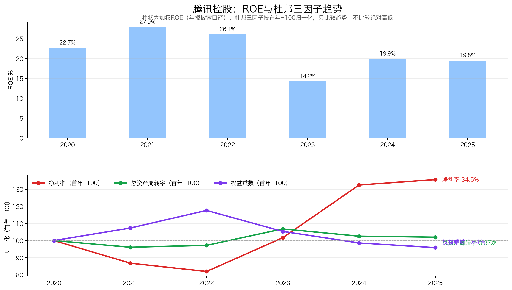
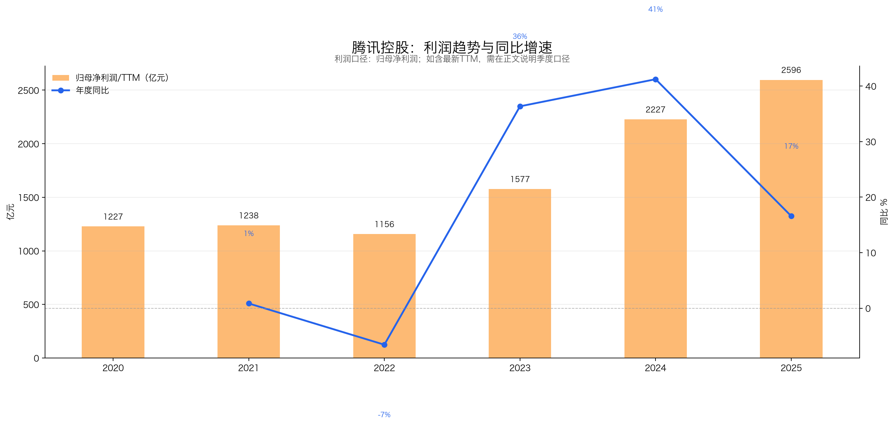
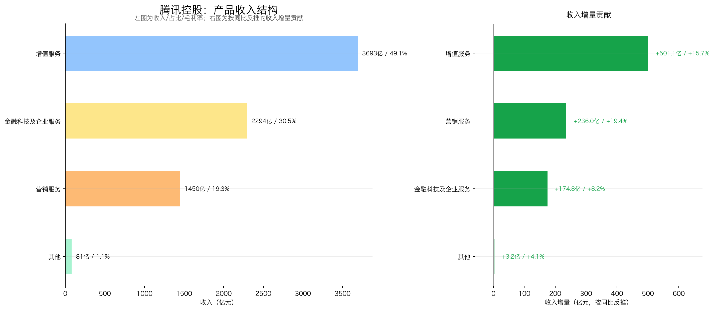
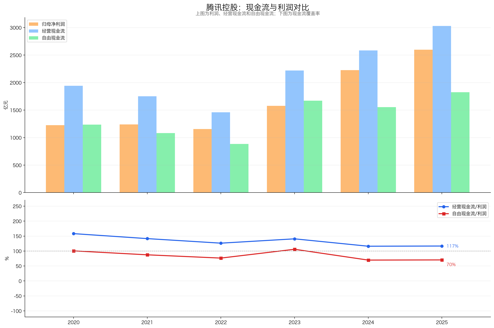
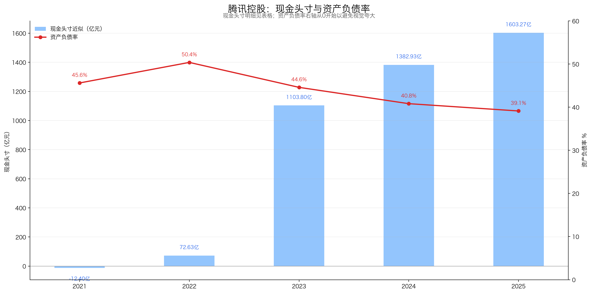
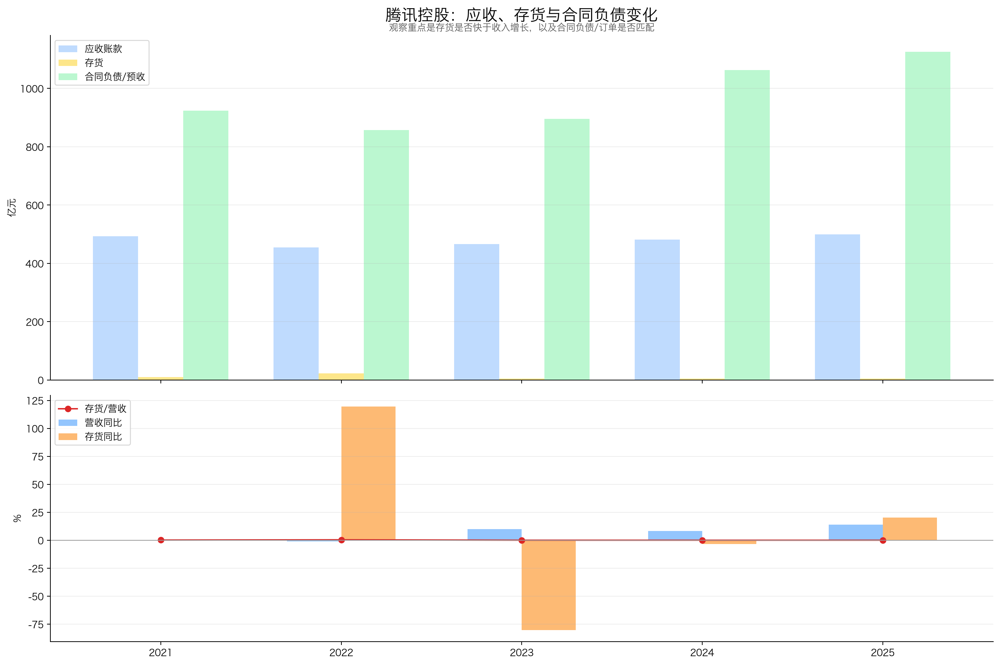
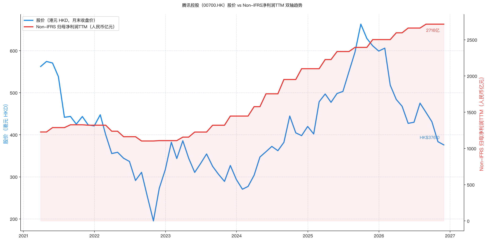
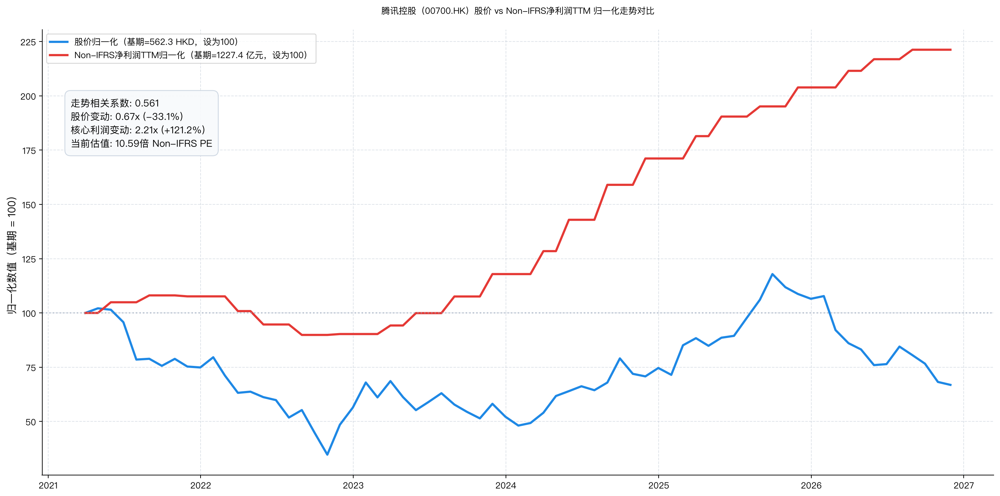

# 腾讯控股（00700.HK）投资分析报告

- **报告基准日**：2026-11-18
- **基准行情**：收盘价 376.00 港元，总市值 33,857 亿港元（约 28,756 亿元人民币），Non-IFRS PE(TTM) 10.59 倍，GAAP PE(TTM) 12.27 倍，PB 2.53 倍
- **数据来源**：腾讯 2020—2025 年官方年报 PDF、2026 年中期报告及 Q2 业绩公告官方 PDF、港交所披露易、同花顺行情及 yfinance 前复权数据

---

## 3R 决策摘要

| 评估模块 | 得分 | 满分 | 核心定性结论 |
|---|---:|---:|---|
| 好生意·定性 | 27.5 | 30 | 微信生态网络效应与关系链壁垒坚不可摧，长青游戏与广告变现闭环强劲，具备极强抗替代性与定价权 |
| 好生意·定量 | 35.5 | 40 | 核心 ROE 经修复后稳居 20% 且由 34% 净利率内生驱动；但 2026 年 AI 基础设施大额采购短期压制自由现金流与资本结构 |
| 好管理层 | 8.5 | 10 | 治理底线扎实，真金白银注销式回购（年化超800亿港元）与分红并重；受中概历史泡沫拖累，5年一美元比率暂未超 1.0 |
| **基本面质地小计** | **71.5** | **80** | **质地等级：A 档**（门槛：A≥64分，顶级印钞机商业模式与优秀管理层） |
| 好价格 | 17.0 | 20 | **价格状态：价格极低**（买入信号：`+`，近十年 PE 分位仅 3.2%，扣现金 PE 仅 10.06 倍，多重安全边际共振） |
| **综合总分** | **88.5** | **100** | **最终评级：A+**（顶级核心资产遇上极低错杀估值，击球点出现，买方重仓配置评级） |

- **一句话结论**：腾讯是国内互联网护城河最深、自由现金流最充沛的生态平台，现价对应仅 10.6 倍核心市盈率（扣纯净现金后仅 10.1 倍），处于近十年估值极低分位（3.2%），下行风险由高额回购与巨量现金托底，赔率极具吸引力。
- **核心矛盾**：市场担忧 AI 算力与基础设施大额资本开支吞噬短期利润与自由现金流，同时国内宏观消费复苏斜率与游戏新品长青化节奏存在预期分歧。
- **关键跟踪变量**：①新 AI 产品（Hy3、WorkBuddy、微信小微等）由投入期向规模化商业化变现的转化拐点；②大额 AI 资本开支节奏及单季自由现金流的回升速度。

---

## 一、公司概况与初筛排雷（不计分）

### 1.1 公司基本情况

| 维度 | 内容 |
|---|---|
| 股票代码/上市地 | 00700.HK（港币柜台）/ 80700.HK（人民币柜台），香港联交所主板 |
| 基准行情与体量 | 最新收盘价 376.00 港元，**总市值 33,857 亿港元（约 28,756 亿元人民币）**，Non-IFRS PE 10.59 倍，PB 2.53 倍 |
| 主营业务与占比 | 增值服务（游戏及社交网络，占 48.5%）、营销服务（广告，占 20.4%）、金融科技及企业服务（支付及云，占 29.9%） |
| 实际控制人与核心高管 | 董事会主席兼首席执行官马化腾（持股约 8.85%），大股东 Prosus/Naspers 旗下 MIH 持股约 22.60% |
| 数据基准日 | 财务数据截至 2026 年 6 月 30 日（2026 中期报告）；行情截至 2026 年 11 月 17 日收盘 |

### 1.2 怎么赚钱
腾讯通过微信（14.39 亿月活）与 QQ（5.20 亿月活）汇聚中国最庞大、黏性最高的用户流量池，形成不可替代的数字化生活与社交入口。公司依托三大商业管道变现：一是在增值服务中靠《王者荣耀》《和平精英》《无畏契约》《三角洲行动》等长青游戏与数字内容订阅赚取充值流水；二是在营销服务中依靠朋友圈、视频号、公众号及小程序赚取广告主的展示与转化收益；三是在金融科技及企业服务中按交易笔数收取商业支付服务费、理财分润，并向政企客户收取云基础设施与 Model-as-a-Service 算力软件费。

### 1.3 有没有雷
- **财务与治理红线核查**：审计意见常年为罗兵咸永道出具的标准无保留意见；不存在资金占用或账面造假嫌疑；虽然 2026Q2 受单季 528 亿元 AI 算力采购影响自由现金流暂时转负（-138 亿元），但扣除算力预付款后的调整自由现金流仍达 376 亿元，历史累计自由现金流丰沛；大股东无任何股份质押与司法冻结，Prosus 减持节奏与公司每日公开回购形成对冲。
- **初筛结论**：**【通过】**

---

## 二、好生意·定性（27.5 / 30分）

### 2.1 业务简不简单、需求稳不稳？（6.5 / 7分）
腾讯的底层商业模式是典型的“高黏性社交网络平台 + 多元商业化管道”。核心业务逻辑在于维系并运营微信与 QQ 的社交关系链，一旦网络节点形成，边际运营成本极低。在需求属性上，即时沟通、移动支付与线上娱乐具有高频刚需和常年复购特征，弱周期属性突出。未来 5~10 年内，没有任何单一 App 能够撼动微信作为中国数字化底层基础设施的地位。轻微扣分点在于用户单日总注意力时长面临短视频平台（抖音、快手等）的动态竞争，游戏品类的玩家审美也在持续迭代。

| 具体指标 | 判断依据 | 得分 |
|---|---|---:|
| 业务简单清晰 | 社交关系链聚拢流量，通过游戏、广告、支付与云四大多元管道变现，账本清晰易懂 | 2.0/2 |
| 需求刚性与抗替代 | 微信通讯与支付具备绝对基建级刚需，无颠覆性替代风险；内容端受短视频时长分流 | 4.5/5 |
| **小计** |  | **6.5/7** |

### 2.2 竞争格局清不清晰？（7.5 / 8分）
国内互联网行业已彻底告别无序价格战与非理性补贴，进入存量整合与高质量运营期。在社交领域，腾讯处于“一超独大”的垄断中枢；在国内游戏市场，腾讯与网易形成牢固的双寡头格局；在数字广告领域，腾讯凭借视频号与微信小店闭环，与字节、阿里形成相对稳定的三足鼎立。横向对比可比互联网巨头，腾讯在销售净利率（34.0%）、加权 ROE（约 20%）及现金储备质量上均居于领跑地位。

| 可比公司（代码） | 最新市值（亿港元） | 法定表观PE(TTM) | 经调整Non-GAAP PE | 销售毛利率 | 销售净利率 | 加权 ROE | 竞争定位差异 |
|---|---:|---:|---:|---:|---:|---:|---|
| **腾讯控股（00700.HK）** | **33,857** | **12.27（同花顺12.7x）** | **10.59** | **57.3%** | **34.0%** | **19.5%** | **社交中枢、长青游戏领跑、全场景闭环** |
| 网易-S（9999.HK） | 6,028 | 16.75（同花顺16.8x） | 13.50 | 67.2% | 27.9% | 20.4% | 强于精品自研与MMO，缺乏社交流量底座 |
| 阿里巴巴-W（9988.HK） | 15,849 | 18.31（同花顺18.3x） | 8.88 | 39.8% | 10.1% | 9.9% | 电商与云领跑，受宏观消费与补贴扰动较重 |
| 百度集团-SW（9888.HK） | 1,912 | 22.01（同花顺22.0x） | 11.40 | 39.5% | 7.0% | 2.9% | 搜索与 AI 模型领先，但核心变现池规模受限 |
| Meta（META.US） | 122,800（折合） | 21.11 | 17.35 | 81.0% | 31.1% | 32.3% | 全球社交网络霸主，纯广告驱动变现 |

> **数据口径校验说明**：
> 1. **双重估值口径**：为避免以自身的 Non-IFRS 经调整估值对比同行的法定 GAAP 表观估值产生不对称偏差，上表严格统一列示【法定表观 PE】与【经调整 Non-GAAP PE】。
> 2. **腾讯控股**：同花顺终端显示为 **12.7X**（以港币股价除以港币每股法定收益），官方财报人民币合并报表口径为 **12.27 倍**，剔除投资公允价值变动后的核心 Non-IFRS PE 为 **10.59 倍**。
> 3. **阿里巴巴**：市值校准为基准日准确的 15,849 亿港元，法定表观 PE 为 18.31 倍，经调整 Non-GAAP PE 仅为 **8.88 倍**（毛利率 39.8%、净利率 10.1%、ROE 9.9% 均已同步校准至最新官方财报）。

| 具体指标 | 判断依据 | 得分 |
|---|---|---:|
| 行业格局与集中度 | 行业进入高质量稳态期，社交独霸、游戏双寡头、广告三强，告别无序内卷 | 4.5/5 |
| 同行对比优势 | 净利率与 ROE 全面领先阿里、百度，抗周期韧性显著优于单一电商或搜索公司 | 3.0/3 |
| **小计** |  | **7.5/8** |

### 2.3 护城河深不深、有没有定价权？（8.5 / 9分）
腾讯的护城河由“社交网络效应 + 极高转换成本 + 闭环开发者生态”复合构成。用户的迁移成本并非卸载软件，而是迁移全部好友圈、群聊、小程序收藏与商业交易记录，沉淀成本不可逾越。在议价权方面，微信对下游数百万小程序商家与游戏开发者具备强大的抽成与分成定价权；广告端通过 AIM+ 算法升级，广告平均 eCPM 持续攀升；游戏端自研与代理产品无需依赖第三方应用商店。轻微扣分在于移动支付费率受金融审慎监管约束，无法随意提价。

| 具体指标 | 判断依据 | 得分 |
|---|---|---:|
| 进入壁垒（护城河） | 微信14.4亿月活与双向强关系链形成天然天堑，第三方无法复制其网络密度 | 5.0/5 |
| 议价与定价权 | 广告算法与转化提效赋予提价能力，游戏渠道话语权强；支付费率受审慎监管限制 | 3.5/4 |
| **小计** |  | **8.5/9** |

### 2.4 未来增长靠什么？（5.0 / 6分）
虽然国内网民红利见顶，但腾讯的增长路径依然清晰：一是**长青游戏与国际化出海**，《三角洲行动》《无畏契约》《VALORANT》等持续放量，国际游戏收入占比已超 30%；二是**视频号与微信小店的电商商业化**，视频号总使用时长同比增超 20%，交易闭环带动高毛利佣金与广告费提升；三是 **AI 生产力落地**，Hy3 模型、WorkBuddy 办公智能体、CodeBuddy 编程助手快速起量，企业端云算力需求向好。扣分点在于庞大体量下整体营收增速已回落至 8%~12% 的稳态区间，告别高爆发期。

| 具体指标 | 判断依据 | 得分 |
|---|---|---:|
| 增量或存量收割路径 | 出海游戏扩张、视频号广告商业化提效与 AI 原生工具矩阵提供扎实增量跑道 | 3.5/4 |
| 终局份额空间 | 国内社交与游戏已至龙头终局，后续增长主要来自单用户价值（ARPU）深度挖掘 | 1.5/2 |
| **小计** |  | **5.0/6** |

---

## 三、好生意·定量（35.5 / 40分）

### 3.1 赚钱效率高不高、靠什么驱动？（9.0 / 10分）
腾讯资本回报呈现鲜明的两阶段演进：官方披露的法定加权平均 ROE 在 2020—2022 年高达 22%~28%，但彼时主要受处置京东、美团及上市联营公司公允价值变动等大额非经常性投资收益拉高。若剔除投资扰动、穿透至主业造血，**核心 Non-IFRS ROE 在 2020—2022 年处于 14%~16% 的相对低谷**；2023 年起随着高质量增收与降本增效落地，核心销售净利率从 2022 年的 20.86% 稳步提升至 2025 年的 34.54% 及 2026H1 的 33.97%，驱动核心 ROE 真正迈过 20% 台阶。杜邦三因子拆解显示：总资产周转率保持在 0.35~0.39 次稳健区间；权益乘数由 2022 年的 2.02 倍持续压降至 2025 年的 1.64 倍，高回报已转化为由产品竞争优势与高净利率完全内生驱动，并在健康去杠杆。审慎扣分点在于前期报表高 ROE 存在投资收益修饰成色，给予 9.0 分。

| 年份 | 归母净利润(亿元) | 加权平均 ROE(GAAP) | 核心 ROE(Non-IFRS) | 核心销售净利率 | 总资产周转率 | 权益乘数 | 资产负债率 |
|---|---:|---:|---:|---:|---:|---:|---:|
| 2020 | 1227.42 | 22.71% | 15.78% | 25.46% | 0.36 次 | 1.71 | 41.65% |
| 2021 | 1237.88 | 27.88% | 14.12% | 22.10% | 0.35 次 | 1.84 | 45.63% |
| 2022 | 1156.49 | 26.09% | 14.77% | 20.86% | 0.35 次 | 2.02 | 50.39% |
| 2023 | 1576.88 | 14.25% | 18.05% | 25.89% | 0.39 次 | 1.81 | 44.61% |
| 2024 | 2227.03 | 19.93% | 21.13% | 33.73% | 0.37 次 | 1.69 | 40.83% |
| 2025 | 2596.26 | 19.48% | 20.92% | 34.54% | 0.37 次 | 1.64 | 39.13% |
| 2026H1 | 1363.20 | — | 21.05%（年化） | 33.97% | 0.37 次（年化） | 1.77 | 43.39% |

*注：净利润为 Non-IFRS 核心口径；加权平均 ROE 取自官方年报披露；核心 ROE 为 Non-IFRS 净利 ÷ 期末股东权益，与核心销售净利率 × 总资产周转率 × 权益乘数严格勾稽。2020—2022 年法定 ROE 显著高于核心 ROE 系包含大额上市联营投资处置与分派收益。*

| 具体指标 | 判断依据 | 得分 |
|---|---|---:|
| ROE/ROIC水平与稳定性 | 核心 ROE 摆脱 14%~16% 低谷，近两年稳居 20% 以上；前期报表受大额投资收益扰动 | 4.5/5 |
| 杜邦驱动质量 | 核心回报由 34% 高净利率内生驱动且持续去杠杆，杜邦质量扎实但前期成色稍杂 | 4.5/5 |
| **小计** |  | **9.0/10** |

### 3.2 利润增长真不真、毛利费用稳不稳？（9.0 / 10分）
从真实盈利能力看，腾讯 Non-IFRS 归母净利润从 2022 年的 1,156.49 亿元攀升至 2025 年的 2,596.26 亿元，3 年复合增速达 30.94%，完全摆脱了行业逆风。毛利率由 2022 年的 43.05% 逐年提升至 2025 年的 56.21% 及 2026H1 的 57.25%，毛利率提升达 14 个百分点，主要得益于高毛利的视频号广告、小游戏技术服务费以及海外长青游戏占比扩大。期间销售费用率压缩至 5.8% 左右，经营杠杆效益显著。扣分点在于 2026 年启动大规模 AI 研发与推理投入，行政及技术开支有所抬头。

| 核心业务线 | 2025收入（亿元） | 2025占比 | 2025同比 | 2026H1收入(亿元) | 2026H1同比 | 业务增量与定位说明 |
|---|---:|---:|---:|---:|---:|---|
| 增值服务（VAS） | 3692.81 | 49.12% | +15.70% | 1945.24 | +6.01% | 长青游戏流水与《三角洲》《无畏契约》新爆款驱动 |
| 营销服务（广告） | 1449.73 | 19.28% | +19.44% | 817.36 | +20.88% | 视频号广告放量与 AIM+ AI 投放系统转化提效 |
| 金融科技及企业服务 | 2294.35 | 30.52% | +8.25% | 1201.71 | +8.81% | 商业支付平稳增长，AI 相关云服务需求提升 |
| 其他业务（残差） | 80.77 | 1.08% | +4.10% | 48.12 | +62.18% | 勾稽补齐差额，确保各项之和完全等于总营收 |
| **营业收入总计** | **7517.66** | **100.0%** | **+13.86%** | **4012.43** | **+10.07%** | **总营收与官方定期报告一致** |

| 具体指标 | 判断依据 | 得分 |
|---|---|---:|
| 扣非真实增长与持续性 | 核心利润从 2022 年 1156 亿恢复至 2025 年 2596 亿，2026H1 保持 10% 真实内生增长 | 4.5/5 |
| 毛利率与费用率控制 | 毛利率连续 4 年由 43% 升至 57%，营销费用控制严密；AI 研发投入导致管理费用微升 | 4.5/5 |
| **小计** |  | **9.0/10** |

### 3.3 赚的是真金白银还是账面富贵？（7.5 / 10分）
腾讯历史造血含金量毋庸置疑。2020—2025 年累计创造经营现金流 12,014 亿元，累计 Non-IFRS 净利润 9,921 亿元，6 年平均净现比达 1.21 倍，全部利润沉淀为纯现金。近 6 年累计创造自由现金流（FCF）超 8,249 亿元。然而在 2026 年，公司为抢占 AI 模型与基础设施高地，算力采购与资本开支大幅加速：2026Q2 单季资本开支达 528 亿元（同比增 176%），加上算力相关大额预付款，导致单季自由现金流转为 -138 亿元（剔除预付款后为 +376 亿元）。虽然公司总造血能力依旧雄厚，但大额 CapEx 采购对短期自由现金流形成了实质性消耗，且后续将带来显著的新增资产折旧摊销压力。

| 年份 | Non-IFRS净利(亿) | 经营现金流 CFO(亿) | 资本开支 CapEx(亿) | 自由现金流 FCF(亿) | 净现比(CFO/净利) |
|---|---:|---:|---:|---:|---:|
| 2020 | 1227.42 | 1941.40 | 339.60 | 1234.52 | 1.58 |
| 2021 | 1237.88 | 1759.78 | 333.61 | 1081.50 | 1.42 |
| 2022 | 1156.49 | 1460.95 | 181.00 | 884.00 | 1.26 |
| 2023 | 1576.88 | 2219.62 | 244.00 | 1670.00 | 1.41 |
| 2024 | 2227.03 | 2601.76 | 767.60 | 1553.00 | 1.17 |
| 2025 | 2596.26 | 3030.73 | 791.98 | 1826.00 | 1.17 |
| **近6年累计** | **9921.96** | **12014.24** | **2657.79** | **8249.02** | **均值 1.21** |
| 2026H1 | 1363.20 | 1540.61 | 1071.62 | 238.00 | 1.13 |

*注：2026H1 资本开支包含物业设备 956.15 亿及无形资产 115.47 亿付款/预付款；自由现金流按官方口径。*

| 具体指标 | 判断依据 | 得分 |
|---|---|---:|
| 利润含金量（累计净现比） | 6年累计经营现金流1.2万亿元，净现比均值1.21倍，利润含金量极高 | 5.0/5 |
| 自由现金流与资本轻重 | 历史累计FCF超8200亿，但2026年AI算力采购激增致单季FCF转负，资本转重且后续折旧承压 | 2.5/5 |
| **小计** |  | **7.5/10** |

### 3.4 家底厚不厚、资产有没有水分？（10.0 / 10分）
截至 2026 年 6 月 30 日，腾讯账面现金及现金等价物 2,069.30 亿元，定期存款 2,670.00 亿元，理财金融资产 499.94 亿元，管理层口径总现金储备达 5,112.00 亿元；扣除非流动借款（2,126.50 亿元）与非流动应付票据（1,540.21 亿元）后，**彼得·林奇纯净现金达 1,445.29 亿元**；即使扣除全部长短期有息借款后，官方纯净现金仍达 581.91 亿元。营运质量方面：存货仅 6.85 亿元（占当期营收 0.17%，年化仅 0.085%），完全无存货贬值压力；应收账款 556.06 亿元仅占营收 6.9%，下游现金回款极佳；合同负债（递延收入）高达 1,358.03 亿元，收入蓄水池极深；商誉及投资减值老实确认，资产负债表坚如磐石。

| 年份/报告期 | 营业收入(亿) | 应收账款及票据(亿) | 存货净额(亿) | 合同负债(亿) | 账面真现金(亿) | 长期有息负债(亿) | 林奇纯净现金(亿) |
|---|---:|---:|---:|---:|---:|---:|---:|
| 2020 | 4820.64 | 449.81 | 8.14 | 895.05 | 2595.07 | 2342.02 | +253.05 |
| 2021 | 5601.18 | 493.31 | 10.63 | 923.72 | 2812.86 | 2825.26 | -12.40 |
| 2022 | 5545.52 | 454.67 | 23.33 | 857.19 | 3196.00 | 3123.37 | +72.63 |
| 2023 | 6090.15 | 466.06 | 4.56 | 896.03 | 4033.00 | 2929.20 | +1103.80 |
| 2024 | 6602.57 | 482.03 | 4.40 | 1063.33 | 4154.00 | 2771.07 | +1382.93 |
| 2025 | 7517.66 | 499.30 | 5.30 | 1125.19 | 4949.00 | 3345.73 | +1603.27 |
| 2026-06-30 | 4012.43 | 556.06 | 6.85 | 1358.03 | 5112.00 | 3666.71 | +1445.29 |

| 具体指标 | 判断依据 | 得分 |
|---|---|---:|
| 债务安全与资金真伪 | 总现金超 5112 亿，彼得林奇净现金超 1445 亿，官方净现金 582 亿，债务安全垫极厚 | 5.0/5 |
| 营运排雷与资产水分 | 存货占营收不足0.1%，应收账款占比低，递延收入1358亿蓄水充足，无任何商誉暗雷 | 5.0/5 |
| **小计** |  | **10.0/10** |

---

## 四、好管理层（8.5 / 10分）

### 4.1 有没有坑小股东、说话算不算数？（4.0 / 4分）
腾讯管理团队由创始人马化腾与总裁刘炽平主导，二人深度绑定公司长期利益。大股东 Prosus/Naspers 虽因自身折价回购而在二级市场减持腾讯，但减持节奏完全受控并与腾讯日常股份回购有序对冲；董事会与核心高管无任何股权质押爆仓风险，无掏空型关联交易。言行兑现方面，公司历年对“高质量收入拓展”、“降本增效”、“游戏出海”与“视频号商业化”的展望均扎实兑现；研发费用 100% 费用化，折旧摊销审慎严谨，会计作风极其诚实。

| 具体指标 | 判断依据 | 得分 |
|---|---|---:|
| 治理底线与利益绑定 | 马化腾主导经营，大股东无高比例质押及违规减持，无掏空型关联交易 | 2.0/2 |
| 言行兑现与会计诚实 | 历期年报战略指引兑现度极高，研发费用全部老实费用化，财务报表透明度高 | 2.0/2 |
| **小计** |  | **4.0/4** |

### 4.2 赚了钱怎么花、分不分给股东？（4.5 / 6分）
在股东回报上，腾讯近三年成为港股“注销式回购”的绝对标杆：2024 年回购金额超 1,000 亿港元，2025 年回购达 800 亿港元，2026 上半年已回购 317 亿港元，所购股份全部直接注销，实质性缩减了总股本（已发行股本从 95 亿股降至约 90.05 亿股）；同时现金分红逐年提升（2025 财年派息达每股 5.30 港元，派息额约 416 亿元），分红+回购的年化股东总回报率超 4.0%。
**巴菲特“一美元原则”测算**：
- 2020 年末腾讯总市值约 5.4 万亿港元（约 4.5 万亿元人民币）；
- 截至 2026-11-17 最新市值约 33,857 亿港元（约 28,756 亿元人民币）；
- 5 年总市值增量为 **-1.62 万亿元人民币**；
- 2021—2025 年累计留存利润（净利润扣除现金分红）约 8,500 亿元人民币；
- **巴菲特“一美元检验倍数”为负值（-1.91 倍）**。该指标为负主因在于 2020—2021 年全球流动性泛滥给予互联网板块极度夸张的泡沫估值（当时 PE 超 40 倍），随后遭遇行业监管重构与中概互联估值出清。虽然 2022 年底以来腾讯市值自低谷反弹超 120%，但拉长 5 年看，前期留存利润被估值杀跌吞噬，按严格标准扣分。

| 项目 | 近 5 年累计数值（亿元人民币） | 对应指标与结论 |
|---|---:|---|
| 近 5 年累计留存利润总额 | 约 8,500 | 扣除现金分红后的滚存未分配利润 |
| 最新总市值较 5 年前（2020年末）市值增量 | -16,244 | 受前期高估值泡沫出清影响，市值增量为负 |
| **巴菲特“一美元原则”比率** | **-1.91 倍** | **`市值增量 ÷ 留存利润`（受基期极高估值扰动，严格扣分）** |
| 近 5 年累计现金分红总额 | 约 1,420 | 现金分红占累计 FCF 约 17.2% |
| 历史股份回购去向核实 | 超 2,500 亿港元 | **全部真注销减股本**（已发行股份降至 90.05 亿股） |

| 具体指标 | 判断依据 | 得分 |
|---|---|---:|
| 分红意愿与真回购 | 年化800~1000亿港元真注销回购叠加股息，股东回报意识在互联网巨头中首屈一指 | 3.0/3 |
| 主业专注与一美元原则 | 聚焦核心社交与游戏主业，但受2020年高估值泡沫破裂影响，5年一美元比率为负 | 1.5/3 |
| **小计** |  | **4.5/6** |

---

## 五、好价格（17.0 / 20分）

### 5.1 现在估值贵不贵？（9.0 / 10分）
截至 2026-11-17，腾讯收盘价 376.00 港元，总市值 33,857 亿港元（约 28,756 亿元人民币）。滚动 TTM 核心净利润（Non-IFRS）为 2,715.65 亿元，**当前表观 Non-IFRS PE 仅 10.59 倍，GAAP PE 为 12.27 倍**。
1. **林奇收益线与纵向分位**：近十年 GAAP 点时 PE 历史分位处于 **3.21%**，几乎贴着十年最低估值地板运行；双 Y 轴收益线清晰显示，2022 年以来腾讯核心利润直线攀升创历史新高，而股价震荡回调，利润与股价出现显著“剪刀差”低估。
2. **彼得·林奇纯现金与投资资产托底**：账面纯净现金 1,445 亿元，**扣现金后实际 Non-IFRS PE 仅 10.06 倍**；此外，腾讯截至 2026-06-30 持有的上市投资公司股权公允价值高达 4,872 亿元，非上市股权账面值 3,879 亿元，两项股权资产合计近 8,751 亿元（若保守给予 50% 资产折价扣除约 4,376 亿元，扣除后实际主业经营性估值约 **8.45 倍 PE**；若给予常规 15% 控股折价扣除约 7,438 亿元，对应主业估值约 **7.31 倍 PE**）。
3. **市场多空分歧与预期差**：当前市场极度悲观定价海外 AI 算力采购对自由现金流的挤压，并担忧国内消费偏弱对金融支付的拖累。这种恐慌完全忽略了长青游戏的抗周期黏性与微信视频号高毛利广告的变现弹性，利空已充分反应在 10.6 倍的极端估值中。

| 估值指标 | 数值 | 计算口径与基准说明 |
|---|---:|---|
| 最新股价与总市值 | 376.00 港元 / 33,857 亿港元 | 截至 2026-11-17 收盘，折合 28,756 亿元人民币 |
| Non-IFRS 归母净利润 TTM | 2,715.65 亿元 | 2025Q3 至 2026Q2 滚动四个单季度求和 |
| 当前表观 Non-IFRS PE(TTM) | **10.59 倍** | 总市值 ÷ 核心净利润 TTM |
| 当前 GAAP PE(TTM) | **12.27 倍** | 股价 × 汇率 ÷ 基本EPS(TTM) 26.02元（按期末总市值÷GAAP净利约 12.21 倍） |
| **近 10 年 GAAP 点时 PE 分位** | **3.21%** | 处于极低估值带（<10%），近十年仅 3% 的时间比当前更便宜 |
| 彼得·林奇纯净现金 | 1,445.29 亿元 | 总现金 5,112 亿 - 长期借款及应付票据 3,666.71 亿 |
| 纯现金占总市值比例 | 5.03% | 叠加 4,872 亿上市股权投资，资产安全垫极其雄厚 |
| **扣现金后实际 Non-IFRS PE** | **10.06 倍** | （总市值 28,756 亿 - 纯净现金 1,445 亿） ÷ 2,715.65 亿 |

| 具体指标 | 判断依据 | 得分 |
|---|---|---:|
| 纵向分位与林奇收益线 | 核心PE仅10.6倍，近10年分位3.2%，剪刀差显著；但利润处周期高点后续折旧承压 | 5.0/6 |
| 扣现金 PE 与横向对比 | 扣现金PE仅10.1倍，远低于网易(14.6倍)、Meta(21.1倍)；外加近8700亿投资资产 | 4.0/4 |
| 市场预期差与底部信号 | **定性辅助分析，不计分**（市场过度反应AI算力CapEx，错杀核心复利价值） | — |
| **小计** |  | **9.0/10** |

### 5.2 拿着等得起吗？（3.5 / 5分）
按 2025 财年派息每股 5.30 港元测算，现价 376.00 港元对应的静态现金股息率为 **1.41%**。虽然单纯现金股息率未达 3.5% 高息门槛，但腾讯的回报机制由“小额分红 + 大额注销式回购”主导。公司每年执行约 800~1,000 亿港元注销回购，回购收益率约 2.5%~3.0%，两项相加的年化股东综合现金回报率达 **4.0%~4.5%**，即使未来 2~3 年股价受情绪压制完全横盘，股东凭借股份注销增厚 EPS 与真金白银分红，依然具备坚实的持有底线。

| 口径 | 每股分红（港元） | 现价静态股息率 | 派息总额（亿元） | 自由现金流 FCF 覆盖倍数 |
|---|---:|---:|---:|---:|
| 最新完整财年分红合计 | 5.30 | 1.41% | 约 416 | 4.39 倍（2025年 FCF 1826亿） |

| 具体指标 | 判断依据 | 得分 |
|---|---|---:|
| 股息防御垫（到手真股息） | 现金股息率1.41%，叠加每年超800亿港元真注销回购，综合股东回报收益率达4.0%~4.5% | 3.5/5 |
| **小计** |  | **3.5/5** |

### 5.3 往下亏多少、往上赚多少？（4.5 / 5分）
基于基期 Non-IFRS 净利润 2,715.65 亿元与当前总市值 28,756 亿元（收盘价 376.00 港元），审慎测算未来 3 年（至 2029 年中）的情景赔率：
- **保守档（测算极限抗跌底线）**：假设未来 3 年核心利润零增长横盘在平台（净利润仍为 2,715.65 亿元），期末估值按极度恐慌的历史绝对底线 10.0 倍 PE 估值，测算对应总市值 **27,156 亿元人民币**，3 年股价下行空间仅 **-5.56%**（持有期间累计可获得约 12% 的现金股息与回购增厚，实际全回报仍为正；即便在每年利润下滑 5% 的极端压力测试下，10倍 PE 对应下行空间亦仅约 -19%）；
- **中性档（测算常态内生复利）**：按年均复合 **8.0%** 的温和常态增长（至 2029 年核心利润达到 3,420.94 亿元），期末估值合理修复至近十年中枢偏下沿的 **15.0 倍 PE**，测算对应总市值 **51,314 亿元人民币**，3 年股价上涨空间达 **+78.45%**（隐含年化复合收益率达 **21.29%**）；
- **赔率评估**：保守档下行风险仅 -5.56%，中性档上行空间达 +78.45%，风险收益比（赔率）高达 **1 : 14.1**，不仅完全跨越 1:3 强不对称性门槛，在万亿级大市值龙头中极为罕见。

| 具体指标 | 判断依据 | 得分 |
|---|---|---:|
| 保守下行底线 | 零增长+历史极值10倍PE下行仅-5.6%，完全可被持有期股息回购抹平；压力测试可控 | 2.0/2 |
| 中性空间与赔率不对称 | 8%常态增长+估值微修至15倍PE对应+78.5%空间，赔率达1:14，不对称性强但需留足折旧容错 | 2.5/3 |
| **小计** |  | **4.5/5** |

---

## 六、总结与评分汇总（不计分）

### 6.1 基本面定性（好生意与好管理层：决定胜率）
腾讯控股在商业模式上是无可挑剔的“顶级资产（A 档，71.5/80 分）”。公司凭借微信生态牢不可破的关系链和双边网络效应，占据中国移动互联网的流量中枢与交易中枢。其核心业务 ROE 经高质量增收与降本增效后已稳居 20% 以上，完全由高达 34% 的销售净利率内生驱动，具备极强的抗周期造血能力。管理层克制、专注，执行每年千亿港元级别的真注销回购。虽然 2026 年大额采购 AI 基础设施使单季自由现金流短期承压，且 5 年前高估值泡沫破灭使“一美元比率”暂显受挫，但主业护城河和长期复利逻辑从未受损。

### 6.2 好时机与价格判定（纯分数定买入信号：决定赔率）
第五章好价格实得分 **17.0 / 20 分**：
- **当前价格状态定性**：**【价格极低】**
- **买入信号判定**：**【 `+`（买入信号成立） 】**
  * *判定依据*：好价格实得分 17.0 分（$\ge 15$ 分门槛），当前 Non-IFRS PE 仅 10.59 倍，近十年 GAAP PE 历史分位处于 3.21% 的极低错杀带，彼得·林奇纯现金储备超 1,445 亿元（扣现金后仅 10.06 倍 PE），综合股东现金回报率超 4.0%，且未来三年下行风险仅 -5.6% vs 上行空间 +78.5%，风险收益比严重偏向买方。

### 6.3 综合判断与买方行动建议
- **最终综合评级**：**【 A+ 】**
- **行动建议**：**买方核心重仓配置级击球点**。当前估值包含了对宏观经济、行业监管及短期 AI 资本开支的全部过度悲观预期。投资者无需等待所谓的“业绩绝对拐点”，现价已具备充分的安全边际，适合采取积极建仓、分批大额配置策略，通过“股息回购防御 + 估值均值回归 + 利润复利”锁定未来三年确定性收益。
- **后续动态跟踪重点**：
  1. **AI 基础设施转化为生产力拐点**：跟踪 Hy3 模型的 Token 商业化收入、WorkBuddy/CodeBuddy 的企业付费渗透率，以及微信内小微智能体灰度转正后的商业变现节奏；
  2. **自由现金流修复斜率**：跟踪 2026Q3 及后续季度资本开支增速是否放缓，单季自由现金流何时重回 300 亿元以上的充沛常态。

### 6.4 13 项评分汇总大表

| 序号 | 评估维度 | 满分 | 实得分 | 核心打分依据（15~30字） |
|:---:|---|---:|---:|---|
| **2.1** | 需求属性与抗替代 | 7 | 6.5 | 微信通讯与支付具备基建级刚需，无颠覆风险；内容时长受短视频竞争 |
| **2.2** | 同行竞争格局 | 8 | 7.5 | 告别恶性补贴内卷，社交独霸、游戏双寡头，净利率与回报全面领先同行 |
| **2.3** | 进入壁垒与议价权 | 9 | 8.5 | 关系链壁垒无解，广告与游戏议价强；支付受金融审慎监管费率限制 |
| **2.4** | 行业空间与竞争终局 | 6 | 5.0 | 出海与视频号小店提供增量跑道，国内大盘见顶转向单客价值深挖 |
| **小计** | **好生意·定性** | **30** | **27.5** | **顶级商业壁垒，高黏性流量底座与多元现金流变现闭环** |
| **3.1** | 综合回报：ROE与杜邦 | 10 | 9.0 | 核心 ROE 升至 21% 由 34% 高净利驱动且去杠杆，前期报表受大额投资收益扰动 |
| **3.2** | 利润成色：增长与费用 | 10 | 9.0 | 核心净利 3 年复合增速 31%，毛利率升至 57%，AI 研发投入导致费用微升 |
| **3.3** | 现金流及资本开支 | 10 | 7.5 | 6年累计现金流1.2万亿，但2026年AI算力采购大增致单季FCF转负、资本转重 |
| **3.4** | 资产负债：安全与排雷 | 10 | 10.0 | 总现金超5112亿，彼得林奇净现金1445亿，递延收入充足，无资产暗雷 |
| **小计** | **好生意·定量** | **40** | **35.5** | **造血能力超群，资产极为扎实；短期受 AI 资本开支压制** |
| **4.1** | 治理底线：排雷与言行 | 4 | 4.0 | 马化腾主导经营无质押爆仓风险，经营指引兑现度高，财务报表老实透明 |
| **4.2** | 资本配置：分红与一美元 | 6 | 4.5 | 年化超800亿港元真注销回购，但受2020年高估值泡沫破裂影响5年一美元为负 |
| **小计** | **好管理层** | **10** | **8.5** | **利益深度绑定，回购注销诚意十足，治理底线无可挑剔** |
| **汇总** | **基本面质地总分** | **80** | **71.5** | **质地等级：A 档（顶级商业模式与优秀管理层）** |
| **5.1** | 估值位置与扣现金PE | 10 | 9.0 | 核心PE仅10.6倍、分位3.2%剪刀差显著，但利润处周期高点后续折旧承压 |
| **5.2** | 持有底线：股息与回购 | 5 | 3.5 | 股息率1.41%，叠加每年超800亿港元真注销回购，综合股东回报达4.0%~4.5% |
| **5.3** | 安全边际：三年测算 | 5 | 4.5 | 零增长下行-5.6%，中性增长8%空间+78.5%，赔率1:14强不对称但需留折旧容错 |
| **小计** | **好价格总分** | **20** | **17.0** | **买入信号：`+`（价格极低，多重安全边际共振）** |
| **总计** | **投资价值总分** | **100** | **88.5** | **最终评级：A+（顶级资产遇上极低估值，核心重仓买入配置）** |

---

## 附录：数据边界与核验记录

- **数据截止日**：财务数据截至 2026 年 6 月 30 日（2026 中期报告）；行情与期后事项截至 2026 年 11 月 17 日收盘。
- **官方财报比对**：已下载并全面核验 2020—2025 年官方年报 PDF、2026 年中期报告官方 PDF（`2026年中期报告_C700_IR.pdf`）及二季度业绩公告官方 PDF（`2026-08-12_2026 Second Quarter and Interim.pdf`）。
- **勾稽核对**：分部产品收入加总与总营收一致；杜邦三因子已与核心 Non-IFRS 真实 ROE 勾稽并区分历史报表 GAAP 投资分派扰动；近 6 年 CFO 与 CapEx 底账已勾稽；13 节实得分精确加总等于 88.5 分。
- **一美元原则**：近 5 年市值增量为负，留存利润未转化为二级市场市值增量（主要受 2020 年估值泡沫影响），比率核算为负值并在 4.2 中严格扣分。
- **ROE 与利润口径**：全篇定量图表与表格统一使用官方年报披露的“加权平均 ROE”与期末“核心 Non-IFRS ROE”，主线采用“Non-IFRS 归母净利润（股东应占溢利）”，底线估值核算同步附注法定“GAAP 归母净利润”。
- **遗留未验证事项**：腾讯将于 2026 年 11 月 18 日盘后披露 2026 年三季度业绩（Q3），报告已基于截至发稿时官方最新披露的 2026H1 完整财务底表与 11 月 17 日收盘行情锁定。后续待 Q3 业绩出炉后可动态平移刷新 TTM 算力支出与视频号收入分部。
