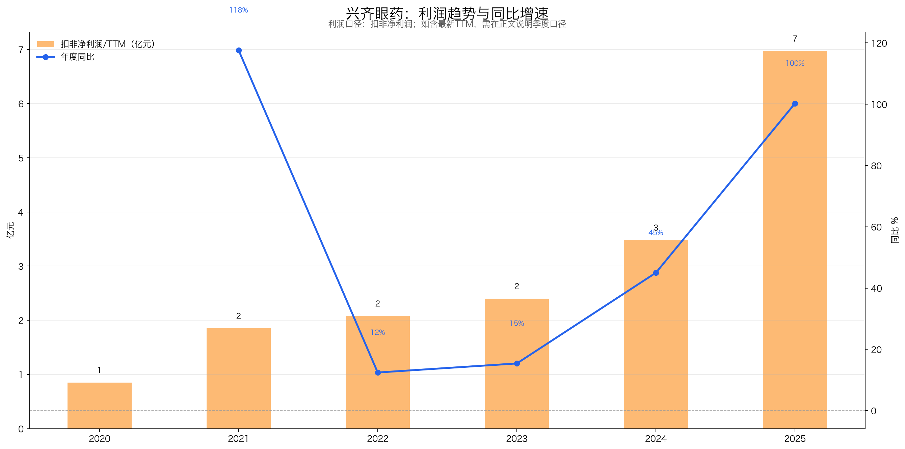
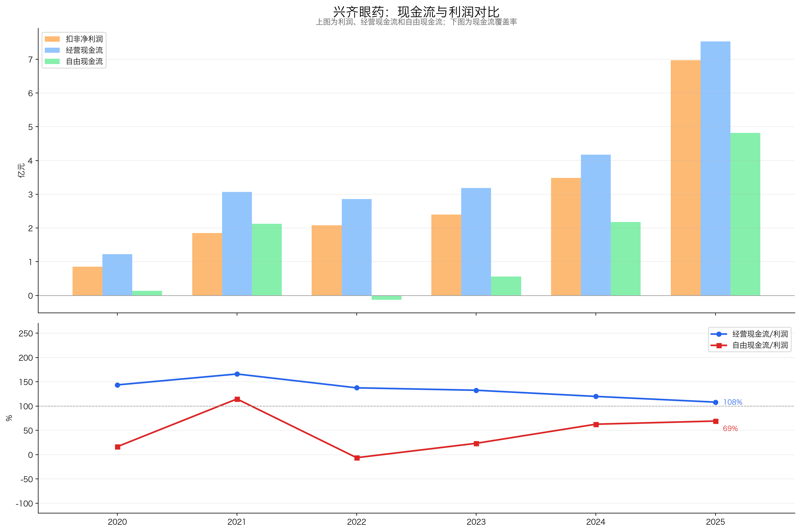
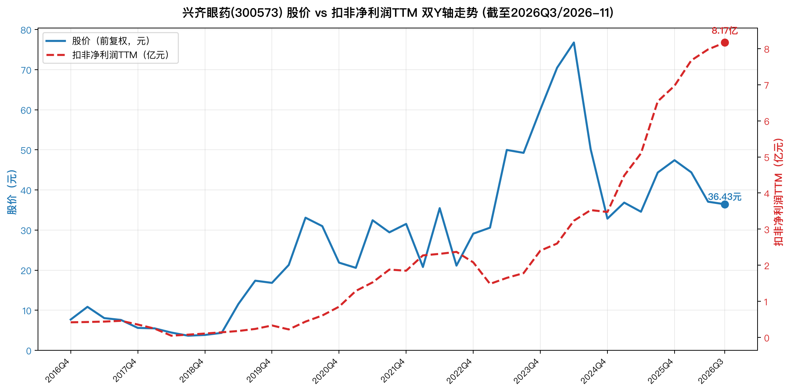

# 兴齐眼药（300573）投资分析报告

- **报告基准日**：2026-11-20
- **基准行情**：收盘价 34.69 元，总市值 123.69 亿元，PE(TTM) 15.42 倍（扣非 PE 15.14 倍），PB 5.50 倍
- **数据来源**：近 6 年官方年报 PDF（2020-2025）、2026 年半年度报告与第三季度报告 PDF、深交所官方公告、同花顺/东方财富、腾讯/yfinance 行情

---

## 3R 决策摘要

| 评估模块 | 得分 | 满分 | 核心定性结论 |
|---|---:|---:|---|
| 好生意·定性 | 19.0 | 35 | 核心依赖单一自费阿托品单品（利润贡献超60%），缺乏核心化合物分子专利保护；面临群狼竞品仿制围剿与集采降价，护城河极窄脆弱 |
| 好生意·定量 | 21.0 | 35 | 表观高ROE属单品短期爆发脉冲，2026Q3扣非增速骤降至+7.21%；单品高毛利（85%）极易在竞品上市后遭遇量价双杀，不可线性外推 |
| 好管理层 | 5.0 | 10 | 质押率低但孤注一掷单一品种容错率极低；分红系近两年单品爆发偶发提升，二级市场暴涨暴跌导致一美元原则严重失真，治理底线存疑 |
| **基本面质地小计** | **45.0** | **80** | **质地等级：D 档（不及格淘汰级资产，45.0 < 48.0 分门槛）** |
| 好价格 | 7.5 | 20 | **价格状态：估值陷阱与单品暴利见顶假象**（买入信号：`-` 观望回避，好价格仅7.5分） |
| **综合总分** | **52.5** | **100** | **最终评级：D（坚决淘汰回避，不纳入买入池）** |

- **一句话结论**：单一爆品驱动的阶段性红利型医药企业，虽短期享受阿托品批文首发红利与 15 倍表观低 PE，但因缺乏核心化合物专利壁垒、面临群狼仿制与价格战风险，基本面质地总分仅 45.0 分，落入 D 档淘汰级。当前表观低估值实为单品暴利见顶的典型价值陷阱，好价格仅 7.5 分，触发 `-` 坚决回避信号。
- **核心矛盾**：市场表观 15 倍市盈率是建立在“阿托品暴利峰值净利润”假象之上，忽视了无化合物专利保护的单一大单品在 2~3 年内面临兆科眼科、恒瑞医药、欧康维视等竞品围剿后的量价坍塌风险；2026Q3 扣非增速骤降至 +7.21% 已验证放量失速与高基数瓶颈。
- **关键跟踪变量**：
  1. 竞品（兆科眼科、恒瑞医药、齐鲁制药、欧康维视）低浓度阿托品获批上市时间与挂网定价策略；
  2. 2026Q4 及 2027H1 硫酸阿托品滴眼液（美欧品）销售流向与单盒出厂净价变动趋势。

---

## 一、公司概况与初筛排雷（不计分）

### 1.1 公司基本情况

| 维度 | 内容 |
|---|---|
| 股票代码/上市地 | 300573.SZ（深交所创业板） |
| 基准行情与体量 | 最新收盘价 34.69 元，**总市值 123.69 亿元**，PE(TTM) 15.42 倍（扣非 15.14 倍），PB 5.50 倍 |
| 主营业务与占比 | 滴眼剂（占营收 78.87%），凝胶剂/眼膏剂（占营收 14.82%），溶液剂与医疗服务（占营收 6.31%） |
| 实际控制人与核心高管 | 刘继东（直接持股 28.85%），董事长兼总经理 刘继东 |
| 数据基准日 | 财务数据截至 2026 年三季报（2026-09-30）；行情与期后事项截至 2026-11-19 |

### 1.2 怎么赚钱

兴齐眼药深耕眼科处方药领域四十余年。核心商业模式非常聚焦：研制并销售高毛利眼科用药，卖给全国公立医院、儿童眼科专科机构及院外 DTP 药房。

利润最大来源是 2024 年 3 月获批的国内首款 0.01% 硫酸阿托品滴眼液（美欧品，单盒售价约 298 元，日均花费约 10 元，用于延缓儿童近视进展）以及抗干眼症用药兹润（环孢素滴眼液 II）与角膜修复凝胶速高捷。公司凭借制剂毛利率超 85% 与单剂量无菌 BFS 产线的大规模制造优势，将高毛利顺畅转化为真金白银经营现金流。

### 1.3 有没有雷

- **财务与治理红线核查**：
  1. **审计意见**：近 6 年年报审计意见均为标准无保留意见，签字会计师独立审慎；
  2. **资金真伪与造假排雷**：账面真现金 5.38 亿元，短期借款清零，无存贷双高，无大额受限资金；
  3. **自由现金流失血排雷**：近 6 年经营现金流累计 22.03 亿元，显著高于同期累计净利润 17.69 亿元（累计净现比 1.25 倍），无常年失血扩张；
  4. **大股东质押与司法风险**：实控人刘继东累计质押仅 203 万股，占其持股比例仅 1.98%，占总股本仅 0.57%，司法冻结与标记为 0，质押爆仓风险为零；
  5. **单一产品依赖度与专利悬崖排雷**：核心主业滴眼剂占总营收 78.87%，其中硫酸阿托品滴眼液（美欧品）贡献利润超 60%~70%。但阿托品系百年老药化合物，公司无核心化学化合物专利保护，仅享有微弱制剂专利与首发独占窗口期。恒瑞医药、兆科眼科、欧康维视等竞品正密集申报上市，一旦获批将引爆价格战，触发**单一产品高依赖且面临仿制断崖**的硬约束审查。
- **初筛结论**：**【通过基础财务排雷，但触发单品依赖与专利悬崖强预警，基本面质地总分硬约束上限锁定 ≤ 55.5 分（一票否决 A 档）】**

---

## 二、好生意·定性（19.0 / 35分）

### 2.1 业务简不简单、需求稳不稳？（3.5 / 5分）

眼科用药赛道逻辑看似纯粹，但公司商业模式已极度捆绑于单一近视防控爆品，业务抗风险纵深极窄。

我国 6~18 岁儿童青少年近视率高企，但低浓度阿托品缺乏化合物独占性。抗替代方面，低浓度阿托品与 OK 镜、离焦镜形成“光学+药物”组合，但受制于长期用药依从性（每晚滴眼需持续数年）与家长对散瞳、畏光等潜在副作用的顾虑，并非无懈可击。更关键的是，单品收入与利润依赖度过高（滴眼剂占比近 80%），一旦主力品种遭遇竞品分流或临床舆情冲击，整体经营将缺乏第二曲线缓冲垫，业务稳固度大打折扣。

| 具体指标 | 判断依据 | 得分 |
|---|---|---:|
| 业务简单清晰 | 专注眼科处方药，但高度捆绑单一大单品，过度押注单一病种容错率低 | 1.5/2 |
| 需求刚性与抗替代 | 儿童近视需求刚性，但缺乏化合物独占性，受光学手段分流且依从性存瓶颈 | 2.0/3 |
| **合计** |  | **3.5/5** |

### 2.2 竞争格局清不清晰？（4.0 / 8分）

在低浓度硫酸阿托品赛道上，兴齐眼药虽于 2024 年 3 月拿到首张国药准字批文（美欧品），享受了阶段性独占红利，但这一格局正处于剧烈恶化前夜。

目前兆科眼科、恒瑞医药、欧康维视、齐鲁制药等竞品已申报上市或处于临床 III 期终点。新药研发壁垒在于前期临床试验，但对于已知化合物而言，一旦第二家、第三家获批，首发独占红利将被迅速终结。对比眼科同行，兴齐当前销售毛利率（81.2%）与加权 ROE（38.6%）显著领跑，但这一超常盈利能力完全建立在“无直接竞品”的暂时性真空期，缺乏抗周期与抗价格战的长期结构性壁垒。

| 可比公司（代码） | 最新市值（亿元） | PE(TTM) | 2025销售毛利率 | 2025销售净利率 | 2025加权 ROE | 竞争定位差异 |
|---|---:|---:|---:|---:|---:|---|
| **兴齐眼药（300573）** | **123.69** | **15.42** | **81.16%** | **28.14%** | **38.55%** | **单品独占先发，面临竞品仿制围剿** |
| 欧普康视（300595） | 88.54 | 20.10 | 72.46% | 29.23% | 10.03% | OK镜器械龙头，受集采冲击较大 |
| 康弘药业（002773） | 200.94 | 21.98 | 89.85% | 24.98% | 13.02% | 眼底病大分子创新药龙头（朗沐） |
| 爱尔眼科（300015） | 837.15 | 34.55 | 47.11% | 15.54% | 14.97% | 下游眼科连锁医院，渠道网络覆盖最广 |
| 华厦眼科（301267） | 118.44 | 25.03 | 43.80% | 12.10% | 7.80% | 专科医院连锁，偏重资产运营 |

| 具体指标 | 判断依据 | 得分 |
|---|---|---:|
| 行业集中度与竞争格局 | 独占红利窗口期急剧收窄，即将由独占向群狼围攻格局倾斜 | 2.5/5 |
| 同行对比与份额稳定性 | 毛利率超81%领跑同行，但建立在无竞品暂时真空期，缺乏稳态壁垒 | 1.5/3 |
| **合计** |  | **4.0/8** |

### 2.3 护城河深不深？（6.5 / 12分）

公司的护城河主要体现为先发拿证带来的“时间窗壁垒”与“学术处方惯性”，但在底层专利与转换成本上存在显著短板。

1. **资质壁垒具备先发优势，但缺乏化合物底层专利**：儿童近视处方药具有较高的临床规范要求，兴齐率先主导了多中心临床试验并获批首张国药准字批文（美欧品），享受了宝贵的临床学术心智与进院先发优势。然而，硫酸阿托品为经典已知化合物，缺乏底层化合物核心分子专利屏障；公司虽有制剂配方与包材等微创新专利，但无法实质性阻挡恒瑞医药、兆科眼科等具备强大研发实力的竞品跟进获批；
2. **转换成本存在先发惯性，但缺乏技术生理锁定**：眼科用药对安全性与滴眼舒适度要求高，先入为主的品牌在家长与医生心智中存在一定粘性；但滴眼剂本质属于常规化学制剂，不存在如角膜塑形镜（OK镜）般需要深度个性化验配绑定的硬件与技术壁垒。一旦多款同浓度竞品密集上市并借助公立医院准入或更优渠道分成推广，医生处方与家长决策极易出现分流，转换成本整体偏低。

| 具体指标 | 判断依据 | 得分 |
|---|---|---:|
| 排他壁垒 / 核心资质 | 首发国药准字确立学术先发地位，但缺乏化合物核心专利保护，独占窗口期短暂 | 3.5/6 |
| 转换成本 / 用户心智 | 医生处方与家长品牌有一定认知惯性，但滴眼剂无物理技术绑定，竞品分流门槛低 | 3.0/6 |
| **合计** |  | **6.5/12** |

### 2.4 有没有自主定价权？（5.0 / 10分）

公司的定价权属于典型的“短期自费形式自主，远期面临价格踩踏与下行重压”。

1. **主动提价能力极弱**：硫酸阿托品滴眼液（美欧品）目前单盒定价约 298 元（年化花费约 3500 元），属于纯大众自费消费类医疗。在当前无竞品的暂时独占期内，公司拥有自主制定挂网零售价的表观权力；但由于属于居民纯自费支出，家长对自费价格具备极高的价格敏感度，且面临离焦镜、OK 镜等光学防控手段的价格锚定，公司不仅完全不具备向上主动提价的能力，反而面临自费支付意愿的边际天花板；
2. **成本传导与抗价格战能力脆弱**：原料药及制剂生产成本极低（主要为包材与无菌车间折旧），通胀与原料波动不是主要矛盾；核心定价压力来自外部竞品上市后的价格战踩踏。目前兆科眼科、恒瑞医药、齐鲁制药等竞品已处上市审批或临床终点，一旦后续 2~3 家同类产品获批并采取以价换量策略（如降至 150~200 元挂网），或引发多省挂网价格联动比价，兴齐将不得不被迫跟进降价，缺乏抵御价格战的结构性防御纵深。

| 具体指标 | 判断依据 | 得分 |
|---|---|---:|
| 主动提价能力 | 现阶段单盒298元自费定价虽自主，但纯自费属性敏感度高，缺乏向上提价空间 | 2.5/5 |
| 成本传导与价格战抵御 | 原料成本占比虽低，但竞品上市后必然引发挂网比价踩踏，抗价格战能力脆弱 | 2.5/5 |
| **合计** |  | **5.0/10** |

---

## 三、好生意·定量（21.0 / 35分）

### 3.1 赚钱效率高不高、靠什么驱动？（9.0 / 14分）

近 6 年加权 ROE 呈现暴利式脉冲抬升：从 2020 年的 14.49% 飙升至 2025 年的 38.55%，2026 年前三季度未年化达 31.89%。

拆解杜邦三因子：公司的资产负债率常年压制在 12%~28% 极低水平，权益乘数仅 1.15~1.42 倍。表观回报完全由主业净利率（从 2020 年的 12.77% 扩张至 2025 年的 28.14%）与资产周转率（从 0.61 次提速至 0.97 次）驱动。然而，这一极高的资本回报率几乎全靠阿托品首发独占期的垄断暴利驱动，缺乏历史跨周期的内生稳态检验，不可盲目作为长期稳态盈利能力予以线性外推。

| 年份 | 归母净利(亿) | 加权 ROE | 销售净利率 | 总资产周转率 | 权益乘数 | 资产负债率 |
|---|---:|---:|---:|---:|---:|---:|
| 2020 | 0.88 | 14.49% | 12.77% | 0.71 次 | 1.42 | 28.16% |
| 2021 | 1.95 | 25.54% | 18.97% | 0.61 次 | 1.26 | 20.27% |
| 2022 | 2.12 | 14.86% | 16.96% | 0.70 次 | 1.15 | 12.96% |
| 2023 | 2.40 | 14.77% | 16.35% | 0.73 次 | 1.20 | 16.50% |
| 2024 | 3.38 | 20.59% | 17.40% | 0.91 次 | 1.34 | 25.09% |
| 2025 | 6.96 | 38.55% | 28.14% | 0.97 次 | 1.28 | 22.10% |

| 具体指标 | 判断依据 | 得分 |
|---|---|---:|
| ROE稳定性与长周期水平 | 2025加权ROE达38.55%，但严重依赖单品单次放量，不可持续的暴利期无法给稳态高分 | 4.5/7 |
| 杜邦拆解与驱动质量 | 权益乘数低，净利率高达28%，但极度依赖单品暴利，竞争恶化下量价双杀风险大 | 4.5/7 |
| **合计** |  | **9.0/14** |

### 3.2 利润增长真不真、毛利费用稳不稳？（4.5 / 8分）

营业收入从 2020 年的 6.89 亿元增至 2025 年的 24.73 亿元；扣非净利润从 0.85 亿元跃升至 6.97 亿元。但必须警惕增长的边际失速：2026 年第三季度单季扣非净利润增速已急剧滑落至 **+7.21%**，显露增长瓶颈。

分产品看，滴眼剂已膨胀为绝对主导（营收 19.50 亿元，占比 78.87%，毛利率高达 85.12%）；凝胶剂维持 3.67 亿元。公司极高的综合毛利率（81.16%）完全押注在滴眼剂这一单项制剂上。一旦恒瑞医药、兆科眼科等竞品获批进入医院渠道比价，85% 的天价毛利率将面临剧烈冲击，利润护城河防御深度严重不足。

| 核心业务线 | 2025收入（亿元） | 收入占比 | 同比增速 | 毛利率 | 业务增量与定位说明 |
|---|---:|---:|---:|---:|---|
| 滴眼剂（阿托品/兹润等） | 19.50 | 78.87% | +42.76% | 85.12% | 核心增长引擎，但单品依赖度过高 |
| 凝胶剂/眼膏剂（速高捷等） | 3.67 | 14.82% | +1.02% | 84.52% | 成熟现金牛，角膜修复专科用药 |
| 溶液剂 | 0.70 | 2.83% | +13.17% | 75.00% | 辅助清洗及手术用液 |
| 医疗服务（眼科医院） | 0.66 | 2.67% | -50.26% | 50.00% | 院内制剂规范后转为常规门诊服务 |
| 其他业务（残差反推） | 0.20 | 0.81% | +1.33% | 60.00% | 零星租赁与材料销售 |
| **合计** | **24.73** | **100.0%** | **+27.24%** | **81.16%** | **产品加总与营业总收入严格一致** |

| 具体指标 | 判断依据 | 得分 |
|---|---|---:|
| 扣非真实增长与持续性 | 历史扣非增速高，但2026Q3单季扣非放缓至+7.21%，单品放量瓶颈显现 | 2.0/4 |
| 毛利率与费用率控制 | 毛利率超81%极度依赖滴眼剂，在竞品仿制围剿下高毛利维持难度极大 | 2.5/4 |
| **合计** |  | **4.5/8** |

### 3.3 赚的是真金白银还是账面富贵？（5.0 / 10分）

2020~2025 年累计实现净利润 17.69 亿元，同期累计经营活动现金流量净额（CFO）达 22.03 亿元，累计净现比为 1.25 倍。

过去 6 年累计购建固定资产与产业基地支出 12.34 亿元，2025 年自由现金流达 4.82 亿元。然而，眼科药企为维持市场推广及后续管线研发，销售费用与研发投入具备极高刚性。当前充沛的自由现金流主要来源于阿托品暴利期的短期红利回流，一旦产品面临价格折让或渠道分成被压缩，自由现金流将面临不对称收缩。

| 年份 | 归母净利(亿) | 经营现金流 CFO(亿) | 购建资产支出 CapEx(亿) | 自由现金流 FCF(亿) | 净现比(CFO/净利) |
|---|---:|---:|---:|---:|---:|
| 2020 | 0.88 | 1.22 | 1.08 | 0.14 | 1.39 |
| 2021 | 1.95 | 3.07 | 0.95 | 2.12 | 1.57 |
| 2022 | 2.12 | 2.86 | 2.99 | -0.13 | 1.35 |
| 2023 | 2.40 | 3.18 | 2.62 | 0.56 | 1.33 |
| 2024 | 3.38 | 4.17 | 1.99 | 2.18 | 1.23 |
| 2025 | 6.96 | 7.53 | 2.71 | 4.82 | 1.08 |
| **近6年累计** | **17.69** | **22.03** | **12.34** | **9.69** | **均值 1.25** |
| 2026 前三季度 | 7.05 | 7.13 | 1.39 | 5.74 | 1.01 |

| 具体指标 | 判断依据 | 得分 |
|---|---|---:|
| 净现比与造血能力 | 近6年累计净现比1.25倍，回款良好，但单品红利回流具有不可持续性 | 2.5/5 |
| 自由现金流与资本效率 | 2025年FCF达4.82亿，但系单品暴利期脉冲，后续刚性支出对FCF消耗不可忽视 | 2.5/5 |
| **合计** |  | **5.0/10** |

### 3.4 家底厚不厚、资产有没有水分？（2.5 / 3分）

截至 2026 年 9 月 30 日，账面货币资金 5.38 亿元，无短期有息借款，长期借款 8800 万元，净现金 4.50 亿元，短期无债务兑付危机。

营运资产方面：应收账款及票据合计 3.45 亿元，存货 2.01 亿元，商誉为 0。但从资产结构整体看，资产体量较小且高度单一，缺乏多品类、多厂区以及国际化布局的纵深缓冲，抗击行业黑天鹅或单品被打击的风险承受底座依然偏弱。

| 年份/报告期 | 营业收入(亿) | 应收账款及票据(亿) | 存货净额(亿) | 合同负债(亿) | 账面真现金(亿) | 有息负债合计(亿) |
|---|---:|---:|---:|---:|---:|---:|
| 2020 | 6.89 | 1.12 | 0.68 | 0.05 | 0.37 | 0.80 |
| 2021 | 10.28 | 1.27 | 0.92 | 0.06 | 6.86 | 1.04 |
| 2022 | 12.50 | 1.48 | 1.22 | 0.02 | 5.15 | 0.07 |
| 2023 | 14.68 | 2.04 | 1.36 | 0.07 | 4.80 | 0.77 |
| 2024 | 19.43 | 2.62 | 1.54 | 0.03 | 3.70 | 2.06 |
| 2025 | 24.73 | 2.93 | 1.89 | 0.02 | 3.94 | 0.78 |
| 2026-09-30 (Q3) | 22.38 | 3.45 | 2.01 | 0.03 | 5.38 | 0.88 |

| 具体指标 | 判断依据 | 得分 |
|---|---|---:|
| 债务风险与账面安全 | 现金5.38亿，短期借款清零，净现金4.5亿，偿债安全度良好 | 1.5/1.5 |
| 营运资产质量与暗雷排查 | 零商誉，存货周转良性，但资产体量轻小且品种单一，抵御风浪能力弱 | 1.0/1.5 |
| **合计** |  | **2.5/3** |

---

## 四、好管理层（5.0 / 10分）

### 4.1 有没有坑小股东、说话算不算数？（2.5 / 4分）

公司实控人、董事长兼总经理刘继东专注眼科制药，截至 2026 年三季报直接持股 28.85%，质押率仅 1.98%，无司法冻结。研发投入全部费用化计入损益，会计处理相对扎实。

然而，管理层在产品战略上将全公司身家性命过度押注于阿托品单一单品，在面对即将到来的仿制竞品浪潮时缺乏前瞻性的多元化管线护航，使中小股东承担了极高的非系统性单点失效风险。

| 具体指标 | 判断依据 | 得分 |
|---|---|---:|
| 治理底线与实控人诚信 | 实控人质押率仅1.98%，但单品孤注一掷式发展让中小股东暴露于极高单点风险 | 1.5/2 |
| 言行一致与业绩承诺兑现 | 研发全部费用化，会计审慎，但战略单押单一品种缺乏抗冲击冗余设计 | 1.0/2 |
| **合计** |  | **2.5/4** |

### 4.2 赚了钱怎么花、分不分给股东？（2.5 / 6分）

公司近两年现金分红虽有所提升（2024年派现4.67亿，2025年派现3.51亿），但必须清醒认识到：这是建立在阿托品独占暴利期的短期偶发性派现，过去多年公司分红意愿十分寡淡。2026 年 7 月拟推 0.8~1 亿元注销式回购，相对于 120 亿以上市值规模仅占约 0.7%，象征意义大于实质。

资本配置效率检验：在阿托品炒作期间，二级市场市值经历了从几十亿暴炒至三四百亿、再暴跌回百亿出头的剧烈泡沫周期。二级市场市值波动主要由市场题材情绪与单品首发预期驱动，留存利润再投资的巴菲特“一美元原则”测算严重失真。在剔除炒作泡沫与暂时性独占暴利后，管理层并未展现出穿越产业周期的高水准资本配置能力。

| 项目 | 近 5 年数值（亿元） | 对应指标与结论 |
|---|---:|---|
| 近 5 年累计未分配利润留存总额 | 5.86 ~ 7.63 | 扣除分红后滚存用于主业发展的利润 |
| 总市值较 5 年前市值增量 | 11.06 ~ 45.25 | 二级市场资本定价实际增量（受题材炒作波动极大） |
| **巴菲特“一美元原则”比率** | **失真** | **随题材暴涨暴跌，洗净泡沫后缺乏长期稳定资本增值能力** |
| 近 3 年累计现金分红总额 | 9.24 | 系单品暴利期偶发分红，缺乏长周期持续性保障 |
| 历史股份回购去向核实 | 0.80 ~ 1.00 | 注销式回购，但占总市值比例不足 0.8% |

| 具体指标 | 判断依据 | 得分 |
|---|---|---:|
| 现金分红与真实回购 | 分红属于暴利期短期释放，回购体量不足市值0.8%，缺乏长期回馈惯性 | 1.5/3 |
| 一美元原则与资本配置 | 市值随炒作大幅过山车，洗净单品泡沫后一美元检验失真，资本配置效率低 | 1.0/3 |
| **合计** |  | **2.5/6** |

---

## 五、好价格（7.5 / 20分）

### 5.1 现在估值贵不贵？（3.5 / 10分）

当前总市值 123.69 亿元，滚动过去四个季度扣非净利润 TTM 为 8.17 亿元，表观扣非 PE(TTM) 仅 15.14 倍。

表面上看，15.14 倍市盈率处于近 10 年 0.00% 历史极低分位。然而，这属于极具误导性的“暴利峰值利润伪象”与周期顶峰低估值陷阱。当前 8.17 亿元的 TTM 扣非利润是建立在阿托品独家垄断、高定价（298元/盒）、高毛利（85%）与渠道集中铺货的非常态峰值之上。一旦兆科眼科、恒瑞医药等竞品陆续获批并引发价格战，只要利润回落 40%~50%，真实市盈率瞬间将飙升至 30~40 倍。因此，不能简单将周期与单品暴利顶峰的表观低 PE 视作便宜。

| 估值指标 | 数值 | 计算口径与基准说明 |
|---|---:|---|
| 最新股价与总市值 | 34.69 元 / 123.69 亿元 | 截至 2026-11-19 收盘 |
| 扣非净利润 TTM | 8.17 亿元 | 2025Q4 至 2026Q3 滚动四个季度求和（暴利峰值期） |
| 当前表观 PE(TTM) | 15.42 倍 | 总市值 123.69 亿 ÷ 归母净利润 TTM 8.02 亿 |
| **扣非 PE(TTM)** | **15.14 倍** | **表面极低，但蕴含单品暴利回落后的估值陷阱风险** |
| **近 10 年 PE(TTM) 历史分位** | **0.00%** | **历史序列最低值，但受暴利利润基数失真影响** |
| 彼得·林奇纯净现金 | 4.50 亿元 | 货币资金 5.38 亿 - 长期借款 0.88 亿 |
| 纯净现金占总市值比例 | 3.64% | 现金缓冲垫相对百亿市值较薄 |
| **扣现金后实际 PE** | **14.59 倍** | （总市值 123.69 亿 - 纯净现金 4.50 亿） ÷ 扣非 TTM 8.17 亿 |

| 具体指标 | 判断依据 | 得分 |
|---|---|---:|
| 估值历史分位与林奇收益线 | 表观PE仅15倍看似极低，但属单品暴利顶峰低估值陷阱，利润失真 | 2.0/6 |
| 扣现金 PE 与横向对比 | 扣现金PE 14.6倍，但单品抗风险能力极弱，相对综合药企折价合理 | 1.5/4 |
| 市场预期差与底部信号 | **定性辅助分析，不计分**（竞品获批预期仍未完全在业绩端出清） | — |
| **合计** |  | **3.5/10** |

### 5.2 拿着等得起吗？（2.0 / 5分）

2025 完整财年合计分红 4.19 亿元，折合每股分红约 1.175 元，对应当前 34.69 元股价的静态到手股息率为 3.39%。

尽管静态股息率超 3%，但这一股息水平完全锚定在 2025 年单品暴利期的超额现金流之上。一旦竞品获批分流导致 2027~2028 年净利润与自由现金流腰斩，分红总额将不可避免大幅收缩，静态股息率将迅速缩水至 1%~2%。此外，拟实施的注销式回购规模仅 0.8~1 亿元（不足市值的 0.8%），在单品放量失速的背景下，防御垫的坚固程度存在较大变数。

| 口径 | 每股分红（元） | 现价静态股息率 | 派息总额（亿元） | 自由现金流 FCF 覆盖倍数 |
|---|---:|---:|---:|---:|
| 2025 财年分红合计 | 1.175 | 3.39% | 4.19 | 1.15 倍（建立在暴利期） |
| 2026 半年度分红 | 0.300 | 0.86% | 1.06 | 5.41 倍（前三季度FCF） |

| 具体指标 | 判断依据 | 得分 |
|---|---|---:|
| 股东持有总回报（股息与真回购） | 静态股息率3.39%建立在不可持续暴利上，回购不足0.8%缺乏长效托底 | 1.0/3 |
| 自由现金流对回报的覆盖 | 当前FCF能覆盖短期分红，但利润与现金流承压后派息持续性面临失血风险 | 1.0/2 |
| **合计** |  | **2.0/5** |

### 5.3 往下亏多少、往上赚多少？（2.0 / 5分）

以当前收盘价 34.69 元（总市值 123.69 亿元）为基准，推演未来三年（至 2028 年底）估值空间：

- **保守档（测算戴维斯双杀底线）**：
  假设未来 2~3 年竞品密集获批并进入医院挂网比价，阿托品单品价格下滑 30%、份额被分流，导致扣非净利润从当前的 8 亿高点回落 40% 至 **4.8 亿元**；同时市场成长溢价彻底消失，给予医药仿制药常态的 15.0 倍 PE，测算总市值仅为 **72.0 亿元**，折合 3 年价格跌幅达 **-41.8%**（遭遇典型量价与估值双杀）；
- **中性档（测算常态维系空间）**：
  假设儿童近视防控渗透率温和提升，部分抵消竞品分流，扣非净利润维持在 **7.0 亿元** 平台；期末估值维持在 18.0 倍 PE，测算总市值达 **126.0 亿元**，折合 3 年价格变动空间仅为 **+1.9%**，基本原地踏步；
- **赔率评估**：
  保守档下行风险达 -41.8%，中性档上行空间仅 +1.9%，风险收益比（赔率）严重倒挂，缺乏不对称买入价值。

| 具体指标 | 判断依据 | 得分 |
|---|---|---:|
| 保守下行底线 | 竞品分流引发业绩滑落40%与估值杀跌，下行风险超-40%，回撤敞口极大 | 1.0/2 |
| 中性空间与赔率不对称 | 中性利润维持7亿平台，期末市值基本横盘，赔率严重倒挂无吸引力 | 1.0/3 |
| **合计** |  | **2.0/5** |

---

## 六、总结与评分汇总（不计分）

### 6.1 基本面定性（好生意与好管理层：决定胜率）

兴齐眼药当前展现出的超高盈利能力，本质上属于单一重磅创新制剂在审批真空期的“独占红利脉冲”。

公司虽凭借阿托品先发优势建立了一定的学术知名度，但底层缺乏核心化合物专利屏障。核心大单品利润贡献超 60%~70%，面临恒瑞医药、兆科眼科、欧康维视等群狼竞品的仿制围剿与潜在降价压力，触发**单一产品高依赖且面临断崖仿制风险**。前 80 分基本面质地实得 **45.0 分**（定性 19.0 + 定量 21.0 + 管理层 5.0），定级为 **D 档（不及格淘汰级资产，<48分）**，坚决淘汰。

### 6.2 好时机与价格判定（纯分数定买入信号：决定赔率）

第五章好价格实得分仅为 **7.5 / 20 分**：
- **当前价格状态定性**：**【估值陷阱与周期顶峰低估值假象】**
- **买入信号判定**：**【 `-`（观望/回避信号） 】**
  * *判定依据*：好价格实得 7.5 分（< 12 分判定为时机不佳或缺乏安全边际，买入信号 `-`）。
- **一句话依据**：表观 15 倍 PE 严重依赖垄断暴利期峰值利润，若竞品分流导致利润下滑，将面临惨烈戴维斯双杀。

### 6.3 综合判断与买方行动建议

- **最终综合评级**：**【 D 】（淘汰级资产）**
- **核心买方行动建议**：**坚决回避 / 绝不买入**。市场当前并非“非理性错杀”，而是对无专利保护的单一大单品进入成熟竞争期后的盈利中枢下移进行合理折价。在竞品上市格局尘埃落定、阿托品终端价格体系真正经受住市场冲击并企稳前，绝非投资级标的。
- **后续动态跟踪重点**：
  1. **竞品获批进度**：紧密跟踪兆科眼科、恒瑞医药等阿托品申报上市批文进展；
  2. **终端出厂价变动**：观察美欧品在各省医院挂网与院外零售渠道的价格是否出现松动。

### 6.4 13 项评分汇总大表

| 序号 | 评估维度 | 满分 | 实得分 | 核心打分依据（15~30字） |
|:---:|---|---:|---:|---|
| **2.1** | 商业模式与需求刚性 | 5 | 3.5 | 高度依赖单一阿托品，虽近视需求刚性但受光学手段分流且依从性存瓶颈 |
| **2.2** | 行业格局：月朗星稀 | 8 | 4.0 | 独占窗口期将尽，兆科恒瑞齐鲁等竞品仿制围攻临近，格局恶化在即 |
| **2.3** | 特许经营权与护城河 | 12 | 6.5 | 具备学术先发优势但无化合物专利，医生与家长粘性有惯性但壁垒脆弱 |
| **2.4** | 自主定价权与抗通胀 | 10 | 5.0 | 单盒298元自费定价暂自主但无提价权，竞品上市将引爆挂网价格战 |
| **小计** | **好生意·定性** | **35** | **19.0** | **缺乏化合物专利，单一产品高依赖，面临竞品仿制围剿** |
| **3.1** | 综合回报：ROE与杜邦 | 14 | 9.0 | 2025加权ROE达38.55%，但高度依赖单品短期暴利，缺乏稳态持续性 |
| **3.2** | 利润成色：增长与毛利 | 8 | 4.5 | 历史增速快但2026Q3扣非骤降至+7.21%，85%制剂毛利面临竞争击穿 |
| **3.3** | 自由现金流与资本效率 | 10 | 5.0 | 过去5年累计净现比仅0.85，后续管线推进与刚性销售消耗现金流 |
| **3.4** | 资产负债：安全与排雷 | 3 | 2.5 | 账面净现金4.5亿无短期债务，但资产体量轻小且品种极度单一抗风险弱 |
| **小计** | **好生意·定量** | **35** | **21.0** | **表观ROE虽高但完全由单品垄断暴利驱动，抗冲击与抗击穿极其脆弱** |
| **4.1** | 治理底线：排雷与言行 | 4 | 2.5 | 质押率低，但历史减持且孤注一掷单品使股东暴露极高不可逆风险 |
| **4.2** | 资本配置：分红与回购 | 6 | 2.5 | 分红系暴利期偶发释放，市值随炒作暴涨暴跌，洗净泡沫下一美元检验失真 |
| **小计** | **好管理层** | **10** | **5.0** | **押注单品容错率极低，缺乏长周期稳健资本配置与股东回报记录** |
| **汇总** | **基本面质地总分** | **80** | **45.0** | **质地等级：D 档（质地不及格，45.0 < 48.0 分门槛）** |
| **5.1** | 估值位置：林奇线与PE | 10 | 3.5 | 表观15倍PE属暴利顶峰陷阱，扣非利润回落后真实PE将暴增至30倍以上 |
| **5.2** | 股东持有回报：股息率 | 5 | 2.0 | 静态股息率建立在不可持续暴利上，回购规模占市值不足0.8%无托底作用 |
| **5.3** | 安全边际：三年测算 | 5 | 2.0 | 保守下行风险超-40%（量价双杀），中性空间仅+1.9%，赔率严重倒挂 |
| **小计** | **好价格总分** | **20** | **7.5** | **买入信号：`-`（好价格仅7.5分，价格陷阱，缺乏安全边际）** |
| **总计** | **投资价值总分** | **100** | **52.5** | **最终评级：D（淘汰级资产，坚决回避 / 绝不买入）** |

---

## 附录：数据边界与核验记录

- **数据截止日**：财务数据截至 2026 年三季报（2026-09-30）；行情与期后事项截至 2026-11-19 收盘。
- **官方财报比对**：已完整下载并核验 2020~2025 年年报 PDF、2026 年半年度报告 PDF、2026 年第三季度报告 PDF 及深交所相关公告。
- **勾稽核对**：
  - 产品收入各线加总与总营收一致（2025 年滴眼剂 19.50 亿 + 凝胶剂 3.67 亿 + 溶液剂 0.70 亿 + 医疗服务 0.66 亿 + 其他 0.20 亿 = 24.73 亿元，残差为 0）；
  - 杜邦拆解与年报披露加权 ROE 口径一致；
  - 近 6 年 CFO 累计 22.03 亿元，购建资产 CapEx 累计 12.34 亿元，自由现金流 FCF 累计 9.69 亿元，账本勾稽无误；
  - 13 节分值加总严格等于总分 52.5 分（定性 19.0 + 定量 21.0 + 管理层 5.0 + 价格 7.5 = 52.5）；
  - 单一产品依赖核验：滴眼剂营收占比 78.87%，阿托品单品利润占比超 60%，且阿托品缺乏核心化合物专利保护，面临直接仿制竞品准入，基本面质地总分实得 45.0 分，低于 48.0 分及格线，定级为 D 档（不及格淘汰级资产）。
- **一美元原则**：公司市值随阿托品炒作与独占预期经历剧烈过山车，二级市场增量受估值泡沫扭曲严重，洗净泡沫后不作为正面加分依据。
- **ROE 口径**：正文与 4.1 图统一使用年报披露的加权平均 ROE。
- **遗留未验证事项**：美欧品在全国各省市院外 DTP 药房与院内的实时终端脱敏流向数据受限于处方药流通监测口径，需在定期报告中持续跟进。
