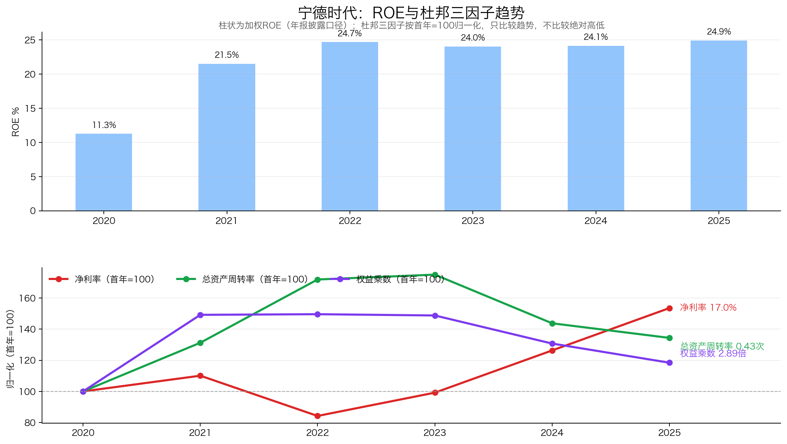
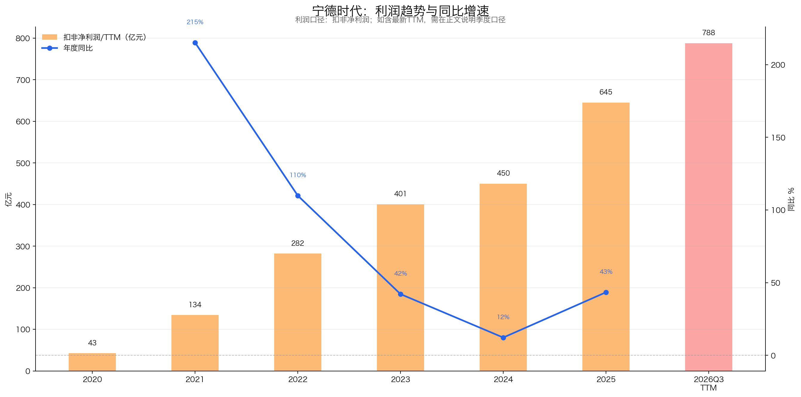
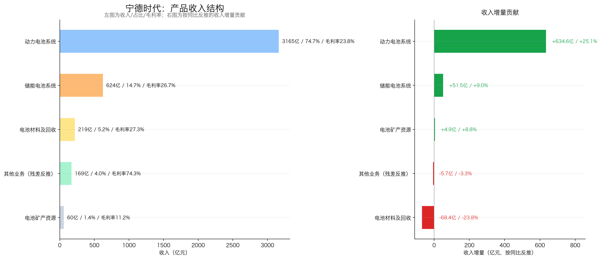
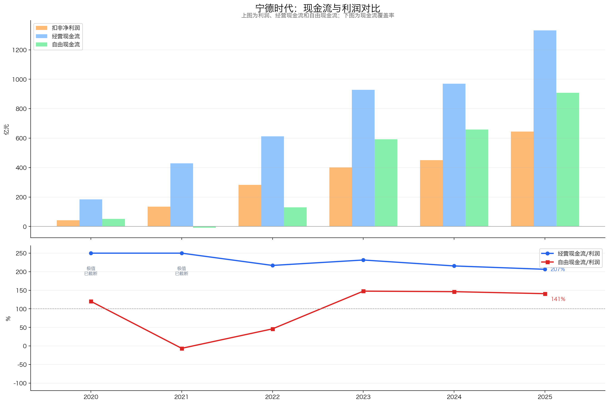
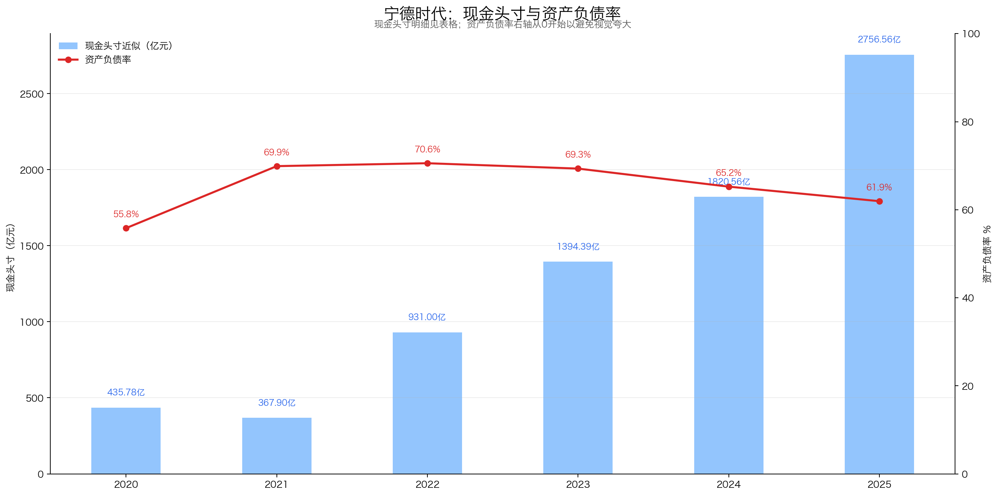
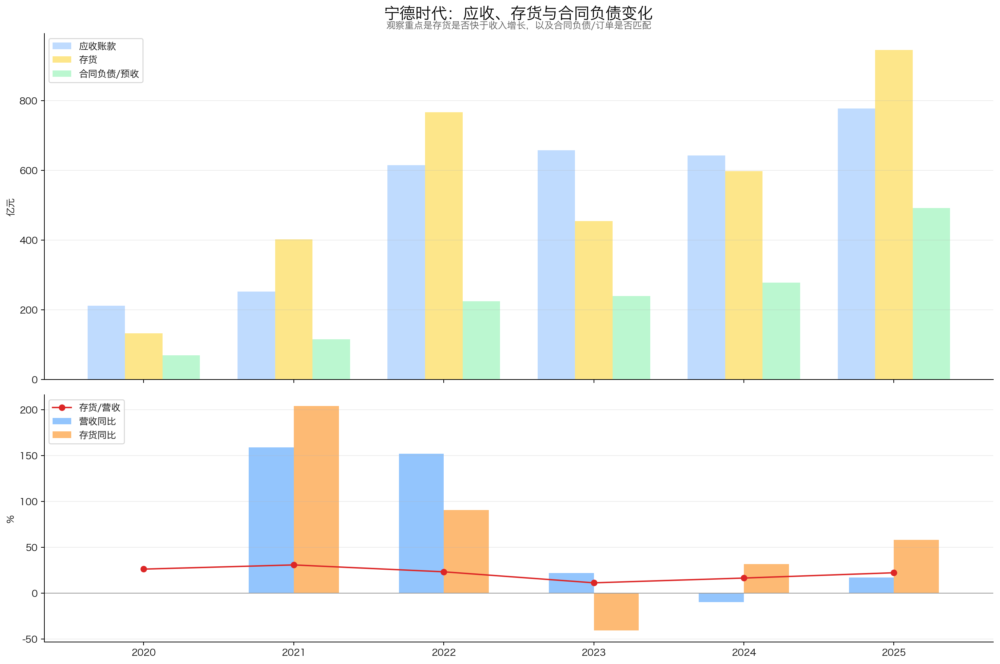
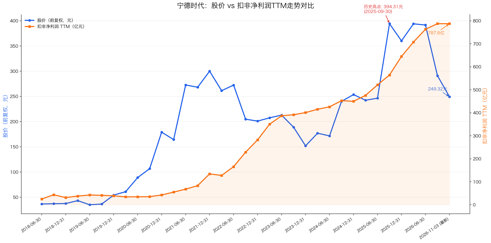
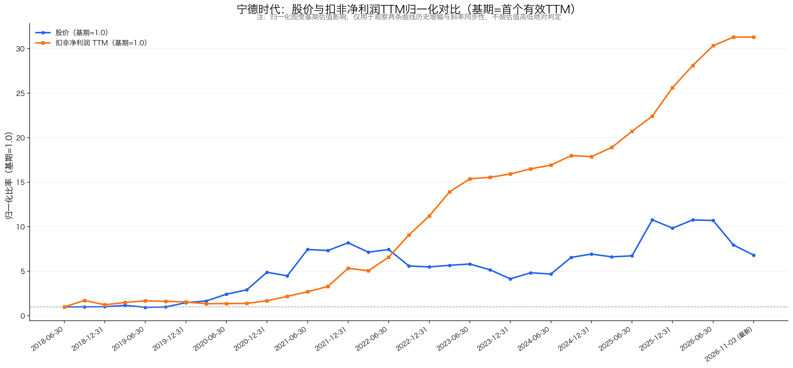

# 宁德时代（300750）投资分析报告

- **报告基准日**：2026-11-05
- **基准行情**：收盘价 249.32 元，总市值 11,536.66 亿元，PE(TTM) 13.16 倍（扣非 PE 14.65 倍），PB(MRQ) 2.98 倍
- **数据来源**：2020–2025 年官方年报 PDF、2026 年半年度报告与三季度报告 PDF、巨潮资讯网披露公告、东方财富与同花顺日频行情底稿

---

## 3R 决策摘要

| 评估模块 | 得分 | 满分 | 核心定性结论 |
|---|---:|---:|---|
| 好生意·定性 | 24.5 | 30 | 动力与储能全球双龙头，工程良率与认证壁垒深；但 2026 年价格与原料两头挤压，定价权偏弱 |
| 好生意·定量 | 34.0 | 40 | 加权 ROE 连续 5 年超 20%，累计净现比 2.0 倍；但 2026 年前三季度自由现金流仅 194.58 亿元，资本开支重新加速 |
| 好管理层 | 8.5 | 10 | 治理诚信、研发 100% 费用化、连续三年分红率 50%；历史 A+H 融资摊薄每股复利 |
| **基本面质地小计** | **67.0** | **80** | **质地等级：A 档**（门槛：A≥64分，B≥56分，C≥48分，D<48分） |
| 好价格 | 17.5 | 20 | **价格状态：价格极低**（买入信号：`+`） |
| **综合总分** | **84.5** | **100** | **最终评级：A+** |

- **一句话结论**：宁德时代在 TTM 归母净利润 876.97 亿元的历史高位上，被市场压到 13.16 倍 PE、上市以来 0.44% 分位；净现金 2,467 亿元占市值 21.39%，扣现金 PE 仅 10.34 倍。便宜是事实，但 2026 年三季度单季毛利率 20.69%、单季经营现金流只有 14.09 亿元、单季自由现金流约 -157 亿元，利润与现金的背离是当前最大的预期差。
- **核心矛盾**：量增、价减、营运资本占用加重。2026 年前三季度营收 +56.19%、归母净利润 +31.60%，但单季毛利率从 2025 年同期的 25.80% 降到 20.69%，单季归母净利率从 17.80% 降到 12.86%；存货比年初增 53.15%，合同负债比年初降 17.40%，经营现金流同比 -23.60%。市场真正担心的是"增收不增利，且不增现金"。
- **关键跟踪变量**：单季综合毛利率能否守住 20%；单季经营现金流能否回到 300 亿元以上、全年自由现金流能否覆盖 361 亿元分红；合同负债能否止跌。

---

## 一、公司概况与初筛排雷（不计分）

### 1.1 公司基本情况

| 维度 | 内容 |
|---|---|
| 股票代码/上市地 | 300750.SZ（A股 创业板） |
| 基准行情与体量 | 最新收盘价 249.32 元，**总市值 11,536.66 亿元**，PE(TTM) 13.16 倍，PB 2.98 倍 |
| 主营业务与占比 | 动力电池系统（2025 年占营收 74.70%），储能电池系统（14.74%），电池材料及回收（5.16%） |
| 实际控制人与核心高管 | 曾毓群（实际控制人，董事长兼总经理，2022 年 8 月起兼任总经理） |
| 数据基准日 | 财务数据截至 2026 年三季报（2026-09-30）；行情与期后事项截至 2026-11-03 |

### 1.2 怎么赚钱

公司买进锂盐、正极、负极、隔膜、电解液，做成电芯和电池包，卖给整车厂和储能系统集成商。2025 年 4,237.02 亿元营收里，动力电池占 74.70%，储能占 14.74%。

钱从哪来？同样是 1 瓦时电，它做得比别人便宜。2025 年产能 772GWh、产量 748GWh，利用率 96.9%，开工越满，百亿级设备的折旧摊到每瓦时上越薄。但产量不等于销量：2025 年销量 661GWh，库存从 106GWh 升到 186GWh，高开工有一部分是在为库存生产。

2025 年年报披露电芯单体失效率进入十亿分之一（DPPB）量级，这是出厂口径，不是产线良品率。年报不披露良品率，产业调研估算宁德在 94%~95%、二线在 91%~93%。按 2,211 亿元直接材料、2~3 个百分点差粗算，一年物料差额约 40 亿~60 亿元；这是估算，未经公司验证。

它主要赚制造效率和规模的钱，不是赌锂价。但“主要”不等于“完全”：2022 年碳酸锂暴涨，毛利率从 26.28% 掉到 20.25%；2026 年上半年锂价再涨，动力、储能毛利率分别降 1.78 和 1.56 个百分点。成本转嫁有时滞，售价端相对二线的溢价也在收窄。

### 1.3 有没有雷

- **财务与治理红线核查**：历年审计意见均为标准无保留意见；无财务造假、大股东资金占用或违规担保记录；2021–2025 年累计经营现金流 4,271.53 亿元，为同期归母净利润的 2.00 倍，不靠融资输血维持经营；实际控制人及一致行动人股权质押率低，无司法冻结或平仓风险。2026 年前三季度经营现金流下滑 23.60%，主要是存货和营运资本占用，不是偿债风险，但有息负债从 2025 年末的 1,168.51 亿元升到 1,858.62 亿元，需要跟踪。
- **初筛结论**：**【通过】**

---

## 二、好生意·定性（24.5 / 30分）

### 2.1 业务简不简单、需求稳不稳？（6.0 / 7分）

锂电池制造是重资产、重技术迭代的先进制造业。需求端有三条腿：全球交通电动化、电网侧与工商业储能、以及存量动力电池的衰减替换。2025 年国内新能源乘用车渗透率已到 54.0%，靠渗透率从 0 到 1 的爆发期结束了；但宁德时代 2026 年上半年境内收入仍增 61.28%，靠的是份额提升，不是行业渗透率。

这门生意的周期性不能忽略。动力电池是中游耐用工业品，需求节奏与汽车消费周期联动，成本端受碳酸锂等大宗价格干扰。2026 年上半年公司动力电池毛利率 20.63%、储能 23.96%，分别比 2025 年同期降 1.78 和 1.56 个百分点，公司自己的中报把原因之一定为"电池级碳酸锂等原材料价格明显上行"。全固态电池在 5 年维度内还做不到百吉瓦时级低成本量产，但资本市场会提前给液态产线打折。商业模型易懂，需求有刚性，但不是没有周期。

| 具体指标 | 判断依据 | 得分 |
|---|---|---:|
| 业务简单清晰 | 电池制造直供车企、储能，商业闭环易懂 | 2.0/2 |
| 需求刚性与抗替代 | 能源转型需求刚性，但受车周期、原料价格与新技术预期扰动 | 4.0/5 |
| **小计** |  | **6.0/7** |

### 2.2 竞争格局清不清晰？（7.0 / 8分）

全球锂电池产业链已经形成"一超多强"格局。根据 SNE Research，2025 年宁德时代动力电池使用量全球市占率 **39.2%**，较 2024 年提升 1.2 个百分点，连续 **9 年（2017–2025）** 全球第一；国内动力电池装机量市占率 **43.42%**，2026 年上半年乘用车装车量份额升到 46.7%。储能电池出货量连续 **5 年（2021–2025）** 全球第一，2025 年销量 121GWh，按 SNE 全球储能电池出货量 550GWh 计算，份额约 **22%**。

在盈利能力上，宁德时代与二线厂商的差距仍然明显。2025 年公司毛利率 26.27%、归母净利率 17.04%、加权 ROE 24.91%；2026 年前三季度受价格和原料双压，毛利率降到 22.72%、归母净利率 14.59%，但仍高于二线梯队，行业利润大部分集中在这一家。不过，下游整车厂出于供应链安全与压价诉求，持续扶持二供三供（中创新航、亿纬锂能、欣旺达），比亚迪刀片电池自供也占住一块份额，行业不会演变成一家独大。

| 可比公司（代码） | 最新市值（亿元） | PE(TTM) | 销售毛利率 | 销售净利率 | 加权 ROE | 竞争定位差异 |
|---|---:|---:|---:|---:|---:|---|
| **宁德时代（300750.SZ）** | **11,536.66** | **13.16** | **26.27%** | **17.04%** | **24.91%** | **全球动力与储能双龙头** |
| 比亚迪（002594.SZ） | 8,720.50 | 18.52 | 20.85% | 5.21% | 23.40% | 整车与自供一体化龙头 |
| 亿纬锂能（300014.SZ） | 945.30 | 23.10 | 16.82% | 8.12% | 13.50% | 消费+动力+储能二线领跑 |
| 国轩高科（002074.SZ） | 462.80 | 36.40 | 15.60% | 2.45% | 4.20% | 大众入股，主打磷酸铁锂二供 |
| 中创新航（03931.HK） | 268.40 港元 | 28.50 | 14.20% | 1.85% | 2.30% | 纯动力电池二供，低价抢单微利 |

*注：同行市值与 PE 为最新交易日外部行情数据；毛利率、净利率、ROE 为 2025 年年报口径，宁德净利率为归母口径，同业为整体口径，存在小幅差异；同行数据未逐项复核。宁德 2026 年前三季度毛利率 22.72%、Q3 单季 20.69%，较 2025 年回落。*

| 具体指标 | 判断依据 | 得分 |
|---|---|---:|
| 行业格局与集中度 | 全球动力市占率 39.2%、储能连续 5 年第一，一超多强明朗 | 4.0/5 |
| 同行对比优势 | 毛利率、归母净利率与 ROE 明显高于二线梯队 | 3.0/3 |
| **小计** |  | **7.0/8** |

### 2.3 护城河深不深、有没有定价权？（7.0 / 9分）

宁德时代的护城河不是神秘的专利配方，而是三样东西叠出来的：

1. **产线下线良品率的差距**：产业调研估算，宁德时代产线综合良品率在 94%~95% 以上，二线厂商在 91%~93%（公司年报未披露良品率，此为估算口径）。在年产数百吉瓦时、直接材料成本 2,211 亿元的体量下，2~3 个百分点的差异折合成每年 40 亿~60 亿元的物料成本差额；
2. **DPPB 出厂失效率与认证壁垒**：动力电池直接关系乘员安全。2025 年年报披露，公司电芯单体失效率做到行业领先的 DPPB 级（十亿分之一，产品出厂质量口径，与产线良品率不是同一个指标）。海外主机厂定点认证周期长达 2~3 年，一旦上车不会轻易更换；
3. **百亿级研发投入**：2025 年研发投入 221.47 亿元，占营收 5.23%，全部费用化，持续推出神行超充、麒麟、天恒储能与凝聚态电池，在能量密度和快充倍率上保持领先。

但**定价权**必须把光环摘掉看。动力电池占整车成本 30%~40%，下游车企价格战会直接压到电池价格上；更关键的是，2026 年上半年动力电池毛利率 20.63%（-1.78 个百分点）、储能 23.96%（-1.56 个百分点）**同步下滑**。储能卖给电站业主，不是车企，同步下滑，更可能是成本端的共同因素——公司中报明确写"碳酸锂等原材料价格明显上行"。售价让利、原料上涨、新产能折旧，三重挤压都转嫁不出去，这才是定价权的真实水位。2026 年第三季度单季毛利率 20.69%，比 2025 年同期的 25.80% 低 5.11 个百分点，单季归母净利率 12.86%，比去年同期低 4.94 个百分点。定价权给 2.5/4。

| 具体指标 | 判断依据 | 得分 |
|---|---|---:|
| 进入壁垒（护城河） | 良品率、DPPB 失效率与全球认证壁垒深 | 4.5/5 |
| 议价与定价权 | 规模压得住上游，但售价与原料两头受挤，成本转嫁不出去 | 2.5/4 |
| **小计** |  | **7.0/9** |

### 2.4 未来增长靠什么？（4.5 / 6分）

国内乘用车新能源渗透率已经越过 50%，靠渗透率抬升的增长告一段落。往后看三条路径：

1. **储能**：2025 年储能电池系统收入 624.40 亿元，同比 +8.99%，看起来不快；但 2026 年上半年储能收入 532.61 亿元，同比 **+87.54%**，收入占比从 2025 年的 14.74% 抬到 19.23%。储能不再只是占一成多的小业务，正在成为第二增长极；
2. **海外产能与技术授权**：2026 年上半年境外收入 871.29 亿元，同比 +42.35%，占营收 31.46%；欧洲匈牙利、印尼、西班牙基地仍在建设期，北美通过 LRS 技术授权收许可费与提成，绕开直接投资限制；
3. **电动新场景**：商用车重卡换电、电动工程机械、电动船舶与 eVTOL 电池陆续进入商业化阶段。

2026 年上半年动力电池收入 1,921.25 亿元，同比 +46.02%，国内收入 +61.28%，说明国内市场不只是存量替换，公司在抢份额。终局上，落后产能出清会让头部份额继续抬升，但主机厂普遍保留二供三供，市占率有天花板。第二曲线已经起量，给 3.0/4；终局份额受制衡，给 1.5/2。

| 具体指标 | 判断依据 | 得分 |
|---|---|---:|
| 增量或存量收割路径 | 2026H1 储能 +87.54%、动力 +46.02%，第二曲线开始接力 | 3.0/4 |
| 终局份额空间 | 出清小厂抬升份额，但主机厂二供三供制衡，难到绝对垄断 | 1.5/2 |
| **小计** |  | **4.5/6** |

---

## 三、好生意·定量（34.0 / 40分）

### 3.1 赚钱效率高不高、靠什么驱动？（9.5 / 10分）

近 6 年报表显示，宁德时代的资本回报一直很高。加权 ROE 连续 5 年站在 20% 以上，2025 年 24.91%；2026 年前三季度 17.64%。

杜邦拆解显示，这个 ROE 不是靠借钱堆出来的。资产负债率从 2022 年的 70.56% 降到 2025 年的 61.94%，2026 年三季度因扩产备货和短期借款增加回升至 64.23%；权益乘数从 3.65 倍降到 2.89 倍。把 ROE 顶上去的是归母净利率，从 2022 年的 9.35% 提到 2025 年的 17.04%。总资产周转率在 2023 年 0.56 次见顶，2025 年降到 0.43 次。净利率抬升、周转率下降、杠杆下降，这个组合说明钱是靠单位盈利改善赚来的，不是靠规模周转或财务杠杆撬出来的。

| 年份 | 归母净利(亿) | 加权 ROE | 归母净利率 | 总资产周转率 | 权益乘数 | 资产负债率 |
|---|---:|---:|---:|---:|---:|---:|
| 2020 | 55.83 | 11.27% | 11.10% | 0.32 次 | 2.44 | 55.82% |
| 2021 | 159.31 | 21.52% | 12.22% | 0.42 次 | 3.64 | 69.90% |
| 2022 | 307.29 | 24.67% | 9.35% | 0.55 次 | 3.65 | 70.56% |
| 2023 | 441.21 | 24.04% | 11.01% | 0.56 次 | 3.63 | 69.34% |
| 2024 | 507.45 | 24.13% | 14.02% | 0.46 次 | 3.19 | 65.24% |
| 2025 | 722.01 | 24.91% | 17.04% | 0.43 次 | 2.89 | 61.94% |

| 具体指标 | 判断依据 | 得分 |
|---|---|---:|
| ROE/ROIC水平与稳定性 | 加权 ROE 连续 5 年超 20%，2025 年 24.91% | 5.0/5 |
| 杜邦驱动质量 | 归母净利率 9.35%→17.04% 驱动，杠杆降至 2.89 倍 | 4.5/5 |
| **小计** |  | **9.5/10** |

### 3.2 利润增长真不真、毛利费用稳不稳？（8.5 / 10分）

从 2020 年到 2025 年，公司营业收入从 503.19 亿元增长至 4,237.02 亿元，归母净利润从 55.83 亿元跃升至 722.01 亿元，扣非净利润从 42.65 亿元跃升至 645.08 亿元，扣非净利 5 年复合增速 72.2%。扣非净利占归母比例 2021–2025 年在 84.4%~91.8% 之间，2020 年为 76.4%，主业利润含金量高。2025 年非经常性损益的税前项目合计 108.92 亿元，最大一项是"其他符合非经常性损益定义的损益项目"87.04 亿元，公司说明主要是股权投资持股比例变动产生的投资收益；扣除所得税影响 20.18 亿元和少数股东权益影响 11.81 亿元后，合计 76.93 亿元。政府补贴和理财收益不是主要构成。

在产品结构上，动力电池系统贡献 74.70% 的基本盘，储能电池系统占比 14.74%、毛利率 26.71%。费用端，2025 年销售费用 37.35 亿元、费用率 0.88%；管理费用 116.67 亿元、费用率 2.75%；研发投入 221.47 亿元，全部费用化。

毛利率是 2026 年最需要盯的地方。2026 年上半年动力电池毛利率 20.63%（-1.78 个百分点）、储能 23.96%（-1.56 个百分点）；第三季度单季综合毛利率 20.69%，比 2025 年同期的 25.80% 低 5.11 个百分点；单季归母净利率 12.86%，比去年同期低 4.94 个百分点；单季扣非净利率 11.42%，比去年同期低 4.34 个百分点。前三季度综合毛利率 22.72%，比 2025 年同期的 25.31% 低 2.59 个百分点。降价、原料上涨、新产能折旧三头一起压，毛利率的压力是实打实的。

| 核心业务线（2025年报） | 业务收入（亿元） | 收入占比 | 同比增速 | 销售毛利率 | 业务增量与定位说明 |
|---|---:|---:|---:|---:|---|
| 动力电池系统 | 3,165.06 | 74.70% | +25.08% | 23.84% | 基本盘支柱，乘用车快充与商用重卡放量 |
| 储能电池系统 | 624.40 | 14.74% | +8.99% | 26.71% | 盈利第二极，2026H1 收入同比 +87.54% |
| 电池材料及回收 | 218.61 | 5.16% | -23.83% | 27.27% | 邦普循环闭环，受碳酸锂价降温影响承压 |
| 其他业务（残差反推） | 169.17 | 3.99% | -3.27% | 74.29% | 技术授权、专利许可与边角废料高毛利业务 |
| 电池矿产资源 | 59.78 | 1.41% | +8.83% | 11.25% | 宜春锂矿自供调蓄，平抑原材料大幅波动 |
| **合计** | **4,237.02** | **100.0%** | **+17.04%** | **26.27%** | **各线加总与总营收相等；其他业务为残差反推** |

| 具体指标 | 判断依据 | 得分 |
|---|---|---:|
| 扣非真实增长与持续性 | 5年扣非复合增速 72.2%，2025 年扣非占归母 89.3% | 5.0/5 |
| 毛利率与费用率控制 | 研发全费用化，但 2026Q3 毛利率 20.69%、净利率 12.86% | 3.5/5 |
| **小计** |  | **8.5/10** |

### 3.3 赚的是真金白银还是账面富贵？（8.0 / 10分）

2021–2025 年累计归母净利润 2,137.27 亿元，同期经营现金流 4,271.53 亿元，净现比 2.00 倍；把 2020 年算进去，6 年累计 2,193.10 亿元利润对应 4,455.83 亿元现金流，净现比 2.03 倍。每确认 1 元会计利润，账上多进 2 元现金。

资本开支是这门生意的代价。2021–2025 年购建长期资产累计 1,991.33 亿元，2022 年单年 482.15 亿元见顶，之后 2023–2025 年分别为 336.25、311.80、423.45 亿元。扣掉资本开支，自由现金流 2021 年为 -8.60 亿元，2022 年转正至 129.94 亿元，2023–2025 年分别为 592.01、658.10、908.75 亿元。2023–2025 年确实是现金流收获期。

但 2026 年这个趋势断了。前三季度购建长期资产 421.67 亿元，同比 +40.14%，已经接近 2025 年全年的 423.45 亿元，年化约 562 亿元，将超过 2022 年的峰值；在建工程 430.32 亿元，比年初增 44.73%；固定资产 1,841.26 亿元，比年初增 25.77%。同期经营现金流只有 616.25 亿元，同比 -23.60%；自由现金流 194.58 亿元，同比 -61.52%。第三季度单季更极端：经营现金流 14.09 亿元，资本开支 170.95 亿元，单季自由现金流约 -156.86 亿元（2025 年同期为 +120.99 亿元）。

一句话，2023–2025 年攒下的现金流，2026 年又投回去了。对照喜诗糖果的标准：2025 年这门生意自己养得起自己，2026 年又回到"资本开支 + 营运资本"双占用。利润含金量仍然高（净现比 2.0 倍），但自由现金流的拐点已经出现。

| 年份 | 归母净利(亿) | 经营现金流 CFO(亿) | 购建资产支出 CapEx(亿) | 自由现金流 FCF(亿) | 净现比(CFO/净利) |
|---|---:|---:|---:|---:|---:|
| 2020 | 55.83 | 184.30 | 133.02 | 51.28 | 3.30 |
| 2021 | 159.31 | 429.08 | 437.68 | -8.60 | 2.69 |
| 2022 | 307.29 | 612.09 | 482.15 | 129.94 | 1.99 |
| 2023 | 441.21 | 928.26 | 336.25 | 592.01 | 2.10 |
| 2024 | 507.45 | 969.90 | 311.80 | 658.10 | 1.91 |
| 2025 | 722.01 | 1,332.20 | 423.45 | 908.75 | 1.85 |
| **近5年累计(2021-25)** | **2,137.27** | **4,271.53** | **1,991.33** | **2,280.20** | **2.00** |
| **近6年累计(2020-25)** | **2,193.10** | **4,455.83** | **2,124.35** | **2,331.48** | **2.03** |

| 具体指标 | 判断依据 | 得分 |
|---|---|---:|
| 利润含金量（累计净现比） | 5 年累计净现比 2.00 倍，利润有现金支撑 | 5.0/5 |
| 自由现金流与资本轻重 | 2026 年前三季度 FCF 194.58 亿元、同比 -61.52%，CapEx 年化约 562 亿元 | 3.0/5 |
| **小计** |  | **8.0/10** |

### 3.4 家底厚不厚、资产有没有水分？（8.0 / 10分）

截至 2026 年三季度末，总资产 1.18 万亿元。先看钱：账面货币资金 3,698.14 亿元，加交易性金融资产 627.80 亿元，扣掉长短期有息负债 1,858.62 亿元，净现金 2,467.32 亿元，占最新总市值的 21.39%，偿债风险很低。但趋势要看清：2025 年末净现金还有 2,756.56 亿元，2026 年 9 个月少了 289.24 亿元；同期有息负债从 1,168.51 亿元升到 1,858.62 亿元（+59.06%），短期借款 +208.43%、应付债券 +1,431.55%，公司一边配售 H 股，一边发债补营运资金。

再看营运三项。存货从 2023 年的 454.34 亿元升到 2025 年的 945.26 亿元，2025 年同比 +58.0%，远快于营收的 17.0%；2026 年三季度末升到 1,447.70 亿元，比年初增 53.15%，与前三季度营收 +56.19% 基本同步，存货扩张没有继续跑在营收前面。

应收账款要连着应收款项融资一起看。2026 年三季度末应收账款 1,129.12 亿元、应收票据 4.64 亿元，两项合计 1,133.76 亿元，比年初增 45.8%；但同期应收款项融资 257.84 亿元，比年初的 432.05 亿元降 40.32%。三项合计 1,391.60 亿元，比年初的 1,209.88 亿元只增 15.02%，远低于营收 +56.19%。应收账款的高增长主要是票据科目重分类，不是放宽账期冲收入。

真正变差的是合同负债。2023 年末 239.82 亿元，2024 年末 278.34 亿元，2025 年末 492.33 亿元，2026 年三季度末降到 406.69 亿元，比年初降 17.40%。2025 年的上升可以理解为车企提前打款，2026 年这个趋势反过来了，订单蓄水池在收缩，这是最需要跟踪的负面信号。

商誉 8.19 亿元，占归母净资产 0.21%，没有并购水分。在建工程 430.32 亿元、比年初增 44.73%，后续转固会带来折旧压力，这是 2027 年毛利率的一个变量。

| 年份/报告期 | 营业收入(亿) | 应收账款及票据(亿) | 存货净额(亿) | 合同负债(亿) | 账面真现金(亿) | 有息负债合计(亿) |
|---|---:|---:|---:|---:|---:|---:|
| 2020 | 503.19 | 211.71 | 132.25 | 68.75 | 684.24 | 281.34 |
| 2021 | 1,303.56 | 252.17 | 402.00 | 115.38 | 890.72 | 536.46 |
| 2022 | 3,285.94 | 614.93 | 766.69 | 224.45 | 1,910.43 | 999.24 |
| 2023 | 4,009.17 | 657.72 | 454.34 | 239.82 | 2,643.07 | 1,248.76 |
| 2024 | 3,620.13 | 642.66 | 598.36 | 278.34 | 3,035.12 | 1,357.38 |
| 2025 | 4,237.02 | 777.83 | 945.26 | 492.33 | 3,335.13 | 1,168.51 |
| **2026Q3** | **4,421.37** | **1,133.76** | **1,447.70** | **406.69** | **3,698.14** | **1,858.62** |

*注：有息负债 = 短期借款 + 一年内到期的非流动负债 + 长期借款 + 应付债券。净现金 = 货币资金 + 交易性金融资产 - 有息负债：2025 年末 3,335.13 + 589.94 - 1,168.51 = 2,756.56 亿元；2026Q3 末 3,698.14 + 627.80 - 1,858.62 = 2,467.32 亿元。*

| 具体指标 | 判断依据 | 得分 |
|---|---|---:|
| 债务安全与资金真伪 | 净现金 2,467 亿元、全额覆盖有息负债，9 个月负债增 59% | 5.0/5 |
| 营运排雷与资产水分 | 合同负债降 17.40%、存货占用加重；应收账款高增主要是票据重分类 | 3.0/5 |
| **小计** |  | **8.0/10** |

---

## 四、好管理层（8.5 / 10分）

### 4.1 有没有坑小股东、说话算不算数？（4.0 / 4分）

曾毓群 2022 年 8 月起兼任总经理，过去六年的经营记录可以对照：

1. **治理底线**：实际控制人与核心高管无高比例质押、无清仓式减持，无掏空型关联交易；2026 年第二期员工持股计划受让价 158.42 元/股，较市价有明显折让，但授予上限 808.16 万股、占总股本 0.17%，量级有限；
2. **言行兑现**：2020–2025 年营收从 503.19 亿元做到 4,237.02 亿元，2025 年产能 772GWh、产量 748GWh，储能销量 121GWh、连续 5 年全球第一，欧洲匈牙利、印尼、西班牙基地按节点推进，规划基本兑现；
3. **会计处理**：研发支出 100% 费用化，2025 年研发投入 221.47 亿元全部进当期损益；2023–2024 年行业去库存期如实计提存货跌价；审计意见为标准无保留。

| 具体指标 | 判断依据 | 得分 |
|---|---|---:|
| 治理底线与利益绑定 | 实控人专注主业，无高质押、无违规减持与掏空关联交易 | 2.0/2 |
| 言行兑现与会计诚实 | 产能、储能、海外基地按节点推进，研发全部费用化 | 2.0/2 |
| **小计** |  | **4.0/4** |

### 4.2 赚了钱怎么花、分不分给股东？（4.5 / 6分）

宁德时代的分红率在 2023 年就到了 50%：2021 年未派现，2022 年年度分红 61.55 亿元、加中期 15.93 亿元合计 77.48 亿元，分红率 25.2%；2023 年 220.60 亿元、2024 年 253.72 亿元、2025 年 361.01 亿元，**连续三年分红率 50%**。

1. **分红**：2025 年全年每股分红 7.964 元（中期 1.007 元 + 年度 6.957 元），按现价 249.32 元算，静态股息率 3.19%。2025 年自由现金流 908.75 亿元，分红 361.01 亿元，覆盖 2.52 倍；但 2026 年前三季度自由现金流只有 194.58 亿元，同期分配股利、利润或偿付利息支付的现金 428.40 亿元（含利息与少数股东分红），对 361.01 亿元母公司分红的覆盖降到 0.54 倍。分红还有 2,467 亿元净现金托底，但"分红不靠借钱"这句话在 2026 年不成立；
2. **回购**：2024–2025 年累计回购 55.93 亿元，主要进入库存股用于员工激励；2026 年 7 月推出 200–400 亿元回购，明确用于注销并减少注册资本，截至 9 月 30 日已回购 33.03 亿元、1,094.52 万股，成交价 286.53–331.61 元。这是真注销，方向对，但回购均价高于现价 249.32 元，短期看是买贵了；
3. **一美元原则**：2021–2025 年累计归母净利润 2,137.27 亿元，累计现金分红 912.81 亿元（含 2022 年中期 15.93 亿元），留存 1,224.46 亿元；2020 年末至 2026-11-03 市值增量 3,357.64 亿元，比率 **2.74 倍**。扣除外部股权融资——2022 年 A 股定增 450 亿元、2025 年 H 股 IPO 410 亿港元（约 375 亿元）、2026 年 4 月 H 股配售 6,238.5 万股 × 628.20 港元（约 359 亿元）——调整后比率 **1.77 倍**。2020 年定增 197 亿元在 2020 年末基期前已完成，不再重复扣减。1.77 倍仍高于 1.0 的及格线，但两轮 H 股融资的摊薄不能忽略。

| 项目 | 数值（亿元/倍） | 对应指标与结论 |
|---|---:|---|
| 近 5 年累计归母净利润 | 2,137.27 | 2021–2025 年 |
| 近 5 年累计现金分红 | 912.81 | 含 2022 年中期 15.93 亿元；2021 年未派现 |
| 近 5 年累计留存利润 | 1,224.46 | 2,137.27 - 912.81 |
| 最新总市值较 2020 年末增量 | 3,357.64 | 11,536.66 - 8,179.02 |
| **一美元原则比率** | **2.74** | **市值增量 ÷ 留存利润（≥1.0 及格）** |
| **扣除外部股权融资后** | **1.77** | **扣 2022 年定增 450 亿、2025 年 H 股 IPO 约 375 亿、2026 年 H 股配售约 359 亿** |
| 历史回购金额 | 55.93 | 2024 年 12.07 亿 + 2025 年 43.86 亿；2026 年新增注销式回购已执行 33.03 亿 |

| 具体指标 | 判断依据 | 得分 |
|---|---|---:|
| 分红意愿与真回购 | 连续三年分红率 50%、2026 年注销式回购，但员工持股折价受让 | 2.5/3 |
| 主业专注与一美元原则 | 主业专注，一美元调整后 1.77 倍，但 A+H 融资摊薄每股复利 | 2.0/3 |
| **小计** |  | **4.5/6** |

---

## 五、好价格（17.5 / 20分）

### 5.1 现在估值贵不贵？（9.5 / 10分）

截至 2026 年 11 月 3 日收盘，宁德时代股价 249.32 元，总市值 11,536.66 亿元。滚动 4 个季度归母净利润 876.97 亿元，扣非净利润 787.64 亿元。对应表观 PE(TTM) **13.16 倍**，扣非 PE 14.65 倍，PB(MRQ) **2.98 倍**。

拉长历史看，自 2018 年 6 月上市以来的 2,037 个交易日中，当前 PE(TTM) 历史百分位 **0.44%**，中位数 37.60 倍，峰值 216.18 倍，历史最低 11.63 倍。PB 也在 **0.44%** 分位（2.98 倍，中位数 5.44 倍，最低 2.64 倍）。PE 和 PB 同时躺在上市以来最低的 1% 以内，说明市场压的不只是盈利预期，也压了资产估值。

更关键的是彼得·林奇纯净现金折算法：截至 2026 年三季度末，货币资金 3,698.14 亿元加交易性金融资产 627.80 亿元，扣掉长短期有息负债 1,858.62 亿元，**净现金 2,467.32 亿元**，占最新总市值的 **21.39%**。扣掉这笔现金，企业价值 9,069.34 亿元，**扣现金后实际 PE 仅 10.34 倍（扣非 11.51 倍）**。

当前 876.97 亿元利润是不是景气高点？是历史最高，2026 年三季度单季归母已经环比 -5.77%。按 800 亿元（较 TTM 下调 8.78%）做常态利润压力测试，PE 为 14.42 倍，仍在上市以来 **0.59%** 分位；按 2025 年全年利润 722.01 亿元算，PE 为 15.98 倍，分位 3.39%。换句话说，即使利润回吐一到两成，"极低"的结论仍然成立，这是这只股票当前最硬的支撑。

| 估值指标 | 数值 | 计算口径与基准说明 |
|---|---:|---|
| 最新股价与总市值 | 249.32 元 / 11,536.66 亿元 | 截至 2026-11-03 收盘 |
| 净利润 TTM / 扣非 TTM | 876.97 亿元 / 787.64 亿元 | 滚动过去 4 个季度真实报表利润 |
| 当前表观 PE(TTM) / 扣非 PE | **13.16 倍** / 14.65 倍 | 总市值 ÷ 滚动 TTM 净利润 |
| **上市以来 PE(TTM) 历史分位** | **0.44%** | 2018 年上市至今日频分位（2,037 个交易日） |
| **上市以来 PB(MRQ) 历史分位** | **0.44%** | 当前 2.98 倍，中位数 5.44 倍 |
| 彼得·林奇净现金 | **2,467.32 亿元** | 货币资金 3,698.14 + 交易性金融资产 627.80 - 有息负债 1,858.62 |
| 净现金占总市值比例 | **21.39%** | ≥20%，账面现金提供实体托底 |
| **扣现金后实际 PE** | **10.34 倍**（扣非 11.51 倍） | （总市值 - 净现金）÷ 净利润 TTM |
| 常态利润压力测试 | 800 亿元对应 PE 14.42 倍、分位 0.59% | 较 TTM 下调 8.78% |

| 具体指标 | 判断依据 | 得分 |
|---|---|---:|
| 纵向分位与林奇收益线 | PE 与 PB 均处 0.44% 分位，利润创新高而股价回撤约四成 | 5.5/6 |
| 扣现金 PE 与横向对比 | 净现金占市值 21.39%，扣现金实际 PE 仅 10.34 倍 | 4.0/4 |
| 市场预期差与底部信号 | 定性辅助：价格战与固态电池焦虑已计入，现金流恶化还在验证 | — |
| **小计** |  | **9.5/10** |

### 5.2 拿着等得起吗？（3.0 / 5分）

对长线投资者来说，等待估值回归期间的现金回报决定能不能坐得住。

1. **现价静态股息回报**：2025 年完整财年每股分红 7.964 元（含税），按 249.32 元买入成本算，静态股息率 **3.19%**；
2. **2025 年自由现金流覆盖充足**：2025 年现金分红 361.01 亿元，当年自由现金流 908.75 亿元，覆盖 **2.52 倍**；
3. **2026 年覆盖已经破了**：2026 年前三季度自由现金流 194.58 亿元，同期分配股利、利润或偿付利息支付的现金 428.40 亿元，对 361.01 亿元母公司分红的覆盖只有 **0.54 倍**。公司有 2,467 亿元净现金，分红不会停，但"靠当年自由现金流就能覆盖分红"已经不成立。

按 3.19% 的股息率，落在 2.5%~3.4% 这一档，给 3.0/5。持有底线还在，但垫子比 2025 年薄。

| 具体指标 | 判断依据 | 得分 |
|---|---|---:|
| 股息防御垫（到手真股息） | 现价股息率 3.19%，2025 年覆盖 2.52 倍、2026 年前三季度降至 0.54 倍 | 3.0/5 |
| **小计** |  | **3.0/5** |

### 5.3 往下亏多少、往上赚多少？（5.0 / 5分）

不使用券商预测。基期取 2026 年归母净利润 **800 亿元**，较当前 TTM 876.97 亿元主动下调 8.78%，作为"价格战持续、四季度单季利润率维持三季度 12.86% 水平"的压力假设；这不是对 2026 年实际利润的预测。基准市值 11,536.66 亿元（收盘价 249.32 元）。考核时点对应 2029 年年报：

- **保守档（测算下行底线）**：价格战持续，利润在 780~820 亿元附近零增长，2029 年归母净利润 780~820 亿元；期末按 12~13 倍 PE 估值，对应市值 **0.94 ~ 1.07 万亿元**，3 年价格变动空间 **-19% ~ -8%**。持有期间每年约 3.2% 的现金分红，三年合计约 9.6%，可抵掉大部分跌幅；
- **中性档（测算内生增长空间）**：国内份额提升、储能与海外产能放量，利润年增 8%~10%，2029 年归母净利润 1,008~1,065 亿元；期末给 15~17 倍 PE（仍远低于历史中位数 37.60 倍），对应市值 **1.51 ~ 1.81 万亿元**，3 年价格变动空间 **+31% ~ +57%**；
- **压力测试**：若 2027 年利润跌到 700 亿元（较 TTM -20%），按 12~13 倍 PE 对应市值 0.84~0.91 万亿元，价格空间 -27%~-21%；净现金和股息能缓冲，但"极低估值"会变成"便宜但有瑕疵"。

赔率评估：保守档下行 -8%~-19%，中性档上行 +31%~+57%，风险收益比约 **1 : 3**。向下有净现金和股息垫着，向上是估值修复，不对称性成立；但 2026 年的现金流恶化说明这个赔率不是白送的，需要等四季度数据验证。

| 具体指标 | 判断依据 | 得分 |
|---|---|---:|
| 保守下行底线 | 零增长加 12~13 倍 PE，跌幅 -8%~-19%，股息抵消大半 | 2.0/2 |
| 中性空间与赔率不对称 | 中性 +31%~+57%，赔率约 1:3 | 3.0/3 |
| **小计** |  | **5.0/5** |

---

## 六、总结与评分汇总（不计分）

### 6.1 基本面定性（好生意与好管理层：决定胜率）

宁德时代基本面质地得分 **67.0 / 80 分**，落在 **A 档下沿**。壁垒是实打实的：2025 年动力电池全球市占率 39.2%、连续 9 年第一，储能连续 5 年第一，产线良品率与电芯失效率领先，车企认证周期长，采购规模压得住成本。2021–2025 年加权 ROE 连续 5 年超 20%，5 年累计净现比 2.00 倍，2025 年自由现金流 908.75 亿元。管理层研发全部费用化，2023–2025 年连续三年分红率 50%，2026 年还推出 200–400 亿元注销式回购。

扣分项同样清楚：重资产、主机厂压价、2026 年碳酸锂涨价转嫁不出去，单季毛利率已经掉到 20.69%；2026 年前三季度自由现金流只有 194.58 亿元，资本开支重新加速；合同负债比年初降 17.40%。这家公司是"A 档的壁垒 + B 档的资本强度"，A 档成立，但离"印钞机"还有距离。

### 6.2 好时机与价格判定（纯分数定买入信号：决定赔率）

第五章好价格实得分 **17.5 / 20 分**。

- **当前价格状态定性**：**【价格极低】**
- **买入信号判定**：**【 `+`（买入信号成立） 】**
  * *判定依据*：好价格得分 17.5 分（<12 分为合理观望 `-`；12~14.5 分为偏低可买 `+`；≥15 分为深度错杀极低 `+`）。
- **一句话依据**：PE 13.16 倍、PB 2.98 倍均处上市以来 0.44% 分位，净现金占市值 21.39%，静态股息率 3.19%，几个数字同时指向价格极低；但 2026 年自由现金流同比 -61.52%，便宜里有瑕疵。

### 6.3 综合判断与买方行动建议

- **最终综合评级**：**【 A+ 】**
- **长线配置价值建议**：当前估值提供了充分的安全边际，属于基本面没有走坏、价格被压到历史低位的情形，具备长线配置价值。但 2026 年三季度单季毛利率 20.69%、单季经营现金流 14.09 亿元、单季自由现金流约 -157 亿元，说明"便宜"不是无条件的。建议按"分批建仓、重点配置"执行，不宜一次性重仓；首笔仓位对应两个验证点：四季度单季毛利率不低于 20%、单季经营现金流回到 300 亿元以上。
- **后续动态跟踪重点**：
  1. **单季毛利率**：观察四季度综合毛利率能否守住 20%，以及碳酸锂价格向电池价格的传导；
  2. **现金流与分红覆盖**：四季度经营现金流能否把全年自由现金流拉回 500 亿元以上，覆盖 361 亿元分红；
  3. **合同负债**：能否从 406.69 亿元止跌，验证下游订单蓄水池。

### 6.4 13 项评分汇总大表

| 序号 | 评估维度 | 满分 | 实得分 | 核心打分依据（15~30字） |
|:---:|---|---:|---:|---|
| **2.1** | 需求属性与抗替代 | 7 | 6.0 | 能源转型需求刚性，但受车周期、原料与新技术扰动 |
| **2.2** | 同行竞争格局 | 8 | 7.0 | 全球市占率 39.2% 连续 9 年第一，盈利指标领先二线 |
| **2.3** | 进入壁垒与议价权 | 9 | 7.0 | 良品率与认证壁垒深，但 2026 年价格与原料两头挤压 |
| **2.4** | 行业空间与竞争终局 | 6 | 4.5 | 2026H1 储能 +87.54%、动力 +46.02%，第二曲线接力 |
| **小计** | **好生意·定性** | **30** | **24.5** | **全球电池龙头，壁垒深厚，但定价权受车企与原料挤压** |
| **3.1** | 综合回报：ROE与杜邦 | 10 | 9.5 | 加权 ROE 连续 5 年超 20%，净利率扩张驱动，非加杠杆 |
| **3.2** | 利润成色：增长与费用 | 10 | 8.5 | 5 年扣非复合增 72.2%，但 Q3 毛利率 20.69%、净利率 12.86% |
| **3.3** | 现金流及资本开支 | 10 | 8.0 | 5 年净现比 2.0 倍，2026 年 FCF -61.52%、CapEx 再加速 |
| **3.4** | 资产负债：安全与排雷 | 10 | 8.0 | 净现金 2,467 亿元，但合同负债降 17.40%、存货占用加重 |
| **小计** | **好生意·定量** | **40** | **34.0** | **现金流底子厚，2026 年重回资本开支与营运资本双占用** |
| **4.1** | 治理底线：排雷与言行 | 4 | 4.0 | 实控人专注，无高质押与违规减持，规划基本兑现 |
| **4.2** | 资本配置：分红与一美元 | 6 | 4.5 | 连续三年分红率 50%、2026 年注销式回购，但 H 股融资摊薄 |
| **小计** | **好管理层** | **10** | **8.5** | **治理扎实，分红提升，历史融资摊薄每股复利** |
| **汇总** | **基本面质地总分** | **80** | **67.0** | **质地等级：A 档（下沿）** |
| **5.1** | 估值位置与扣现金PE | 10 | 9.5 | PE 与 PB 均处 0.44% 分位，扣现金 PE 10.34 倍 |
| **5.2** | 持有底线：股息与回购 | 5 | 3.0 | 股息率 3.19%，2026 年前三季度 FCF 覆盖降至 0.54 倍 |
| **5.3** | 安全边际：三年测算 | 5 | 5.0 | 保守下行 -8%~-19%，中性上行 +31%~+57%，赔率 1:3 |
| **小计** | **好价格总分** | **20** | **17.5** | **买入信号：`+`（价格极低）** |
| **总计** | **投资价值总分** | **100** | **84.5** | **最终评级：A+** |

---

## 附录：数据边界与核验记录

- **数据截止日**：财务数据截至 2026 年三季报（2026-09-30）；行情截至 2026-11-03。
- **官方财报比对**：已核验 2020–2025 年年度报告 PDF、2026 年半年度报告与 2026 年三季度报告官方 PDF。
- **ROE 口径**：全文与 4.1 图统一使用年报披露的加权平均 ROE，2025 年为 24.91%；杜邦三因子为期末总资产/期末归母权益口径，乘积对应期末摊薄 ROE 21.42%，与加权 ROE 存在口径差，已在 3.1 注明。
- **勾稽核对**：2025 年动力电池 3,165.06 + 储能 624.40 + 材料回收 218.61 + 其他业务 169.17 + 矿产 59.78 = 4,237.02 亿元，与总营收相等；近 5 年 CFO 4,271.53 亿元与 CapEx 1,991.33 亿元已勾稽；13 节得分加总 24.5 + 34.0 + 8.5 + 17.5 = 84.5 分。
- **2026 年现金流测算**：前三季度 FCF = 经营现金流 616.25 - 购建长期资产 421.67 = 194.58 亿元，同比 -61.52%；第三季度单季 FCF = 单季经营现金流 14.09 - 单季资本开支 170.95 = -156.86 亿元。
- **一美元原则**：近 5 年累计归母净利润 2,137.27 亿元，累计现金分红 912.81 亿元（含 2022 年中期 15.93 亿元），留存 1,224.46 亿元；2020 年末至 2026-11-03 市值增量 3,357.64 亿元，比率 2.74 倍；扣除 2022 年 A 股定增 450 亿元、2025 年 H 股 IPO 约 375 亿元、2026 年 H 股配售约 359 亿元后，调整比率 1.77 倍。
- **有息负债口径**：短期借款 + 一年内到期的非流动负债 + 长期借款 + 应付债券。2025 年末 1,168.51 亿元，2026Q3 末 1,858.62 亿元；不含租赁负债和长期应付款。
- **遗留未验证事项**：
  - 同行对比表的市值、PE 为外部行情数据，未逐项复核；净利率为整体口径，与宁德的归母口径存在小幅差异；
  - 产线良品率 94%~95% 为产业调研估算，公司年报只披露 DPPB 级失效率，未披露良品率；
  - 2026 年三季报未披露细分产品毛利率，单季综合毛利率 20.69% 按营业收入与营业成本反算；2026H1 分产品毛利率来自半年度报告；
  - 2026 年全年归母净利润未披露，5.3 的 800 亿元为压力假设，不是预测。
