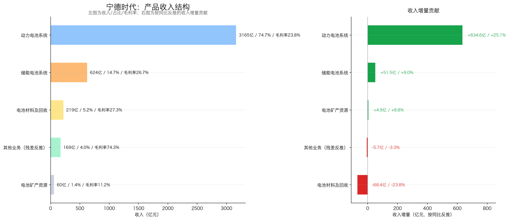
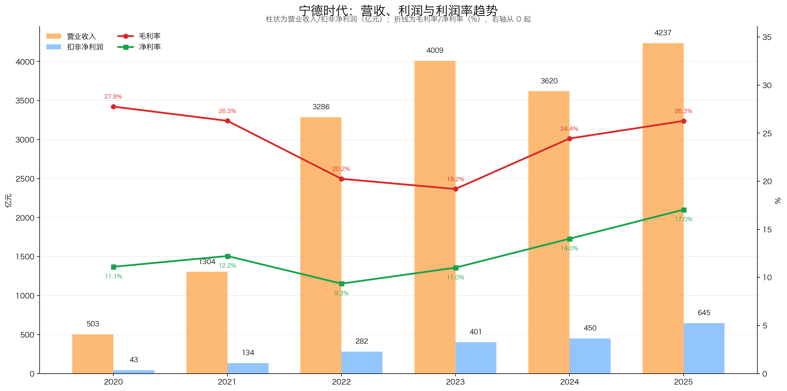
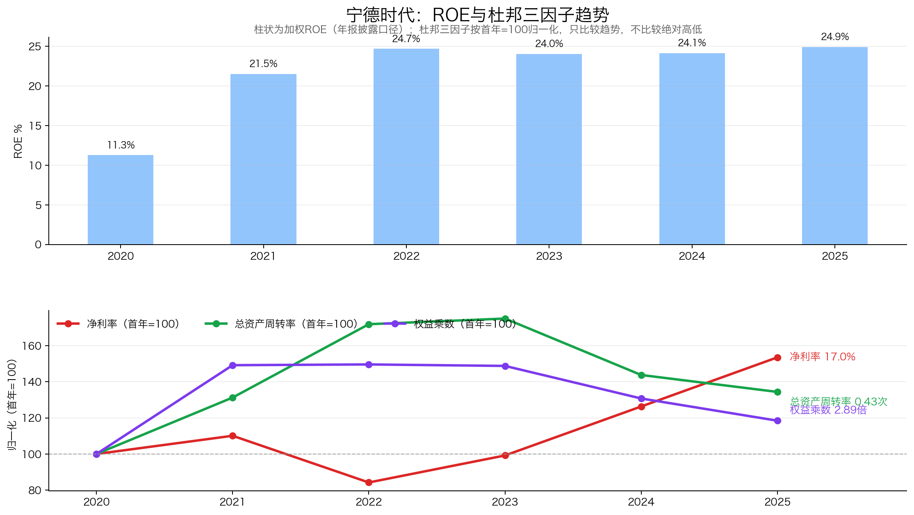
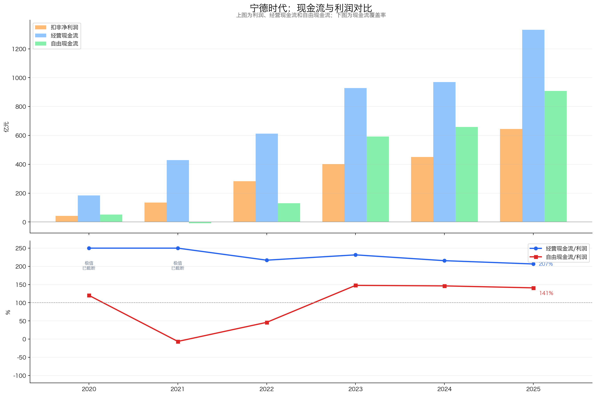
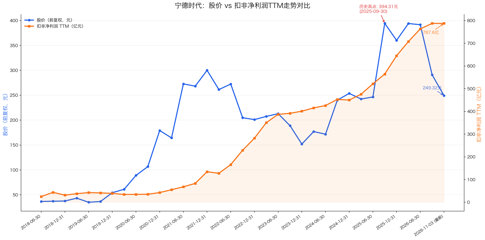

# 宁德时代：13 倍 PE，利润还在涨，现金却没跟上

> 数据范围：行情截至 2026-11-03，财务截至 2026 年三季报。本文仅为个人投资研究记录与探讨，不构成任何投资建议。

前三季度营收涨五成六，归母净利润涨三成二；市盈率却被压到 13 倍出头，是 2018 年上市以来的最低分位。业绩向上、股价向下，这是宁德时代 2026 年三季报给出的第一组矛盾。

买股票就是买公司。抛开每天盘面上红绿波动的噪音，拉长到十年的周期来看，要搞清楚一家公司值不值得长线持有，其实只需要客观回答五个常识问题：**能不能看懂、能不能活得久、利润能不能守住、能不能高效复利，以及当前价格买得值不值。**

更扎眼的是现金。同期经营现金流同比少了两成四，第三季度单季只剩 14 亿元。利润和现金第一次明显分了家。这五个关卡，它到底能过几关？

> **宁德时代的一句话判断｜综合评级：A+（84.5/100，核心重仓）**：生意看得懂，需求没消失，壁垒也够深，但定价权偏弱；ROE 连续五年站在 20% 以上，2026 年却又回到砸钱扩产的节奏，前三季度自由现金流同比掉了六成；当前 PE 13 倍、PB 2.98 倍都躺在上市以来 0.44% 分位，净现金占市值两成出头。便宜是事实，但便宜里有一道现金流裂缝。

## 一、能不能看懂：宁德时代卖的是电池，赚的是产线效率的钱

**业务简单、盈利模式清楚，未来自由现金流才有一定可预测性，而公司的价值本质上是未来自由现金流的折现。**

公司买进锂盐、正极、负极、隔膜、电解液，做成电芯和电池包，卖给整车厂和储能系统集成商。2025 年四千多亿营收里，动力电池占七成半，储能占一成半，钱主要来自这两块。

客户凭什么付钱？同样一瓦时电，它做得比别人便宜。2025 年产能利用率 96.9%，百亿级设备的折旧摊到每瓦时上越薄，单瓦时成本就越低。

省钱的大头在良品率。2025 年年报披露电芯缺陷率做到十亿分之一（DPPB）级，同行一般在百万分之一，出事的概率比中彩票都难。产业调研估算是宁德良品率 94%~95%、二线 91%~93%。在两千多亿直接材料上，两三个点的差距一年就是几十亿元物料差额。

所以它赚的是制造效率和规模的钱，不是赌锂价。但"主要"不等于"完全"：2022 年碳酸锂暴涨，毛利率掉到 20%；2026 年上半年锂价再涨，动力和储能毛利率各降一两个点。成本转嫁有时滞。

**这一关过了。** 生意不复杂，钱从哪来、凭什么赚，三句话能说清。看不懂的部分悬在成本端，原料一涨，利润就要让一截。

## 二、能不能活得久：车还在卖，但靠渗透率吃饭的日子结束了

**需求、产品和品类不易被替代，长期投资才有复利基础。**

锂电池的需求有三条腿：全球交通电动化、电网侧和工商业储能、存量动力电池的衰减替换。这三条腿五年内都不会断。

但容易赚的那段过去了。2025 年国内新能源乘用车渗透率已经到 54%，从 0 到 1 的爆发期结束，往后行业总量是缓慢扩容，不再是翻倍扩容。

公司也在换挡。2026 年上半年境内收入仍增六成，靠的不是行业渗透率，是从同行手里抢份额。全球动力电池市占率接近四成，连续九年第一；国内乘用车装车份额也还在往上走。

真正的增量在另外两条线上。储能去年还不温不火，今年上半年同比涨 87.5%，占营收从一成半抬到接近两成；境外收入涨四成，占比超过三成。匈牙利、印尼、西班牙基地还在建，北美走 LRS 技术授权，只收许可费和提成，不背重资产。

风险也要说清。全固态电池五年内还做不到百吉瓦时级的低成本量产，可资本市场会提前给液态产线打折。动力电池又是中游耐用工业品，需求和汽车消费周期绑在一起，成本端还要受碳酸锂干扰。

**这一关勉强过。** 需求不会消失，第二曲线也真起了量，但"长期存在"和"高速增长"是两回事：前者成立，后者已经从行业红利换成了份额争夺。

## 三、利润能不能守住：护城河很深，定价权却不在自己手里

**行业竞争要“月朗星稀”，公司还要有护城河；护城河不等于定价权，强势客户仍可能拿走一部分利润。**

同行为什么抢不走利润？三样东西叠在一起。

一是良品率差 2~3 个百分点，在千亿物料成本上就是每年几十亿的差额。二是认证壁垒，动力电池直接关系乘员安全，海外主机厂定点认证要 2~3 年，一旦上车不会轻易换。三是研发，一年两百多亿投进去，全部费用化，神行超充、麒麟一路推着走。

但护城河深，不等于能随便涨价。这两件事必须拆开看。

动力电池占整车成本三到四成，下游车企打价格战，压力会直接传到电池价格上。2026 年上半年，动力电池和储能毛利率同步下滑一两个点。

储能卖给电站业主，不是车企，两个业务同步下滑，更像是成本端的共同因素。公司中报写得很直接："碳酸锂等原材料价格明显上行"。

售价让利、原料上涨、新产能折旧，三重挤压一个都转嫁不出去。2026 年第三季度单季综合毛利率 20.69%，比 2025 年同期的 25.80% 低了五个多点；单季净利率也掉了近五个点。

横向比，龙头的利润厚度还在。2025 年宁德毛利率 26%、净利率 17%；亿纬锂能、中创新航这些二线，毛利率普遍在 15% 上下，净利率只有个位数。行业利润大部分集中在这一家。

把五年数据串起来看，利润率的来路更清楚。2020—2025 年营收从五百亿做到四千两百亿，扣非净利润从四十多亿做到 645 亿；毛利率在 2022 年塌到 20%、2023 年见底 19%，2024—2025 年修回 26%。这五年利润跑得比收入快，靠的是利润率修复。

2026 年前三季度毛利率 22.7%，比去年同期低两个多点；第三季度单季营收涨近六成，归母净利润只增一成半，这轮修复被吐回去一大截。

好在利润的成色没坏。2025 年扣非占归母接近九成，非经常性损益最大一项是股权投资持股比例变动带来的投资收益，不是靠补贴和理财凑的。

**这一关勉强过。** 同行抢不走它的份额，但它也拦不住下游压价。壁垒保住了位置，没保住利润率。

## 四、能不能高效复利：ROE 很高，可 2026 年又得往厂房里砸钱

**投入较少资本、产生较高回报，上行期能高效复利，下行时也会有保护。**

先看回报率：加权 ROE 连续 5 年站在 20% 以上，2025 年 24.91%，2026 年前三季度 17.64%。

拆开杜邦三因子看，这个 ROE 不是借来的。归母净利率一路抬升，权益乘数一路下降。净利率往上、杠杆往下，钱是靠单位盈利改善赚的，不是靠借钱撬的。

再看这门生意吃不吃本钱。2021—2025 年购建长期资产累计近两千亿，同期经营现金流四千多亿，是累计归母净利润的两倍。2023—2025 年是收获期，自由现金流一年比一年厚。

2026 年这个趋势断了。前三季度资本开支四百多亿，同比增四成，已经接近 2025 年全年；在建工程比年初增四成多。

同期自由现金流只剩 194.58 亿元，同比降了六成。第三季度单季更极端：经营现金流只剩十几亿，资本开支却有 170 亿，单季自由现金流约 -157 亿元。

一句话，2023—2025 年攒下的现金，2026 年又投回去了：厂房设备砸了四百多亿，存货比年初增五成，合同负债降 17%，一头多备货、一头少预收。

管理层没有明显扣分项。实控人没有高比例质押、清仓式减持和掏空型关联交易；研发 100% 费用化，行业去库存的 2023—2024 年如实计提存货跌价；审计意见连年标准无保留。说过的产能、储能、海外基地，基本按节点兑现。

分红也给得实在。2023—2025 年连续三年分红率 50%，2025 年现金分红 361 亿元，按现价算静态股息率 3.19%。2026 年 7 月还推了两三百亿的注销式回购，到 9 月底已回购三十多亿。

但分红的水分要看清。2025 年自由现金流能覆盖分红 2.5 倍；2026 年前三季度只剩 0.54 倍，同期分掉的现金比赚的还多。

"分红靠当年现金流赚出来"这句话，2026 年不成立了，靠的是账上两千多亿净现金托底。

还有一笔账要算。2021—2025 年累计赚了两千多亿，分掉九百多亿，留存一千两百亿，对应市值增加三千三百多亿，每留 1 元利润换来 2.74 元市值。

但扣掉两轮定增和 H 股融资的一千多亿，只剩 1.77 倍——仍然及格，只是没有表面好看。

**这一关勉强过。** 存量回报是真的，管理层也没乱来，但增长重新开始吃资本，分红的现金来源也在变薄。

## 五、当前价格买得值不值：13 倍 PE 里，装着多少真便宜

**市场预期已经反映在股价中，只有实际增长超过市场预期增长，投资者才容易获得好回报。前四问判断公司值不值得长期持有，第五问判断当前价格值不值得买。**

市场担心一句话：增收不增利，也不增现金。收入在涨，利润涨得更慢，经营现金流反而在退。

先看贵不贵。PE 13.16 倍、PB 2.98 倍，从 2018 年上市算起，都在 0.44% 的历史分位，PE 中位数是 37.6 倍。两个指标都在上市以来最低的 1% 以内。

支撑在资产端。账上现金加理财四千三百多亿，扣掉有息负债，净现金 2,467 亿元，占总市值 21.39%。扣掉这笔钱，扣现金 PE 只有 10.34 倍。

但便宜有个陷阱要防：当前利润是不是景气顶。这个利润确实是历史最高，三季度单季归母已经环比下滑。

按 800 亿元做压力测试（较 TTM 下调近一成），PE 也只有 14 倍出头；按 2025 年全年的 722 亿元算，也就 16 倍。分位都还在 1% 附近，即使利润回吐一到两成，"极低"这个结论仍然成立。

| 指标 | 数据 |
|---|---:|
| 股价 / 总市值 | 249.32 元 / 11,536.66 亿元 |
| 归母净利润 TTM / 扣非 TTM | 876.97 亿元 / 787.64 亿元 |
| PE(TTM) / 历史分位 | 13.16 倍 / 0.44% |
| PB(MRQ) / 历史分位 | 2.98 倍 / 0.44% |
| 扣纯现金后 PE | 10.34 倍（扣非 11.51 倍） |
| 彼得林奇纯净现金头寸 | 2,467.32 亿元（占市值 21.39%） |
| 静态股息率 | 3.19% |

再看拿不拿得住。静态股息率 3.19%，分红覆盖从 2.5 倍掉到 0.54 倍，垫子比去年薄；好在净现金在，加上注销式回购，不是完全没有回报。

最后算赔率。不预测，直接拿 800 亿元作压力假设，看 2029 年年报。

保守档：价格战持续，利润零增长，期末给 12~13 倍 PE，三年价格空间 -19%~-8%；持有期每年约 3.2% 的股息，三年能抵掉大部分跌幅。

中性档：国内份额提升、储能和海外产能放量，利润年增 8%~10%，2029 年做到一千亿出头，给 15~17 倍 PE，仍是历史中位数的一半不到，三年空间 +31%~+57%。

| 情景 | 利润假设 | 期末 PE | 期末市值 | 价格变动空间 |
|---|---|---:|---:|---:|
| 中性 | 2029 年归母净利润 1,008~1,065 亿元（年增 8%~10%） | 15~17 倍 | 1.51~1.81 万亿元 | +31% ~ +57% |
| 保守 | 2029 年归母净利润 780~820 亿元（零增长） | 12~13 倍 | 0.94~1.07 万亿元 | -19% ~ -8% |

*注：保守档三年股息约 9.6%，可抵掉大部分跌幅。*

下行 -8%~-19%，上行 +31%~+57%，风险收益比约 1:3。不对称成立，但这份赔率不是白送的，现金流恶化需要四季度数据来验证。

**这一关过了。** 价格确实便宜，赔率也划算，但便宜的原因还得盯住。

## 六、最终结论：宁德时代现在值得买入吗？

按五个常识问题检验，前四关都过了，只是后三关只能算勉强：生意看得懂、壁垒够深，但需求增速换了挡、定价权不在自己手里、增长又开始吃资本。

| 维度 | 得分 | 权重 | 核心判断 |
|---|---:|---:|---|
| 好生意 | 58.5 | 70 | 全球动力与储能双龙头，壁垒深、回报高，但定价权弱、2026 年现金流拐头 |
| 好管理层 | 8.5 | 10 | 治理扎实、研发全费用化、连续三年分红率 50%，但 A+H 融资摊薄每股复利 |
| 好价格 | 17.5 | 20 | PE/PB 均处 0.44% 分位，扣现金 PE 10.34 倍，赔率约 1:3 |
| **合计** | **84.5** | **100** | **核心重仓（评级：A+）** |

### 当前是不是好时机（价格研判）

当前估值处在上市以来极低分位，两千多亿纯净现金垫在下面，下行有股息和现金托底，中性档的空间远大于下行。基本面没有走坏、价格被压到历史低位，具备长线配置价值。

但"便宜"不是无条件的。三季度单季毛利率掉到 20.69%，经营现金流只剩十几亿，自由现金流是负的，现金流这条腿在打晃。

做法是分批建仓、重点配置，不宜一次性重仓。第一笔仓位可以对照两个验证点下手：四季度单季毛利率不低于 20%，单季经营现金流回到 300 亿元以上。

### 动态跟踪与证伪条件（什么时候认错）

1. **毛利率失守**：连续两个季度单季综合毛利率低于 20%，说明价格与成本两头挤压已经无法靠效率消化；
2. **现金流不回头**：2026 年全年自由现金流低于 500 亿元、覆盖不了 361 亿元分红，且单季经营现金流没有回到 300 亿元以上；
3. **订单蓄水池继续漏**：合同负债跌破 380 亿元且连续两个季度不回升，说明下游备货意愿是系统性转弱，不只是账期调整。

三项里出现任意一项，长线逻辑就得重算，不能拿"估值低"硬扛。

---

如果您觉得这篇文章有启发，欢迎点赞、转发、关注！

风险提示： 本文仅供参考，不构成投资建议。市场有风险，入市需谨慎。
