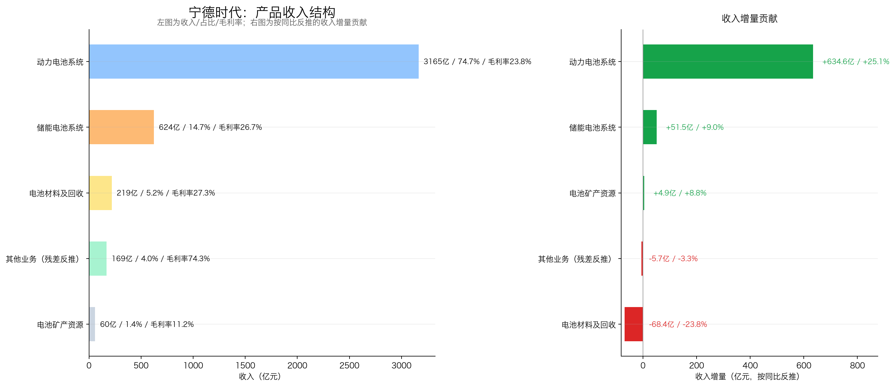
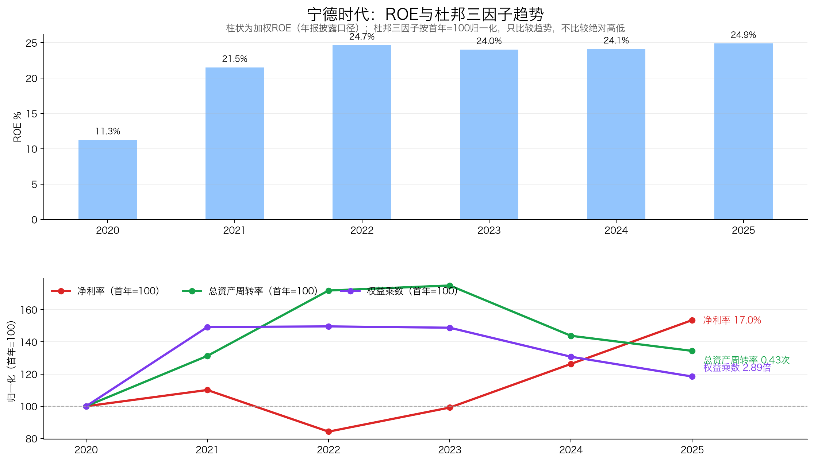
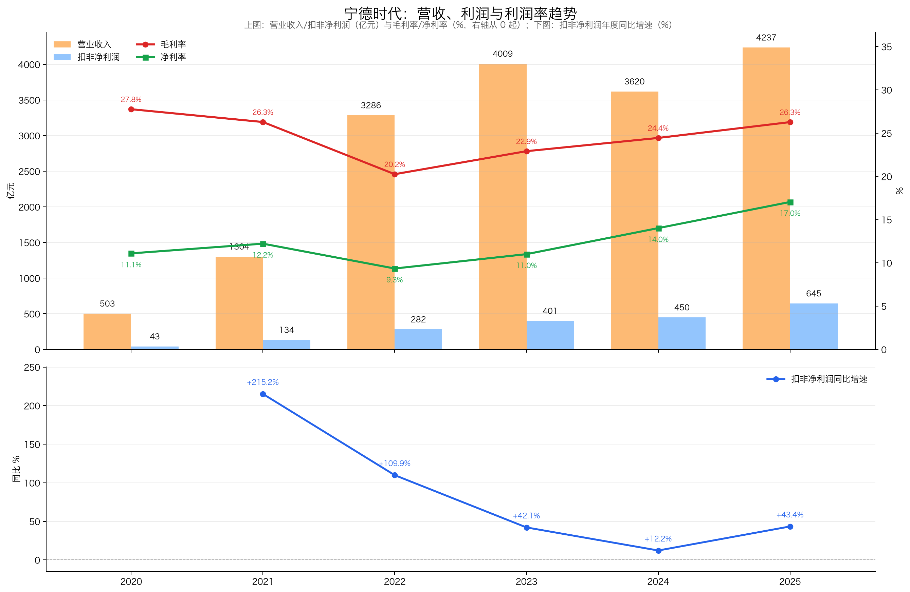
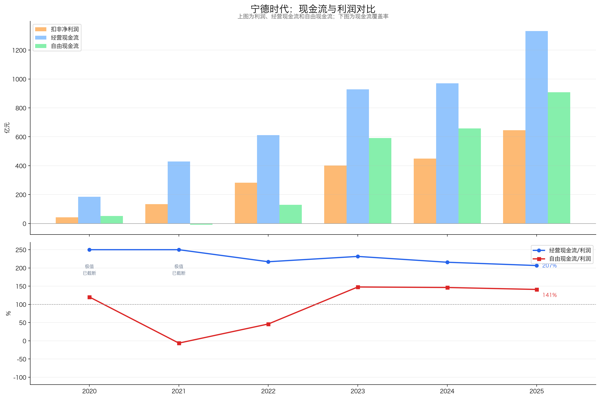
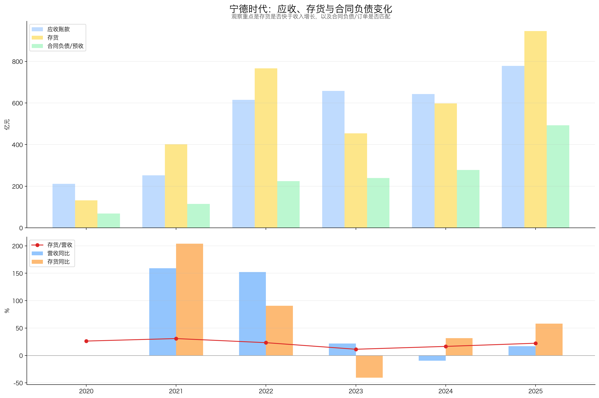
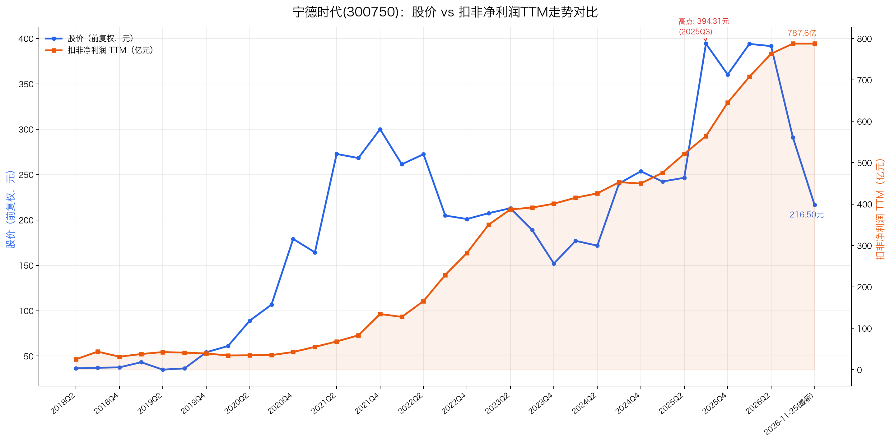

# 宁德时代（300750.SZ / 03750.HK）投资分析报告

- **报告基准日**：2026-11-25
- **基准行情**：A股 216.50 元（11:30 午盘），A股同价总市值 10,018.00 亿元；表观滚动市盈率 PE(TTM) 11.42 倍，市净率 PB 2.59 倍[^1]
- **数据来源**：2020–2025 年官方年报 PDF、2026 年半年报与三季报官方 PDF、同花顺/东方财富原始报表、腾讯实时行情与 yfinance 前复权日频序列

---

## 决策摘要

| 评估模块 | 得分 | 满分 | 核心定性结论 |
|---|---:|---:|---|
| 好生意·定性 | 27.0 | 35 | 全球动力与储能双料第一，工程良率与车规认证壁垒深； 中游重资本与主机厂年降博弈压制，差 1.0 分未达 A 档定性门槛 |
| 好生意·定量 | 27.0 | 35 | ROE 连年超 21%，5 年累计净现比 2.00 倍； 但 2026Q3 毛利率跌至 20.69%、单季自由现金流转负且合同负债回落 |
| 好管理层 | 9.0 | 10 | 实控人零质押、研发全额费用化、连续三年分红率 50%  并启动 200–400 亿注销回购；近 5 年外部股权融资超千亿有摊薄 |
| **基本面质地小计** | **63.0** | **80** | **质地等级：B 档**（门槛：A≥64且定性≥28，B≥56，C≥48，D<48） |
| 好价格 | 17.0 | 20 | **价格状态：价格极低**（买入信号：`+`；PE 11.42 倍与 PB 2.59 倍 双双跌破上市以来最低点，扣纯现金后 PE 仅 8.4–9.5 倍） |
| **综合总分** | **80.0** | **100** | **最终评级：B+** |

- **一句话结论**：宁德时代靠制造良率、车规长周期认证和产业链占款坐稳了全球动力与储能电池第一把交椅，但电池毕竟是重资产的中游制造，既要年年花大钱扩产，又夹在车企年降和矿价波动中间受挤压；眼下市场把估值打到了上市以来最低一带，已经充分反映了这些压力，适合分批买进、等盈利和估值修复，综合评级 **B+**。
- **核心矛盾**：量在增长，但价、现金和订单都在收紧。2026 年前三季度营收增长 56.19%，但 Q3 单季综合毛利率同比下滑 5.11 个百分点至 20.69%；单季经营现金流缩水至 14.09 亿元，自由现金流转为 -156.86 亿元，合同负债也较年初下降 17.40%。市场正在对“增收少增现金”和新一轮扩产压价。
- **关键跟踪变量**：单季综合毛利率能否守住 20%；单季经营现金流能否回到 300 亿元以上，重新覆盖分红与扩产；合同负债能否在 406.69 亿元一带止跌回升。

---

## 一、公司概况与初筛排雷（不计分）

### 1.1 公司基本情况

| 维度 | 内容 |
|---|---|
| 股票代码/上市地 | 300750.SZ（A股，44.0895 亿股）/ 03750.HK（H股，2.1830 亿股），总股本 46.2725 亿股 |
| 基准行情与体量 | A股 216.50 元，H股 320.80 港元；**A股同价市值 10,018.00 亿元**（A+H 分类加总 **10,141.82 亿元**），PE(TTM) 11.42 倍，PB 2.59 倍 |
| 主营业务与占比 | 动力电池系统（2025 年占营收 74.70%），储能电池系统（14.74%），电池材料及回收（5.16%） |
| 实际控制人与核心高管 | 曾毓群（通过厦门瑞庭投资持股 22.04%），董事长兼总经理曾毓群 |
| 数据基准日 | 财务数据截至 2026 年三季报（2026-09-30）；行情与期后事项截至 2026-11-25 午盘 |

### 1.2 怎么赚钱
公司采购锂盐、正负极、隔膜和电解液，加工成电芯与电池系统，卖给整车厂和储能集成商。结合 2025 年业务结构（见下图），动力电池仍是基本盘与增量主力，储能与材料回收毛利率略高。

超额利润主要来自两头：
- **满产摊薄与制造良率**：2025 年公司产能利用率高达 96.9%，2026 上半年仍保持在 94.86%，接近满负荷运转有效摊薄了百亿级设备折旧。同时，官方披露电芯单体出厂失效率达到十亿分之一级，产线良率领先二线厂商带来了可观的物料成本优势[^2]。
- **周期摩擦风险**：高开工背后也出现产大于销，2025 年末库存电芯增至 186GWh。当上游碳酸锂价格快速上涨时，金属联动调价条款存在 1–2 个季度时滞，短期毛利率仍会承压。

### 1.3 有没有雷
- **财务与治理红线核查**：2020–2025 年年报均获标准无保留审计意见，未发现财务造假或大股东资金占用。2021–2025 年累计经营现金流 4,271.53 亿元，为同期归母净利润的 2.00 倍，收现扎实。实控人曾毓群持股平台厦门瑞庭持股 22.04% 且零质押，前十大股东仅有一位小比例质押，无爆仓风险[^3]。2026 年前三季度有息负债升至 1,858.62 亿元，但同期账面现金及理财超 3,961 亿元，短期没有偿债压力。
- **初筛结论**：**【通过】**

---

## 二、好生意·定性（27.0 / 35分）

### 2.1 业务简不简单、需求稳不稳？（3.5 / 5分）
电池制造属于重资产、高技术门槛的先进制造业，商业闭环清晰：采购原材料、生产电芯与模组、直供车企和储能客户。

- **长期需求**：交通电动化、电网储能以及存量电池衰减替换共同支撑未来 5–10 年刚需。全固态电池 5 年内还很难实现低成本大规模量产，但技术路线更替的预期会压低现有液态产线的长期估值。
- **周期约束**：动力电池深度绑定汽车耐用品消费景气度，且上游锂价波动会干扰盈利节奏，稳定性弱于日常必选消费。

> **本节得分：3.5 / 5 分**
> - **业务简单清晰（1.5/2）**：原料加工电芯系统直供车企储能，闭环清晰，但技术迭代较快。
> - **需求刚性与行业适应性（2.0/3）**：电动化与储能长期刚需无外部颠覆，但受车市周期与大宗价格扰动。

### 2.2 竞争格局清不清晰？（7.0 / 8分）
全球动力与储能电池已呈“一超多强”格局。据 SNE Research 数据，2025 年宁德时代全球动力电池市占率达 39.2%，连续 9 年排第一；国内装车份额超 43%，2026 上半年乘用车装车占比进一步升至 46.7%；储能电池出货量也连续 5 年全球第一。

反映在盈利能力上，宁德时代对二线电芯厂形成了断层领先，净利率和投入资本回报率大幅甩开同行（见下表）。不过整车厂出于供应链安全和议价需要，长期扶持二供、三供，比亚迪也靠垂直自供稳居第二，行业价格竞争并未彻底停火。

| 可比公司（代码） | 最新市值（亿元） | PE(TTM) | 销售毛利率 | 销售净利率 | 加权 ROE / ROIC(扣现) | 竞争定位差异 |
|---|---:|---:|---:|---:|---:|---|
| **宁德时代（300750.SZ）** | **10,018.00** | **11.42** | **26.27%** | **18.12%（归母17.04%）** | **24.91% / 84.74%** | **全球动力与储能双料第一，全资本 ROIC 17.64%** |
| 比亚迪（002594.SZ） | 6,831.52 | 21.60 | 17.74% | 4.20% | 15.31% / 22.10% | 整车+电池垂直自供龙头，全资本 ROIC 12.01% |
| 亿纬锂能（300014.SZ） | 951.75 | 14.51 | 16.17% | 7.00% | 10.50% / 8.73% | 消费+动力+储能二线领先，自由现金流长期承压 |
| 国轩高科（002074.SZ） | 386.54 | 55.29 | 16.17% | 5.08% | 8.65% / 6.23% | 大众参股二供，扣非盈利微薄（2025年仅4.3亿） |
| 中创新航（03931.HK） | 174.80 | 8.10 | 16.69% | 4.72%（归母3.32%） | 4.02% / 3.20% | 港股纯电池二供，规模上量但净利率与回报偏低 |

*注：市值与 PE 为 2026-11-25 午盘实时口径（中创新航按 205.23 亿港元 × 0.8517 折算人民币，PE 按 2026Q3 财报 TTM 归母净利 21.57 亿元计算）；利润率、ROE、ROIC 均按 2025 年报同花顺报表数据统一核算（净利率按同花顺销售净利率整体口径）。*

> **本节得分：7.0 / 8 分**
> - **行业格局与集中度（4.0/5）**：全球动力与储能双料第一，但整车厂扶持二供使价格竞争延续。
> - **同行对比优势（3.0/3）**：毛利率、净利率、ROE 及 ROIC 全面大幅领先全部可比同行。

### 2.3 护城河深不深、是在加深还是变窄？（11.0 / 14分）
宁德时代的护城河并非稀缺牌照或独家专利垄断，而是靠高压研发、极限制造工艺和车规安全背书建立的系统防线：
1. **排他性壁垒（3.0/4）**：2025 年研发投入 221.47 亿元且全额费用化，神行超充、麒麟电池与天恒储能等产品形成了明显代差；但锂电基础化学体系全行业均可并行研发，不具备法律排他性。
2. **结构性竞争优势（3.5/4）**：高产能利用率摊薄折旧、百亿级采购议价和回收闭环共同压低成本；但维持这条成本线代价不菲，每年仍需三四百亿元资本开支和两百亿级研发投入，2026 前三季度资本开支已达 421.67 亿元，重资产门槛客观存在。
3. **转换成本与网络效应（3.0/4）**：电芯十亿分之一级的极低出厂失效率，加上长达 2–3 年的底盘联合标定，让主机厂换供风险极高，终端也形成了“买电车认宁德”的心智，但多供策略仍在局部稀释订单。
4. **护城河动态趋势（1.5/2）**：2025 年全球动力份额逆势升至 39.2%，匈牙利及西班牙工厂逐步落地，领先优势稳中有扩，主要需盯防二线持续扩产和车企自研电池分流。

> **本节得分：11.0 / 14 分**（以上 4 项细分得分之和）

### 2.4 有没有自主或隐性定价权？（5.5 / 8分）
动力电池占整车成本三到四成，处于下游车企年度降价要求与上游矿产波动的夹缝中，定价权受到明显约束：
1. **主动提价与隐性定价权（3.5/5）**：公司很难对老款电芯直接涨价，2026 年在车市价格战下基础产品依然承压；隐性溢价主要靠推新品调结构，通过神行、麒麟高端快充和大储系统拉高高毛利占比，让单瓦时利润继续高于同行。
2. **成本转嫁机制（2.0/3）**：与主流车企签有碳酸锂等金属价格联动条款，能转嫁大宗原料暴涨的主要风险，但调价有 1–2 个季度滞后期，原料急涨阶段仍需自身消化部分挤压。

> **本节得分：5.5 / 8 分**（以上 2 项细分得分之和）

---

## 三、好生意·定量（27.0 / 35分）

### 3.1 赚钱效率高不高、靠什么驱动？（12.5 / 14分）
近 5 年公司加权净资产收益率 ROE 连续稳在 21.5%–24.9%，2026 前三季度受净利率回落影响，未年化 ROE 小幅降至 17.64%。从投入资本回报率 ROIC（衡量扣除或包含现金后的真实生息资产赚钱效率）看，扣现 ROIC 一路升至 84.74%，即便把账上近 4,000 亿元现金全算进来，全资本 ROIC 仍稳在 15.2%–17.6%，远高于资金成本[^4]。

杜邦拆解显示，高回报不是靠金融加杠杆，而是靠利润率与无息商业占款：
- **杠杆总体下降**：2022–2025 年资产负债率与期末权益乘数持续下行，直到 2026Q3 扩产发债才微升。
- **利润率翻倍拉动**：归母净利率从 2022 年的 9.35% 提升至 2025 年的 17.04%。
- **产业链无息占款**：公司负债大头并非银行借款，而是应付票据、应付账款、合同负债及质保返利等上下游免息资金，构成了核心资本效率来源[^4]。

> 注：图名中的 4.x 为标准图表编号，对应本报告 3.x 节，下文同。

| 年份 | 归母净利(亿) | 加权 ROE | ROIC(扣现/全资本) | 归母净利率 | 总资产周转率 | 权益乘数 | 资产负债率 |
|---|---:|---:|---:|---:|---:|---:|---:|
| 2020 | 55.83 | 11.27% | 30.40% / 8.93% | 11.10% | 0.32 次 | 2.44 | 55.82% |
| 2021 | 159.31 | 21.52% | 46.42% / 15.52% | 12.22% | 0.42 次 | 3.64 | 69.90% |
| 2022 | 307.29 | 24.67% | 50.70% / 16.73% | 9.35% | 0.55 次 | 3.65 | 70.56% |
| 2023 | 441.21 | 24.04% | 60.58% / 16.01% | 11.01% | 0.56 次 | 3.63 | 69.34% |
| 2024 | 507.45 | 24.13% | 66.71% / 15.21% | 14.02% | 0.46 次 | 3.19 | 65.24% |
| 2025 | 722.01 | 24.91% | 84.74% / 17.64% | 17.04% | 0.43 次 | 2.89 | 61.94% |

*注：杜邦因子（净利率、周转率、权益乘数）按期末总资产及期末归母净资产核算，三因子乘积对应期末摊薄 ROE（2025 年为 21.42%），与年报法定加权 ROE 存在期间加权口径差。*

> **本节得分：12.5 / 14 分**
> - **ROE/ROIC 水平与趋势（6.5/7）**：加权 ROE 连年超 21%、扣现 ROIC 达 84.7%，2026Q3 略承压。
> - **杜邦驱动与回报质量（6.0/7）**：净利率翻倍驱动叠加超 3,000 亿元无息供应链占款，杠杆总体下行。

### 3.2 利润增长真不真、毛利费用稳不稳？（5.5 / 8分）
2020–2025 年，宁德时代扣非净利润从 42.65 亿元增至 645.08 亿元，近 3 年复合增速达 31.74%，过去五年扣非占归母比例保持在 84.4%–91.8%，主业成色扎实[^5]。同时费用控制极严：2025 年销售费用率仅 0.88%、管理费用率 2.75%，221.47 亿元研发费用全额计入当期损益，没有资本化粉饰。

但 **2026 年毛利率压力已经显现**：前三季度营收虽大增 56.19% 至 4,421.37 亿元，扣非净利增长 32.68% 至 578.76 亿元，但综合毛利率从上年同期的 25.31% 降至 22.72%。其中 **Q3 单季毛利率跌至 20.69%**、单季归母净利率跌至 12.86%；分板块看，2026 上半年核心动力电池毛利率降至 20.63%，而储能收入同比大增 87.54%、毛利率保持在 23.96%，是重要盈利缓冲垫[^5]。

> **本节得分：5.5 / 8 分**
> - **扣非真实增长与持续性（3.0/4）**：近 3 年扣非复合增 31.7%，主业占比高，但 2026 年增速受让利拖累。
> - **毛利率与费用率控制（2.5/4）**：费控极优且研发全额费用化，但 2026Q3 单季毛利率跌至 20.69% 显著承压。

### 3.3 赚的是真金白银还是账面富贵？（7.0 / 10分）
历史造血极其扎实：2021–2025 年累计归母净利润 2,137.27 亿元，累计经营现金流 4,271.53 亿元，净现比高达 2.00 倍。扣除五年累计 1,991.33 亿元扩产资本开支后，累计自由现金流仍达 2,280.20 亿元，且 2025 年产能利用率高达 96.9%，扩产并未沉淀成无效资产。

然而 **2026 年现金流出现明显拐点**：
- **前三季度走弱**：经营现金流同比下降 23.60% 至 616.25 亿元，同期资本开支大增 40.14% 至 421.67 亿元，自由现金流同比缩水 61.52% 至 194.58 亿元。
- **Q3 单季转负**：单季经营现金流仅 14.09 亿元，但资本开支达 170.95 亿元，单季自由现金流转为 **-156.86 亿元**。
- **外部融资依赖**：近 5 年公司通过 A 股定增和两轮 H 股发行累计净募资 1,164.68 亿元，重资产扩产仍需要外部股权和债权资金配合。

| 年份 | 归母净利(亿) | 经营现金流 CFO(亿) | 购建资产支出 CapEx(亿) | 自由现金流 FCF(亿) | 净现比(CFO/净利) | CapEx/营收 |
|---|---:|---:|---:|---:|---:|---:|
| 2020 | 55.83 | 184.30 | 133.02 | 51.28 | 3.30 | 26.4% |
| 2021 | 159.31 | 429.08 | 437.68 | -8.60 | 2.69 | 33.6% |
| 2022 | 307.29 | 612.09 | 482.15 | 129.94 | 1.99 | 14.7% |
| 2023 | 441.21 | 928.26 | 336.25 | 592.01 | 2.10 | 8.4% |
| 2024 | 507.45 | 969.90 | 311.80 | 658.10 | 1.91 | 8.6% |
| 2025 | 722.01 | 1,332.20 | 423.45 | 908.75 | 1.85 | 10.0% |
| **近5年累计(2021-25)** | **2,137.27** | **4,271.53** | **1,991.33** | **2,280.20** | **2.00** | **12.1%** |

> **本节得分：7.0 / 10 分**
> - **利润含金量（4.0/5）**：5 年累计净现比 2.00 倍，2026Q3 单季经营现金流骤降至 14.1 亿元拖累明显。
> - **资本效率与造血纯度（3.0/5）**：5 年累计自由现金流 2,280 亿元、高开工兑现，但 2026Q3 转负且近 5 年有千亿股权融资。

### 3.4 家底厚不厚、资产有没有水分？（2.0 / 3分）
截至 2026Q3 末，公司总资产 1.18 万亿元。先看资金安全垫：剔除受限资金和定期存单后，可随时动用现金等价物加理财减去长期有息负债，**彼得·林奇纯净现金为 2,670.85 亿元**；即便把全部 1,858.62 亿元长短期有息负债一口气还清，账上仍剩 **2,103.16 亿元**净金融现金，偿债安全垫极厚[^6]。

需要紧盯的是举债节奏与营运信号异常（见下图与精简底表）：
- **短债与发债大增**：2026Q3 短期借款同比暴增 208.43%，应付债券飙升 1,431.55% 至 527.38 亿元。
- **订单蓄水池缩水**：合同负债从年初 492.33 亿元跌至 406.69 亿元，降幅 17.40%，说明下游提前打款意愿减弱。
- **存货、应收与折旧压力**：存货较年初大增 53.15% 至 1,447.70 亿元，与营收增速基本同步；应收款项合计仅增 15.02%，主要源自票据重分类而非放宽赊销；商誉仅 8.19 亿元。不过在建工程大增 44.73% 至 430.32 亿元，2027 年集中转固后折旧将明显抬升[^6]。

| 报告期 | 营业收入(亿) | 应收及票据 / 存货(亿) | 合同负债(亿) | 货币+理财(亿) | 长期 / 全部有息债(亿) | 林奇净现金 / 扣全债(亿) |
|---|---:|---:|---:|---:|---:|---:|
| 2023 | 4,009.17 | 657.72 / 454.34 | 239.82 | 2,643.15 | 1,026.86 / 1,248.76 | 1,616.28 / 1,394.38 |
| 2024 | 3,620.13 | 642.66 / 598.36 | 278.34 | 3,177.94 | 931.61 / 1,357.38 | 2,246.33 / 1,820.55 |
| 2025 | 4,237.02 | 777.83 / 945.26 | 492.33 | 3,925.07 | 816.78 / 1,168.51 | 3,108.28 / 2,756.55 |
| **2026Q3** | **4,421.37** | **1,133.76 / 1,447.70** | **406.69** | **4,325.94** | **1,290.93 / 1,858.62** | **2,670.85 / 2,103.16** |

*注：2023–2025 年林奇净现金按报表货币资金+理财-长期借款及应付债券口径列示；2026Q3 严格按现金等价物 3,333.98+理财 627.80 剔除受限部分核定（详细拆分见注释 [^6]）。*

> **本节得分：2.0 / 3 分**
> - **债务安全与资金真伪（1.0/1.5）**：扣全债净现金仍超 2,103 亿元，但短债与发债急增需保持跟踪。
> - **营运排雷与资产水分（1.0/1.5）**：商誉极小、应收管控良好，但合同负债较年初跌 17.4%、在建工程大增。

---

## 四、好管理层（9.0 / 10分）

### 4.1 有没有坑小股东、说话算不算数？（4.0 / 4分）
- **治理底线与利益绑定（2.0/2）**：实控人曾毓群持股平台厦门瑞庭持股 22.04% 且零质押，没有司法冻结、清仓减持或掏空式关联交易。2026 年第二期员工持股计划虽有折价，但规模上限仅占总股本 0.17%，对股东摊薄极微[^7]。
- **言行兑现与会计诚实（2.0/2）**：2021 年报提出的三大长期战略到 2025 年基本兑现，包括十亿分之一级电芯失效率、772GWh 产能落地与储能五连冠；2022 年 A 股定增的 5 个募投项目也大多如期达产达效[^7]。221 亿元研发投入全部当期费用化，不资本化注水。

> **本节得分：4.0 / 4 分**

### 4.2 赚了钱怎么花、分不分给股东？（5.0 / 6分）
- **分红与真回购（2.5/3）**：2023–2025 年公司连续三年将现金分红率保持在归母净利的 50%，近 5 年累计派息占同期自由现金流的 40.0%，造血覆盖充分；但 2026 前三季度自由现金流骤降至 194.58 亿元，短期派息需动用存量现金或借款。回购方面，早期 55.93 亿元用于股权激励未减股本，但 2026 年 7 月起启动 200–400 亿元真注销回购，三季末已实施 33.03 亿元[^8]。
- **修正一美元原则检验（2.5/3）**：衡量“公司每留存或融来 1 块钱，帮股东创造了多少长期价值”。口径 A（表观市值比率）仅 0.77 倍，主因是 2020 年末处于 184 倍 PE 的极端牛市泡沫，随后杀至 11.4 倍形成戴维斯双杀；剔除估值泡沫后的**口径 B 高达 6.73 倍**（即便按 15 倍保守估值中枢仍达 4.18 倍）。公司主业极聚焦、利润增超 12 倍且启动百亿回购，但千亿级外部股权融资仍有明显摊薄，综合扣减 0.5 分[^8]。

| 项目 | 近 5 年累计数值（亿元） | 对应指标与结论 |
|---|---:|---|
| 留存利润 + 外部股权再融资（分母） | 2,389.14 | 留存利润 1,224.46 + 外部股权再融资 1,164.68（明细见脚注 [^8]） |
| 最新总市值较 5 年前市值增量 | 1,838.98 | A 股同价增量（A+H 分类加总增量 1,962.80 亿元） |
| **表观一美元比率（口径 A）** | **0.77** | **A+H 口径 0.82 倍（受 184x PE 杀至 11.4x 的双杀影响）** |
| **估值归一化一美元比率（口径 B）** | **6.73** | **近 5 年中枢 PE 24.12x × 净利增量 666.18 ÷ 2,389.14** |
| **综合资本配置判定** | **被错杀纠偏** | **内生利润暴增且启真注销回购，但两轮 H 股融资有摊薄** |
| 近 5 年累计现金分红 / 真注销回购 | 912.81 / 33.03 | 分红占同期 FCF 的 40.0%；另有 2024–25 年 55.93 亿激励库存股 |

> **本节得分：5.0 / 6 分**（分红意愿与真回购 2.5/3 + 主业专注与一美元原则 2.5/3）

---

## 五、好价格（17.0 / 20分）

### 5.1 现在估值贵不贵？（9.5 / 10分）
基本估值、分位数和林奇纯净现金均列于下方估值面板[^9]。正文只回答两个核心问题：
1. **利润打八折后，历史最低估值依然成立**：自 2018 年上市以来，当前 11.42 倍 PE 与 2.59 倍 PB 双双跌破历史最低点，林奇收益线（见下图）显示 2025Q3 后利润攀顶而股价持续背离下探。即便把 876.97 亿滚动利润狠砍两成压回 **700 亿元**，常态 PE 也只有 **14.31 倍**，依旧落在上市以来 **0.5% 分位以内**。
2. **厚现金托底明显低于同行，但年内短债略削安全边际**：林奇纯净现金占总市值 26.66%，即便扣光全部长短债仍占 20.7%–21.0%，牢牢越过 20% 强资产托底线；扣现后 PE 仅 8.38 倍，远低于比亚迪（21.60 倍）、亿纬锂能（14.51 倍）与国轩高科（55.29 倍），仅略高于微利高杠杆的中创新航（8.10 倍）。因 2026 年发债与短债大增且扩产耗现，扣现金加分项小幅打折。

| 估值指标 | 数值 | 计算口径与基准说明 |
|---|---:|---|
| 最新股价与总市值 | 216.50 元 / 10,018.00 亿元 | 截至 2026-11-25 午盘（A+H 口径见脚注 [^1]） |
| 归母 TTM / 扣非 TTM | 876.97 亿元 / 787.64 亿元 | 滚动过去 4 个季度（2025Q4–2026Q3） |
| 表观 PE(TTM) / 扣非 PE | **11.42 倍** / **12.72 倍** | A+H 分类加总归母 PE 为 11.56 倍（扣非 12.87 倍） |
| **可用历史 PE(TTM) 分位** | **0.00%** | 统计区间 2018-06-11 至 2026-11-25（中位数 37.47 倍，近 5 年 24.12 倍） |
| 彼得·林奇纯净现金 | **2,670.85 亿元** | 现金等价物 3,333.98 + 理财 627.80 - 长借及债券 1,290.93（扣全债 2,103.16 亿） |
| 纯净现金占总市值比例 | **26.66%**（A+H 26.34%） | ≥20% 强资产托底（扣全债后仍占 20.7%–21.0%） |
| **扣现金后实际 PE** | **8.38 倍**（扣非 **9.33 倍**） | A+H 口径扣现金归母 PE 8.52 倍（扣非 9.49 倍） |
| 常态利润（700 亿）测试 | 常态 PE 14.31 倍 | 较 TTM 下调 20%，仍在历史 <0.5% 极低分位 |

> **本节得分：9.5 / 10 分**
> - **纵向分位与林奇收益线（6.0/6）**：PE/PB 双破上市新低，即便利润打八折常态 PE 14.3x 仍属 0.5% 极低带。
> - **扣现金 PE 与横向对比（3.5/4）**：纯现金占市值 26.7%、扣现金 PE 8.4–9.5x，但短期举债扩产扣 0.5 分。

### 5.2 拿着等得起吗？（3.5 / 5分）
- **股东回报率与现金流覆盖（2.0/3）**：按 2025 年度已实施分红 361.01 亿元算，当前 A 股静态股息率达 **3.68%**，2025 年自由现金流覆盖 2.52 倍。但这里有两层约束：一是公司章程只写死 20% 法定最低比例而未锁定 50% 下限，若保守剔除类似往年的特别分红，常规股息率约 **1.47%**；二是近 3 年已实际落地的注销回购仅年均 11.01 亿元（占市值 0.11%），且 2026 前三季度自由现金流暂不足以覆盖全年派息[^10]。
- **纯净现金市值占比托底（1.5/2）**：林奇纯现金占市值 26.7%，即便扣光全部有息负债仍占 20.7%–21.0%，现金安全垫扎实，但海外重资本扩建仍在持续消耗流动性。

> **本节得分：3.5 / 5 分**

### 5.3 往下亏多少、往上赚多少？（4.0 / 5分）
基期将常态归母净利润主动下调 14.5% 至 **750 亿元**，对比当前 A 股总市值 10,018.00 亿元独立推算至 2029 年末[^11]：
- **保守档（压力双杀测试）**：假设价格战延续且新产能折旧压低利润至 **700 亿元**，估值压回历史最低以下的 **10.5 倍 PE**，期末市值降至 **7,350 亿元**，价格跌幅 **-26.6%**（若利润稳在 750 亿且 PE 维持 11.4 倍，跌幅为 **-14.6%**，三年股息可对冲约 5%–11%）。
- **中性档（内生增长与估值回归）**：公司已步入万亿成熟期，不套用早期 37 倍泡沫估值。假设净利润按年均 **8.0%** 温和增长至 2029 年 **944.8 亿元**：即便极度保守取 **16.0 倍 PE**，期末市值也达 **15,117 亿元（+50.9%）**；若对标近 5 年历史中位数 **24.12 倍 PE**，市值更是达到 **22,789 亿元（+127.5%）**[^11]。
- **赔率评估**：下行约 -14.6%～-26.6%，保守 16 倍 PE 下的中性上行空间 +50.9%（含息约 +56%～+62%），**风险收益比约 1 : 2.0～1 : 3.5**，赔率明显占优。

> **本节得分：4.0 / 5 分**
> - **保守下行底线（1.5/2）**：双杀回撤 -26.6%（零增维持估值 -14.6%），净现金与股息形成缓冲。
> - **中性空间与赔率不对称（2.5/3）**：8% 温和增长+16x 审慎 PE 涨 +50.9%（24.1x 中枢涨 +128%），赔率占优。

---

## 六、行动建议、风险证伪与评分汇总（不计分）

### 6.1 综合行动建议与核心风险证伪表
- **最终综合评级**：**【 B+ 】**（基本面质地 63.0/80 B 档 + 好价格 17.0/20 `+` 极低）
- **行动建议**：**高性价比买入配置（分批建仓，不一把梭哈，盯紧单季毛利与现金流修复）**。11.4 倍 PE 与 8.4 倍扣现金 PE 已经给足估值安全垫，但 2026Q3 自由现金流与毛利率恶化说明基本面仍在寻底，适合在 216 元附近分批配置，以时间换毛利企稳和估值修复。
- **核心风险与量化证伪阈值（连续两个报告期确认，过滤单季噪声）**：

| 风险类别 | 概率/影响 | 核心监控指标与连续两期证伪阈值 | 触发应对动作 |
|---|---|---|---|
| 技术/需求替代（固态与车市放缓） | 中 / 中 | 全固态量产进度、全球装机份额；若液态份额跌破 35% 触发警戒 | 跟踪技术进展，份额跌破阈值时下调估值中枢 |
| 竞争/价格压制（年降与锂价波动） | 高 / 高 | **单季综合毛利率连续 2 期跌破 19.0%** 且动力/储能毛利率均下滑 | 证实价格战击穿良率护城河，降级至 C 档并撤退 |
| 资本开支/资金链（FCF 转负与缩单） | 中 / 高 | **连续 2 期单季 FCF 大幅为负（累计净流出超 200 亿）且合同负债破 350 亿** | 表明扩产重陷烧钱换份额陷阱、订单蓄水池枯竭，砍半仓位 |
| 治理/财务失信（股权稀释与减持） | 低 / 中 | 实控人质押率、高管减持及大额折价增发比例 | 若再启大额折价增发摊薄 EPS 立即减持 |

### 6.2 13 项评分汇总总表

| 序号 | 评估维度 | 满分 | 实得分 | 核心打分依据（15~30字） |
|:---:|---|---:|---:|---|
| **2.1** | 商业模式与需求刚性 | 5 | 3.5 | 闭环清晰、电动储能长期刚需，但受车市周期与技术迭代压估值 |
| **2.2** | 行业格局：月朗星稀 | 8 | 7.0 | 全球动力储能双第一且指标断层领跑，但二供存在压制价格 |
| **2.3** | 护城河与动态趋势 | 14 | 11.0 | 极限制造与 DPPB 认证壁垒深，因需高 CapEx 维持且非独占牌照不满分 |
| **2.4** | 定价权与抗通胀 | 8 | 5.5 | 金属联动具时滞，受年降与锂价上行双重挤压（≤70%） |
| **小计** | **好生意·定性** | **35** | **27.0** | **优质制造冠军但中游属性限制定性高度（<28分门槛）** |
| **3.1** | 综合回报：ROE/ROIC与杜邦 | 14 | 12.5 | ROE 连超 21%、扣现 ROIC 84.7%、无息占款充沛，2026Q3 略承压 |
| **3.2** | 利润成色：增长与毛利 | 8 | 5.5 | 历史扣非高增且研发全费用化，2026Q3 毛利率跌至 20.7% 压制（≤70%） |
| **3.3** | 自由现金流与资本效率 | 10 | 7.0 | 5 年累计净现比 2.0 倍，2026Q3 FCF 转负及千亿融资压制（≤70%） |
| **3.4** | 资产负债：排雷与底线 | 3 | 2.0 | 扣全债净现金超 2,100 亿，但短债暴增 208% 且合同负债跌 17% |
| **小计** | **好生意·定量** | **35** | **27.0** | **历史造血优异，2026 年单季扩产与盈利压缩已严格入分** |
| **4.1** | 治理底线：排雷与言行 | 4 | 4.0 | 实控人零质押零掏空，历史产能与募投基本兑现，研发全费用化 |
| **4.2** | 资本配置：分红、回购与再投资 | 6 | 5.0 | 连续 3 年分红 50% 并启真注销回购，口 B 6.7x，扣减两轮 H 股稀释 |
| **小计** | **好管理层** | **10** | **9.0** | **治理透明诚信，分红回购进取但仍伴随股权再融资摊薄** |
| **汇总** | **基本面质地总分** | **80** | **63.0** | **质地等级：B 档（顶尖高端制造龙头，总分与定性双落 B 档）** |
| **5.1** | 估值位置：林奇线与PE | 10 | 9.5 | PE/PB 双破上市新低（0%分位），扣纯现金 PE 仅 8.4–9.5 倍 |
| **5.2** | 股东持有回报：股息率 | 5 | 3.5 | 2025 全派 3.68% 叠加注销回购，未写死下限与 2026 FCF 走弱扣分 |
| **5.3** | 安全边际：三年测算 | 5 | 4.0 | 保守双杀虽有回撤，但中性 16x/24x PE 具高赔率不对称性 |
| **小计** | **好价格总分** | **20** | **17.0** | **买入信号：`+`（深度低估极低带，≥15 分）** |
| **总计** | **投资价值总分** | **100** | **80.0** | **最终评级：B+（高性价比重仓配置或分批建仓）** |

---

## 附录：数据边界与核验记录

- **数据截止日**：财务数据截至 2026 年三季报（2026-09-30）；行情与汇率截至 2026-11-25 11:30 午盘（1 港元 = 0.8517 元人民币）。
- **官方财报比对**：已核验 2020–2025 年年报 PDF、2026 年半年度报告及三季度报告官方 PDF，并与同花顺 `300750_main_year.xls`、`300750_main_simple.xls` 交叉勾稽。
- **A+H 股本与总市值核对**：2026Q3 末总股本 4,627,249,686 股（其中 A 股 4,408,949,386 股，H 股 218,300,300 股）。A 股同价市值 10,018.00 亿元，A+H 实际分类加总市值 10,141.82 亿元。
- **勾稽核对**：2025 年 5 条产品线加总严格等于 4,237.02 亿元（动力 3,165.06 + 储能 624.40 + 材料及回收 218.61 + 其他业务残差 169.17 + 矿产资源 59.78）；2021–2025 年 CFO 4,271.53 亿元、CapEx 1,991.33 亿元、FCF 2,280.20 亿元、分红 912.81 亿元及外部股权融资 1,164.68 亿元均已核验；13 节得分加总 27.0 + 27.0 + 9.0 + 17.0 = 80.0 分。
- **ROIC 口径**：`NOPAT ÷ 期初期末平均投入资本`，`NOPAT = (利润总额 + 利息费用) × (1 - 有效税率)`；表中并列展示“扣货币资金及交易性金融资产口径（30.40%→84.74%）”与“全投入资本不扣现金口径（8.93%→17.64%）”，全篇同行一致对比。
- **遗留未验证事项**：2026Q3 季报未审计且未披露受限保证金与定期存单拆分明细，3.4 与 5.1 采用保守现金及现金等价物总额（3,333.98 亿元）代替未扣受限总额以避免虚增安全垫；产线良品率 94%–95% 为产业估算口径，公司年报仅官方披露 DPPB 级出厂失效率。

---

## 注释与计算明细

[^1]: **双市场估值与股本**：H 股收报 320.80 港元（1 港元 = 0.8517 元人民币），A+H 实际分类加总总市值为 10,141.82 亿元；按 A 股总市值计算的扣非 PE(TTM) 为 12.72 倍（A+H 分类加总归母 PE 为 11.56 倍、扣非 PE 为 12.87 倍）。
[^2]: **产销存与良率成本估算**：2025 年公司产能 772GWh、产量 748GWh（产能利用率 96.9%），同期销量 661GWh 低于产量致期末库存升至 186GWh。官方披露电芯单体出厂失效率达十亿分之一（DPPB）级；产线具体良品率年报未披露，产业调研估算宁德时代比二线同行高 2–3 个百分点，按超 2,000 亿元直接材料成本粗算约有 40–60 亿元物料优势（属产业估算，未经公司官方验证）。
[^3]: **股东质押明细**：前十大股东中仅李平质押 2,455 万股，占其自身持股的 12.4%，仅占公司总股本的 0.53%。
[^4]: **ROIC 与商业占款明细**：2026Q3 未年化 ROE 上年同期为 17.76%；2026Q3 扩产发债后资产负债率从 2025 年的 61.94% 回升至 64.23%。商业占款方面，2025 年末应付票据及应付账款 2,636 亿元、合同负债 492 亿元；至 2026Q3 末，应付票据与账款增至 3,334 亿元，预计负债（质保返利为主）达 1,041 亿元。
[^5]: **增长率、分部边际与单季下滑明细**：2020–2025 年营收从 503.19 亿元增至 4,237.02 亿元，5 年扣非净利润 CAGR 为 72.18%（含前期渗透加速红利），2022–2025 年 3 年 CAGR 为 31.74%；2025 年税后非经常性损益 76.93 亿元，主要系参股投资股权比例变动收益。2026H1 动力电池毛利率降至 20.63%（同比 -1.78 个百分点），储能电池系统收入同比 +87.54%、毛利率 23.96%；2026Q3 单季毛利率同比下降 5.11 个百分点至 20.69%，单季归母净利率同比下降 4.94 个百分点至 12.86%。
[^6]: **现金、负债与应收拆分明细**：2026Q3 账面货币资金 3,698.14 亿元与现金等价物 3,333.98 亿元之间的 364.16 亿元差额，参照 2026H1 附注结构约含近百亿受限保证金及约 159–260 亿元定期存款；另有 2026H1 核实的其他非流动资产定期存单 26.69 亿元，其他流动资产主要为 171.5 亿元进项留抵税额（不计入现金）。有息负债构成：长期借款 763.55 亿元 + 应付债券 527.38 亿元 = 长期有息负债 1,290.93 亿元；加上短期借款 398.98 亿元与一年内到期非流动负债 168.71 亿元，全部有息负债合计 1,858.62 亿元。营运方面，应收账款 1,129.12 亿元与应收票据、应收款项融资 257.84 亿元等三项合计 1,391.60 亿元（较年初 +15.02%）。
[^7]: **员工持股与募投项目核验**：2026 年第二期员工持股计划受让价 158.42 元/股，上限 808.16 万股占总股本 0.17%。2022 年 A 股定增 5 个募投项目中，福鼎、江苏四期、车里湾均已按期达产达效，仅广东瑞庆一期延期至 2026 年底（2025 年当期亦已实现 27.02 亿元效益，达到预计效益）。
[^8]: **分红、回购与修正一美元原则算式**：2025 年 361.01 亿元分红由中期 45.68 亿元与年度及特别分红 315.32 亿元构成，2026 年中期再派 64.93 亿元。2024–2025 年回购 55.93 亿元系转库存股用于股权激励；2026 年 7 月启动 200–400 亿元注销回购，截至 2026-09-30 已回购 1,094.52 万股（成交额 33.03 亿元，成交价区间 286.53–331.61 元）。修正一美元原则基期 2020 年末市值 8,179.02 亿元（PE 183.68 倍）。2021–2025 年留存未分配利润 1,224.46 亿元（2,137.27 - 912.81）+ 外部股权融资净额 1,164.68 亿元（2022 定增 448.70 亿 + 2025 H 股 IPO 373.56 亿 + 2026 年 4 月 H 股配售 342.42 亿）= 增量权益资本 2,389.14 亿元。口径 A：1,838.98 ÷ 2,389.14 = 0.77 倍（A+H 市值增量 1,962.80 亿对应 0.82 倍）；口径 B：24.12x × 666.18 ÷ 2,389.14 = 6.73 倍（若按 15 倍保守常模 PE 仍达 4.18 倍）。
[^9]: **估值分位、收益线与现金算式**：2018-06-11 上市至 2026-11-25 共 2,053 个交易日（约 8.4 年，尚不足 10 年），此前历史最低 PE(TTM) 为 11.63 倍；林奇收益线显示 2018Q2 至今扣非 TTM 增长 31.30 倍、股价上涨 5.92 倍。扣林奇净现金后企业价值为 7,347–7,471 亿元，对应扣现金归母 PE 为 8.38–8.52 倍、扣非 PE 为 9.33–9.49 倍。
[^10]: **股息率与分红下限明细**：2025 年度每股分红 7.964 元 = 中期 1.007 元 + 年度及特别 6.957 元（总额 361.01 亿元）；按 A+H 总市值分母算总股息率为 3.56%。2023/2024 年报曾将 50% 分红拆分为“20% 常规年度 + 30% 特别”，2025 年报合并披露；若仅按 20% 常规部分（约 144.40 亿元）估算股息率为 1.44%–1.47%。近 3 年年均注销回购 11.01 亿元（33.03 ÷ 3）占当前市值 0.11%。
[^11]: **三年情景测算口径说明**：本测算不采用卖方券商一致预期，基期取接近 2025 全年 722 亿元的 750 亿元作为常态归母净利润（较当前 TTM 下调 14.5%），所有增长假设均低于公司近 5 年扣非 CAGR（72.2%）。中性档 8.0% 增速对应 2029 年净利 944.8 亿元：按 16.0 倍 PE 对应市值 15,117 亿元（+50.9%，叠加 3 年约 5%–11% 股息含息约 +56%～+62%）；按近 5 年历史中位数 24.12 倍 PE 对应市值 22,789 亿元（+127.5%，赔率超 1:5）。
