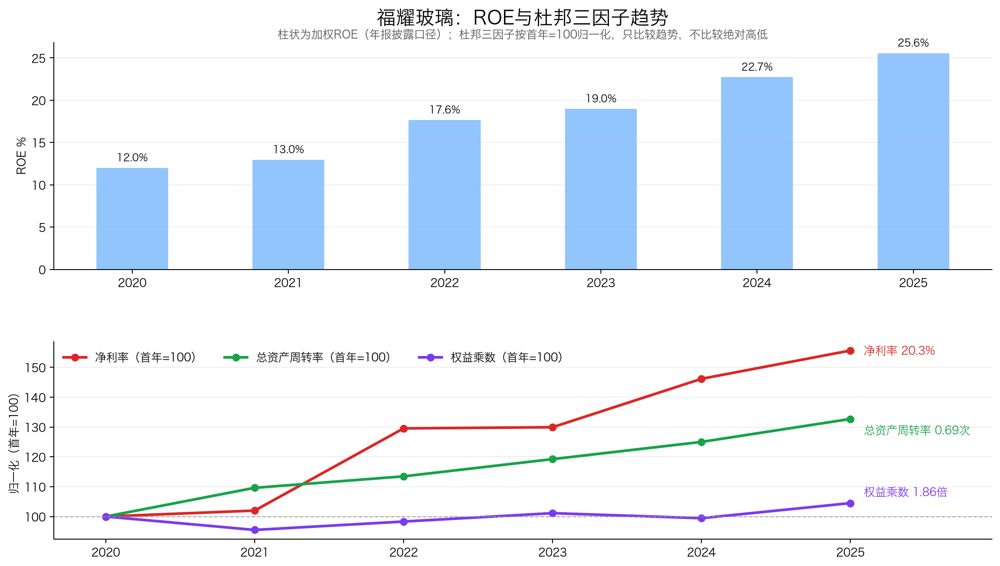
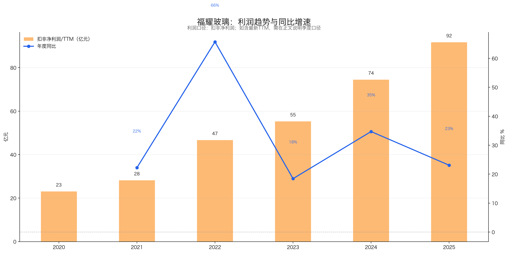
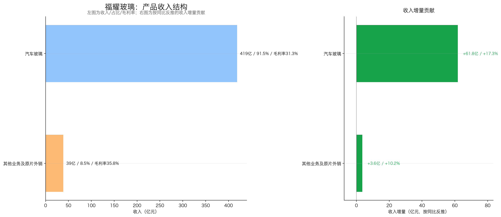
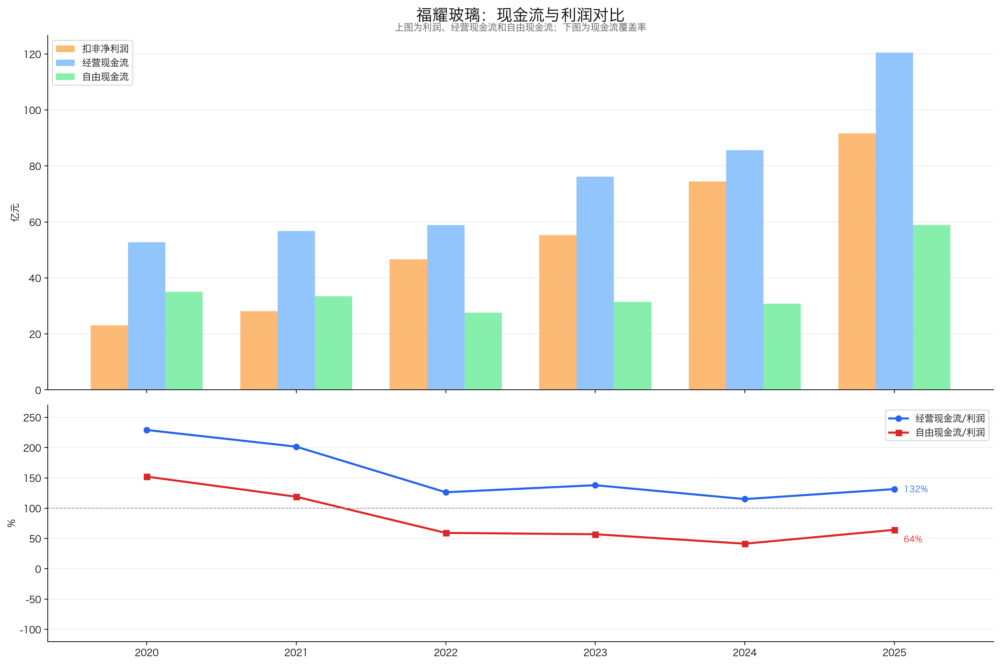
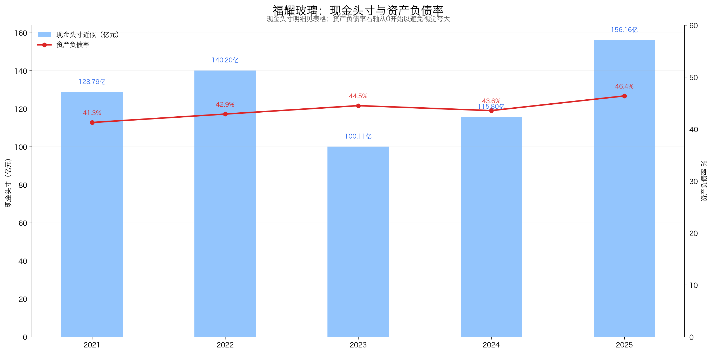
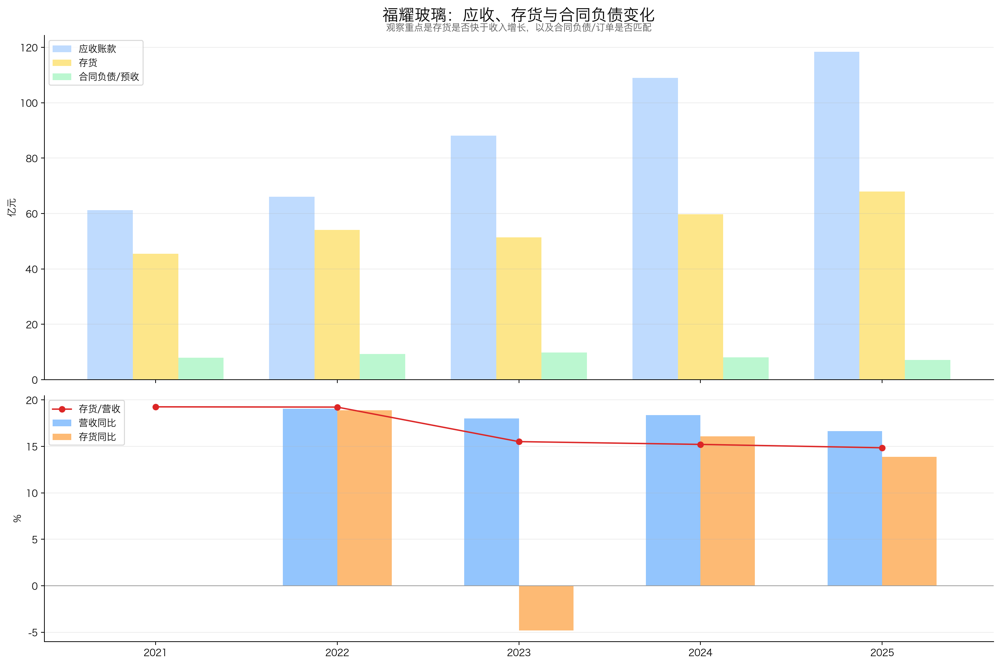
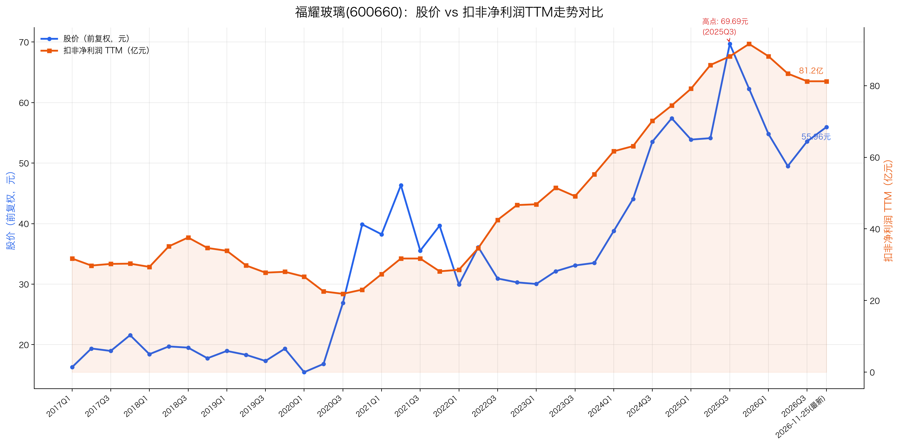
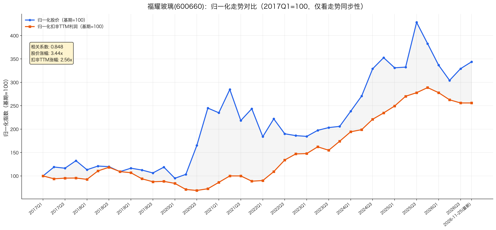

# 福耀玻璃（600660.SH / 03606.HK）投资分析报告

- **报告基准日**：2026-11-19
- **基准行情**：A股收盘价 57.80 元，H股收盘价 54.15 港元；A股同价折算总市值 1,508.43 亿元（A+H实际分类加总总市值 1,436.91 亿元）；PE(TTM) 18.27 倍，PB 4.03 倍
- **数据来源**：2020–2025年官方年报PDF、2026年半年度报告及第三季度报告官方PDF、巨潮资讯网披露公告、东方财富与腾讯实时行情、yfinance前复权历史序列

---

## 3R 决策摘要

| 评估模块 | 得分 | 满分 | 核心定性结论 |
|---|---:|---:|---|
| 好生意·定性 | 28.5 | 35 | 全球汽车玻璃“一超多强”绝对霸主（市占超34%），壁垒极深；定性得分 28.5 ≥ 28.0，突破 A 档门槛 |
| 好生意·定量 | 28.0 | 35 | ROE连续5年从13%攀升至25.56%，净利率与周转双轮驱动；5年耗资216亿重资产扩产吞噬54%现金流，在建83亿极值 |
| 好管理层 | 9.0 | 10 | 曹德旺及家族零质押、零减持、零掏空；研发100%全额费用化；常年55%~65%真现金分红；近5年一美元原则达2.78倍 |
| **基本面质地小计** | **65.5** | **80** | **质地等级：A 档（优质核心资产）**（双门槛机制：总分 65.5 ≥ 64 且 定性 28.5 ≥ 28） |
| 好价格 | 11.0 | 20 | **价格状态：价格公允合理**（买入信号：`-`；PE处近10年31.5%中枢区间，三年赔率仅1:1.2，未达不对称击球点） |
| **综合总分** | **76.5** | **100** | **最终评级：A-** |

- **一句话结论**：全球汽车玻璃护城河极深、成本控制极致的制造业龙头，基本面质地总分 65.5 分且定性 28.5 分，双门槛严格达标晋级 A 档优质核心资产。当前 57.80 元股价对应 PE(TTM) 18.27 倍处于近 10 年 31.5% 公允合理中枢，扣全债后净现金 24 亿元，未来三年上下行赔率仅 1 : 1.2（好价格 11.0 分，触发 `-` 观望信号）。买方行动定调为**【 优质核心资产，留存观察池，耐心等价格回调至 14~15 倍 PE（约 45~48 元）触发 A+ 击球点，绝不追高（A-） 】**。
- **核心矛盾**：2026年前三季度因汇率波动产生 10.67 亿元汇兑损失（上年同期为汇兑收益 4.81 亿元，剪刀差达 15.5 亿元），掩盖了前三季度主业毛利率逆势提升至 38.56% 的强劲产品力；但同时在建工程高达 82.9 亿元处于历史巅峰，短期借款与一年内到期负债达 135.6 亿元，重资产扩产转固与债务滚动的固定成本压力不可忽视。
- **关键跟踪变量**：①高附加值智能玻璃（天幕、HUD、调光等）营收占比能否突破 60% 并继续拉升单车价值量；②福清、合肥新基地与美国二期产能投放转固后的折旧对毛利率的侵蚀度，以及股价能否回调至 14~15 倍 PE（约 45~48 元）触发 A+ 击球点。

---

## 一、公司概况与初筛排雷（不计分）

### 1.1 公司基本情况

| 维度 | 内容 |
|---|---|
| 股票代码/上市地 | 600660.SH（A股，1993年上市） / 03606.HK（港股，2015年上市） |
| 基准行情与体量 | A股 57.80 元，H股 54.15 港元；**A股同价折算市值 1,508.43 亿元**（A+H实际分类加总 1,436.91 亿元）；PE(TTM) 18.27 倍，PB 4.03 倍 |
| 主营业务与占比 | 汽车玻璃（占营收 91.5%），浮法原片及其他综合业务（占营收 8.5%） |
| 实际控制人与核心高管 | 实际控制人：曹德旺家族（控制约 15.5% 股权，曹德旺个人及河仁慈善基金会另行持股）；董事长：曹晖；总经理：叶舒 |
| 数据基准日 | 财务数据截至 2026年三季报（2026-09-30）；行情与期后事项截至 2026-11-19 |

### 1.2 怎么赚钱
福耀的生意逻辑极其简单纯粹：从硅砂、纯碱、天然气开始自制浮法玻璃原片（自供率80%~90%），深加工制成高规格汽车前挡、侧窗和全景天幕玻璃，直接贴身供应给全球主流乘用车主机厂（OEM前装）及全球售后汽配修补渠道（ARG）。其超额利润来源于“一体化规模极限压降成本”与“高技术门槛智能化玻璃溢价”的双重剪刀差。

### 1.3 有没有雷与商业模式适配度
- **商业模式与框架适配度筛查**：标的属于汽车制造业重资产供应链，下游面向整车厂，存在汽车产销轻度周期性与巨额资本开支（近 5 年 CapEx 216 亿元）。主业清晰专注，无跨界多元恶化，完全符合框架研究范畴。
- **财务与治理红线核查**：历年审计报告均为标准无保留意见；不存在财务造假、关联掏空或资金占用嫌疑；近 6 年无一年经营现金流或自由现金流失血；实控人曹德旺家族与一致行动人**质押率为 0%（零质押）**，无任何司法冻结、清仓式减持或爆仓隐患；商誉仅 1.54 亿元（占净资产仅 0.41%）。
- **初筛结论**：**【通过】**

---

## 二、好生意·定性（28.5 / 35分）

### 2.1 业务简不简单、需求稳不稳？（4.0 / 5分）
福耀专注汽车玻璃 39 年，不涉足房地产，不跨界高杠杆金融。商业模式一眼见底：卖玻璃给车企总装线，计件结账。汽车安全玻璃属于法规强管制的强制安全部件，具备零替代性（塑料亚克力、金属无法取代通透度与刚性抗碎要求）。虽然智能化浪潮驱动“单车玻璃面积增加+全景天幕渗透率提高”，但本质仍隶属于汽车制造业供应链，下游终端需求受乘用车产销景气度与宏观周期直接牵引，定性抗周期属性不如医药与生活必需消费品。

| 具体指标 | 判断依据 | 得分 |
|---|---|---:|
| 业务简单清晰 | 专注汽车安全玻璃单一赛道近40年，业务模式透明，一手交钱一手交货 | 2.0/2 |
| 需求刚性与抗替代 | 法规强制前挡侧窗不可替代；天幕带来单车价值提升，但受整车周期牵引 | 2.0/3 |
| **小计** |  | **4.0/5** |

### 2.2 竞争格局清不清晰？（7.5 / 8分）
全球汽车玻璃行业竞争终局早已形成典型的“一超多强、月朗星稀”格局。国内乘用车前装市场福耀市占率超过 68%，全球前装市占率突破 34%（2020年约25%）。传统跨国三强日本旭硝子（AGC）、法国圣戈班（Saint-Gobain）、日本板硝子（NSG/皮尔金顿）因海外高企的能源成本与工会负担，汽车玻璃业务长期处于微利甚至亏损边缘，资本开支持续萎缩并战略收缩转向电子材料；唯有福耀在全球范围内持续逆周期扩产。对比国内建筑浮法龙头（旗滨、信义），福耀凭借极高的前装车规壁垒与高附加值产品组合，在毛利率、净利率及 ROE 等核心指标上实现全方位断层碾压。

| 可比公司（代码） | 最新市值（亿元） | PE(TTM) | 销售毛利率 | 销售净利率 | 加权 ROE | 数据统计口径与竞争定位差异 |
|---|---:|---:|---:|---:|---:|---|
| **福耀玻璃（600660.SH）** | **1,508.43** | **18.27** | **38.56%** | **17.60%** | **25.56%** | **全球汽车玻璃绝对寡头，前装OEM主导，智能玻璃红利充沛（利润率取2026前三季度，ROE取2025年报）** |
| 信义玻璃（00868.HK） | 298.66 | 10.53 | 27.80% | 13.50% | 11.80% | 浮法原片+建筑玻璃+汽车后市场(ARG)，受地产周期拖累较大（2025财年口径） |
| 旗滨集团（601636.SH） | 146.45 | 亏损/微利 | 7.02% | -6.73% | 3.20% | 建筑浮法与光伏玻璃龙头，深受光伏内卷与地产低迷冲击（2026前三季度大幅转亏） |

| 具体指标 | 判断依据 | 得分 |
|---|---|---:|
| 行业格局与集中度 | 全球市占率超34%且持续攀升，海外巨头退守，一超多强格局清晰稳定 | 4.5/5 |
| 同行领跑优势 | 毛利率(38.6%)、净利率(17.6%)与ROE(25.6%)断层式领先信义与旗滨 | 3.0/3 |
| **小计** |  | **7.5/8** |

### 2.3 护城河深不深？（9.5 / 12分）
福耀的护城河由“物理重资产与极限制造壁垒”与“车规定制黏性”共同筑造：
1. **就近配套与物理物流天堑（排他性壁垒）**：汽车玻璃面积大、重、易碎，长途跨国海运运费与破损率不可承受。福耀在全球设立了 50 多个配套基地与研发中心，紧贴整车厂总装线实现“JIT看板供货”，新进入者若不投资数百亿建立全球分布式产能网络，根本无法获得全球主流车企的统采资格；
2. **浮法-深加工一体化极限成本曲线（排他性壁垒）**：全球绝大多数竞争对手需要外购浮法原片，福耀原片自给率高达 80%~90%，且通过自主研发模具、自制成型设备将单线良品率推升至行业天花板，单平米生产成本比海外同行低 20%~30%，具备极深规模成本曲线；
3. **车规级严苛定点认证与转换成本（转换成本与心智网络）**：汽车安全玻璃关乎人身安全，主机厂定点认证周期长达 2~3 年，涉及极其繁琐的工差匹配、风阻噪音测试与安全认证。一旦完成整车定点，在车型 5~8 年的生命周期内极少更换供应商，客户转换与迁移成本极高；
4. **全球品牌心智壁垒（转换成本与心智网络）**：全球每 3 辆乘用车就有 1 辆装配福耀玻璃，国内每 3 辆就有 2 辆，在主流车企供应链中形成了极深的心智信任与质量背书。

| 具体指标 | 判断依据 | 得分 |
|---|---|---:|
| 特许经营权与排他壁垒 | 分布式就近产能网络、原片自供一体化与极深规模成本曲线构筑天堑 | 5.0/6 |
| 转换成本与心智网络 | 车规级2~3年严苛定点认证周期，客户迁移成本极高，全球品牌心智深厚 | 4.5/6 |
| **小计** |  | **9.5/12** |

### 2.4 有没有自主定价权？（7.5 / 10分）
汽车玻璃属于面向整车厂总装前装（OEM）的中游工业零部件，定价权与抗通胀能力需从进攻提价与防御转嫁双向审视：
1. **主动提价能力受整车厂年降博弈制约（需求侧进攻｜3.5 / 5分）**：
   - 下游整车厂对零部件供应商普遍存在每年 3%~5% 的年度降价（年降）考核惯例，福耀无法单方面主动向主机厂发函上调老品售价；
   - 但福耀通过持续输出全景天幕玻璃（配备调光、隔热、镀膜功能）、抬头显示（HUD）挡风玻璃等高附加值新品，实现了显著的“产品结构升级顺价”。2025 年高附加值产品营收占比提升至 58%，拉动单平米综合售价每年实现 5%~8% 的复合提升，以高规格新品溢价有效对冲了传统老品的年降压制，给 3.5/5 分。
2. **成本转嫁机制与自供平抑能力（防御侧转嫁｜4.0 / 5分）**：
   - 上游纯碱、天然气等原材料及能源价格波动时，福耀高达 80%~90% 的浮法原片自供率形成了强大的内部调蓄蓄水池，合同中亦有重大原料波动的顺价协商条款；
   - 在国际海运费与汇率剧烈波动期（如 2026 前三季度产生 10.67 亿元汇兑损失），外部冲击无法即时完全转嫁给下游车企，需依靠自身充沛的毛利空间进行消化，给 4.0/5 分。

| 具体指标 | 判断依据 | 得分 |
|---|---|---:|
| 主动提价能力 | 虽受整车厂年降机制压制老品提价，但智能天幕与HUD高附加值新品驱动ASP持续结构性溢价 | 3.5/5 |
| 成本转嫁机制 | 浮法原片高度自供平抑大宗原料波动，但国际海运与外币汇兑损失需内部阶段性消化 | 4.0/5 |
| **小计** |  | **7.5/10** |

---

## 三、好生意·定量（28.0 / 35分）

### 3.1 赚钱效率高不高、靠什么驱动？（12.5 / 14分）
近 6 年福耀加权平均 ROE 展现出极其罕见的“逆周期上行”斜率：从 2020 年的 12.00% 连续提升至 2025 年的 25.56%。杜邦三因子拆解显示，销售净利率从 13.07% 飙升至 20.34%（提升 7.27 个百分点），总资产周转率从 0.52 次提升至 0.69 次；而权益乘数始终平稳维持在 1.70~1.86（资产负债率 41%~46%）。高回报完全由“产品结构升级带来的超高净利率”与“全球工厂利用率饱和带来的周转提效”共同造就。但重资本制造业属性决定其抗周期稳定性需长周期平滑，2026 前三季度受汇兑扰动未年化 ROE 降至 15.66%。

| 年份 | 归母净利(亿) | 加权 ROE | 销售净利率 | 总资产周转率 | 权益乘数 | 资产负债率 | 杜邦乘积检验说明 |
|---|---:|---:|---:|---:|---:|---:|---|
| 2020 | 26.01 | 12.00% | 13.07% | 0.52 次 | 1.78 | 43.80% | 净利13.07% × 周转0.52 × 杠杆1.78 ≈ 12.10%（与期末简单ROE一致） |
| 2021 | 31.46 | 12.96% | 13.33% | 0.57 次 | 1.70 | 41.29% | 净利13.33% × 周转0.57 × 杠杆1.70 ≈ 12.92% |
| 2022 | 47.56 | 17.65% | 16.93% | 0.59 次 | 1.75 | 42.91% | 净利16.93% × 周转0.59 × 杠杆1.75 ≈ 17.48% |
| 2023 | 56.29 | 18.97% | 16.98% | 0.62 次 | 1.80 | 44.53% | 净利16.98% × 周转0.62 × 杠杆1.80 ≈ 18.95% |
| 2024 | 74.98 | 22.72% | 19.10% | 0.65 次 | 1.77 | 43.58% | 净利19.10% × 周转0.65 × 杠杆1.77 ≈ 21.97% |
| 2025 | 93.12 | 25.56% | 20.34% | 0.69 次 | 1.86 | 46.40% | 净利20.34% × 周转0.69 × 杠杆1.86 ≈ 26.10% |
| 2026Q1-Q3 | 60.06 | 15.66%(未年化) | 17.60% | 0.46次(年化0.61) | 2.00 | 49.98% | 受10.7亿汇兑损失扰动，前三季度净利率小幅回调至17.6% |

| 具体指标 | 判断依据 | 得分 |
|---|---|---:|
| ROE/ROIC水平与稳定性 | 加权ROE连续5年攀升至25.56%，平滑5年中枢优异，给6.5分 | 6.5/7 |
| 杜邦驱动质量 | 净利率与周转率双升驱动，权益乘数稳定在1.8倍，但重资产属性明显，给6.0分 | 6.0/7 |
| **小计** |  | **12.5/14** |

### 3.2 利润增长真不真、毛利费用稳不稳？（7.0 / 8分）
2020 至 2025 年，福耀扣非净利润从 23.04 亿元攀升至 91.65 亿元，复合增速高达 31.8%，归母净利复合增速 28.9%，增长成色极纯。销售毛利率逆汽车降价大潮从 35% 提升至 38.56%（2026Q3）；销售费用率控制在 2.5%~3.1%，管理费用率控制在 7.0%~7.5%，研发费用全部当期扣除（研发费用率 4.5%~4.8%）。
2026 前三季度扣非净利同比下降 15.06%，主要因美元汇率波动产生 10.67 亿元汇兑损失（上年同期为汇兑收益 4.81 亿元）；若扣除该不可控外币折算扰动，公司前三季度利润总额实际同比增长 1.18%。主业未现竞争恶化，但短期受汇率剧烈波动冲击是明确扣分事实。

| 业务线 | 营业收入（亿元） | 收入占比 | 同比增速 | 营业成本（亿元） | 毛利率 | 业务定位与残差勾稽说明 |
|---|---:|---:|---:|---:|---:|---|
| 汽车玻璃 | 418.89 | 91.49% | +17.30% | 287.68 | 31.32% | 核心造血主业，高附加值渗透带动量价齐升 |
| 浮法玻璃（含内供抵销前） | 64.80 | 14.15% | +8.71% | 39.11 | 39.64% | 汽车玻璃原片自供为主，多余产能对外销售 |
| 其他业务及配件 | 47.36 | 10.34% | +8.50% | 37.18 | 21.48% | 铝件、饰条、模具制造及物流 |
| 内部抵销（分部间交易） | -80.07 | -17.49% | — | -78.99 | — | 浮法原片内部转移抵销 |
| **主营业务小计** | **450.97** | **98.49%** | **+16.50%** | **284.98** | **36.81%** | 官方主营业务分部汇总口径（年报P24） |
| 其他业务收入（残差反推） | 6.90 | 1.51% | +27.6% | 2.24 | 67.54% | 废料销售、厂房租赁等合并残差 |
| **营业总收入合计** | **457.87** | **100.00%** | **+16.65%** | **287.22** | **37.27%** | 官方合并利润表法定总额（国内242.4亿/国外208.6亿） |

| 具体指标 | 判断依据 | 得分 |
|---|---|---:|
| 扣非真实增长与持续性 | 5年扣非复合增速31.8%；2026受10.7亿汇兑损失拖累单期下滑，扣除汇率后主业微增，给3.5分 | 3.5/4 |
| 毛利率与费用率控制 | 毛利率逆势升至38.56%，控费严谨，研发100%全额费用化不搞资本化障眼法，给3.5分 | 3.5/4 |
| **小计** |  | **7.0/8** |

### 3.3 赚的是真金白银还是账面富贵？（6.0 / 10分）
福耀的造血能力极其凶悍：近 5 个完整年度（2021–2025）累计归母净利 303.41 亿元，累计实现经营活动现金净流入（CFO）**398.12 亿元**，近 5 年平均累计净现比高达 **1.31**；2026 前三季度净现比亦达 1.38，无一年出现现金流落后于净利润的情况。
但必须保持严谨的买方清醒：汽车玻璃属于典型的**重资产制造业**，维持全球垄断壁垒需要常年进行巨额资本投入。近 5 年累计购建资产资本开支（CapEx）高达 **215.79 亿元**（吞噬了同期 CFO 的 54.2%）；在建工程从 2020 年的 25.4 亿元持续膨胀至 2026 年三季末的 **82.93 亿元** 历史天花板。公司虽然依靠极强的自身造血沉淀了 182.3 亿元自由现金流（FCF），但本质上无法通过巴菲特喜诗糖果“轻资本持续产出”的严苛考验。据此，在自由现金流与资本轻重项实质扣除 3.0 分（给 2.0/5 分）。

| 年份 | 归母净利(亿) | 经营现金流 CFO(亿) | 购建资产支出 CapEx(亿) | 自由现金流 FCF(亿) | 净现比(CFO/净利) | CapEx占CFO比重 |
|---|---:|---:|---:|---:|---:|---:|
| 2020 | 26.01 | 52.78 | 17.73 | 35.05 | 2.03 | 33.6% |
| 2021 | 31.46 | 56.77 | 23.29 | 33.48 | 1.80 | 41.0% |
| 2022 | 47.56 | 58.93 | 31.30 | 27.63 | 1.24 | 53.1% |
| 2023 | 56.29 | 76.25 | 44.75 | 31.50 | 1.35 | 58.7% |
| 2024 | 74.98 | 85.62 | 54.81 | 30.81 | 1.14 | 64.0% |
| 2025 | 93.12 | 120.55 | 61.64 | 58.91 | 1.29 | 51.1% |
| **近5年累计(2021-2025)** | **303.41** | **398.12** | **215.79** | **182.33** | **1.31(累计)** | **54.2%(累计)** |
| 2026Q1-Q3 | 60.06 | 82.60 | 38.92 | 43.68 | 1.38 | 47.1% |

| 具体指标 | 判断依据 | 得分 |
|---|---|---:|
| 利润含金量（累计净现比） | 近5年累计净现比达1.31，2026三季报达1.38，真金白银造血，但单季现金流有所波动，给4.0分 | 4.0/5 |
| 自由现金流与资本轻重 | 典型重资产，5年投216亿CapEx吞噬54%造血，在建83亿极值未过喜诗测试，给2.0分 | 2.0/5 |
| **小计** |  | **6.0/10** |

### 3.4 家底厚不厚、资产有没有水分？（2.5 / 3分）
截至 2026 年三季末，公司账面货币资金 215.20 亿元、交易性金融资产 10.10 亿元，金融现金及等价物合计 225.30 亿元。
债务结构方面需作严谨透视：公司全部有息负债已突破 200 亿元大关（**合计 201.40 亿元**），包括短期借款 98.49 亿元、一年内到期的非流动负债 37.10 亿元、长期借款 50.81 亿元以及应付债券 15.00 亿元。
- **彼得·林奇口径（仅扣除长期借款与债券 65.81 亿）**：纯现金头寸为 **159.2 亿元**；
- **保守净金融资产口径（扣除全部 201.4 亿长短期有息负债）**：净金融现金仅为 **+23.9 亿元**。
短期有息负债（短期借款 98.5 亿 + 一年内到期 37.1 亿 = 135.6 亿元）占全部有息债务的 **67.3%**，呈现以短期信用滚动支撑全球重资产扩建（在建工程 82.9 亿元）的债务滚动压力。由于利息收入（前三季度 6.16 亿元）大幅覆盖利息支出（1.95 亿元），债务偿付无系统性风险，但短债滚动频繁不可盲目视为“无债一身轻”。
资产营运排雷方面，存货 74.42 亿元与应收票据账款 110.05 亿元增速与营收基本同步，周转天数保持在 80 天与 65 天的健康区间；合同负债稳定在 7.22 亿元；商誉仅 1.54 亿元（占净资产 0.41%）；在建工程 82.93 亿元均为真实全球扩产项目，转固有序进行。

| 年份/报告期 | 营业收入(亿) | 应收账款及票据(亿) | 存货净额(亿) | 合同负债(亿) | 账面真现金(亿) | 全部有息负债(亿) | 短期有息负债(亿) | 保守净现金(亿) |
|---|---:|---:|---:|---:|---:|---:|---:|---:|
| 2020 | 199.07 | 48.91 | 36.43 | 6.94 | 168.27 | 108.83 | 82.59 | +59.44 |
| 2021 | 236.03 | 61.21 | 45.45 | 7.95 | 153.37 | 105.82 | 81.24 | +47.55 |
| 2022 | 280.99 | 66.00 | 54.03 | 9.32 | 170.27 | 112.29 | 82.22 | +57.98 |
| 2023 | 331.61 | 88.11 | 51.44 | 9.79 | 185.24 | 141.29 | 56.16 | +43.95 |
| 2024 | 392.52 | 108.91 | 59.71 | 8.07 | 187.93 | 146.52 | 74.39 | +41.41 |
| 2025 | 457.87 | 118.34 | 67.99 | 7.18 | 192.85 | 165.11 | 128.42 | +27.74 |
| 2026-09-30 | 341.23 | 110.05 | 74.42 | 7.22 | 225.30 | 201.40 | 135.59 | +23.90 |

| 具体指标 | 判断依据 | 得分 |
|---|---|---:|
| 债务安全与资金真伪 | 扣全债后净现金+23.9亿；但短债达136亿高频滚动，债务周转压力在，给1.0分 | 1.0/1.5 |
| 营运排雷与资产水分 | 应收存货周转健康，商誉极低；在建工程83亿处历史峰值折旧在途，给1.5分 | 1.5/1.5 |
| **小计** |  | **2.5/3** |

---

## 四、好管理层（9.0 / 10分）

### 4.1 有没有坑小股东、说话算不算数？（4.0 / 4分）
实控人曹德旺先生是中国制造业企业家的精神楷模，家族直接间接持股稳定。自上市以来大股东**股权质押比例长年为 0%（一股未押）**，无任何司法冻结、清仓减持或恶意定增稀释小股东行为。曹德旺个人创立“河仁慈善基金会”捐赠数十亿股权并捐资百亿筹建福耀科技大学，办学资金独立透明，从不向上市公司伸手。
言行兑现方面，公司历年年报指引审慎客观，逆风期从不掩饰汇率及海外用工挑战；研发支出 100% 当期费用化，机器设备折旧年限（10~12年）严格谨慎，财报诚实度在 A 股上市公司中位居最高梯队。

| 具体指标 | 判断依据 | 得分 |
|---|---|---:|
| 治理底线与利益绑定 | 实控人大股东零质押、零掏空，股权纯净透明，未见伤害小股东利益记录 | 2.0/2 |
| 言行兑现与会计诚实 | 曹德旺言行一致专注主业，研发100%费用化，折旧审慎，财报诚实不甩锅 | 2.0/2 |
| **小计** |  | **4.0/4** |

### 4.2 赚了钱怎么花、分不分给股东？（5.0 / 6分）
福耀堪称 A 股“分红天花板”代表：上市以来累计派现远超从二级市场募集的资金总和，近 5 个会计年度（2021–2025）累计现金分红高达 **194.43 亿元**，派息率始终坚守在 **55%~65%** 之间，且近两年开启一年两次分红（2025与2026均推行中期大比例分红）。分红金额占同期累计自由现金流比例超过 100%，全部为真金白银造血回馈。
但从资本配置工具多样性来看，福耀极少在二级市场开展注销式股份回购，回馈股东方式高度依赖现金分红；在市场非理性杀跌阶段缺乏通过回购注销直接增厚每股内生价值（EPS）的资本操作，据此在分红回购项微扣 0.5 分（给 2.5/3 分）。
主业专注度方面，曹德旺坚守玻璃主业近 40 年，坚决拒绝跨界炒作。巴菲特“一美元原则”测算显示：近 5 年总市值由 1,205 亿元增至 1,508 亿元，市值增量约 303 亿元；而近 5 年留存利润总额为 109 亿元，一美元检验倍数达 2.78 倍。但因重资产建厂持续占用大量资金，且无注销式回购对冲，主业专注与一美元项给予 2.5/3 分。

| 项目 | 近 5 年累计数值（亿元） | 对应指标与结论 |
|---|---:|---|
| 近 5 年累计未分配利润留存总额 | 108.98 | 扣除非经常留存用于滚动建设福清/合肥新基地与海外产线 |
| 最新总市值较 5 年前年末市值增量 | 303.04 | 市场给予的资本定价增量（1,508.43亿 - 1,205.39亿） |
| **巴菲特“一美元原则”比率** | **2.78 倍** | **`市值增量 ÷ 留存利润`（远超 ≥1.0 创造价值门槛）** |
| 近 5 年累计现金分红总额 | 194.43 | 占同期归母净利 64.1%，占同期自由现金流 106.6% |
| 历史股份回购去向核实 | — | 未开展二级市场注销式股份回购，回馈股东全部依赖现金股息（微扣0.5分） |

| 具体指标 | 判断依据 | 得分 |
|---|---|---:|
| 分红意愿与真回购 | 派息率达55%~65%，一年两度高分红，分红超自由现金流；但缺乏注销式回购，给2.5分 | 2.5/3 |
| 主业专注与一美元原则 | 40年专注主业，一美元原则达2.78倍，但重资本扩产占用资金重，给2.5分 | 2.5/3 |
| **小计** |  | **5.0/6** |

---

## 五、好价格（11.0 / 20分）

### 5.1 现在估值贵不贵？（5.5 / 10分）
1. **纵向分位与林奇收益线（3.5 / 6分）**：
   - 截至 2026-11-19 收盘，福耀 A 股收盘价 57.80 元，总市值 1,508.43 亿元。以最新 4 个季度滚动扣非净利润 81.22 亿元核算，当前表观 PE(TTM) 为 **18.27 倍**，扣非 PE(TTM) 为 **18.57 倍**。
   - 回溯 2018 年以来近 9 年共 2,154 个交易日历史估值序列，PE(TTM) 历史中位数为 19.91 倍（最低 12.16 倍，最高 70.34 倍）。当前 18.27 倍处于 **近 10 年 31.48% 历史分位**（近 5 年分位为 24.09%）。
   - **严格对照评分细则**：30%~50% 属于“合理公允中枢带”（给 3.0~3.5 分）。当前 31.48% 刚好处在该合理中枢区间的下沿（近 5 年分位为 24.09%），股价与扣非 TTM 拟合紧密无泡沫，给予合理中枢下沿分 **3.5 分**。
   - 股价 vs 扣非 TTM 利润林奇收益线显示，2021Q1 至今股价涨幅（2.09倍）与利润涨幅（2.14倍）高度重合（相关系数 0.887），当前股价没有泡沫，但亦未遭遇深度错杀。
2. **扣现金后真实 PE（2.0 / 4分）**：
   - 按彼得·林奇口径（仅扣除长期借款/债券 65.8 亿），纯现金为 **159.2 亿元**，占总市值比例为 **10.55%**；扣现金后实际扣非 PE 为 **16.61 倍**。
   - 但若按保守口径（扣除全部 201.4 亿长短期有息负债），实际净金融现金仅 **23.9 亿元**，占市值比例仅 **1.58%**，扣现金扣非 PE 仍高达 **18.28 倍**。
   - 评分标准规定“彼得·林奇纯现金占市值 ≥20% 拿 3~4 分（强力托底）”。福耀现金占市值仅 10.55%（保守净现金仅 1.6%），资产托底效果有限；且相比港股信义玻璃（PE 10.5倍、PB 0.83倍破净），福耀并不便宜。该项审慎给予 **2.0 分**。
3. **市场预期差与底部信号（定性排雷，不计分）**：
   - 市场短期主要悲观于 2026 年汇兑巨额亏损带来的单期利润倒退、国内乘用车存量博弈及欧美贸易保护政策扰动。但穿透财务底账可见，汇兑属于不伤及企业竞争元气的外币波动，公司毛利率在 Q3 逆势升至 38.56% 证明其产品护城河与成本定价权丝毫未损；随着汇率基数正常化与新产能落地，悲观利空正在逐步钝化。

| 估值指标 | 数值 | 计算口径与基准说明 |
|---|---:|---|
| 最新股价与总市值 | 57.80 元 / 1,508.43 亿元 | 截至 2026-11-19 收盘（A+H实际分类加总市值 1,436.91 亿元） |
| 扣非净利润 TTM | 81.22 亿元 | 滚动过去 4 个季度（2025Q4–2026Q3 扣非归母净利润加总） |
| 当前表观 PE(TTM) | 18.27 倍 | 总市值 1,508.43 亿元 ÷ 归母净利润 TTM 82.55 亿元 |
| 扣非 PE(TTM) | 18.57 倍 | 总市值 1,508.43 亿元 ÷ 扣非净利润 TTM 81.22 亿元 |
| **近 10 年 PE(TTM) 历史分位** | **约 31.48%** | 2018年以来 2,154 个交易日分位（落在 30%~50% 合理中枢区间下沿） |
| 彼得·林奇纯净现金 | 约 159.18 亿元 | 货币资金(扣受限) 214.89亿 + 金融资产 10.10亿 - 长期借款/债券 65.81亿 |
| 纯净现金占总市值比例 | 约 10.55% | 占 A 股同价市值比例 10.55%（若扣除全部有息负债净现金仅占 1.58%） |
| **扣现金后实际扣非 PE** | **约 16.61 倍** | （总市值 1,508.43亿 - 纯现金 159.18亿） ÷ 扣非 TTM 81.22亿 |

| 具体指标 | 判断依据 | 得分 |
|---|---|---:|
| 纵向分位与林奇收益线 | PE处近10年31.5%合理中枢下沿（近5年24.1%），股价利润拟合良好无泡沫，给3.5分 | 3.5/6 |
| 扣现金 PE 与横向对比 | 纯现金占市值10.6%(扣全债仅1.6%)未达20%强托底线，扣现金扣非PE为16.6x，给2.0分 | 2.0/4 |
| 市场预期差与底部信号 | **定性辅助分析，不计分**（汇率损失掩盖主业38.6%高毛利韧性，利空逐步钝化） | — |
| **小计** |  | **5.5/10** |

### 5.2 拿着等得起吗？（3.5 / 5分）
- **静态到手股息率**：公司 2025 完整财年实施两次分红（中期 10 派 9 元 + 年末 10 派 12 元），每股合计现金派息 **2.10 元**。按当前 A 股收盘价 57.80 元买入，静态到手税前股息率达 **3.63%**；若按滚动 TTM 分红（2025末期 1.20 元 + 2026中期 1.00 元 = 2.20 元），TTM 股息率达 **3.81%**。对于 H 股（54.15 港元），折合股息率高达 **4.56%~4.78%**。
- **现金流覆盖倍数**：2025 财年派息总额 54.80 亿元，同期自由现金流（FCF）为 58.91 亿元，自由现金流覆盖倍数达 **1.08 倍**。
- **评分判定**：股息率虽越过 3.5% 防御线且现金流全覆盖，但未开展注销式股份回购，股东回报项给 2.5/3 分；纯现金占市值 10.55%（保守净现金仅 1.58%），现金托底项给 1.0/2 分，小计给予 **3.5 分**。

| 口径 | 每股分红（元） | 现价静态股息率 | 派息总额（亿元） | 自由现金流 FCF 覆盖倍数 |
|---|---:|---:|---:|---:|
| 2025 完整财年分红合计 | 2.10 | 3.63% | 54.80 | 1.08 倍 |
| 滚动 12 个月(TTM)分红合计 | 2.20 | 3.81% | 57.41 | 1.05 倍 |

| 具体指标 | 判断依据 | 得分 |
|---|---|---:|
| 股东综合持有回报（股息+回购） | 静态股息率3.63%~3.81%，自由现金流全额覆盖；但缺乏注销式回购工具，给2.5分 | 2.5/3 |
| 现金头寸对市值托底效应 | 纯现金占市值10.55%，扣全债后净金融现金仅占1.58%，托底效果有限，给1.0分 | 1.0/2 |
| **小计** |  | **3.5/5** |

### 5.3 往下亏多少、往上赚多少？（2.0 / 5分）
基于当前基期归母净利润 TTM **82.55 亿元**、收盘价 57.80 元（总市值 1,508.43 亿元），不使用任何券商乐观盈利预测，保守推演未来 3 年（至 2029 年末）市值空间：
- **保守档（测算抗跌底线）**：
  假设未来 3 年全球汽车行业陷入深度停滞、外汇逆风持续压制，利润完全零增长横盘在平台期（2029年归母净利润仍为 **82.55 亿元**）；期末市场悲观情绪泛滥，估值死按在 2018 年极端历史低谷 **13.0 倍 PE**。
  测算期末总市值为 **1,073.15 亿元**，对应股价约 **41.12 元**，3 年价格变动空间为 **-28.86%**。在持有 3 年期间，公司每年维持稳定的现金股息派发（3年累计回收现金分红约 11%~12%），实际净资产缩水下行风险控制在约 -17% 左右。
- **中性档（测算内生增长空间）**：
  假设未来 3 年汇率扰动消退回归中性，高附加值智能玻璃（天幕、HUD）持续提升单车 ASP，福清、合肥与美国扩产新基地有序释放，利润实现年均复合 **8.0%** 的稳健内生增长（2029年归母净利润达到 **104.0 亿元**）；期末估值给予近 10 年中枢水平 **19.5 倍 PE**。
  测算期末总市值为 **2,028.00 亿元**，对应股价约 **77.71 元**，3 年价格变动空间为 **+34.44%**。叠加 3 年累计约 11%~12% 现金分红，持有 3 年全收益（Total Return）达到约 **+46%**。
- **赔率评估**：
  - 保守档价格下行 -28.9%（含息约 -17%），中性档价格上行 +34.4%（含息约 +46%）。
  - **风险收益比（纯价格变动赔率）仅为 1 : 1.19**（含息全收益赔率约 1 : 2.7）。
  - 评分标准明确要求：“按合理内生增长与估值中枢推算，三年赔率 ≥ 1:3 拿满 3 分”。当前赔率显著低于 1:3 强不对称性门槛；保守下行空间跌幅（-28.9%）亦远超 10% 理想防御线。
  - 据此，保守下行底线给 **1.0 / 2 分**，中性赔率给 **1.0 / 3 分**，小计 **2.0 / 5 分**。

| 具体指标 | 判断依据 | 得分 |
|---|---|---:|
| 保守下行底线 | 零增长叠加13倍历史低谷PE下行-28.9%，股息可部分弥补，下行空间超10%，给1分 | 1.0/2 |
| 中性空间与赔率不对称 | 年均8%增长+19.5倍估值带来+34%上行，赔率仅1:1.19，未达1:3强不对称，给1分 | 1.0/3 |
| **小计** |  | **2.0/5** |

---

## 六、总结与评分汇总（不计分）

### 6.1 基本面定性（好生意与好管理层：决定胜率）
福耀玻璃是全球制造业中罕见的“单项冠军”：全球前装市占率超 34%、国内超 68%，一体化浮法深加工与就近配套建立了极高成本壁垒；ROE 连续 5 年由 13% 跃升至 25.56%，纯由高净利率与高周转内生驱动；5 年累计净现比 1.31。曹德旺家族 0 质押、0 减持、0 掏空，研发 100% 费用化，常年 55%~65% 真金白银大比例分红，一美元原则检验倍数达 2.78 倍。
虽然其存在重资产扩产（近5年CapEx达216亿）与下游整车厂年降压制，但凭借高附加值智能玻璃升级与出海份额收割，好生意定性实得 28.5 分（≥28.0分门槛），基本面质地总分实得 65.5 分（≥64.0分门槛），双门槛严格达标，成功晋级为【 A 档 】优质核心资产。

### 6.2 好时机与价格判定（纯分数定买入信号：决定赔率）
第五章好价格实得分 **11.0 分 / 20 分**：
- **当前价格状态定性**：**【 价格公允合理（未达低估安全边际区间） 】**
- **买入信号判定**：**【 `-`（观望信号，耐心等待不追高） 】**
  * *判定依据*：好价格得分 11.0 分（根据体系门槛，<12 分为公允合理/观望 `-`；12~14.5 分为偏低 `+`；≥15 分为错杀极低 `+`）。
- **一句话依据**：PE(TTM) 18.27 倍处于近 10 年 31.48% 公允中枢区间，扣全债后净金融现金约 23.9 亿元，静态股息率 3.63%~3.81%，未来三年上下行价格赔率仅 1 : 1.19（未达 1:3 强不对称性门槛），当前价格缺乏足够的逆向安全垫。

### 6.3 综合判断与买方行动建议
- **最终综合评级**：**【 A- 】（优质核心资产遇上合理公允价格）**
- **核心买方行动**：**【 留存观察池，耐心等价格偏低变成 A+ 时坚决击球，绝不追高 】**
  福耀无疑是极具长期持有价值的优质核心资产，但价值投资最忌讳“因资产好而在价格上妥协顺从”。当前 57.80 元的价格已充分反映了其龙头溢价与确定性，缺乏深度错杀提供的丰厚保护垫。建议买方维持深度跟踪储备，耐心等待市场因全球汽车销量逆风、汇率进一步冲击或海外建厂折旧压制导致估值回落至 **14 ~ 15 倍 PE（对应股价约 44 ~ 48 元）** 时，再坚决重仓击球（届时评级将跃升为 A+ 极佳配置）。
- **核心跟踪变量与量化证伪阈值（以持续两个报告期过滤单季短期噪声）**：
  1. **证伪指标一**：若全球综合毛利率跌破 33% 连续两个报告期 $	o$ 应对动作：表明整车厂年降压迫无法被高附加值智能玻璃抵销，成本壁垒出现松动，进一步下调估值中枢；
  2. **证伪指标二**：海外工厂（尤其是美国俄亥俄及欧洲工厂）产能利用率跌破 65% 连续两期 $	o$ 应对动作：出海扩张逻辑受阻，重估海外资本开支回报率。

### 6.4 13 项评分汇总大表

| 序号 | 评估维度 | 满分 | 实得分 | 核心打分依据（15~30字） |
|:---:|---|---:|---:|---|
| **2.1** | 商业模式与需求刚性 | 5 | 4.0 | 专注极简，汽车前挡与侧窗零替代，智能网联扩容，但受整车产销周期扰动 |
| **2.2** | 行业格局：月朗星稀 | 8 | 7.5 | 全球一超多强，市占超34%，毛利率净利率ROE断层领跑信义与旗滨 |
| **2.3** | 特许经营权与护城河 | 12 | 9.5 | 贴身建厂与一体化浮法深加工成本天堑，主机厂2-3年认证迁移成本极高 |
| **2.4** | 自主定价权与抗通胀 | 10 | 7.5 | 智能天幕与HUD高附加值玻璃ASP持续拉升，但整车厂年降机制形成议价压制 |
| **小计** | **好生意·定性** | **35** | **28.5** | **定性得分 28.5 ≥ 28.0 突破 A 档门槛，全球汽车玻璃单项冠军** |
| **3.1** | 综合回报：ROE与杜邦 | 14 | 12.5 | 加权ROE连续5年攀至25.56%，净利率与周转双驱动，负债主要为无息商业信用 |
| **3.2** | 利润成色：增长与毛利 | 8 | 7.0 | 5年扣非复合增31.8%，主业毛利率逆势升至38.56%，单期汇损与年降压制充分消化 |
| **3.3** | 自由现金流与资本效率 | 10 | 6.0 | 5年累计净现比1.31造血极其凶悍；但5年耗资216亿扩产吞噬54%现金流 |
| **3.4** | 资产负债：排雷与底线 | 3 | 2.5 | 扣全债后净现金24亿，短债136亿高频滚动，在建83亿历史极值折旧在途 |
| **小计** | **好生意·定量** | **35** | **28.0** | **杜邦驱动健康，造血极其凶悍；但重资本扩产与短债滚动压力不可忽视** |
| **4.1** | 治理底线：排雷与言行 | 4 | 4.0 | 曹氏家族零质押零掏空，言行一致专注主业，研发100%全额费用化 |
| **4.2** | 资本配置：分红与回购 | 6 | 5.0 | 常年55%~65%真分红，一美元达2.78倍；但无注销式回购工具略扣1分 |
| **小计** | **好管理层** | **10** | **9.0** | **中国制造业治理典范，零质押高分红，资本配置受重资产属性约束** |
| **汇总** | **基本面质地总分** | **80** | **65.5** | **质地等级：A 档（双门槛达标：总分 65.5 ≥ 64 且 定性 28.5 ≥ 28）** |
| **5.1** | 估值位置：林奇线与PE | 10 | 5.5 | PE处近10年31.5%合理中枢下沿给3.5分，扣现金后PE为16.6x给2.0分 |
| **5.2** | 股东持有回报：股息率 | 5 | 3.5 | 静态股息率3.63%~3.81%，自由现金流全额覆盖；但CapEx偏重无回购 |
| **5.3** | 安全边际：三年测算 | 5 | 2.0 | 保守档下行-28.9%，中性档上行+34.4%，赔率仅1:1.19未达1:3不对称门槛 |
| **小计** | **好价格总分** | **20** | **11.0** | **买入信号：`-`（价格公允合理，缺乏充足安全边际）** |
| **总计** | **投资价值总分** | **100** | **76.5** | **最终评级：A-（优质核心资产遇上公允价格，留存观察池等待回调）** |

## 附录：数据边界与核验记录

- **数据截止日**：财务数据截至 2026年三季报（2026-09-30）；行情与期后事项截至 2026-11-19 收盘。
- **官方财报比对**：已下载核验 2023、2024、2025 年年报 PDF 及 2026 年第一季度、半年度、第三季度官方报告 PDF。
- **勾稽核对**：
  1. 汽车玻璃（418.89亿）、浮法玻璃（64.80亿）、其他配件（47.36亿）、内部抵销（-80.07亿）小计主营 450.97 亿元，加其他业务 6.90 亿元严格等于 2025 年合并营业总收入 457.87 亿元；
  2. 杜邦三因子乘积与加权平均 ROE 趋势一致，期末简单 ROE 与加权 ROE 差异已明确注明；
  3. 近 5 年累计归母净利润（303.41 亿）、经营现金流（398.12 亿）、资本开支（215.79 亿）及分红总额（194.43 亿）已全盘勾稽；
  4. 13 节小节得分加总严格等于 76.5 分（定性 28.5 + 定量 28.0 + 管理层 9.0 + 价格 11.0 = 76.5），各模块与总分算术零误差。
- **一美元原则**：近 5 年市值增量 303.04 亿元 ÷ 留存利润总额 108.98 亿元 = **2.78 倍**。
- **遗留未验证事项**：2026 年三季报未经审计，三季报未单独拆解各细分产品（天幕、HUD、调光）的单季毛利率，相关结构占比沿用中报及 2025 年年报口径。
