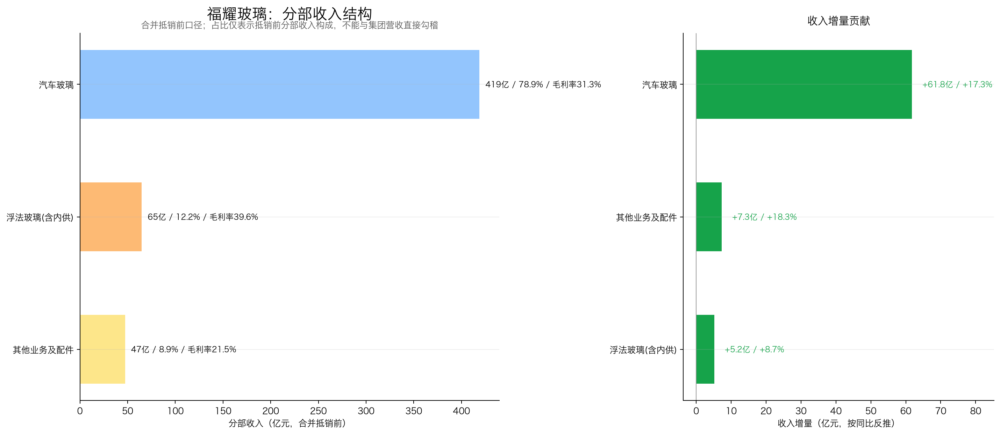
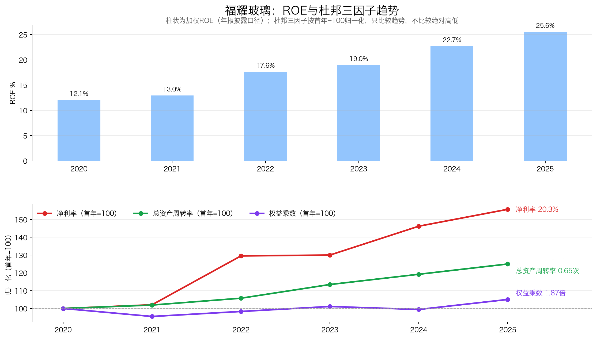
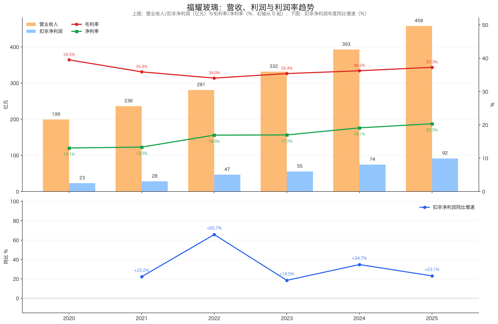
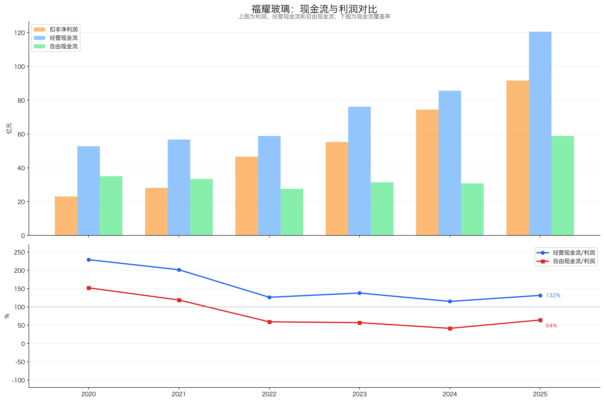
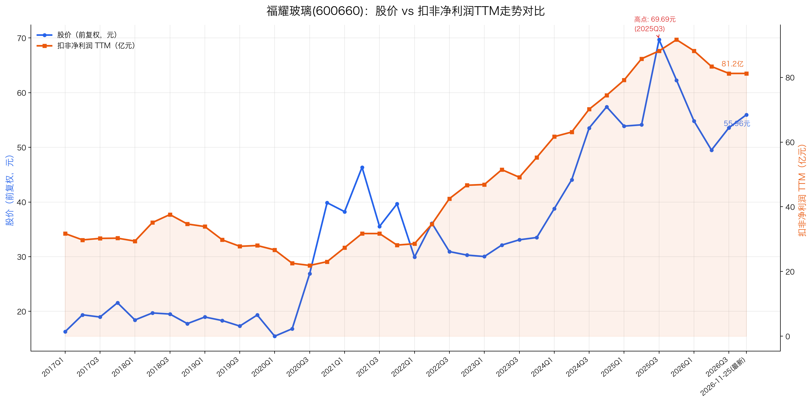

# 福耀玻璃（600660.SH / 03606.HK）投资分析报告

- **报告基准日**：2026-11-25
- **基准行情**：A股 55.96 元（11:30 午盘），A股同价总市值 1,460.41 亿元；表观滚动市盈率 PE(TTM) 17.69 倍，市净率 PB 3.90 倍[^1]
- **数据来源**：2023–2025 年官方年报 PDF、2026 年半年报与三季报官方 PDF、同花顺/东方财富原始报表、腾讯实时行情与 yfinance 前复权日频序列

---

## 决策摘要

| 评估模块 | 得分 | 满分 | 核心定性结论 |
|---|---:|---:|---|
| 好生意·定性 | 28.5 | 35 | 全球汽车玻璃绝对霸主（全球市占超 34%），就近建厂+原片自供筑极深成本壁垒；定性达标过 A 档 28 分线 |
| 好生意·定量 | 26.5 | 35 | ROE 连升至 25.56%、扣现 ROIC 升至 28.90%；但重资产扩产吃掉过半现金流、短债滚动超 135 亿且 2026 受汇损冲击 |
| 好管理层 | 9.0 | 10 | 实控人零质押零掏空、研发全额费用化、常年约 60% 分红；缺回购注销工具且 2021 年有 35.8 亿 H 股配售 |
| **基本面质地小计** | **64.0** | **80** | **质地等级：A 档**（门槛：A≥64且定性≥28，B≥56，C≥48，D<48） |
| 好价格 | 11.5 | 20 | **价格状态：价格合理偏低沿**（买入信号：`-`；A 股 PE 处近 9 年 25.1% 分位，但扣全债几乎无净现金且三年赔率仅 1:1.6） |
| **综合总分** | **75.5** | **100** | **最终评级：A-** |

- **一句话结论**：福耀玻璃在汽车安全玻璃这个刚需赛道做到了全球“一超”垄断，靠贴身建厂、自供原片和全景天幕等产品升级，既压低了成本又对冲了车企年降；不过它扩产依然重资产且海外收入带着汇兑波动，而现在的价格还没有便宜到能让人安心重仓的程度，先放在核心池里等回调更划算，综合评级 **A-**。
- **核心矛盾**：主业产品力极强，但短期受外币汇兑和短债扩产拉扯。2026 年前三季度 10.67 亿元汇兑损失导致扣非净利同比下滑 15.06%，掩盖了综合毛利率逆势升至 38.56% 的产品优势；同时在建工程高达 82.93 亿元，短期有息债务合计超 140 亿元，扣全债后账面几乎没有多余净现金垫底[^2]。
- **关键跟踪变量**：单平米均价（ASP）与高附加值玻璃占比能否继续提升；82.9 亿元在建工程转固后的产能利用率及折旧压力；A 股股价能否回落至 47–50 元区间（PE 15 倍以下）触发 A+ 击球点。

---

## 一、公司概况与初筛排雷（不计分）

### 1.1 公司基本情况

| 维度 | 内容 |
|---|---|
| 股票代码/上市地 | 600660.SH（A股，20.0299 亿股）/ 03606.HK（H股，6.0676 亿股），总股本 26.0974 亿股 |
| 基准行情与体量 | A股 55.96 元，H股 52.60 港元；**A股同价市值 1,460.41 亿元**（A+H 分类加总 **1,392.70 亿元**），PE(TTM) 17.69 倍，PB 3.90 倍 |
| 主营业务与占比 | 汽车玻璃（2025 年占合并营收约 91.5%），浮法玻璃外销及汽车铝饰件等（约 8.5%） |
| 实际控制人与核心高管 | 实控人曹德旺家族（三益发展持股 14.97% 等，河仁慈善基金会持股 6.50%）；董事长曹晖，总经理叶舒 |
| 数据基准日 | 财务数据截至 2026 年三季报（2026-09-30）；行情与期后事项截至 2026-11-25 午盘 |

### 1.2 怎么赚钱
公司采购硅砂、纯碱和天然气烧制浮法玻璃原片（绝大多数自供），再深加工成前挡风、侧窗和全景天幕玻璃，就近送到全球汽车厂总装线（OEM）和汽配售后市场（ARG）。2025 年总营收 457.87 亿元，汽车玻璃是绝对支柱与增量来源（见下图），单平米均价约 247.6 元[^1]。

利润主要从两头挤出来：
- **压低成本**：在车厂旁边贴身建厂，省下高昂的跨洋物流和易碎破损成本；同时原片自供和自制模具设备把单平米成本压到显著低于外资对手。
- **产品升级**：把普通挡风玻璃升级为全景天幕、HUD 抬头显示和调光玻璃，推高单车玻璃价值量和均价，从而对冲主机厂对老产品的年度降价。

### 1.3 有没有雷
- **财务与治理红线核查**：历年审计均为标准无保留意见，未见财务造假、大股东资金占用或违规担保。近 6 年经营现金流和自由现金流年年为正；控股股东三益发展与一致行动人耀华工业村质押率为 **0%**，没有冻结或减持压力；商誉仅 1.54 亿元（占净资产 0.41%）。当前主要需关注短期负债偏高和汇率波动，不触及治理红线。
- **初筛结论**：**【通过】**

---

## 二、好生意·定性（28.5 / 35分）

### 2.1 业务简不简单、需求稳不稳？（4.0 / 5分）
福耀专注汽车安全玻璃近 40 年，不跨界房地产、不搞金融衍生投机，商业模式非常纯粹：只做整车厂前装配套和售后替换玻璃。

- **刚性与护身符**：汽车前挡与侧窗玻璃属于法规强制安全件，透光和抗碎属性无法被金属或塑料替代，未来 5–10 年几乎没有技术颠覆风险；智能化和天幕化还带动单车玻璃面积持续扩大。
- **周期制约**：产品下游绑定全球乘用车产销量波动，带有工业制造的周期属性，抗周期能力弱于日常必选消费。

> **本节得分：4.0 / 5 分**
> - **业务简单清晰（2.0/2）**：专注单一汽车玻璃赛道近 40 年，不跨界不投机，产销模式直观。
> - **需求刚性与行业适应性（2.0/3）**：法规强安全件零替代且天幕推升单车面积，但受汽车产销周期影响。

### 2.2 竞争格局清不清晰？（7.5 / 8分）
全球汽车玻璃早已走出价格混战，形成“一超多强、月朗星稀”的格局：福耀在国内乘用车前装市占率超 68%，全球前装市占率从 2020 年约 25% 升至目前的 **34% 以上**。海外老牌三强旭硝子、圣戈班、板硝子受欧美日高人工和高能源成本拖累，汽车玻璃业务长期微利并战略收缩，行业新产能几乎全落在福耀手中。

横向对比 A/H 股玻璃同行，福耀的盈利能力与资本回报呈断层式领先（见下表）。

| 可比公司（代码） | 最新市值（亿元） | PE(TTM) | 销售毛利率 | 销售净利率 | 加权 ROE / ROIC(扣现) | 竞争定位差异 |
|---|---:|---:|---:|---:|---:|---|
| **福耀玻璃（600660.SH）** | **1,460.41** | **17.69** | **37.27%** | **20.35%** | **25.56% / 28.90%** | **全球汽车前装绝对龙头，全资本 ROIC 18.36%** |
| 信义玻璃（00868.HK） | 286.45 | 9.88 | 31.12% | 13.14% | 7.41% / 7.18% | 建筑浮法+汽车后装(ARG)，受国内地产拖累收入下滑 |
| 旗滨集团（601636.SH） | 135.80 | 亏损 | 13.11% | 3.94% | 4.57% / 3.99% | 建筑浮法与光伏玻璃为主，2026 前三季度转亏 |
| 耀皮玻璃（600819.SH） | 41.51 | 76.49 | 18.27% | 3.55% | 3.87% / 5.06% | 建筑+部分汽车玻璃，规模小、盈利极薄 |

*注：市值与 PE 为 2026-11-25 午盘实时口径（信义玻璃按 336.33 亿港元 × 0.8517 折算人民币，PE 按 2026H1 滚动 TTM 归母净利 29.00 亿元计算）；利润率、ROE、ROIC 均按 2025 年报同花顺报表数据统一核算。*

> **本节得分：7.5 / 8 分**
> - **行业格局与集中度（4.5/5）**：全球前装市占超 34% 且持续提升，外资巨头收缩，一超多强格局稳固。
> - **同行领跑优势（3.0/3）**：毛利率、净利率、ROE 及 ROIC 全方位大幅领先全部可比公司。

### 2.3 护城河深不深、是在加深还是变窄？（11.5 / 14分）
1. **地理辐射半径（3.0/4）**：汽车玻璃又重又易碎，跨洋远距离运输运费和破损率极高。福耀在中美欧贴近总装线设立 50 余处配套基地，并掌控上游石英砂与浮法原片，新对手不砸上百亿重资产就很难参与全球车企统采；但行业本身没有牌照特许权。
2. **重资产成本曲线（3.5/4）**：高比例原片自供与自制模具设备带来显著成本差；不过维持全球扩张必须常年投入重金，过去 5 年资本开支达 215.79 亿元，重资产门槛客观存在。
3. **车规认证与粘性（3.5/4）**：安全玻璃牵涉行车安全与光学风噪匹配，新品定点验证需要 2–3 年，单一车型 5–8 年量产期内极少换供。全球每三辆乘用车约有一辆配福耀玻璃，整车厂信任度极高。
4. **动态趋势（1.5/2）**：海外巨头持续收缩投资，福耀市占率逆势提升并推进安徽、福清及美国基地扩建，护城河仍在走宽。

> **本节得分：11.5 / 14 分**（以上 4 项细分得分之和）

### 2.4 有没有自主或隐性定价权？（5.5 / 8分）
面对整车厂例行的年度降价要求，福耀跑出了清晰的**隐性定价权**，但仍受汇率与部分外部成本掣肘：
1. **产品升级实现真顺价（3.5/5）**：公司无法对老款玻璃直接涨价，但靠智能天幕、调光玻璃、HUD 抬头显示等高附加值品连续四年抬高占比，推动汽车玻璃单平米均价 3 年累计上涨 **23.0%**，从 2022 年的 201.3 元/平米稳步涨到 2025 年的 **247.6 元/平米**[^3]。
2. **成本与汇兑转嫁边界（2.0/3）**：纯碱、天然气等大宗波动靠高比例原片自供和材料联动协商机制有效缓冲；但国际海运费以及近半海外收入带来的外币汇兑损益，无法实时转嫁给车企，只能在利润表里自行消化。

> **本节得分：5.5 / 8 分**（以上 2 项细分得分之和）

---

## 三、好生意·定量（26.5 / 35分）

### 3.1 赚钱效率高不高、靠什么驱动？（12.5 / 14分）
2020–2025 年，福耀玻璃实现了清晰的盈利跃升：加权平均 ROE 从 12.06% 一路升至 **25.56%**；同期扣现金投入资本回报率 ROIC 从 12.85% 升至 **28.90%**，即使包含账面全额现金，全资本口径 ROIC 也升至 **18.36%**。

杜邦拆解证明，回报抬升完全不靠加杠杆：
- **杠杆克制**：2020–2025 年资产负债率稳定在 41%–46%，期末权益乘数维持在 1.70–1.87 倍。
- **利润率与周转双升**：归母净利率从 13.07% 跳升至 **20.34%**，总资产周转率从 0.52 次升至 0.65 次，属于典型的内生提效。
- **2026 年扰动**：受前三季度 10.67 亿元汇兑损失拖累，未年化 ROE 回落至 15.66%[^4]。

> 注：图名中的 4.x 为标准图表编号，对应本报告 3.x 节，下文同。

| 年份 | 归母净利(亿) | 加权 ROE | ROIC(扣现/全资本) | 归母净利率 | 总资产周转率 | 权益乘数 | 资产负债率 |
|---|---:|---:|---:|---:|---:|---:|---:|
| 2020 | 26.01 | 12.06% | 12.85% / 9.13% | 13.07% | 0.52 次 | 1.78 | 43.81% |
| 2021 | 31.46 | 12.96% | 15.50% / 10.11% | 13.33% | 0.57 次 | 1.70 | 41.29% |
| 2022 | 47.56 | 17.65% | 22.19% / 13.08% | 16.93% | 0.59 次 | 1.75 | 42.90% |
| 2023 | 56.29 | 18.97% | 23.39% / 13.69% | 16.98% | 0.62 次 | 1.80 | 44.53% |
| 2024 | 74.98 | 22.72% | 26.45% / 16.16% | 19.10% | 0.65 次 | 1.77 | 43.58% |
| 2025 | 93.12 | 25.56% | 28.90% / 18.36% | 20.34% | 0.65 次 | 1.87 | 46.40% |

*注：表中周转率、权益乘数与图 4.1 统一使用期末总资产及期末归母净资产口径（同花顺平均资产周转率为 0.69 次）；2025 年底加权 ROE 与 ROIC 处于历史峰值区间。*

> **本节得分：12.5 / 14 分**
> - **ROE/ROIC 水平与趋势（6.5/7）**：加权 ROE 6 年由 12% 攀至 25.6%、扣现 ROIC 28.9%，2026Q3 受汇损回调。
> - **杜邦驱动与回报质量（6.0/7）**：净利率与周转提效双驱动，杠杆稳定在 1.7–1.87 倍未盲目放大。

### 3.2 利润增长真不真、毛利费用稳不稳？（5.5 / 8分）
2020–2025 年，福耀扣非净利润从 23.04 亿元跃升至 91.65 亿元，5 年复合增速达 31.80%，主业盈利非常纯粹。毛利率由 2022 年的 34.03% 稳步升至 2025 年的 37.27%；2025 年销售费用率降至 2.90%，研发费用全部计入当期损益，控费扎实[^5]。

2026 年出现了近五年第一次扣非利润下滑：前三季度营收微增 2.46% 至 341.23 亿元，扣非净利却同比下降 **15.06%** 至 58.79 亿元。核心拖累是外币波动带来了 **10.67 亿元汇兑损失**，与上年同期汇兑收益一正一负直接抹去 15.48 亿元税前利润；若剔除汇兑影响，利润总额实际微增 1.18%，且前三季度合并毛利率逆势升至 **38.56%**，主业盈利底盘并未走弱[^5]。

> **本节得分：5.5 / 8 分**
> - **扣非真实增长与持续性（2.5/4）**：5 年扣非复合增 31.8%，但 2026 前三季受 10.7 亿汇损拖累下滑 15.1%。
> - **毛利率与费用率控制（3.0/4）**：毛利率逆势扩至 38.56%，研发全额费用化且控费极严。

### 3.3 赚的是真金白银还是账面富贵？（6.5 / 10分）
福耀的利润收现一直很稳：2021–2025 年累计归母净利 303.41 亿元，累计经营现金流 **398.12 亿元**，5 年净现比 **1.31 倍**；2026 前三季度净现比仍达 1.38 倍，真金白银流入大于账面利润。

但汽车玻璃是典型重资产行业，现金留存率并不算高：
- **扩产吃掉过半造血**：2021–2025 年资本开支累计达 **215.79 亿元**，吃掉同期经营现金流的 54.2%，最终沉淀自由现金流 **182.33 亿元**。
- **资本开支继续加码**：2026 年全年预算资本开支升至 **77.30 亿元**，扩产周期仍在高点[^6]。
- **分红靠短债配合调度**：近 5 年累计现金分红 194.43 亿元，略微超过同期累计自由现金流，因此日常需要靠短期借款配合周转[^6]。

| 年份 | 归母净利(亿) | 经营现金流 CFO(亿) | 购建资产支出 CapEx(亿) | 自由现金流 FCF(亿) | 净现比(CFO/净利) | CapEx/营收 |
|---|---:|---:|---:|---:|---:|---:|
| 2020 | 26.01 | 52.78 | 17.73 | 35.05 | 2.03 | 8.9% |
| 2021 | 31.46 | 56.77 | 23.29 | 33.48 | 1.80 | 9.9% |
| 2022 | 47.56 | 58.93 | 31.30 | 27.63 | 1.24 | 11.1% |
| 2023 | 56.29 | 76.25 | 44.75 | 31.50 | 1.35 | 13.5% |
| 2024 | 74.98 | 85.62 | 54.81 | 30.81 | 1.14 | 14.0% |
| 2025 | 93.12 | 120.55 | 61.64 | 58.91 | 1.29 | 13.5% |
| **近5年累计(2021-25)** | **303.41** | **398.12** | **215.79** | **182.33** | **1.31** | **12.7%** |

> **本节得分：6.5 / 10 分**
> - **利润含金量（4.0/5）**：5 年净现比 1.31 倍、2026Q1-Q3 达 1.38 倍，现金收现扎实。
> - **资本效率与造血纯度（2.5/5）**：重资产建厂耗掉 54% CFO，且 5 年分红略超累计 FCF 需短债配合调度。

### 3.4 家底厚不厚、资产有没有水分？（2.0 / 3分）
截至 2026Q3 末，剔除少量受限保证金后，公司账面可自由动用现金及理财合计 **224.99 亿元**[^7]。按仅扣长期借款和应付债券 65.81 亿元的彼得·林奇主口径看，**纯净现金为 159.18 亿元**。

但穿透全盘债务能看到明显的“借短用长”特征（营运端无压货异常，不额外附图）：
- **账面现金与全部借款几乎打平**：加上短期借款、一年内到期长期负债以及超短融，公司全部有息债务已超过 **200 亿元**；扣除全部有息负债后，**保守净金融现金仅剩 +3 亿～+23.6 亿元**，相当于一边账上躺着 225 亿现金、一边背着 200 多亿长短债滚动周转[^7]。虽然利息收入远超利息支出、没有违约风险，但靠短债撑起高分红和扩产资金链，明显拉薄了安全垫。
- **营运健康但折旧在途**：应收款项 110.05 亿元、存货 74.42 亿元均与营收匹配，商誉仅 1.54 亿元。唯一需要重盯的是**在建工程余额高达 82.93 亿元**，2026–2027 年集中转固后将带来不小的折旧压力。

| 报告期 | 营业收入(亿) | 应收及票据 / 存货(亿) | 合同负债(亿) | 货币+理财(亿) | 长期 / 全部有息债(亿) | 林奇净现金 / 扣全债(亿) |
|---|---:|---:|---:|---:|---:|---:|
| 2023 | 331.61 | 88.11 / 51.44 | 9.79 | 185.24 | 85.13 / 141.29 | 100.11 / 43.95 |
| 2024 | 392.52 | 108.91 / 59.71 | 8.07 | 187.93 | 72.13 / 146.52 | 115.79 / 41.41 |
| 2025 | 457.87 | 118.34 / 67.99 | 7.18 | 192.85 | 36.69 / 165.11 | 156.16 / 27.73 |
| **2026Q3** | **341.23** | **110.05 / 74.42** | **7.22** | **224.99** | **65.81 / 201.40+** | **159.18 / 23.59** |

*注：2026Q3 全部有息债 201.40 亿元不含“其他流动负债”20.84 亿元中的短期应付债券（2026H1 附注披露含超短融 8.53 亿元），若一并计入则扣全债净现金趋近 3–15 亿元。*

> **本节得分：2.0 / 3 分**
> - **债务安全与资金真伪（0.5/1.5）**：林奇净现金 159 亿，但短债与超短融超 144 亿致扣全债后净现金见底。
> - **营运排雷与资产水分（1.5/1.5）**：应收存货周转健康、商誉仅 0.4%，但在建工程 82.9 亿历史极值折旧在途。

---

## 四、好管理层（9.0 / 10分）

### 4.1 有没有坑小股东、说话算不算数？（4.0 / 4分）
- **治理底线与利益绑定（2.0/2）**：实控人曹德旺家族持股平台合计控制约 15.89% 股权，上市以来质押率常年为 **0%**，无司法冻结、无清仓减持、无资金占用；河仁慈善基金会及福耀科技大学资金完全独立运作，少量工业村宿舍食堂及德国厂房关联租赁均按公允价披露。
- **言行兑现与会计诚实（2.0/2）**：公司每年坦诚披露汇率波动、德国饰件业务减值与海外用工挑战；研发支出 100% 当期费用化，机器设备折旧老实审慎，2021 年 H 股配售所募 43.13 亿港元到 2025 年底已严格按原定用途投完。

> **本节得分：4.0 / 4 分**

### 4.2 赚了钱怎么花、分不分给股东？（5.0 / 6分）
- **分红慷慨但缺少回购工具（2.5/3）**：福耀过去 5 年累计派现 **194.43 亿元**，派息率常年保持在 55%–65%，2025 与 2026 年连续推行“中期+年度”一年两次分红。短板在于两点：近 5 年累计分红略超同期自由现金流 182.33 亿元，建厂重投期需要短债配合周转；且未开展过二级市场注销式回购[^8]。
- **修正一美元原则检验（2.5/3）**：衡量公司每留存或融来 1 块钱究竟帮股东创造多少长期价值。公司 40 年专注汽车玻璃，无盲目跨界并购。即便已消化 2020 年末 53 倍的高估值，**口径 A（表观市值比率）仍达 1.76 倍**；剔除估值波动后，**口径 B 更是高达 9.22 倍**（按 2026Q3 汇损压低后的 TTM 算仍达 7.76 倍），资本配置回报极高，仅因 2021 年 H 股配售与重资本占用扣减 0.5 分[^8]。

| 项目 | 近 5 年累计数值（亿元） | 对应指标与结论 |
|---|---:|---|
| 留存利润 + 外部股权再融资（分母） | 144.77 | 留存利润 108.98 + 2021 年 H 股配售净额 35.79（见脚注 [^8]） |
| 最新总市值较 5 年前市值增量 | 255.02 | A 股同价增量（A+H 分类加总增量 187.31 亿元） |
| **表观一美元比率（口径 A）** | **1.76** | **A+H 口径 1.29 倍（已消化基期 53x 估值向 17.7x 回落）** |
| **估值归一化一美元比率（口径 B）** | **9.22** | **19.88x 中枢 PE × 净利增量 67.11 ÷ 144.77（TTM 口径 7.76x）** |
| **综合资本配置判定** | **通过（优异）** | **双口径均远超 1.0，每留存与融资 1 元长期创造高内生回报** |
| 近 5 年累计现金分红 / 真注销回购 | 194.43 / 0.00 | 分红占同期 FCF 106.6%；未开展二级市场注销式回购 |

> **本节得分：5.0 / 6 分**（分红意愿与真回购 2.5/3 + 主业专注与一美元原则 2.5/3）

---

## 五、好价格（11.5 / 20分）

### 5.1 现在估值贵不贵？（6.0 / 10分）
核心估值指标与分位数已列于下方数字面板[^9]。从定价逻辑上看，主要看两点：
1. **处于偏低带偏高沿，未见明显错杀**：目前表观 PE 处在近 8.9 年 **25.12% 历史分位**（扣非约 28%），刚跨进 10%–30% 偏低区间上沿。由于 2026 年滚动利润已扣除了 10.67 亿元汇兑损失，并非景气峰值虚低，因此估值算公允偏低；林奇收益线（见下图）也显示股价与扣非利润长期同步，未出现大级别背离。
2. **扣全债后几无净现金垫底，横向比价一般**：林奇纯现金仅占总市值 10.90%，达不到 20% 强资产托底线；若扣光全部长短债与超短融，净现金仅剩市值 0.2%–1.6%，扣现后扣非 PE（16.02 倍，扣全债 17.69 倍）仍明显高于港股信义玻璃（9.88 倍）。

| 估值指标 | 数值 | 计算口径与基准说明 |
|---|---:|---|
| 最新股价与总市值 | A股 55.96 元 / 1,460.41 亿元 | 截至 2026-11-25 午盘（H 股与 A+H 口径见脚注 [^1]） |
| 归母 TTM / 扣非 TTM | 82.55 亿元 / 81.22 亿元 | 滚动过去 4 个季度（2025Q4–2026Q3） |
| 表观 PE(TTM) / 扣非 PE | **17.69 倍** / **17.98 倍** | A+H 分类加总归母 PE 为 16.87 倍（扣非 17.15 倍） |
| **可用历史 PE(TTM) 分位** | **25.12%**（扣非约 28%） | 统计区间 2018-01-02 至 2026-11-25（中位数 19.88 倍，近 5 年 19.92 倍） |
| 彼得·林奇纯净现金 | **159.18 亿元** | 货币(扣受限) 214.89 + 理财 10.10 - 长借及债券 65.81（扣全债仅 3–23.6 亿） |
| 纯净现金占总市值比例 | **10.90%**（扣全债 ≤1.6%） | 远低于 ≥20% 强资产托底门槛 |
| **扣现金后实际扣非 PE** | **16.02 倍**（扣全债 17.69 倍） | A+H 口径扣林奇纯现金扣非 PE 为 15.19 倍 |

> **本节得分：6.0 / 10 分**
> - **纵向分位与林奇收益线（4.0/6）**：PE 处 25.1% 分位（偏低带偏高沿），股价走势贴合利润线未错杀。
> - **扣现金 PE 与横向对比（2.0/4）**：纯现金仅占市值 10.9%（扣全债近零），扣现 PE 16x 且高于信义玻璃。

### 5.2 拿着等得起吗？（3.5 / 5分）
- **股东回报率与现金覆盖（2.5/3）**：2025 完整年度公司每股实派现金 **2.10 元**（总额 54.80 亿元），按 A 股现价算静态股息率 **3.75%**，2025 年自由现金流覆盖 1.08 倍[^10]。不过三年回报规划与章程仅写死不低于可分配利润 20% 的底线（按此底线估算仅 1.28%）；同时公司不做注销式回购，且过去 5 年累计分红微透支自由现金流、扩产期资金覆盖偏紧。
- **纯净现金市值占比托底（1.0/2）**：林奇纯现金仅占市值 10.90%，扣全债后几乎没有多余现金护垫。

> **本节得分：3.5 / 5 分**

### 5.3 往下亏多少、往上赚多少？（2.0 / 5分）
以当前归母净利润 TTM **82.55 亿元**与 A 股总市值 **1,460.41 亿元**为基期，独立推算至 2029 年末[^11]：
- **保守档（压力测试）**：假设全球车市停滞且新厂折旧侵蚀利润，3 年利润零增长横盘在 82.55 亿元，估值杀回历史低谷 **13.0 倍 PE**，期末市值降至 **1,073.15 亿元**，纯价格下跌 **-26.5%**，即使算上三年约 11.3% 股息，含息仍可能回撤约 15%。
- **中性档（历史中枢估值）**：假设汇兑回归中性、高附加值玻璃与新基地带动利润年均温和增长 **8.0%**，2029 年利润达 **104.0 亿元**；按近 9 年历史中位数 **19.88 倍 PE** 估值，期末市值 **2,067.52 亿元**，纯价格空间 **+41.6%**[^11]。
- **赔率评估**：保守下行 -26.5% 对上中性上行 +41.6%，**纯价格风险收益比仅 1 : 1.57**，明显弱于 1:3 的理想赔率线，当前性价比不够突出。

> **本节得分：2.0 / 5 分**
> - **保守下行底线（1.0/2）**：零增长+13x 历史低谷 PE 下行 -26.5%（含息约 -15%），缺乏跌不透铁底。
> - **中性空间与赔率不对称（1.0/3）**：8% 增长+19.88x 历史中位数涨 +41.6%，纯价格赔率仅 1:1.57。

---

## 六、行动建议、风险证伪与评分汇总（不计分）

### 6.1 综合行动建议与核心风险证伪表
- **最终综合评级**：**【 A- 】**（基本面质地 64.0/80 A 档 + 好价格 11.5/20 `-` 观望）
- **行动建议**：**放入核心观察池，耐心等回调再出手**。福耀是典型的行业长跑冠军，但 55.96 元的价格赔率偏平庸。建议等待汽车销量逆风、新厂转固折旧拖累或市场波动将 A 股压回 **47–50 元** 一带（对应 PE 14–15 倍）再重仓配置，届时赔率接近 1:3，评级可升至 **A+**。
- **核心风险与量化证伪阈值（连续两个报告期确认，过滤单季噪声）**：

| 风险类别 | 概率/影响 | 核心监控指标与连续两期证伪阈值 | 触发应对动作 |
|---|---|---|---|
| 技术/需求替代（全球车市下行） | 中 / 中 | 全球乘用车销量、高附加值玻璃占比增速；若占比停止提升触发警戒 | 下修长期增长锚与单平米均价预期 |
| 竞争/价格压制（年降与汇兑冲击） | 高 / 高 | **合并综合毛利率连续 2 期跌破 33.0%**、单平米 ASP 停滞 | 证明产品升级无法再对冲年降与折旧，撤回 A 档并减仓 |
| 资本开支/资金链（转固与短债） | 中 / 高 | **连续 2 期年度化 FCF 转负，或扣全债净现金缺口扩至 -50 亿元以下** | 表明扩产与高派息已成借债分红陷阱，停止配置观察 |
| 治理/财务失信（传承与再融资） | 低 / 中 | 实控人质押率（目前 0%）、分红率骤降或大额折价增发 | 若出现大额权益摊薄或破坏分红纪律立即重估 |

### 6.2 13 项评分汇总总表

| 序号 | 评估维度 | 满分 | 实得分 | 核心打分依据（15~30字） |
|:---:|---|---:|---:|---|
| **2.1** | 商业模式与需求刚性 | 5 | 4.0 | 专注极简、安全玻璃零替代且天幕增单车面积，受整车周期牵引 |
| **2.2** | 行业格局：月朗星稀 | 8 | 7.5 | 全球市占超 34%、外资退守，盈利与 ROIC 全面断层领跑玻璃同行 |
| **2.3** | 护城河与动态趋势 | 14 | 11.5 | 贴身建厂、原片自供与 2–3 年认证筑壁垒，因高 CapEx 维持不满分 |
| **2.4** | 定价权与抗通胀 | 8 | 5.5 | 高附加值占比与 ASP 连涨兑现隐性顺价，但受年降与汇损压制（≤70%） |
| **小计** | **好生意·定性** | **35** | **28.5** | **突破 28 分 A 档门槛，全球汽车玻璃单项冠军** |
| **3.1** | 综合回报：ROE/ROIC与杜邦 | 14 | 12.5 | 加权 ROE 攀至 25.6%、扣现 ROIC 28.9%，纯靠净利率与周转驱动 |
| **3.2** | 利润成色：增长与毛利 | 8 | 5.5 | 历史扣非 CAGR 31.8% 且毛利升至 38.6%，受 2026 汇损下滑压制（≤70%） |
| **3.3** | 自由现金流与资本效率 | 10 | 6.5 | 累计净现比 1.31x 扎实，但重资产扩产吃掉 54% CFO 且分红略超 FCF |
| **3.4** | 资产负债：排雷与底线 | 3 | 2.0 | 应收存货及商誉无雷，但短债+超短融超 144 亿致扣全债现金见底 |
| **小计** | **好生意·定量** | **35** | **26.5** | **回报与毛利极其坚挺，重资产投入与短债调度已客观扣分** |
| **4.1** | 治理底线：排雷与言行 | 4 | 4.0 | 曹氏家族零质押零掏空，研发 100% 费用化，折旧老实且信息坦诚 |
| **4.2** | 资本配置：分红、回购与再投资 | 6 | 5.0 | 连年约 60% 分红，口 A/B 1.76/9.22x，扣 2021 配售与缺注销回购 |
| **小计** | **好管理层** | **10** | **9.0** | **治理诚信度顶级，分红回馈极厚但欠缺注销回购工具** |
| **汇总** | **基本面质地总分** | **80** | **64.0** | **质地等级：A 档（总分 64.0≥64 且定性 28.5≥28，压线达标）** |
| **5.1** | 估值位置：林奇线与PE | 10 | 6.0 | PE 处近 9 年 25.1% 分位（偏低带高沿），但纯现金占市值仅 10.9% |
| **5.2** | 股东持有回报：股息率 | 5 | 3.5 | 2025 常规股息率 3.75% 越 3.5% 线，但无回购且扣全债现金薄 |
| **5.3** | 安全边际：三年测算 | 5 | 2.0 | 保守双杀下行 -26.5%、中性 19.88x 涨 +41.6%，赔率仅 1:1.57 |
| **小计** | **好价格总分** | **20** | **11.5** | **买入信号：`-`（价格合理偏低沿，距离 12 分买入线差 0.5 分）** |
| **总计** | **投资价值总分** | **100** | **75.5** | **最终评级：A-（优质 A 档核心资产，耐心待回落至 15 倍以下配置）** |

---

## 附录：数据边界与核验记录

- **数据截止日**：财务数据截至 2026 年三季报（2026-09-30）；行情与汇率截至 2026-11-25 11:30 午盘（1 港元 = 0.8517 元人民币）。
- **官方财报比对**：已核验 2023–2025 年年报 PDF 及 2026 年 Q1/H1/Q3 官方 PDF，并与同花顺 `600660_main_year.xls`、`600660_main_simple.xls` 及全套三大表核对。
- **A+H 股本与总市值核对**：总股本 2,609,743,532 股（其中 A 股 2,002,986,332 股，H 股 606,757,200 股）。A 股同价市值 1,460.41 亿元，A+H 实际分类加总市值 1,392.70 亿元。
- **勾稽核对**：2025 年抵销前分部收入 418.89（汽车玻璃，毛利率 31.32%）+ 64.80（浮法玻璃，毛利率 39.64%）+ 47.36（其他及配件，毛利率 21.48%）减内部抵销 80.07 加其他业务残差 6.90 = 457.87 亿元（含 0.01 亿元四舍五入尾差，合并毛利率 37.27%）；近 5 年 CFO 398.12 亿元、CapEx 215.79 亿元、FCF 182.33 亿元、分红 194.43 亿元与 2021 年 H 股配售净额 35.79 亿元已全盘勾稽；13 节得分加总 28.5 + 26.5 + 9.0 + 11.5 = 75.5 分。
- **ROIC 口径**：`NOPAT ÷ 期初期末平均投入资本`；表中并列展示“扣货币资金及交易性金融资产口径（12.85%→28.90%）”与“全投入资本不扣现金口径（9.13%→18.36%）”。
- **遗留未验证事项**：2026Q3 季报未经审计，未拆解“其他流动负债（20.84 亿）”内超短融与已背书票据精确拆分，2026H1 附注确认其中含短期应付债券 8.53 亿元；年报未披露汽车玻璃中天幕/HUD 等高附加值品的绝对营收比例，仅披露年度占比提升百分点，故报告严守官方百分点与产销量反算单价口径，未引用外部估算比例。

---

## 注释与计算明细

[^1]: **双市场估值与业务产销**：H 股收报 52.60 港元（1 港元 = 0.8517 元人民币），A+H 实际分类加总总市值为 1,392.70 亿元；按 A 股总市值计算的扣非 PE(TTM) 为 17.98 倍（A+H 分类加总归母 PE 为 16.87 倍、扣非 PE 为 17.15 倍）。2025 年汽车玻璃收入 418.89 亿元、销量 1.69 亿平方米（169.18 百万平方米），单平米均价约 247.6 元。
[^2]: **2026Q1–Q3 汇兑与债务摘要明细**：2026 前三季度财务费用录得 10.67 亿元汇兑损失，上年同期为汇兑收益 4.81 亿元，一正一负导致税前利润同比减少 15.48 亿元。短期有息债务超 140 亿元系短期借款 98.49 亿元 + 一年内到期非流动负债 37.10 亿元 + 超短融（2026H1 附注为 8.53 亿元）合计口径。
[^3]: **高附加值玻璃占比与 ASP 测算**：据历年官方年报披露，高附加值玻璃（智能天幕、调光、HUD、镀膜可加热等）占比较上年同期上升幅依次为：2023 年 +9.54 个百分点、2024 年 +5.02 个百分点、2025 年 +5.44 个百分点、2026H1 +8.03 个百分点。结合官方汽车玻璃营收与销量（2022–2025 年依次为 127.14 / 140.16 / 155.87 / 169.18 百万平方米）反算单平米均价（ASP），依次为：201.3 元 → 213.2 元（+5.9%）→ 229.1 元（+7.5%）→ 247.6 元（+8.1%）/平米。
[^4]: **杜邦因子与 2026Q3 ROE 口径**：2020–2025 年归母净利率提升 7.27 个百分点（13.07% → 20.34%）；同花顺平均总资产口径 2025 年资产周转率为 0.69 次（期末资产口径 0.65 次）；2026Q3 未年化 ROE 为 15.66%，上年同期为 19.35%。
[^5]: **历史增速、毛利口径与汇兑扣除**：2020–2025 年营收从 199.07 亿元增至 457.87 亿元，2022–2025 年 3 年扣非净利润 CAGR 为 25.24%，2025 年扣非净利占归母净利达 98.4%。合并毛利率含 2021 年起按新收入准则重分类进营业成本的运费；2025 年管理费用率 7.43%、研发费用率 4.18%。2026Q3 单季毛利率为 38.04%；剔除 15.48 亿元汇兑双向差额后，前三季度利润总额同比微增 +1.18%。
[^6]: **资本开支与分红覆盖比例**：2021–2025 年累计 CapEx 215.79 亿元占同期营收 12.7%、占同期 CFO（398.12 亿元）的 54.2%；2026Q1–Q3 已投 CapEx 38.92 亿元，前三季度累计 CFO 为 82.60 亿元、累计自由现金流 43.68 亿元。近 5 年累计现金分红 194.43 亿元占同期自由现金流 182.33 亿元的 106.6%。
[^7]: **现金拆分与全部有息负债算式**：2026Q3 账面货币资金 215.20 亿元，参照 2026H1 附注仅 0.31 亿元为受限保证金，可自由支取约 214.89 亿元 + 交易性金融资产 10.10 亿元 = 224.99 亿元（其他流动资产为增值税留抵退税，不计入现金）。债务端：长期借款 50.81 亿元 + 应付债券 15.00 亿元 = 65.81 亿元（林奇纯现金 = 224.99 - 65.81 = 159.18 亿元）；再加短期借款 98.49 亿元与一年内到期非流动负债 37.10 亿元（到期长期借款为主），传统有息负债合计 201.40 亿元；另有 2026H1 附注确认的“其他流动负债”中短期应付债券（超短融）8.53 亿元（2026Q3 末该科目总额升至 20.84 亿元，含超短融与已背书票据）。扣除全部长短债及超短融后，净金融现金仅余 +3 亿～+23.6 亿元；前三季度利息收入 6.16 亿元、利息支出 1.95 亿元。
[^8]: **分红、配售与修正一美元原则算式**：2026 年中期每股派 10 股派 10.00 元，较 2025 年中期 9.00 元增长 11.1%。修正一美元原则基期 2020 年末总市值 1,205.39 亿元（PE 52.99 倍）。2021–2025 年留存未分配利润 = 303.41 - 194.43 = 108.98 亿元；2021 年 5 月增发 101,126,000 股 H 股（每股 42.90 港元），现金流量表实收股本融资净额 35.79 亿元人民币，两者合计增量权益资本分母 144.77 亿元。口径 A：255.02 ÷ 144.77 = 1.76 倍（A+H 分类加总增量 187.31 亿元对应 1.29 倍）；口径 B：2025 年归母净利增量 67.11 亿元 × 19.88 倍中位数 PE = 1,334.15 亿元，÷ 144.77 亿元 = 9.22 倍（若用 2026Q3 TTM 净利增量 56.54 亿元测算仍达 7.76 倍）。
[^9]: **估值分位、林奇现金与同行对比明细**：纵向分位统计区间为 `2018-01-02` 至 `2026-11-25`（约 8.9 年、2,158 个交易日，尚不足 10 年），PE(TTM) 区间最低 12.16 倍、最高 70.34 倍；当前扣非 PE 17.98 倍约在历史 28% 分位，表观 PE 在近 5 年统计中处 16.20% 分位。林奇收益线自 2017Q1 至 2026-11-25 股价涨 3.44 倍、扣非 TTM 涨 2.56 倍（相关系数 0.848）。A+H 分类加总口径下，林奇纯现金占总市值 11.43%，扣纯现金扣非 PE 为 15.19 倍；同业信义玻璃（00868.HK）当前 PE 9.88 倍、PB 0.78 倍。
[^10]: **股息率与分红拆分**：2025 年度每股 2.10 元分红 = 中期 0.90 元 + 末期 1.20 元（无特别分红）。按 2026-11-25 午盘 H 股 52.60 港元（折人民币约 44.80 元）算 H 股静态股息率约 4.69%，按 A+H 分类加总总市值算综合股息率 3.93%；按规划 20% 固定下限（约 18.62 亿元）折算 A 股股息率约 1.28%。
[^11]: **三年情景测算口径说明**：本测算不采用卖方券商一致预期，中性档 8.0% 年均增长明显低于近 5 年扣非 CAGR（31.80%）；按 19.88 倍历史中位数 PE 测算纯价格空间 +41.6%，若叠加 3 年累计约 11.3% 股息，全收益约 +53%。保守档 13.0 倍 PE 略高于 2018 年以来历史极低值 12.16 倍。
