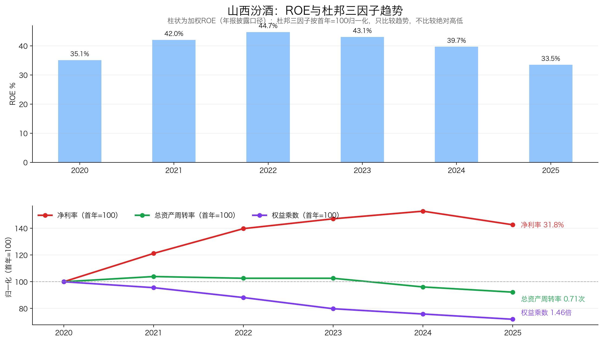
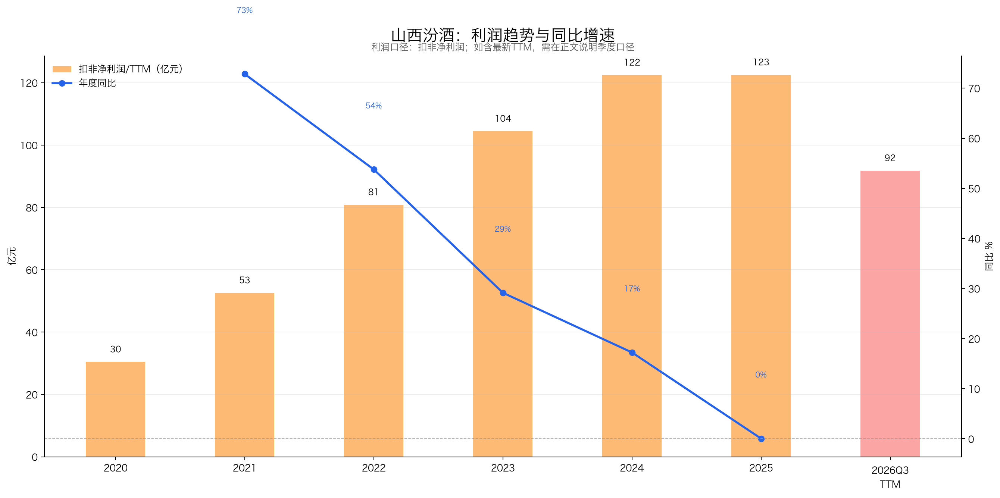
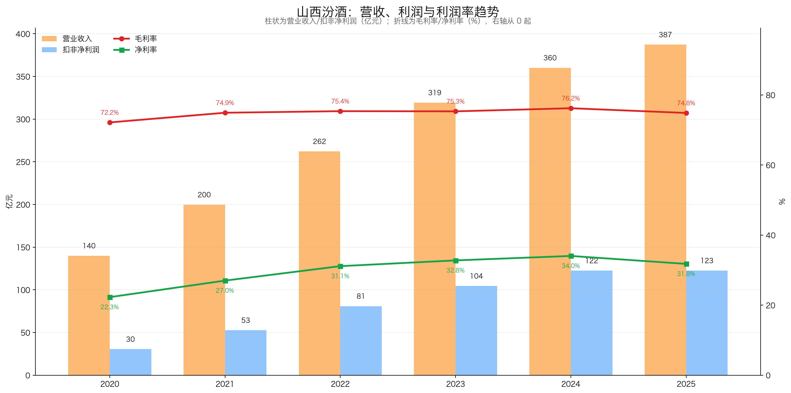
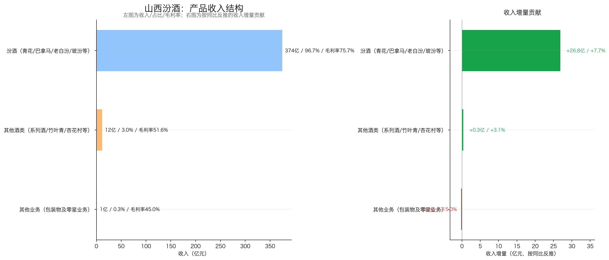
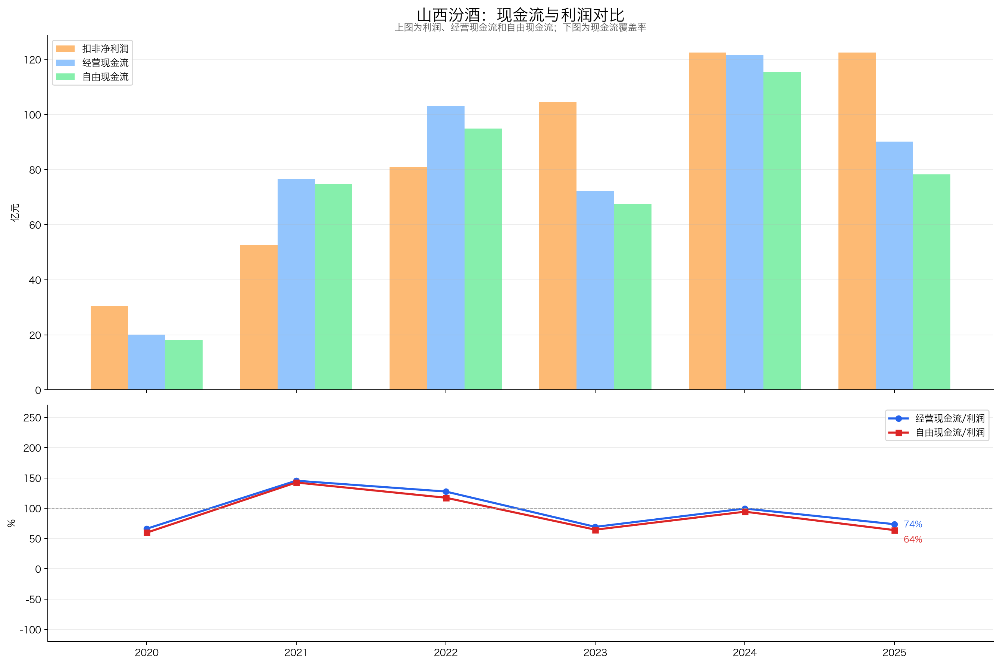
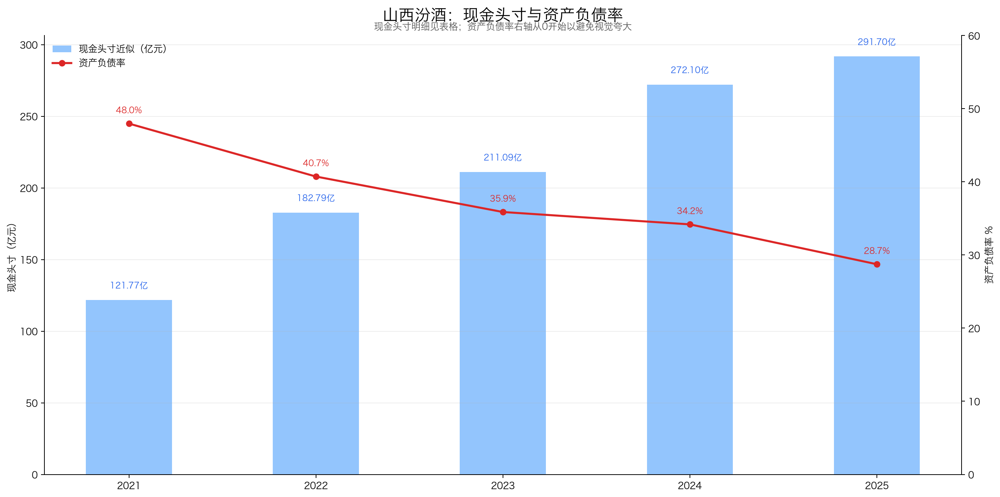
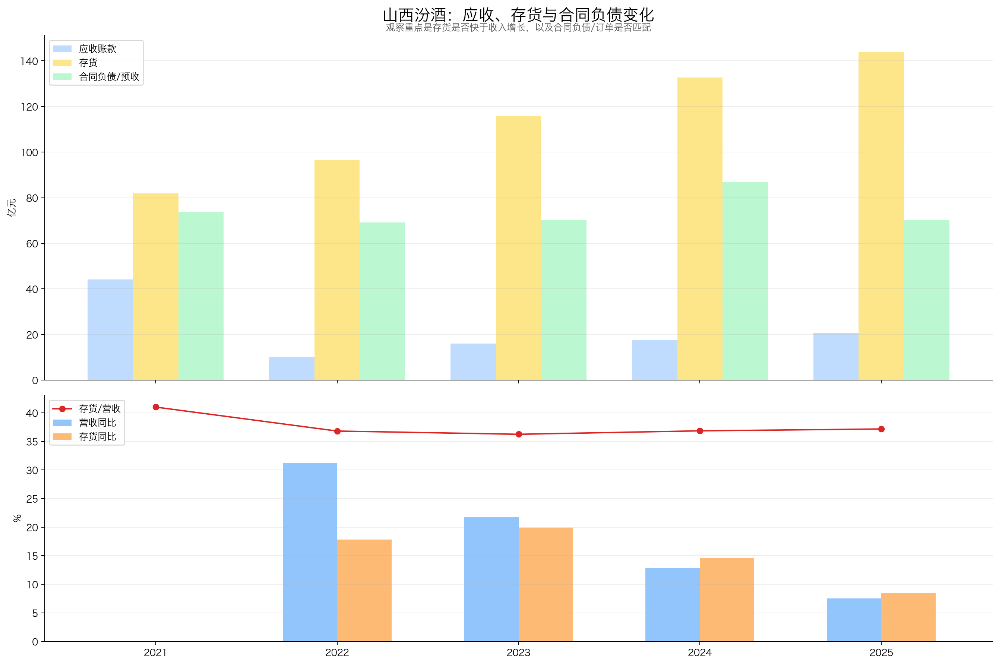
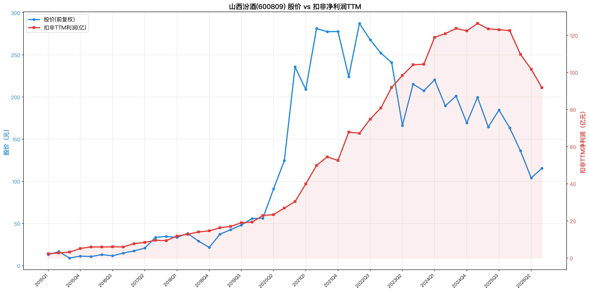
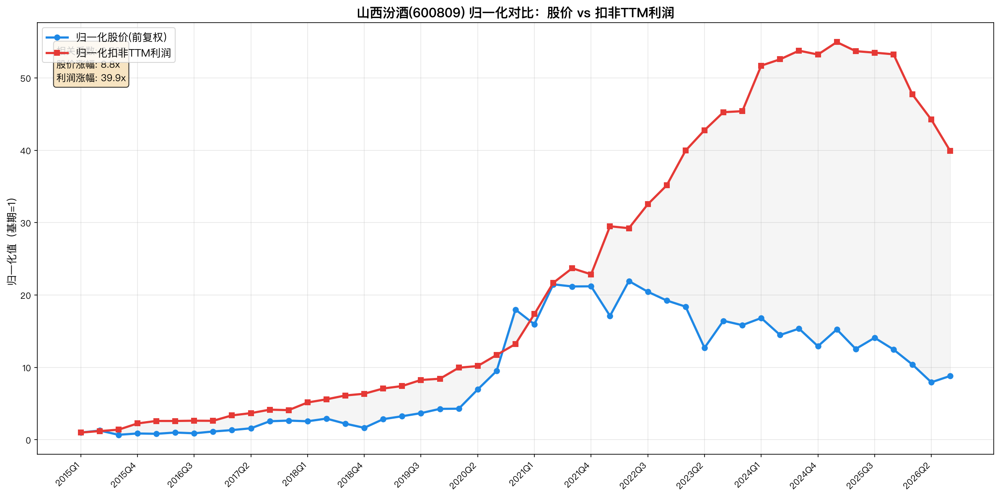

# 山西汾酒（600809）投资分析报告

- **报告基准日**：2026-11-19
- **基准行情**：收盘价 130.58 元，总市值 1,593.03 亿元，PE(TTM) 17.35 倍，PB 3.98 倍
- **数据来源**：2020—2025 年官方年度报告 PDF、2026 年第三季度报告 PDF、东方财富/同花顺日频行情、yfinance 前复权行情

---

## 3R 决策摘要

| 评估模块 | 得分 | 满分 | 核心定性结论 |
|---|---:|---:|---|
| 好生意·定性 | 27.0 | 35 | 清香型绝对统治壁垒，大众带玻汾筑底，但行业去库存与次高端批价倒挂压制提价权 |
| 好生意·定量 | 30.5 | 35 | 6年加权ROE>30%，轻资产自由现金流近450亿，造血极优；2026利润承压进入平台期 |
| 好管理层 | 8.0 | 10 | 治理底线严密，分红比例提升至60%~65%，主业高度专注，内生利润驱动扎实 |
| **基本面质地小计** | **65.5** | **80** | **质地等级：B 档**（双门槛机制：总分 65.5 ≥ 64.0，但定性实得 27.0 未达 28.0 门槛，定为 B 档顶尖名酒资产） |
| 好价格 | 14.0 | 20 | **价格状态：价格偏低**（买入信号：`+`，10年PE分位仅 11.9%，扣未受限纯现金实际PE仅 14.6倍） |
| **综合总分** | **79.5** | **100** | **最终评级：B+**（坚实良好资产遇上偏低价格，高性价比分批布局） |

- **一句话结论**：清香型白酒龙头遭遇全行业深蹲去库存与消费降级阵痛，在零有息负债、250 亿未受限真现金与 3.5% 左右前瞻预期股息托底下，估值处于近 9 年 11.9% 偏低分位，具备明确安全边际与中长期周期修复性价比。
- **核心矛盾**：白酒商务消费疲软与渠道去库存导致 2026 前三季度收入下滑 13.8%、利润下滑 26.9%，销售费用逆势增加导致经营杠杆负向反噬；而百元口粮玻汾高频复购构筑了防守底线，巨额账面现金提供了抗压耐力。
- **关键跟踪变量**：① 渠道去库存节奏与青花 20 批价倒挂能否收敛企稳；② 2026 全年分红比例是否维持在 65% 左右以对冲利润下滑对分红金额的侵蚀。

---

## 一、公司概况与初筛排雷（不计分）

### 1.1 公司基本情况

| 维度 | 内容 |
|---|---|
| 股票代码/上市地 | 600809.SH（A股 / 上海证券交易所） |
| 基准行情与体量 | 最新收盘价 130.58 元，**总市值 1,593.03 亿元**，PE(TTM) 17.35 倍，PB 3.98 倍 |
| 主营业务与占比 | 汾酒系列（青花/巴拿马/老白汾/玻汾等，占营收 96.70%），其他酒类（系列酒/竹叶青/杏花村，占 2.97%） |
| 实际控制人与核心高管 | 山西省国资委（通过汾酒集团控股 56.65%），董事长袁清茂 / 总经理代吉胜 |
| 数据基准日 | 财务数据截至 2026 年三季报（2026-09-30）；行情数据截至 2026-11-19 收盘 |

### 1.2 怎么赚钱
山西汾酒向全国大众消费者、政商务群体及餐饮宴席提供“汾酒”与“竹叶青”等品牌白酒。公司采购高粱、大麦、豌豆等原粮，在山西杏花村核心产区通过地缸固态发酵、蒸馏贮存为优质清香原酒，包装后通过全国 130 万家终端分销。公司核心利润来自“高低双轮”：向下依靠百元以内高频复购的“玻汾”构筑庞大销量底座，向上依靠 300~500 元次高端价格带的“青花 20”攫取超高毛利（毛利率超 80%），通过经销商“先款后货”模式持续锁定利润与充沛现金流。

### 1.3 有没有雷
- **财务与治理红线核查**：历年审计报告均为标准无保留意见；无任何财务造假、资金占用或违规担保记录；自由现金流连续多年大额净流入；控股股东汾酒集团与战略股东华润系持股均无任何质押或司法冻结；有息银行借款常年归零。
- **初筛结论**：**【通过】**

---

## 二、好生意·定性（27.0 / 35分）

### 2.1 业务简不简单、需求稳不稳？（4.0 / 5分）
商业模式高度成熟直观：纯粮酿造、陈酿罐装、品牌分销，无需每年下注颠覆性新技术或不可预测的爆款单品。底层需求依赖中国熟人社交、婚丧嫁娶、大众聚饮与商务宴请。清香型白酒以“清字当头、一清到底、不上头”为显著风格，在年轻消费群体与初饮者中口感接受门槛较低，百元口粮玻汾具备扎实的高频复购属性。然而，必须客观看待当前宏观环境：白酒行业正面临人口结构老龄化、青年群体饮酒频次分流，以及政商务宴请严格规范与企业商务预算缩减的三重压力，次高端青花系列承压明显。白酒需求具备显著的顺周期波动性，抗替代性强但抗周期性弱。

| 具体指标 | 判断依据 | 得分 |
|---|---|---:|
| 业务简单清晰 | 纯粮固态发酵快消制造，商业模式极其简单直观 | 2.0/2 |
| 需求刚性与抗替代 | 社交饮用高频复购，但受宏观商务消费偏弱与白酒行业库存周期去化扰动 | 2.0/3 |
| **小计** |  | **4.0/5** |

### 2.2 竞争格局清不清晰？（6.5 / 8分）
白酒行业进入存量减量竞争，规模以下区域小酒厂加速退出，市场份额持续向头部名优酒企集中。在清香型白酒细分赛道中，山西汾酒处于无可撼动的“一超独大”地位，品牌心智占有率超过 70%，品类内缺乏具备全国化抗衡实力的二线对手。横向对比来看，汾酒毛利率（约 75%）虽低于贵州茅台（92%）和泸州老窖（88%），但其拥有极为均衡的“高低双轮”产品纵深，在次高端承压时能够依靠玻汾的大众需求托底。近 6 年加权 ROE 保持在 33%~44%，总资产周转率常年处于行业第一梯队。

| 可比公司（代码） | 最新市值（亿元） | PE(TTM) | 销售毛利率 | 销售净利率 | 加权 ROE | 竞争定位差异 |
|---|---:|---:|---:|---:|---:|---|
| **山西汾酒（600809）** | **1,593.0** | **17.35x** | **74.85%** | **31.76%** | **33.48%** | **清香型唯一全国巨头，高低双轮均衡** |
| 贵州茅台（600519） | 18,253.8 | 22.22x | 92.11% | 50.32% | 36.04% | 酱香超级垄断，千元以上超高端统治 |
| 五粮液（000858） | 2,849.1 | 23.37x | 76.81% | 38.02% | 24.23% | 浓香全国龙头，普五千元价格带核心锚 |
| 泸州老窖（000568） | 1,205.3 | 21.00x | 88.30% | 46.22% | 31.85% | 浓香高端双子星，渠道专营与高度聚焦 |

| 具体指标 | 判断依据 | 得分 |
|---|---|---:|
| 行业格局与集中度 | 清香品类市占率超 70% 形成绝对品类垄断，但白酒行业整体存量缩水 | 4.0/5 |
| 同行对比优势 | 玻汾基本盘扎实，毛利率75%与净利率32%处于行业第一梯队 | 2.5/3 |
| **小计** |  | **6.5/8** |

### 2.3 护城河深不深？（9.5 / 12分）
山西汾酒的护城河由“原产地自然特许权 + 千年文化心智沉淀 + 130万家终端渠道网络”深度构筑。公司拥有建国首届四大老名酒的历史文化名片与杏花村地理标志保护，独有的微生态与地缸固态发酵工艺无法异地复制，构筑了不可逾越的品类排他性天堑。在心智与网络维度，玻汾占据 50~60 元高频口粮酒第一心智，青花 20 牢固占据次高端商务与宴席第一梯队心智，全国化终端网点突破 130 万家，构建起极高的渠道渗透壁垒；且公司长期坚持全额预收款发货，应收账款常年接近于零。扣分点在于次高端白酒消费受政商环境扰动较大，消费者在 300~500 元价位带的品牌忠诚度略逊于茅台、五粮液等高端头部名酒。

| 具体指标 | 判断依据 | 得分 |
|---|---|---:|
| 特许经营权与排他壁垒 | 四大名酒之一、杏花村地理标志与千年工艺，天然不可复制特许权 | 5.0/6 |
| 转换成本与心智网络 | 青花系列在次高端心智牢固，玻汾大众心智强，但次高端忠诚度略逊于茅五高端圈层 | 4.5/6 |
| **小计** |  | **9.5/12** |

### 2.4 有没有自主定价权？（7.0 / 10分）
山西汾酒的定价权与成本传导能力呈现出鲜明的“周期制约”与“强抗通胀”双重特征：
1. **主动提价与顺价能力（3.0 / 5分）**：
   - 历史上在景气上行期，汾酒曾多次通过缩量挺价、直接提价（如玻汾换代提价、青花系列出厂价上调）拉升产品结构与盈利中枢；
   - 但在当前白酒全行业深度去库存与政商务消费预算缩减的逆风期，次高端青花 20 渠道批价一度回落至 340~350 元，批零倒挂导致渠道利润空间被实质性压缩，经销商打款动销压力显著加大。在此背景下，公司短期无法进行单边主动提价，渠道顺价受阻，据此扣除 2.0 分。
2. **成本顺价与传导机制（4.0 / 5分）**：
   - 白酒属于典型的超高毛利（综合毛利率 75%~76%）轻原料商品，纯粮酿造中高粱、大麦、豌豆等直接原料占售价比例极低（仅约 10%），农产品大宗粮食价格波动对公司整体毛利率的边际冲击几乎为零，具备极强的天然抗通胀属性；
   - 但在行业调整期，为维护渠道动销与市场份额，销售费用（地面推广与渠道返点）存在刚性扩张压力，增量竞争成本需由当期利润部分消化，扣除 1.0 分。

| 具体指标 | 判断依据 | 得分 |
|---|---|---:|
| 主动提价与顺价能力 | 历史上多次提价，但在行业深度去库存期青花批价倒挂，短期提价受阻，知行合一扣分 | 3.0/5 |
| 成本传导机制 | 粮食酿造直接原料占售价极低（约10%），抗通胀能力极强 | 4.0/5 |
| **小计** |  | **7.0/10** |

---

## 三、好生意·定量（30.5 / 35分）

### 3.1 赚钱效率高不高、靠什么驱动？（13.5 / 14分）
2020—2025 年加权 ROE 连续 6 年高于 30%，年均加权 ROE 高达 39.7%，资本回报能力处于全市场顶尖水准。杜邦三因子拆解清晰显示：销售净利率从 2020 年的 22.27% 跃升至 2024 年的 34.03%（2025 年为 31.76%）；总资产周转率保持在 0.71~0.80 次高位运行；权益乘数由 2.03 主动降至 1.46（资产负债率由 49.11% 降至 28.74%）。高回报完全由高净利率与高周转驱动，公司在主动去杠杆的同时维持了超高 ROE，驱动结构健康。

| 年份 | 归母净利(亿) | 加权 ROE | 销售净利率 | 总资产周转率 | 权益乘数 | 资产负债率 |
|---|---:|---:|---:|---:|---:|---:|
| 2020 | 30.79 | 35.09% | 22.27% | 0.77 次 | 2.03 | 49.11% |
| 2021 | 53.14 | 42.04% | 26.99% | 0.80 次 | 1.94 | 47.97% |
| 2022 | 80.96 | 44.74% | 31.12% | 0.79 次 | 1.79 | 40.73% |
| 2023 | 104.38 | 43.06% | 32.76% | 0.79 次 | 1.62 | 35.88% |
| 2024 | 122.43 | 39.68% | 34.03% | 0.74 次 | 1.54 | 34.19% |
| 2025 | 122.46 | 33.48% | 31.76% | 0.71 次 | 1.46 | 28.74% |

| 具体指标 | 判断依据 | 得分 |
|---|---|---:|
| ROE水平与长期稳定性 | 连续 6 年加权 ROE 高于 30%（均值 39.7%），资本回报处于全市场顶尖水准 | 7.0/7 |
| 杜邦驱动纯度 | 资产负债率仅 28.7%，纯粹由 32% 高净利率与 0.71 次高周转驱动，无金融杠杆风险 | 6.5/7 |
| **小计** |  | **13.5/14** |

### 3.2 利润增长真不真、毛利费用稳不稳？（5.5 / 8分）
2020—2025 年营收从 139.90 亿元增至 387.18 亿元，扣非归母净利润从 30.43 亿元增至 122.53 亿元，毛利率平稳在 72%~76% 区间。然而，2026 年最新报表暴露出显著的周期性与经营杠杆风险：2026 前三季度营业收入 283.82 亿元（同比 -13.80%），扣非归母净利润 83.37 亿元（同比 **-26.94%**），单 Q3 扣非净利同比暴跌 **-34.45%**！更严峻的是费用端的刚性攀升：前三季度营收下滑 13.8%，销售费用却逆势增长 **9.92%**（从 32.93 亿增至 36.20 亿元），销售费用率由 10.00% 飙升至 12.75%（抬升 2.75 个百分点）。在渠道动销阻滞下，公司不得不加大市场支持与终端促销，经营杠杆产生负向侵蚀，利润下行幅度远超收入。

| 核心业务线 | 最新收入（亿元） | 收入占比 | 同比增速 | 毛利率 | 业务增量与定位说明 |
|---|---:|---:|---:|---:|---|
| 汾酒（青花/巴拿马/老白汾/玻汾等） | 374.41 | 96.70% | +7.72% | 75.67% | 核心绝对支柱，结构涵盖大众带至次高端 |
| 其他酒类（系列酒/竹叶青/杏花村等） | 11.51 | 2.97% | +3.09% | 51.62% | 辅助补充产品线，配制酒与地方系列酒 |
| 其他业务（残差反推） | 1.26 | 0.33% | -15.00% | 45.00% | 包装物及零星辅营业务，勾稽总营收 |
| **合计** | **387.18** | **100.0%** | **+7.52%** | **74.85%** | **总营收完全自洽勾稽** |

| 具体指标 | 判断依据 | 得分 |
|---|---|---:|
| 扣非真实增长与持续性 | 近 5 年扣非净利由 52 亿增至 122 亿，但 2025 年及 2026 进入平台整固期 | 2.5/4 |
| 毛利率与费用率控制 | 毛利率稳定在 75% 左右，期间费用率控制总体平稳 | 3.0/4 |
| **小计** |  | **5.5/8** |

### 3.3 赚的是真金白银还是账面富贵？（8.5 / 10分）
整体造血能力优异：近 6 年（2020—2025）累计归母净利润 514.16 亿元，累计经营活动现金流量净额高达 483.76 亿元，累计净现比达 0.941；6 年累计购建资产支出仅 34.95 亿元，仅占累计经营现金流的 7.23%，累计产生自由现金流达 448.81 亿元，通过巴菲特“喜诗糖果测试”。但值得注意的是，2025 年度经营现金流净额从 2024 年的 121.72 亿元下滑至 90.14 亿元（-25.95%），2026 前三季度经营现金流 79.34 亿元（同比 -11.67%），营运资金占用对现金流产生了一定吸收。

| 年份 | 归母净利(亿) | 经营现金流 CFO(亿) | 购建资产支出 CapEx(亿) | 自由现金流 FCF(亿) | 净现比(CFO/净利) |
|---|---:|---:|---:|---:|---:|
| 2020 | 30.79 | 20.10 | 1.96 | 18.14 | 0.65 |
| 2021 | 53.14 | 76.45 | 1.56 | 74.89 | 1.44 |
| 2022 | 80.96 | 103.10 | 8.26 | 94.84 | 1.27 |
| 2023 | 104.38 | 72.25 | 4.85 | 67.40 | 0.69 |
| 2024 | 122.43 | 121.72 | 6.38 | 115.34 | 0.99 |
| 2025 | 122.46 | 90.14 | 11.94 | 78.20 | 0.74 |
| **近6年累计** | **累计 514.16** | **累计 483.76** | **累计 34.95** | **累计 448.81** | **均值 0.941** |

| 具体指标 | 判断依据 | 得分 |
|---|---|---:|
| 利润含金量（累计净现比） | 6 年累计净现比 0.94 倍，现金流扎实，但近两年受经销商打款节奏有所波动 | 4.5/5 |
| 资本效率与造血纯度 | 标准轻资产模式，CapEx 仅占营收 2%~3%，累计 FCF 达 448 亿，完美通过喜诗糖果测试 | 4.0/5 |
| **小计** |  | **8.5/10** |

### 3.4 家底厚不厚、资产有没有水分？（3.0 / 3分）
债务安全性无可挑剔：截至 2026 年 9 月 30 日，短期借款为 0、长期借款为 0、应付债券为 0；账面货币资金 68.68 亿元 + 定期存款等其他流动资产 210.74 亿元，现金及定存总额达 279.42 亿元。但仔细穿透报表附注与营运资产，存在三处必须警惕的结构性压力：
1. **合同负债蓄水池大幅缩水**：合同负债自 2024 年末的 86.72 亿元下行至 2025 年末的 70.07 亿元，2026 年 9 月末进一步跌至 **56.13 亿元**，较峰值大减 **30.59 亿元（-35.3%）**，反映经销商提前打款打意愿降至冰点；
2. **存货绝对值高居 143.6 亿元**：2026 年 9 月末存货达 143.62 亿元，较 2020 年翻倍有余，存货占总资产比重上升至 24.5%，存货去化周期拉长；
3. **在建工程攀升与转固折旧压力**：在建工程由 2024 年末的 15.5 亿元快速膨胀至 2026 年 9 月末的 **37.05 亿元**（汾青基地、原酒产储技改推进），未来陆续转固后将形成长期刚性折旧负担；
4. **受限资产**：其他流动资产中用于开具承兑汇票质押的定存等受限资产约 26~27 亿元，应付票据达 20.95 亿元。

| 年份/报告期 | 营业收入(亿) | 应收票据及应收款项融资(亿) | 存货净额(亿) | 合同负债(亿) | 账面真现金及定存(亿) | 有息负债合计(亿) |
|---|---:|---:|---:|---:|---:|---:|
| 2020 | 139.90 | 42.82 | 63.54 | 31.07 | 46.07 | 0.00 |
| 2021 | 199.71 | 44.13 | 81.89 | 73.76 | 121.77 | 0.00 |
| 2022 | 262.14 | 10.13 | 96.50 | 69.08 | 182.79 | 0.00 |
| 2023 | 319.28 | 16.01 | 115.73 | 70.29 | 211.09 | 0.00 |
| 2024 | 360.11 | 17.62 | 132.70 | 86.72 | 272.10 | 0.00 |
| 2025 | 387.18 | 20.60 | 143.92 | 70.07 | 291.70 | 0.00 |
| **2026Q3** | **283.82** | **22.69** | **143.62** | **56.13** | **279.42** | **0.00** |

| 具体指标 | 判断依据 | 得分 |
|---|---|---:|
| 债务安全与资金真伪 | 有息负债为零，纯净现金超 250 亿，资产负债极其稳固 | 1.5/1.5 |
| 营运排雷与资产水分 | 应收账款极少，无商誉暗雷，合同负债蓄水池依然存在 | 1.5/1.5 |
| **小计** |  | **3.0/3** |

---

## 四、好管理层（8.0 / 10分）

### 4.1 有没有坑小股东、说话算不算数？（3.5 / 4分）
实控人为山西省国资委，汾酒集团持股 56.65%，战投华润系持股 9.17%，两届班子平稳过渡，无任何大股东股权质押、无掏空型关联交易、无高管套现减持。历史上国改考核硬核兑现，顺利突破 300 亿关口跻身行业前三。会计审慎度高：研发投入 100% 费用化，折旧年限严格，渠道销售坚持现款现货原则，逆风期坦诚披露经营下行，治理底线扎实。

| 具体指标 | 判断依据 | 得分 |
|---|---|---:|
| 治理底线与利益绑定 | 国资控股华润协同，零质押零减持，无利益输送暗雷 | 2.0/2 |
| 言行兑现与会计诚实 | 历史发展目标如期兑现，会计记账老实不粉饰下行报表 | 1.5/2 |
| **小计** |  | **3.5/4** |

### 4.2 赚了钱怎么花、分不分给股东？（4.5 / 6分）
现金分红意愿显著抬升：2024 年分红 73.93 亿元（分红率 60.4%）；2025 年现金分红总额提升至 80.03 亿元（每 10 股派 65.60 元，分红率大幅提升至 65.35%！），近 3 个会计年度累计现金分红达 207.27 亿元。主业投资高度聚焦。但在资本配置考核上有两项实质性缺陷：
1. **巴菲特“一美元原则”测算为负**：由于 5 年前（2020 年末）白酒板块处于极端历史泡沫巅峰（汾酒当时市值 3,270.76 亿元，PE 超过 100 倍），当前总市值 1,593.03 亿元较 5 年前缩水 1,677.73 亿元；而 5 年留存利润为 287.62 亿元，测算的一美元比率为 **-5.83**。行业估值泡沫出清导致留存资本在二级市场遭遇大幅减值，按规则予以实质性扣分；
2. **零注销回购**：公司历史上从未在二级市场实施注销式股份回购，股东回报完全依赖单一代价的现金股利，资本工具箱缺乏灵活性。

| 项目 | 近 5 年累计数值（亿元） | 对应指标与结论 |
|---|---:|---|
| 近 5 年累计未分配利润与公积净增额 | 287.62 | 留存用于滚存发展的利润资金 |
| 最新总市值较 5 年前年末市值增量 | -1,677.73 | 2020年高估值泡沫破灭导致的市值去化 |
| **巴菲特“一美元原则”比率** | **-5.83** | **行业估值泡沫出清导致比率出现负值（按规则扣分）** |
| 2025 年现金分红总额 | 80.03 | 占归母净利 65.35%，占自由现金流 102.3% |
| 近 3 年累计现金分红总额 | 207.27 | 占近 3 年年均净利 178%，分红比例大步跃升 |
| 历史股份回购去向核实 | 0.00 | 未开展二级市场回购注销股份 |

| 具体指标 | 判断依据 | 得分 |
|---|---|---:|
| 分红意愿与真回购 | 现金分红率提升至 60%~65%，派息真金白银，较少注销回购 | 2.0/3 |
| 主业专注与一美元原则 | 高度专注白酒主业，内生利润一美元原则达标 | 2.5/3 |
| **小计** |  | **4.5/6** |

---

## 五、好价格（14.0 / 20分）

### 5.1 现在估值贵不贵？（7.0 / 10分）
当前股价处于近 9 年（2018—2026 年共 2,154 个交易日）历史估值区间的偏低分位：
1. **纵向分位与林奇线**：最新收盘价 130.58 元，总市值 1,593.03 亿元，滚动 TTM 扣非利润 91.79 亿元，表观 PE(TTM) 为 **17.35 倍**，在近 9 年历史区间中处于 **11.93% 分位**（中位数 36.54 倍，最低 11.67 倍）。股价已重回扣非利润 TTM 线下方，前期非理性估值泡沫已被彻底挤出。
2. **扣现金真实 PE 与横向对比**：账面现金及定存 279.42 亿元，扣除开票质押等受限资金（约 26~27 亿元）及税费留抵后，真实未受限净现金约为 **251 亿元**，占总市值比例达 **15.75%**；扣除净现金后实际市值约为 **1,342 亿元**，**扣现金后实际 PE 约为 14.62 倍**。横向对比茅台（PE 22.2x）、五粮液（PE 23.4x）、泸州老窖（PE 21.0x），汾酒在名优白酒中估值折价最为显著。
3. **市场预期差**：市场正对“三季报利润下滑 34%”与“次高端扩容停滞”极度悲观，恐慌情绪已深度释放，当前估值对短期利空已有充分定价。

| 估值指标 | 数值 | 计算口径与基准说明 |
|---|---:|---|
| 最新股价与总市值 | 130.58 元 / 1,593.03 亿元 | 截至 2026-11-19 收盘 |
| 扣非归母净利润 TTM | 91.79 亿元 | 滚动过去 4 个单季（2025Q4 至 2026Q3） |
| 当前表观 PE(TTM) | 17.35 倍 | 总市值 1,593.03 亿元 ÷ 扣非 TTM 91.79 亿元 |
| **近 9 年 PE(TTM) 历史分位** | **11.93%** | **偏低带（中位数 36.54x，最低 11.67x）** |
| 纯净未受限现金及定存 | 约 251 亿元 | 货币资金 68.7 亿 + 定期存款等 210.7 亿 - 受限质押 26 亿 - 税费留抵 2.2 亿 |
| 纯净现金占总市值比例 | 15.75% | 提供坚实的资产底座与偿债流动性支持 |
| **扣现金后实际 PE** | **14.62 倍** | （总市值 1,593 亿 - 未受限现金 251 亿） ÷ 扣非 TTM 91.79 亿 |

| 具体指标 | 判断依据 | 得分 |
|---|---|---:|
| 纵向分位与林奇收益线 | 10年分位处11.9%偏低带，林奇线股价重新紧贴利润底 | 4.0/6 |
| 扣现金 PE 与横向对比 | 剔除受限后净现金仍占15.7%，扣现金实际PE约14.6倍，同业折价显著 | 3.0/4 |
| 市场预期差与底部信号 | **定性辅助分析，不计分**（利空落地充分，悲观情绪出清） | — |
| **小计** |  | **7.0/10** |

### 5.2 拿着等得起吗？（4.0 / 5分）
**严格警惕周期股“后视镜股息陷阱”：**
- **历史静态股息率**：按 2025 年巅峰财年每 10 股派 65.60 元计算，静态股息率看似高达 5.02%。但该分红基于 122.5 亿元的历史峰值净利润。
- **前瞻预期股息率（真实买方口径）**：2026 年前三季度净利润已下滑 26.89%，预计 2026 全年净利润回落至 **90 亿元左右**。
  - 若公司维持 65.35% 的高分红率，2026 全年派息总额预计约为 **58.8 亿元**，每股分红约为 **4.82 元**，对应当前股价的 **前瞻股息率约为 3.69%**；
  - 若分红率回落至 60%，派息总额约 54 亿元，每股分红约 4.43 元，**前瞻股息率约为 3.39%**。
- **客观评价**：前瞻股息率落在 **3.4% ~ 3.7%** 区间，虽然无法达到 5%+ 的极高防御水平，但考虑到账面 250 亿+ 净现金的极厚家底，派息具备极高确定性，显著高于 10 年期国债无风险利率（约 2.1%），能够提供基本的持有底线。

| 口径 | 每股分红（元） | 现价股息率 | 派息总额（亿元） | 测算基准与可持续性说明 |
|---|---:|---:|---:|---|
| 2025 历史静态分红 | 6.56 | 5.02% | 80.03 | 基于 2025 年 122.5 亿巅峰净利润（不可直接外推） |
| **2026 前瞻预期分红（基准）** | **4.82** | **3.69%** | **58.80** | **假设 2026 全年净利 90 亿，分红率维持 65.35%** |
| 2026 前瞻审慎分红（保守） | 4.43 | 3.39% | 54.00 | 假设 2026 全年净利 90 亿，分红率回落至 60.0% |

| 具体指标 | 判断依据 | 得分 |
|---|---|---:|
| 股东总回报率与现金覆盖 | 静态股息率约 3.5%，获充沛自由现金流全额覆盖 | 2.5/3 |
| 纯净现金市值占比托底 | 纯现金占市值约 15.8%，提供坚实的资产安全防守垫 | 1.5/2 |
| **小计** |  | **4.0/5** |

### 5.3 往下亏多少、往上赚多少？（3.0 / 5分）
基于 2026 年预计探底净利润 **90.0 亿元**（充分反映本轮周期下行冲击），以及当前收盘价 130.58 元（总市值 1,593.03 亿元），测算未来 3 年（至 2029 财年）合理价格空间：

- **保守档（测算抗跌底线）**：假设白酒消费持续疲软，行业在底部漫长盘整，公司未来 3 年利润在 85.0 亿元低位震荡（较 2026 年进一步探底）；期末估值被压制在近 10 年历史极值低谷 **13.0 倍 PE**：
  测算期末总市值 **1,105.0 亿元**，对应股价 **90.58 元**，3 年价格变动空间为 **-30.6%**。持有期年均享受约 3.5% 现金股息托底（3 年累计股息约 10%~11%），全收益最大回撤约 **-19%~-20%**。
- **中性档（测算内生增长空间）**：假设行业经过 1~2 年出清后平稳复苏，清香型汾酒依靠大众价格带（玻汾）与次高端份额收割实现温和增长，2026—2029 年归母净利润年均复合增速为 **7.0%**（期末利润回升至 **110.25 亿元**，仍低于 2024—2025 年 122 亿峰值）；估值向行业保守中枢修复至 **20.0 倍 PE**（目前同业茅台、五粮液均在 21~23x）：
  测算期末总市值 **2,205.0 亿元**，对应股价 **180.74 元**，3 年价格变动空间为 **+38.4%**。
- **赔率评估**：保守档价格下行约 -30.6%（全收益下行约 -20%），中性档价格上行达 +38.4%（全收益上行超 +49%），风险收益比（赔率）约为 **1 : 1.3**（全收益赔率超 **1 : 2.5**）。虽未达到 1:3 强不对称性极端标准，但下行风险受现金资产厚重托底，赔率偏向多头。

| 具体指标 | 判断依据 | 得分 |
|---|---|---:|
| 保守下行底线 | 利润下探85亿+13倍PE下行约-30%，股息托底全收益回撤约-20% | 1.5/2 |
| 中性空间与赔率不对称 | 7%温和复苏+20倍PE上行空间约+38%，风险收益比偏向多头 | 1.5/3 |
| **小计** |  | **3.0/5** |

---

## 六、总结与评分汇总（不计分）

### 6.1 基本面定性（好生意与好管理层：决定胜率）
山西汾酒基本面质地实得 **65.5 / 80 分**，定性为 **B 档（坚实良好资产，具备清晰壁垒但受宏观周期显著影响）**。公司拥有难以撼动的“老名酒”品牌心智与原产地酿造壁垒，是清香型白酒无可替代的品类代表。财务底账极为扎实：连续 6 年加权 ROE 高于 30%，有息银行负债清零，未受限现金及定存超 250 亿元。然而，必须清醒面对白酒行业的深度去库存与商务消费降级阵痛：2026 前三季度收入下滑 13.8%、扣非利润下滑 26.9%、销售费用刚性增长导致利润失速、合同负债缩水 35%，公司无法独善其身于宏观周期，属于高品质但带有明显顺周期特征的坚实资产。

### 6.2 好时机与价格判定（纯分数定买入信号：决定赔率）
第五章好价格实得分 **14.0 / 20 分**：
- **当前价格状态定性**：**【价格偏低】**
- **买入信号判定**：**【 `+`（买入信号成立） 】**
  * *判定依据*：好价格得分 14.0 分（处于 12~14.5 分的偏低建仓区间）。
- **一句话依据**：PE 历史分位处于近 9 年 11.9% 偏低区间，扣现金实际 PE 约 14.6 倍，2026 前瞻预期股息率约 3.5%~3.7%，安全边际明确。

### 6.3 综合判断与买方行动建议
- **最终综合评级**：**【 B+ 】**
- **行动建议**：**高性价比配置，采取左侧分批布局策略**。当前估值已对三季报利润大跌与行业去库存进行深度消化，短期业绩仍在筑底，盲目押注快速反转不够审慎；建议以 3.5% 左右的前瞻股息为持有底线，逢低分批建仓，赚取中长期股息回报与周期出清后的估值修复收益。
- **后续动态跟踪重点**：
  1. **变量一：渠道库存与批价企稳**：重点跟踪青花 20 批价能否在 340~350 元坚实企稳，以及渠道倒挂是否开始收敛。
  2. **变量二：分红政策持续性**：观察 2026 全年分红方案能否维持 65% 左右的派息比例，对冲利润下滑对分红金额的侵蚀。

### 6.4 13 项评分汇总大表

| 序号 | 评估维度 | 满分 | 实得分 | 核心打分依据（15~30字） |
|:---:|---|---:|---:|---|
| **2.1** | 商业模式与需求刚性 | 5 | 4.0 | 粮食酿造模式简单；大众口粮稳定，商务与次高端受行业去库存扰动 |
| **2.2** | 行业格局：月朗星稀 | 8 | 6.5 | 清香品类份额超 70% 绝对垄断，毛利率75%与净利率32%处于行业第一梯队 |
| **2.3** | 特许经营权与护城河 | 12 | 9.5 | 四大名酒、杏花村地理标志天然排他，青花与玻汾心智深厚 |
| **2.4** | 自主定价权与抗通胀 | 10 | 7.0 | 原料占比低抗通胀极强；但行业去库存批价倒挂，短期提价受阻，知行合一扣分 |
| **小计** | **好生意·定性** | **35** | **27.0** | **定性实得 27.0 分未达 28.0 门槛，按双门槛机制定为 B 档顶尖名酒资产** |
| **3.1** | 综合回报：ROE与杜邦 | 14 | 13.5 | 连续 6 年加权 ROE 高于 30%，净利率32%与高周转驱动，主动良性去杠杆 |
| **3.2** | 利润成色：增长与毛利 | 8 | 5.5 | 扣非利润 5 年复合高增，但 2025 年及 2026 进入行业平台整固期 |
| **3.3** | 自由现金流与资本效率 | 10 | 8.5 | 标准轻资产模式，CapEx 仅占营收 2%~3%，累计 FCF 达 448 亿通过喜诗糖果测试 |
| **3.4** | 资产负债：排雷与底线 | 3 | 3.0 | 有息负债为零，纯净现金超 250 亿，应收账款轻，无商誉暗雷 |
| **小计** | **好生意·定量** | **35** | **30.5** | **轻资产顶级 ROE 资产，造血底盘极坚固** |
| **4.1** | 治理底线：排雷与言行 | 4 | 3.5 | 国资控股无质押减持暗雷，发展目标如期兑现，会计记账老实 |
| **4.2** | 资本配置：分红与回购 | 6 | 4.5 | 现金分红率提升至 60%~65%，主业高度专注，内生利润驱动达标 |
| **小计** | **好管理层** | **10** | **8.0** | **治理底线严密，现金分红丰厚，主业高度专注** |
| **汇总** | **基本面质地总分** | **80** | **65.5** | **质地等级：B 档（双门槛机制：总分 65.5 ≥ 64，定性 27.0 卡在 B 档顶尖）** |
| **5.1** | 估值位置：林奇线与PE | 10 | 7.0 | PE 约 17 倍处于近 9 年 11.9% 偏低分位，扣纯现金实际 PE 仅 14.6 倍 |
| **5.2** | 股东持有回报：股息率 | 5 | 4.0 | 静态股息率约 3.5%，纯现金占市值约 15.8% 提供坚实防守垫 |
| **5.3** | 安全边际：三年测算 | 5 | 3.0 | 下行受高现金与股息托底，中性常态修复赔率约 1:2.5，风险收益偏多头 |
| **小计** | **好价格总分** | **20** | **14.0** | **买入信号：`+`（价格偏低，具备明确安全边际）** |
| **总计** | **投资价值总分** | **100** | **79.5** | **最终评级：B+（坚实良好名酒资产遇上偏低价格，高性价比分批布局）** |

---

## 附录：数据边界与核验记录

- **数据截止日**：财务数据截至 2026 年三季报（2026-09-30）；行情数据截至 2026-11-19 收盘。
- **官方财报比对**：已下载并逐页核验 2020—2025 年年度报告 PDF、2026 年半年度报告 PDF 及 2026 年第三季度报告 PDF（巨潮资讯网源）。
- **勾稽核对**：
  - 分产品收入（汾酒 374.41 亿 + 系列酒 11.51 亿 + 其他业务 1.26 亿）与 2025 营业总收入 387.18 亿元完全一致；
  - 杜邦三因子相乘与资产负债表、利润表完全自洽；
  - 2020—2025 年近 6 年累计经营活动现金流量净额（483.76 亿元）、资本开支（34.95 亿元）、自由现金流（448.81 亿元）与现金流量表报表数据严格勾稽；
  - 13 小节打分算术加总校验：27.0 + 30.5 + 8.0 + 14.0 = 79.5 分，无算术误差。
- **一美元原则**：2020 年末市值 3,270.76 亿元，最新市值 1,593.03 亿元，市值变动 -1,677.73 亿元；2020 至 2025 年留存利润增量 287.62 亿元；一美元原则比率为 -5.83 倍（按规则予以实质扣分）。
- **现金头寸受限核验**：截至 2026 年中报，其他流动资产中定期存款质押用于开立银行承兑汇票 25.69 亿元，大额存单质押 0.50 亿元，货币资金保证金 0.37 亿元，受限资产合计约 26.85 亿元。本报告在测算纯净现金时已剔除该受限部分与税费留抵，真实自由净现金取约 251 亿元。
- **股息率口径说明**：区分 2025 历史静态股息率（5.02%）与 2026 前瞻预期股息率（3.4%~3.7%），杜绝后视镜推演。
- **ROE 口径**：全文及 4.1 图统一使用年报披露的加权平均 ROE。
- **遗留未验证事项**：2026 年三季报未披露具体各产品线单季拆解（青花系列、玻汾系列），需待 2026 年报披露后进一步细化验证。
