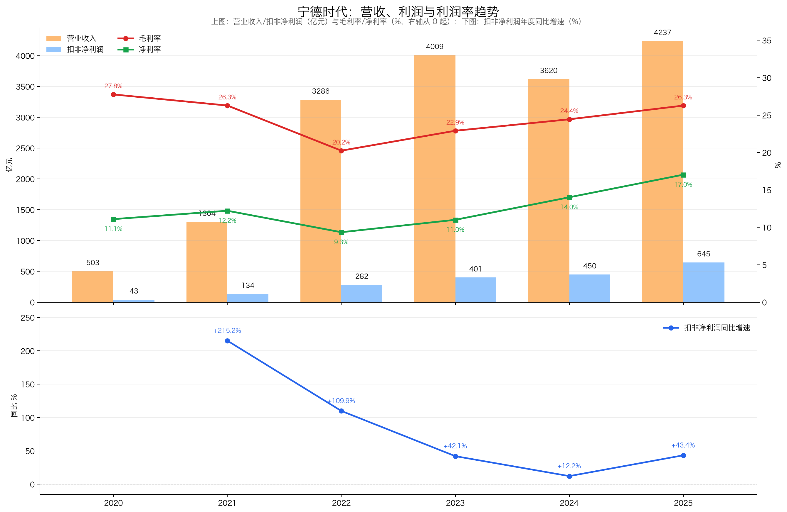
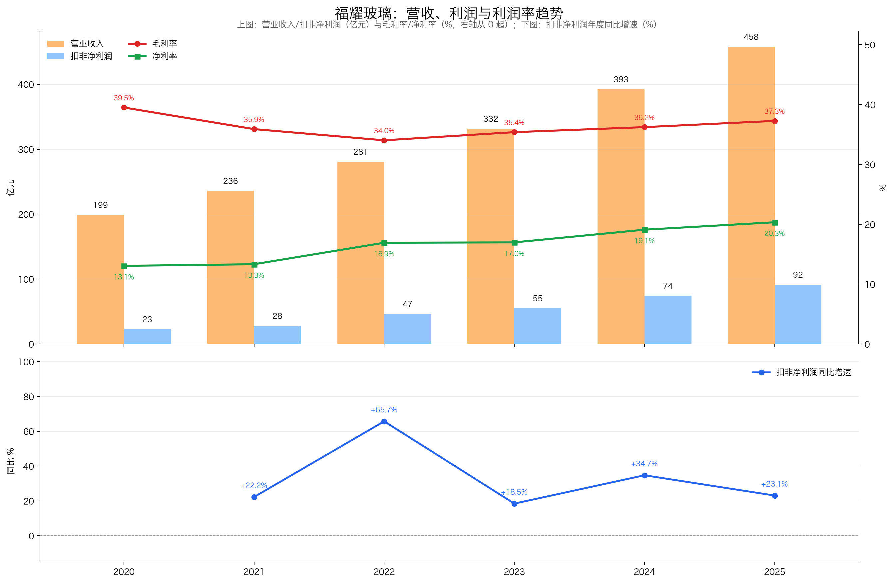
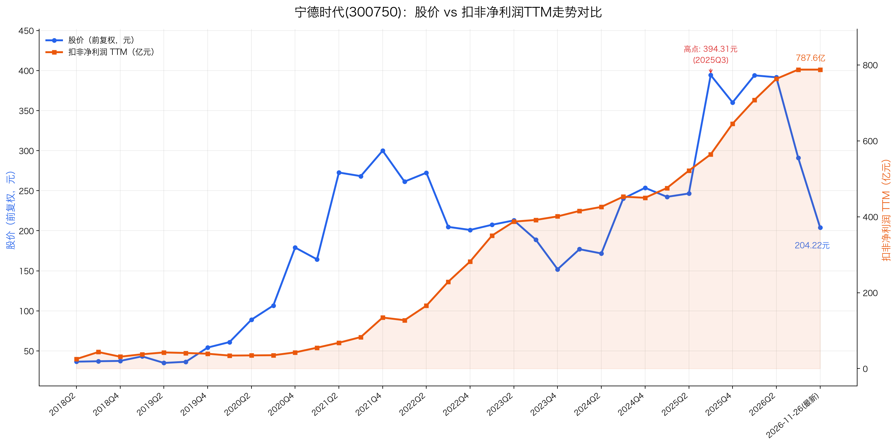
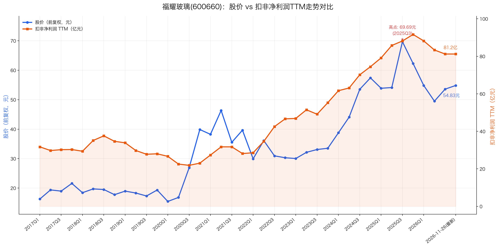

# 两家全球龙头：福耀的好生意，宁德的好价格

2026 年 11 月 26 日收盘，A 股两家制造业全球第一交出了两组反着走的账单。

宁德时代收在 204.22 元，总市值跌破万亿关口，停在 9,449.77 亿元。它对应过去四个季度的滚动市盈率只有 10.78 倍（扣非后 12.00 倍），市净率 2.44 倍，创下上市八年半以来最低估值；还清账上全部长短期借款和债券后，它口袋里还实打实躺着超过 2,100 亿元的净现金。

同一天，福耀玻璃收在 54.83 元，总市值 1,430.92 亿元，滚动市盈率 17.33 倍（扣非后 17.62 倍），市净率 3.82 倍。按三季报账本算，它账面可动用的现金加理财共 224.99 亿元，可对面排着超过 200 亿元的长短期借款和超短融，真把所有有息债结清，净现金只剩几亿到二十多亿元。

按“字母看生意质地、加减号看当下买点”的简单标尺：A 级代表省心稳固的好生意，B 级代表底子不错但带有重资产瑕疵；`+` 号表示现价足够便宜、触发买入信号，`-` 号表示还没到便宜击球点、先观望不追高。只论生意本身有多省心，我给福耀玻璃打 **A 级**，给宁德时代打 **B 级**；但把今天的价格放上台面，反而是带着瑕疵的宁德时代拿到了 **B+**（触发买入，适合分批配置），福耀玻璃暂时只给 **A-**（好生意偏贵，留在自选池里等回调）。

---

### 同样是全球龙头，福耀赢在清场，宁德赢在体量

论商业模式有多稳，福耀玻璃几乎占尽了制造业的便宜。过去近四十年它只做汽车安全玻璃一件事，前挡风和侧窗都是法规强制安全件，金属和塑料替不了，技术路线也很难被突然颠覆。玻璃又重又易碎，跨洋海运运费贵、破损率高，福耀直接把五十多家工厂贴着整车厂总装线建在中美欧，再自己烧制绝大多数玻璃原片。欧美日老牌三强旭硝子、圣戈班、板硝子受高人工和能源成本拖累，长期收缩产能，全球新扩产几乎全让给了福耀，前装市场份额一路做到 34% 以上，国内更是超过 68%。

宁德时代的全球第一要累得多。它虽然拿下了全球 39.2% 的动力电池份额和连续五年的储能第一，靠极限制造工艺把电芯出厂失效率压到十亿分之一级别（产业调研估算其产线良率高出二线 2 到 3 个百分点，年报未披露具体良率），还让整车厂花两三年联合标定才敢装车，可电池毕竟占了电动车成本的三到四成。只要主机厂开始打价格战，降本第一刀就会砍向电池，而且汽车厂为了供应链安全，长期扶植二供、三供甚至自己造电芯。

这种格局差异直接反映在定价权上。两家都躲不开车企对老产品的年度降价要求，但福耀靠着把普通玻璃换成全景天幕、调光玻璃和抬头显示（HUD）玻璃，硬生生把单平米均价从 2022 年的 201.3 元推高到 2025 年的 247.6 元，三年涨了 23%，每平米多卖出 46 块多钱，自己就顺出了隐性提价。宁德时代虽然也能靠神行超充和麒麟电池赚取高端溢价，上游碳酸锂涨价却要靠合同联动条款慢慢传导，中间通常有 1 到 2 个季度的时滞，上下夹击的拉扯更剧烈。

如果拉长十年看赛道坡道，宁德的坡显然更长更陡，后面还挂着储能和电池回收两大增量；福耀的天花板相对可见，靠全球车市温和增长和天幕升级赚钱，但胜在赛道已经清场，不用年年押注下一代化学体系革命，雪层厚得更稳当。

---

### 摊开三季报，两家各自藏了一道坎

表面看，2026 年前三季度宁德时代营收同比大涨 56.19%，达到 4,421.37 亿元，像是在一路狂奔。但往深处看，三季度单季已经出现三个扎眼的拐点：

* **毛利率掉头向下**：三季度单季综合毛利率同比跌掉 5.11 个百分点，落到 20.69%，让利降价、锂价上涨和设备折旧同时压住了利润率。
* **扩产又开始吞现金**：三季度单季经营现金流只剩 14.09 亿元，同期买设备建厂花掉 170.95 亿元，单季自由现金流直接转为负 156.86 亿元。
* **客户提前打款在减少**：三季度末合同负债（客户预付的订单定金）比年初缩水 17.40%，降到 406.69 亿元。

过去五年宁德时代靠强悍的造血能力累计净赚 2,137.27 亿元，拿回来的经营现金流是净利润的两倍，但前面近 2,000 亿元扩产开支和今年三季度的失血，提醒着投资者它依然是重资本机器。市场把它的估值砸到 10.78 倍，定价的正是“增收少增现金”的担忧。

福耀玻璃的三季报刚好反过来。今年前三季度它扣非净利润同比下滑了 15.06%，只有 58.79 亿元，乍一看像是业务失速。翻开明细才会发现，它的综合毛利率其实逆势爬到了 38.56%，创下近年新高，真正拖垮账面利润的是 10.67 亿元外币汇兑损失（去年同期反而赚了 4.81 亿元汇兑收益，一正一负直接抹掉 15.48 亿元税前利润）。剔除汇率波动，它的主业经营依然硬朗。

真正让福耀玻璃略显局促的是资产负债表和资本开支节奏。过去五年福耀给股东派了 194.43 亿元现金分红，派息极大方，但同一时期建厂花掉 215.79 亿元，自由现金流只有 182.33 亿元。分红略微透支了自由现金流，公司只好靠银行短债和超短融滚动周转——截至三季度末，短期借款、一年内到期长期负债加上 2026 半年报附注里披露的 8.53 亿元超短融，短期有息债务已超过 140 亿元；账面还挂着 82.93 亿元在建工程，未来一两年集中转固后，折旧也会压上来。

---

### 10.78 倍的 B 级龙头与 17.33 倍的 A 级垄断，今天怎么选

买股票绕不开两个问题：好公司 + 好价格，才是好股票。

在今天 204.22 元的位置上，宁德时代的容错率已经拉得很满。对照下面这张股价与利润双线图就能看出，去年三季度以来公司利润还在往上走，股价却几乎腰斩，走出了上市以来最大的一次背离。哪怕保守假设未来净利润从当前 876.97 亿元打八折掉回 700 亿元，对应市盈率也才 13.5 倍；如果按三季度末扣除全部长短债后仍剩 2,103.16 亿元净现金的口径来算，剔除净现金后的主业市盈率更是只有 8.38 倍。

按 2025 年全年已派发的每股 7.964 元分红算，宁德当前股息率有 3.90%，外加今年 7 月启动的 200 到 400 亿元真注销式回购（三季末已买入 33.03 亿元）。不过要留个心眼：宁德章程只写死了 20% 的法定最低派息比例，去年分红包含特别分红，若未来只按 20% 常规比例分红，股息率会降到约 1.56%。即便如此，它的悲观预期已经充分兑现在 10 倍出头的市盈率里，往下跌有千亿净现金和回购兜底，往上看只要毛利率企稳、自由现金流回正，估值修复空间就很可观。当前 **B+** 评级（触发 `+` 买入信号），适合分批买赔率。

福耀玻璃今天 54.83 元、17.33 倍市盈率，落在它自己近八年多历史估值的 22% 分位附近，股价走势长期紧贴着利润线走，没有出现大级别错杀，不算贵但也谈不上便宜。按去年每股 2.10 元常规分红算，当前股息率有 3.83%，现金回报不低；但扣除全部借款后账面几乎没有多余净现金垫底，且后面还有 82.93 亿元在建工程等待转固折旧，一旦全球汽车产销降温或估值回到 12 到 13 倍的历史低谷，价格仍有两成以上的下探空间。

把两只股票摆在同一天对比，操作选择就很清楚：

* **买宁德时代（B+，`+` 买入信号）**：买的是极低价格对冲生意瑕疵。不用一把梭哈，重点盯两个季报硬指标——单季综合毛利率别连续两期跌破 19%，单季自由现金流能否停止失血、合同负债止跌回升。
* **等福耀玻璃（A-，`-` 观望信号）**：它是更省心的长期好生意，但今天没给足折价。更稳妥的做法是把它留在核心池里，等汽车周期逆风或新厂折旧压力把股价压到 47 到 50 元（对应 14 到 15 倍市盈率）再重仓动手。

---

如果您觉得这篇文章有启发，欢迎点赞、转发、关注！

风险提示： 本文仅供参考，不构成投资建议。市场有风险，入市需谨慎。
